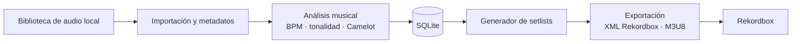

<div align="center">

# 🎧 SetlistGen · Generador Automático de Setlists para DJs


**Trabajo Fin de Grado · Grado en Ingeniería en Sistemas de Información · Universidad de Alcalá**

</div>

---

# 📖 Descripción

SetlistGen es una aplicación de escritorio que analiza una biblioteca musical local y genera setlists para DJs. A partir de una carpeta de audio en bruto (MP3, WAV, FLAC y AIFF), el sistema:

1. Extrae los metadatos de las etiquetas.
2. Estima el BPM y la tonalidad de cada pista y deriva su código Camelot.
3. Guarda los descriptores en una base de datos local.
4. Genera un setlist ordenado que respeta las restricciones del DJ (duración, rango y salto de BPM, compatibilidad armónica, géneros por intervalos y pistas ancladas).
5. Exporta el resultado en un formato importable por **Rekordbox**.

El sistema se integra en el flujo de trabajo del DJ, no lo sustituye: el DJ revisa y ajusta la propuesta en su propio entorno antes de la actuación. Todo el procesamiento es local y no se envía ningún dato a servicios externos.

---

# 🎯 Objetivos

## Objetivo general

Diseñar e implementar un sistema que asista al DJ en la preparación de setlists a partir de su propia biblioteca de audio local, reduciendo el tiempo de planificación manual y mejorando la coherencia musical del resultado.

## Objetivos específicos

| ID | Objetivo |
|---|---|
| O1 | Importar una carpeta local de audio y extraer los metadatos de las etiquetas |
| O2 | Estimar BPM y tonalidad a partir de la señal y derivar la notación Camelot |
| O3 | Almacenar pistas, descriptores y setlists en una base de datos local, evitando reanalizar material ya procesado |
| O4 | Generar setlists que respeten las restricciones y las reglas de mezcla armónica |
| O5 | Exportar el setlist en un formato importable por Rekordbox |
| O6 | Ofrecer un panel de gestión y estadísticas (objetivo ampliable) |
| O7 | Evaluar el sistema frente a los valores de Rekordbox y, si es posible, con la valoración de DJs |

Estos objetivos proceden del anteproyecto aprobado. Su estado de avance se indica en la sección *Estado del proyecto*.

---

# 🏗️ Arquitectura

La aplicación sigue **Clean Architecture** con puertos y adaptadores. El dominio no depende de ninguna librería concreta: el análisis de audio, la persistencia y la exportación se sustituyen mediante adaptadores. El detalle está en [`docs/architecture/README.md`](docs/architecture/README.md).



---

# 🛠️ Stack tecnológico

Las decisiones están registradas en los ADR (véase la tabla de la sección siguiente). Las marcadas como *candidato* o *propuesto* siguen pendientes de validación o de una prueba de concepto.

| Ámbito | Tecnología | Estado |
|---|---|---|
| Distribución | Aplicación de escritorio | Aceptado (ADR-001) |
| Lenguaje | Python | Adoptado; se formaliza en ADR-008 (propuesto) |
| Arquitectura | Clean Architecture, puertos y adaptadores | Aceptado (ADR-002) |
| Análisis musical | Essentia (principal previsto), librosa y madmom (comparación) | Candidatos; selección tras la prueba de concepto (ADR-003) |
| Lectura de etiquetas | Mutagen | Candidato |
| Persistencia | SQLite | Aceptado (ADR-004) |
| Generación | Satisfacción de restricciones con función de coste | Aceptado (ADR-005) |
| Exportación | XML de Rekordbox y M3U8 | Aceptado, pendiente de la prueba de importación (ADR-006) |
| Interfaz gráfica | PySide6 (alternativa: Tkinter) | Propuesto (ADR-008) |
| Pruebas | pytest | Adoptado |
| Control de versiones | Git y GitHub | Adoptado |
| Gestión | GitHub Projects y Microsoft Teams | Adoptado |

> Versiones anteriores de este README indicaban FastAPI, React y PostgreSQL. Esas tecnologías corresponden a una aplicación web cliente-servidor, descartada en ADR-001 y ADR-004, y ya no forman parte del proyecto.

---

# 🧭 Decisiones de arquitectura

| ADR | Decisión | Estado |
|---|---|---|
| ADR-001 | Aplicación de escritorio | Aceptado |
| ADR-002 | Clean Architecture con puertos y adaptadores | Aceptado |
| ADR-003 | Puerto de análisis desacoplado; librería por prueba de concepto | Aceptado (librería pendiente) |
| ADR-004 | SQLite | Aceptado (esquema pendiente de `data-model.md`) |
| ADR-005 | Restricciones con función de coste | Aceptado |
| ADR-006 | XML de Rekordbox con M3U8 complementario | Aceptado (verificación pendiente) |
| ADR-007 | Licencias y compatibilidad legal | Propuesto |
| ADR-008 | Lenguaje, interfaz gráfica y empaquetado | Propuesto |
| ADR-009 | Conjunto de evaluación y protocolo de validación | Propuesto |
| ADR-010 | Identificación permanente de pistas | Propuesto |

Las decisiones que aún dependen de tutor y cotutor están en [`docs/architecture/open-decisions.md`](docs/architecture/open-decisions.md).

---

# 📁 Estructura del repositorio

```text
src/setlistgen/      Código fuente, organizado por capas (propuesta de ADR-008)
tests/               Pruebas, con la misma estructura que src
scripts/             Utilidades de desarrollo
docs/
├── project-management/
├── requirements/        SRS, casos de uso, matriz de trazabilidad y glosario
├── architecture/        Arquitectura, ADR y modelo de datos
├── testing/
└── memory/              Memoria del TFG (LaTeX)
README.md
LICENSE
```

> La estructura de código `src/setlistgen/` es una propuesta de ADR-008. El repositorio actual contiene directorios `backend`, `frontend` y `database`, pensados para una arquitectura cliente-servidor, que deben reorganizarse al adoptarla.

---

# 📚 Documentación

| Área | Documento |
|---|---|
| Requisitos | [`requirements.md`](docs/requirements/requirements.md) (SRS) |
| Casos de uso | [`use-cases.md`](docs/requirements/use-cases.md) |
| Trazabilidad | [`traceability-matrix.md`](docs/requirements/traceability-matrix.md) |
| Vocabulario | [`glosario.md`](docs/requirements/glosario.md) |
| Arquitectura | [`docs/architecture/README.md`](docs/architecture/README.md) y registros de decisiones (`docs/architecture/adrs/`) |
| Decisiones abiertas | [`open-decisions.md`](docs/architecture/open-decisions.md) |
| Auditoría | [`audit-review.md`](docs/project-management/audit-review.md) |
| Memoria | `docs/memory/` |

---

# 📋 Estado del proyecto

| Fase | Estado |
|---|---|
| Fase 0 · Preparación (GitHub, Teams, estructura documental, tablero) | Completada |
| Fase 1 · Análisis (anteproyecto, requisitos, casos de uso, trazabilidad, glosario) | Completada; versión 4.0 de requisitos pendiente de validación por los tutores |
| Fase 2 · Diseño (ADR, modelo de dominio, modelo de datos, persistencia) | **En progreso**: ADR-001 a ADR-006 aceptados, ADR-007 a ADR-010 propuestos; modelo de dominio y de datos pendientes |
| Fase 3 · Infraestructura | Pendiente |
| Fase 4 · Desarrollo del núcleo | Pendiente |
| Fase 5 · Interfaz de usuario | Pendiente |
| Fase 6 · Validación experimental | Pendiente |
| Fase 7 · Memoria y defensa | Memoria en preparación: capítulos 1 a 4 redactados |

Todavía no hay código ejecutable. Las instrucciones de instalación y de uso se añadirán cuando exista una primera versión.

---

# 🧪 Metodología

Desarrollo incremental e iterativo con documentación continua y priorización MoSCoW:

- Clean Architecture, SOLID, DRY y KISS.
- Trazabilidad entre objetivos, requisitos, casos de uso, decisiones, tareas y pruebas.
- Git Flow (`main`, `develop`, `feature/*`, `release/*`, `hotfix/*`) y Conventional Commits.
- Pruebas con pytest, con cobertura mínima en dominio y aplicación (RNF-24).

---

# 🎓 Información académica

| | |
|---|---|
| **Alumno** | Pablo Hernández Borregón |
| **Titulación** | Grado en Ingeniería en Sistemas de Información |
| **Centro** | Escuela Politécnica Superior, Universidad de Alcalá |
| **Tutor** | Óscar Gutiérrez Blanco |
| **Cotutor** | Ángel Javier Álvarez Miguel |
| **Curso** | 2026/2027 |

---

# 🤖 Uso de asistentes de inteligencia artificial

Se ha utilizado un asistente de inteligencia artificial generativa como apoyo técnico y metodológico (contraste de ideas, revisión de documentación y propuesta de estructuras). La responsabilidad sobre las decisiones de diseño, el contenido de la memoria y la veracidad de las fuentes corresponde íntegramente al autor.

---

# 🔒 Datos y derechos de autor

- El sistema trabaja solo con ficheros locales y no envía información a servicios externos.
- El repositorio **no contiene ficheros de audio**. Los conjuntos de evaluación se publicarán solo como datos derivados (identificadores, BPM y tonalidad), nunca como obras.
- «Rekordbox» es una marca de su titular y se menciona únicamente para indicar compatibilidad. El sistema no accede a la base de datos interna de Rekordbox.

---

# 📄 Licencia

El código de este repositorio se distribuye bajo la **licencia MIT** (véase [`LICENSE`](LICENSE)). Las dependencias de terceros mantienen sus propias licencias, que se inventarían y revisan según ADR-007.
