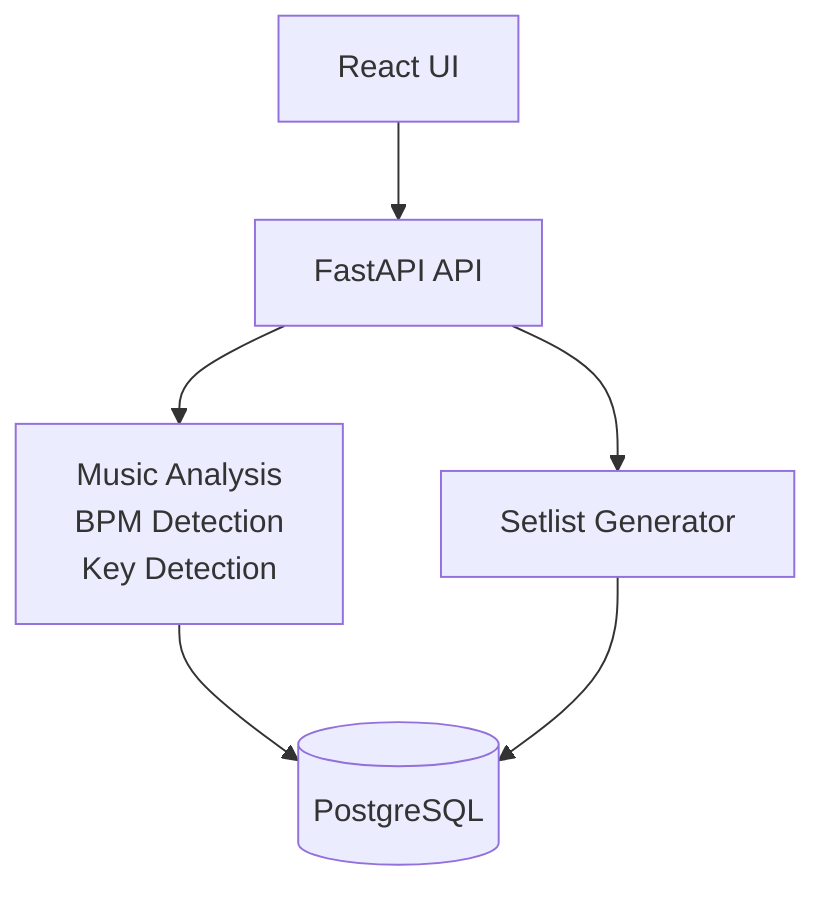
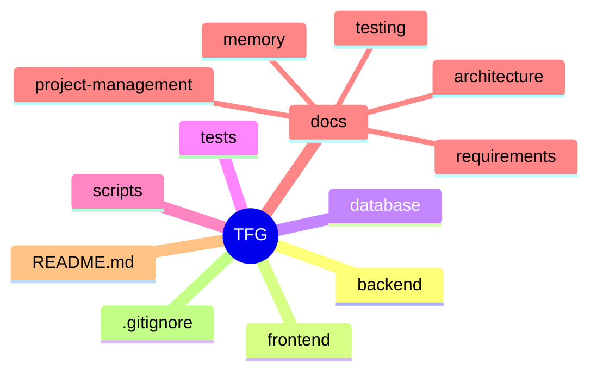

<div align="center">

# 🎧 Generador Inteligente de Setlists para DJs


**Trabajo Fin de Grado · Ingeniería en Sistemas de Información**

</div>

---

# 📖 Descripción

Este proyecto tiene como objetivo el desarrollo de una aplicación capaz de analizar automáticamente una biblioteca musical local y generar setlists optimizados para DJs mediante técnicas de análisis musical, compatibilidad armónica y selección inteligente de canciones.

La herramienta busca reducir el tiempo necesario para preparar sesiones musicales, facilitando la creación de sets coherentes y compatibles para su posterior uso en software profesional como Rekordbox.

---

# 🎯 Objetivos

## Objetivo General

Desarrollar una aplicación capaz de generar automáticamente setlists para DJs a partir de una biblioteca musical local.

## Objetivos Específicos

- ✅ Importar bibliotecas musicales.
- ✅ Extraer metadatos automáticamente.
- ✅ Detectar BPM.
- ✅ Detectar tonalidad musical.
- ✅ Almacenar información musical estructurada.
- ✅ Aplicar criterios de mezcla armónica.
- ✅ Generar setlists automáticamente.
- ✅ Exportar resultados compatibles con Rekordbox.

---

# 🏗️ Arquitectura General



---

# 🛠️ Stack Tecnológico

## Backend

- Python
- FastAPI
- SQLAlchemy
- Librosa
- NumPy

## Frontend

- React
- TypeScript
- Vite
- Material UI

## Base de Datos

- PostgreSQL

## Testing

- Pytest

## Control de Versiones

- Git
- GitHub

## Gestión

- GitHub Projects
- Microsoft Teams

## Entorno de Desarrollo

- Visual Studio Code
- Claude Sonnet

---

# 📁 Estructura del Proyecto



---

# 📚 Documentación

La documentación del proyecto se organiza en las siguientes áreas:

## Gestión de Proyecto

- Project Roadmap
- Registro de Decisiones
- Registro de Reuniones
- Objetivos del TFG
- Stack Tecnológico

## Análisis

- Requisitos Funcionales
- Requisitos No Funcionales
- Actores
- Casos de Uso
- Matriz de Trazabilidad

## Diseño

- Arquitectura Software
- Modelo de Datos
- Diseño de API
- ADRs (Architecture Decision Records)

## Validación

- Plan de Pruebas
- Casos de Prueba
- Validación Experimental

## Memoria

- Documentación progresiva para la memoria del TFG.

---

# 📋 Roadmap

## Fase 0 · Preparación

- [x] Configuración GitHub
- [x] Configuración Teams
- [x] Configuración Claude
- [x] Estructura documental
- [x] Kanban del proyecto

## Fase 1 · Análisis

- [ ] Requisitos funcionales
- [ ] Requisitos no funcionales
- [ ] Actores
- [ ] Casos de uso

## Fase 2 · Diseño

- [ ] Arquitectura software
- [ ] Modelo de datos
- [ ] Diseño de API

## Fase 3 · Infraestructura

- [ ] Backend
- [ ] Frontend
- [ ] Base de datos

## Fase 4 · Desarrollo Core

- [ ] Importación musical
- [ ] Extracción de metadatos
- [ ] Detección BPM
- [ ] Detección de tonalidad
- [ ] Generación de setlists

## Fase 5 · Interfaz de Usuario

- [ ] Gestión de biblioteca
- [ ] Generador de sesiones

## Fase 6 · Validación

- [ ] Plan de pruebas
- [ ] Validación experimental

## Fase 7 · Memoria y Defensa

- [ ] Memoria final
- [ ] Presentación
- [ ] Defensa

---

# 📈 Estado Actual

| Área | Estado |
|--------|--------|
| Gestión del Proyecto | ✅ Completada |
| Análisis | 🔄 En progreso |
| Diseño | ⏳ Pendiente |
| Backend | ⏳ Pendiente |
| Frontend | ⏳ Pendiente |
| Testing | ⏳ Pendiente |
| Memoria | 🔄 En preparación |

---

# 👨‍💻 Metodología

El proyecto sigue un enfoque iterativo basado en buenas prácticas de Ingeniería del Software:

- Clean Architecture
- Clean Code
- SOLID
- DRY
- KISS
- Git Flow
- Desarrollo incremental
- Documentación continua

---

# 🎓 Información Académica

**Alumno:** Pablo Hernández Borregón

**Titulación:** Ingeniería en Sistemas de Información

**Trabajo:** Trabajo Fin de Grado

**Curso:** 2026/2027

---

# 🤝 Herramientas de Colaboración

- GitHub → Desarrollo y control de versiones.
- GitHub Projects → Gestión de tareas.
- Microsoft Teams → Coordinación y seguimiento.
- Claude Sonnet → Asistencia técnica y metodológica.

---

# 🚀 Estado del Proyecto

```text
Preparación del entorno ✅
Análisis de requisitos 🔄
```

Actualmente el proyecto se encuentra en la fase de análisis y definición de requisitos.

---

# 📄 Licencia

Proyecto desarrollado con fines exclusivamente académicos como Trabajo Fin de Grado.

</div>

