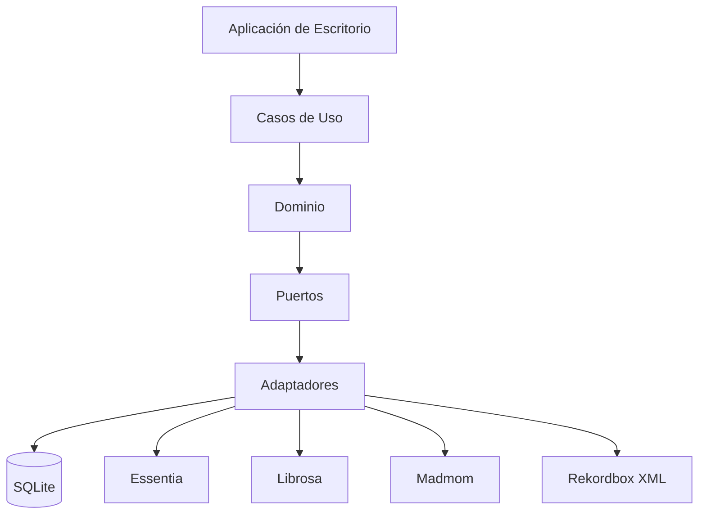
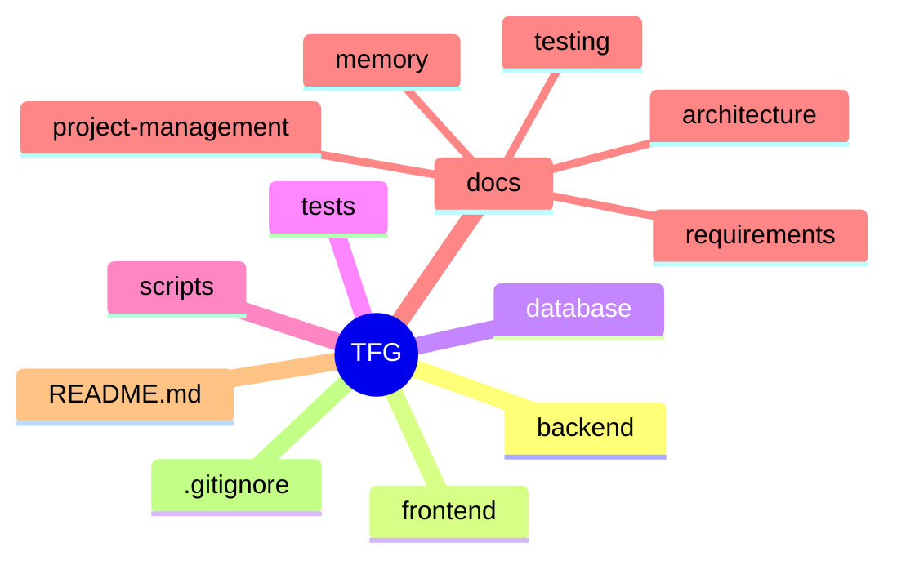

<div align="center">

# 🎧 Generador Inteligente de Setlists para DJs


**Trabajo Fin de Grado · Ingeniería en Sistemas de Información**

</div>

---

# 📖 Descripción

Este proyecto tiene como objetivo el desarrollo de una aplicación capaz de analizar automáticamente una biblioteca musical local y generar setlists optimizados para DJs mediante técnicas de análisis musical, compatibilidad armónica y selección inteligente de canciones.

La herramienta busca reducir el tiempo necesario para preparar sesiones musicales, facilitando la creación de sets coherentes y compatibles para su posterior uso en software profesional como Rekordbox.

---

# 🎯 Objetivos

## Objetivo General

Desarrollar una aplicación capaz de generar automáticamente setlists para DJs a partir de una biblioteca musical local.

## Objetivos Específicos

- ✅ Importar bibliotecas musicales.
- ✅ Extraer metadatos automáticamente.
- ✅ Detectar BPM.
- ✅ Detectar tonalidad musical.
- ✅ Almacenar información musical estructurada.
- ✅ Aplicar criterios de mezcla armónica.
- ✅ Generar setlists automáticamente.
- ✅ Exportar resultados compatibles con Rekordbox.

---

# 🏛️ Arquitectura

La documentación arquitectónica del proyecto se encuentra en:

- [Arquitectura](docs/architecture/README.md)

Incluye:

- [ADR-001: Forma de Distribución](docs/architecture/adrs/ADR-001-forma-distribucion.md)
- [ADR-002: Arquitectura General](docs/architecture/adrs/ADR-002-arquitectura-general.md)
- [ADR-003: Motor de Análisis Musical](docs/architecture/adrs/ADR-003-motor-analisis-musical.md)
- [ADR-004: Persistencia](docs/architecture/adrs/ADR-004-persistencia.md)
- [ADR-005: Generación de Setlists](docs/architecture/adrs/ADR-005-generacion-setlists.md)
- [ADR-006: Integración con Rekordbox](docs/architecture/adrs/ADR-006-exportacion-rekordbox.md)

## Arquitectura General



---

# 🛠️ Stack Tecnológico

## Lenguaje Principal

- Python

## Arquitectura

- Clean Architecture
- SOLID
- Arquitectura basada en Puertos y Adaptadores

## Persistencia

- SQLite

## Análisis Musical

Motor principal:

- Essentia

Herramientas de apoyo y validación:

- Librosa
- Madmom

## Generación de Setlists

- Constraint Satisfaction Problem (CSP)

## Exportación

- Rekordbox XML
- M3U8

## Testing

- Pytest

## Control de Versiones

- Git
- GitHub

## Desarrollo

- Visual Studio Code
- Claude Sonnet

---

# 📁 Estructura del Proyecto



---

# 📚 Documentación

## Memoria

La documentación del proyecto se organiza en las siguientes áreas:

- [Capítulos de la memoria](docs/memory/Book/chapters/)

## Requisitos

- [Especificación de requisitos](docs/requirements/requirements.md)
- [Casos de uso](docs/requirements/use-cases.md)
- [Matriz de trazabilidad](docs/requirements/traceability-matrix.md)
- [Glosario](docs/requirements/glosario.md)

## Arquitectura

- [Visión arquitectónica](docs/architecture/README.md)
- [ADRs](docs/architecture/adrs/)
- Arquitectura Software
- Modelo de Datos
- Diseño de API

## Validación

- Plan de Pruebas
- Casos de Prueba
- Validación Experimental

---

# 📋 Roadmap

## Fase 0 · Preparación

- [x] Configuración GitHub
- [x] Configuración Teams
- [x] Configuración Claude
- [x] Estructura documental
- [x] Kanban del proyecto

## Fase 1 · Análisis

- [x] Requisitos funcionales
- [x] Requisitos no funcionales
- [x] Actores
- [x] Casos de uso

## Fase 2 · Diseño

- [x] ADR-001 Distribución
- [x] ADR-002 Arquitectura
- [x] ADR-003 Motor de análisis
- [x] ADR-004 Persistencia
- [x] ADR-005 Generación de setlists
- [x] ADR-006 Exportación
- [ ] Modelo de datos detallado
- [ ] Diseño físico SQLite

## Fase 3 · Infraestructura

- [ ] Backend
- [ ] Frontend
- [ ] Base de datos

## Fase 4 · Desarrollo Core

- [ ] Importación musical
- [ ] Extracción de metadatos
- [ ] Detección BPM
- [ ] Detección de tonalidad
- [ ] Generación de setlists

## Fase 5 · Interfaz de Usuario

- [ ] Gestión de biblioteca
- [ ] Generador de sesiones

## Fase 6 · Validación

- [ ] Plan de pruebas
- [ ] Validación experimental

## Fase 7 · Memoria y Defensa

- [ ] Memoria final
- [ ] Presentación
- [ ] Defensa

---

| Área | Estado |
|--------|--------|
| Gestión del Proyecto | ✅ Completada |
| Análisis | ✅ Completado |
| Diseño Arquitectónico | ✅ Completado |
| Diseño de Datos | 🔄 En progreso |
| Implementación | ⏳ Pendiente |
| Testing | ⏳ Pendiente |
| Memoria | 🔄 En progreso |

---

# 👨‍💻 Metodología

El proyecto sigue un enfoque iterativo basado en buenas prácticas de Ingeniería del Software:

- Clean Architecture
- Clean Code
- SOLID
- DRY
- KISS
- Git Flow
- Desarrollo incremental
- Documentación continua

---
# 📐 Decisiones Tomadas

| Área | Decisión |
|--------|--------|
| Distribución | Aplicación de escritorio |
| Lenguaje | Python |
| Arquitectura | Clean Architecture |
| Persistencia | SQLite |
| Análisis musical | Essentia + Librosa + Madmom |
| Generación | CSP |
| Exportación | XML Rekordbox + M3U8 |

---
# 🎓 Información Académica

**Alumno:** Pablo Hernández Borregón

**Titulación:** Ingeniería en Sistemas de Información

**Trabajo:** Trabajo Fin de Grado

**Curso:** 2026/2027

---

# 🤝 Herramientas de Colaboración

- GitHub → Desarrollo y control de versiones.
- GitHub Projects → Gestión de tareas.
- Microsoft Teams → Coordinación y seguimiento.
- Claude Sonnet → Asistencia técnica y metodológica.

---

# 🚀 Estado del Proyecto

```text
Preparación del entorno ✅
Análisis de requisitos ✅
ADRs arquitectónicos ✅
Arquitectura objetivo ✅
Modelo de datos 🔄
Implementación ⏳
Validación ⏳
Memoria final 🔄
```

Actualmente el proyecto ha completado las fases de análisis y diseño arquitectónico y se encuentra en la fase de diseño detallado del modelo de datos previa a la implementación.

---

# 📄 Licencia

Proyecto desarrollado con fines exclusivamente académicos como Trabajo Fin de Grado.

</div>

