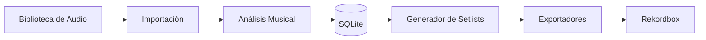

<div align="center">

# 🎧 SetlistGen · Generador Inteligente de Setlists para DJs


**Trabajo Fin de Grado · Grado en Ingeniería en Sistemas de Información · Universidad de Alcalá**

</div>

---

# 📖 Descripción

SetlistGen es una aplicación de escritorio orientada a asistir a DJs en la preparación de sesiones musicales.

El sistema analiza automáticamente una biblioteca musical local, calcula características musicales relevantes y genera propuestas de setlists compatibles con técnicas de mezcla armónica y restricciones configuradas por el usuario.

A partir de una colección de audio local, el sistema:

1. Importa y cataloga pistas musicales.
2. Extrae metadatos desde las etiquetas existentes.
3. Estima BPM y tonalidad mediante análisis de audio.
4. Calcula la notación Camelot.
5. Almacena la información en una base de datos local.
6. Genera setlists automáticamente a partir de restricciones definidas por el DJ.
7. Exporta los resultados para su uso en Rekordbox.

Todo el procesamiento se realiza localmente.

---

# 🎯 Objetivos

## Objetivo General

Diseñar e implementar un sistema que reduzca el tiempo necesario para preparar sesiones musicales mediante la generación automática de setlists compatibles con criterios de mezcla utilizados por DJs.

## Objetivos Específicos

| ID | Objetivo |
|----|-----------|
| O1 | Importar bibliotecas musicales locales |
| O2 | Extraer metadatos de las pistas |
| O3 | Estimar BPM y tonalidad |
| O4 | Calcular la notación Camelot |
| O5 | Mantener una base de datos musical local |
| O6 | Generar setlists automáticamente |
| O7 | Evaluar los resultados frente a Rekordbox |

---

# 🏛️ Arquitectura

La arquitectura del sistema se basa en:

- Clean Architecture.
- Ports & Adapters.
- Dominio desacoplado de tecnologías concretas.
- Persistencia local.
- Procesamiento completamente offline.

La documentación arquitectónica se encuentra en:

```text
docs/architecture/
```

Incluye:

- ADR-001 Distribución del sistema
- ADR-002 Arquitectura general
- ADR-003 Motor de análisis musical
- ADR-004 Persistencia
- ADR-005 Generación de setlists
- ADR-006 Exportación Rekordbox
- ADR-007 Licencias
- ADR-008 Lenguaje e interfaz
- ADR-009 Evaluación y validación
- ADR-010 Identificación de pistas

---

## Arquitectura General



---

# 🛠️ Stack Tecnológico

## Tecnologías aceptadas

| Área | Tecnología |
|--------|------------|
| Lenguaje principal | Python |
| Arquitectura | Clean Architecture |
| Persistencia | SQLite |
| Testing | pytest |
| Control de versiones | Git |
| Gestión | GitHub Projects |
| Coordinación | Microsoft Teams |

## Tecnologías propuestas y pendientes de validación

| Área | Alternativa principal |
|--------|----------------------|
| Interfaz gráfica | PySide6 |
| Motor MIR | Essentia |
| Motores complementarios | Librosa, Madmom |

---

# 📚 Estado Arquitectónico

## ADR aceptados

✅ ADR-001 Distribución

✅ ADR-002 Arquitectura

✅ ADR-003 Motor de análisis

✅ ADR-004 Persistencia

✅ ADR-005 Generación de setlists

✅ ADR-006 Exportación

## ADR propuestos

🔄 ADR-007 Licencias

🔄 ADR-008 Lenguaje, interfaz y empaquetado

🔄 ADR-009 Evaluación y validación

🔄 ADR-010 Identificación de pistas

---

# 📂 Documentación

## Requisitos

- `docs/requirements/requirements.md`
- `docs/requirements/use-cases.md`
- `docs/requirements/traceability-matrix.md`
- `docs/requirements/glosario.md`

## Arquitectura

- `docs/architecture/README.md`
- `docs/architecture/adrs/`

## Gestión

- `docs/project-management/audit-review.md`
- `docs/project-management/open-decisions.md`

## Memoria

- `docs/memory/`

---

# 📈 Estado del Proyecto

| Área | Estado |
|--------|--------|
| Anteproyecto | ✅ Completado |
| Requisitos | ✅ Completado |
| Casos de Uso | ✅ Completado |
| Trazabilidad | ✅ Completada |
| Glosario | ✅ Completado |
| Arquitectura | ✅ Completada |
| ADRs | ✅ Consolidados |
| Auditoría técnica | ✅ Completada |
| Modelo de dominio | ✅ Completado |
| Modelo de datos | ✅ Completado |
| Persistencia SQLite | 🔄 Pendiente |
| Implementación | ⏳ Pendiente |
| Validación experimental | ⏳ Pendiente |
| Defensa | ⏳ Pendiente |

---

# 🚧 Próximo Hito

Diseñar:

```text
docs/architecture/data-model.md
```

incluyendo:

- Modelo de dominio.
- Modelo conceptual.
- MER.
- Modelo relacional.
- Persistencia SQLite.

---

# 👨‍💻 Metodología

El proyecto sigue un enfoque iterativo basado en:

- Ingeniería de requisitos.
- Arquitectura dirigida por ADR.
- Clean Architecture.
- SOLID.
- DRY.
- KISS.
- Documentación continua.
- Validación progresiva.

---

# 🎓 Información Académica

| Campo | Valor |
|--------|--------|
| Alumno | Pablo Hernández Borregón |
| Titulación | Grado en Ingeniería en Sistemas de Información |
| Universidad | Universidad de Alcalá |
| Escuela | Escuela Politécnica Superior |
| Curso | 2026/2027 |

---

# 🤖 Uso de IA

Durante el proyecto se han utilizado asistentes de inteligencia artificial generativa como apoyo en:

- revisión documental,
- análisis de diseño,
- evaluación de alternativas,
- estructuración de documentación.

Todas las decisiones finales, implementaciones y contenidos del TFG son responsabilidad del autor.

---

# 🔒 Privacidad

- El audio nunca abandona el equipo del usuario.
- No se utilizan servicios cloud.
- El repositorio no contiene archivos musicales protegidos por derechos de autor.
- Rekordbox se utiliza únicamente como herramienta de referencia y destino de exportación.

---

# 📄 Licencia

El código fuente del repositorio se distribuye bajo licencia MIT.

Las dependencias de terceros mantienen sus propias licencias y su compatibilidad se documenta mediante ADR-007.
