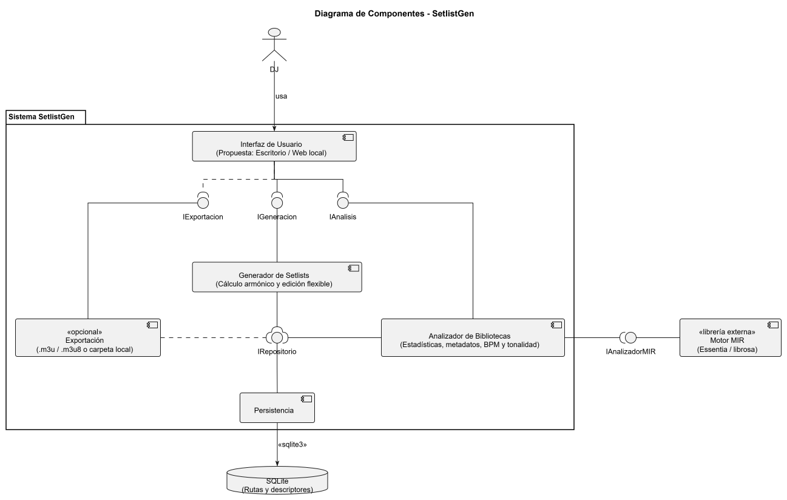
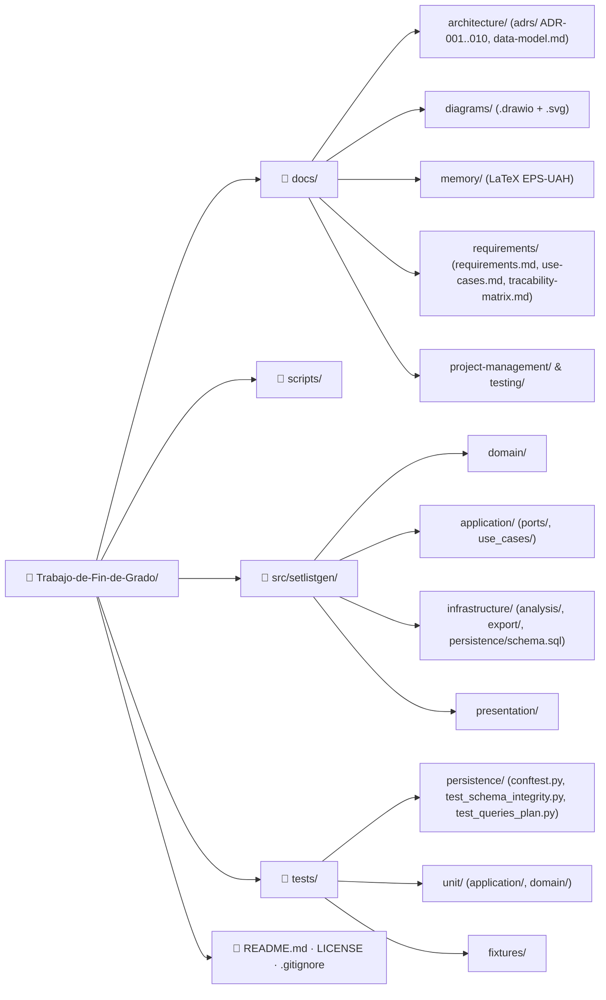

<div align="center">

# 🎧 SetlistGen

### Sistema de Generación Automática de Setlists para DJs a partir del Análisis Musical de una Biblioteca de Audio


**Trabajo de Fin de Grado · Grado en Ingeniería en Sistemas de Información · Universidad de Alcalá**

</div>

---

# 📖 Descripción

SetlistGen es una aplicación local que ayuda a un DJ a preparar sus sesiones. Analiza una biblioteca musical de su equipo, estima el BPM y la tonalidad de cada pista, y genera un setlist ordenado que cumple las condiciones que el DJ define: duración, rango de BPM y compatibilidad armónica según la rueda Camelot.

El sistema se integra en el flujo de trabajo del DJ y no lo sustituye: el DJ revisa y edita la propuesta antes de guardarla. Todo el procesamiento es local y no se envía ningún dato a servicios externos.

## El problema

Elegir, entre miles de pistas, cuáles forman un setlist de una duración dada y en qué orden ponerlas, respetando el tempo y la compatibilidad armónica entre pistas consecutivas, es hoy una tarea manual de varias horas. El análisis de BPM y tonalidad ya es una prestación habitual de las herramientas de DJ; construir la secuencia completa a partir de restricciones globales, no.

## Alcance funcional

El único actor es el **DJ**. Su flujo se organiza en tres bloques:

| Bloque | Qué hace el DJ | Qué hace el sistema |
|---|---|---|
| **1. Bibliotecas** | Selecciona una carpeta local y, más adelante, la actualiza | Muestra estadísticas previas, analiza solo las pistas nuevas o modificadas (metadatos, BPM, tonalidad y código Camelot), marca como no disponibles las que desaparecen y evita duplicados |
| **2. Generación** | Fija duración, rango de BPM, compatibilidad Camelot (preset *Estricta* o *Energética*) y una semilla opcional | Propone un setlist sin repeticiones que cumple las restricciones, o explica por qué no existe ninguno |
| **3. Edición y guardado** | Reordena, ordena por BPM o tonalidad, fija una pista inicial, elimina o añade pistas, deshace y rehace | Reevalúa las transiciones, avisa sin bloquear de lo que incumple, y guarda el setlist de forma privada en SQLite |

Cada DJ tiene una cuenta local con sus propias bibliotecas, pistas y setlists, aislados del resto.

**Fuera de alcance:** reproducción y mezcla de audio, servicios en la nube, uso del género en la generación y almacenamiento de audio en la base de datos (solo se guardan rutas y descriptores).

**Exportación a Rekordbox (ampliación opcional):** si hay margen tras el núcleo, copia de las pistas del setlist en una carpeta local o lista `.m3u8`.

---

# 🏗️ Arquitectura

Clean Architecture con puertos y adaptadores: el dominio no depende de ninguna librería concreta. El motor de análisis musical y el almacenamiento se acceden mediante interfaces sustituibles.



| Componente | Responsabilidad |
|---|---|
| Interfaz de Usuario | Interacción del DJ. Formato (escritorio o web local) aún por decidir |
| Analizador de Bibliotecas | Estadísticas de carpeta, metadatos y análisis de BPM y tonalidad mediante un motor MIR externo |
| Generador de Setlists | Selección y ordenación de pistas por restricciones, y edición del resultado |
| Persistencia | Pistas, bibliotecas y setlists en SQLite |
| Exportación *(opcional)* | Carpeta local o lista `.m3u8` |

Detalle en [`docs/architecture/README.md`](docs/architecture/README.md).

---

# 🛠️ Stack tecnológico

| Ámbito | Tecnología | Estado |
|---|---|---|
| Lenguaje | Python 3.12 o superior | Adoptado |
| Persistencia | SQLite ≥ 3.31 (columnas generadas) | Adoptado. Esquema verificado |
| Arquitectura | Clean Architecture, puertos y adaptadores | Adoptado |
| Pruebas | `pytest` | Adoptado |
| Análisis musical | Essentia (candidato principal), librosa | Pendiente de la prueba de concepto |
| Interfaz | Escritorio Python o web local | Por decidir |
| Control de versiones | Git y GitHub (`main` como rama principal estable; etiqueta `v0.1-pre-tutoria` para la línea base inicial) | Adoptado |

---

# 📁 Estructura del repositorio

```text
.
├── docs/
│   ├── architecture/
│   │   ├── adrs/               Decisiones de arquitectura (ADR-001 a ADR-010)
│   │   ├── data-model.md       Modelo de datos (ER, relacional, DDL y consultas)
│   │   └── README.md           Visión general de la arquitectura y capas
│   ├── diagrams/               Diagramas del proyecto (.drawio + .svg)
│   ├── memory/                 Memoria del TFG en LaTeX (plantilla EPS-UAH)
│   ├── project-management/     Seguimiento y reuniones con los tutores
│   ├── requirements/
│   │   ├── requirements.md     Especificación de requisitos (RF y RNF)
│   │   ├── tracability-matrix.md  Matriz de trazabilidad
│   │   ├── use-cases.md        Casos de uso y flujos
│   │   └── README.md
│   ├── testing/                Estrategia de pruebas y validación
│   └── README.md               Índice general de la documentación
├── scripts/                    Utilidades y scripts auxiliares
├── src/
│   └── setlistgen/
│       ├── application/
│       │   ├── ports/          Interfaces (repositorio, analizador MIR)
│       │   └── use_cases/      Casos de uso de la aplicación
│       ├── domain/             Entidades y reglas de negocio (Camelot, restricciones)
│       ├── infrastructure/
│       │   ├── analysis/       Adaptador del motor MIR
│       │   ├── export/         Exportación opcional (carpeta / .m3u8)
│       │   └── persistence/
│       │       ├── schema.sql  Esquema físico SQLite v1.0
│       │       └── README.md
│       ├── presentation/       Interfaz de usuario
│       └── README.md
├── tests/
│   ├── fixtures/               Datos y ficheros de prueba
│   ├── persistence/
│   │   ├── conftest.py
│   │   ├── test_queries_plan.py
│   │   └── test_schema_integrity.py
│   ├── unit/
│   │   ├── application/        Tests unitarios de casos de uso
│   │   └── domain/             Tests unitarios de dominio
│   └── README.md
├── .gitignore
├── LICENSE
└── README.md
```



> Estado del código: por ahora existe el **esquema físico de la base de datos** y su batería de pruebas. El dominio, los casos de uso, el adaptador de análisis y la interfaz se implementan tras la validación del diseño.

---

# 🚀 Puesta en marcha

## Requisitos

- Git y Python 3.12 o superior.
- SQLite 3.31 o superior (el que incluye Python en la mayoría de instalaciones).

## Instalación

```bash
git clone https://github.com/pabloo806/Trabajo-de-Fin-de-Grado.git
cd Trabajo-de-Fin-de-Grado
python -m venv .venv
```

Activar el entorno:

| Sistema | Comando |
|---|---|
| Windows (PowerShell) | `.venv\Scripts\Activate.ps1` |
| macOS / Linux | `source .venv/bin/activate` |

En PowerShell, si la activación está bloqueada: `Set-ExecutionPolicy -Scope Process -ExecutionPolicy RemoteSigned`.

```bash
python -m pip install pytest
```

## Comprobar la versión de SQLite

```bash
python -c "import sqlite3; print(sqlite3.sqlite_version)"
```

Debe ser 3.31 o superior.

## Ejecutar los tests de persistencia

```bash
python -m pytest tests/persistence
```

La suite aplica `schema.sql` en una base de datos en memoria y verifica:

- Restricciones `CHECK`, `UNIQUE`, `NOT NULL` y la columna generada `codigo_camelot` (las 24 tonalidades).
- Claves foráneas con `CASCADE` y `RESTRICT`.
- Los triggers de aislamiento entre cuentas y de inmutabilidad del propietario.
- El ciclo de estados de una pista y la actualización sin romper setlists guardados.
- El plan de ejecución (`EXPLAIN QUERY PLAN`) de las 19 consultas críticas, sin recorridos completos de tabla.

Resultado esperado: **178 passed**.

---

# 🧭 Documentación

Toda la documentación está en [`docs/`](docs/README.md).

| Si quieres… | Lee |
|---|---|
| Saber qué hace el sistema | [`docs/requirements/requirements.md`](docs/requirements/requirements.md) |
| Ver cómo lo usa el DJ | [`docs/requirements/use-cases.md`](docs/requirements/use-cases.md) |
| Comprobar que cada requisito está cubierto | [`docs/requirements/traceability-matrix.md`](docs/requirements/tracability-matrix.md) |
| Entender la arquitectura y sus decisiones | [`docs/architecture/README.md`](docs/architecture/README.md) y [`docs/architecture/adrs/`](docs/architecture/adrs/) |
| Consultar el modelo de datos | [`docs/architecture/data-model.md`](docs/architecture/data-model.md) |
| Ver el esquema SQL | [`schema.sql`](src/setlistgen/infrastructure/persistence/schema.sql) |
| Ver los diagramas | [`docs/diagrams/`](docs/diagrams/) |

---

# 📋 Estado del proyecto

| Fase | Estado |
|---|---|
| Análisis: requisitos, casos de uso y trazabilidad | ✅ Completado, listo para revisión con los tutores |
| Arquitectura y decisiones (ADR) | ✅ Completada |
| Modelo de datos y esquema SQLite | ✅ Cerrado y verificado (178 tests) |
| Prueba de concepto del motor MIR | ⏳ Pendiente |
| Implementación del núcleo | ⏳ Pendiente |
| Interfaz de usuario | ⏳ Pendiente |
| Validación experimental frente a Rekordbox | ⏳ Pendiente |
| Memoria del TFG | 🟡 Capítulos 1 a 4 redactados; resto en preparación |

---

# 🔭 Evolución futura

Líneas posteriores al núcleo, sin compromiso dentro del alcance del TFG:

- **Exportación a Rekordbox:** copia en carpeta o lista `.m3u8`, como ampliación opcional (ADR-006). Rekordbox no importa setlists en formato XML, por lo que ese formato queda descartado.
- **Renderizado de audio mezclado** a partir del setlist.
- **Integración con APIs externas** (por ejemplo, servicios de streaming). Exigiría revisar el requisito de procesamiento exclusivamente local.
- **Uso del género** como criterio de generación, si las etiquetas de la biblioteca lo permiten.

---

# 🎓 Información académica

| | |
|---|---|
| **Alumno** | Pablo Hernández Borregón |
| **Titulación** | Grado en Ingeniería en Sistemas de Información |
| **Centro** | Escuela Politécnica Superior, Universidad de Alcalá |
| **Tutor** | Óscar Gutiérrez Blanco |
| **Cotutor** | Ángel Javier Álvarez Miguel |
| **Curso** | 2026/2027 |

---

# 🤖 Uso de asistentes de inteligencia artificial

Se ha utilizado un asistente de inteligencia artificial generativa como apoyo técnico y metodológico (contraste de ideas, revisión de la documentación y propuesta de estructuras). Las decisiones de diseño, el contenido de la memoria y la veracidad de las fuentes son responsabilidad íntegra del autor.

---

# 🔒 Privacidad y derechos de autor

- El audio nunca abandona el equipo del usuario y no se utilizan servicios en la nube.
- La base de datos guarda rutas y descriptores, nunca ficheros de audio.
- El repositorio no contiene obras musicales con derechos de terceros.
- «Rekordbox» es una marca de su titular y se menciona solo para indicar compatibilidad.

---

# 📄 Licencia

El código se distribuye bajo licencia **MIT** (véase [`LICENSE`](LICENSE)). Las dependencias de terceros mantienen sus propias licencias.