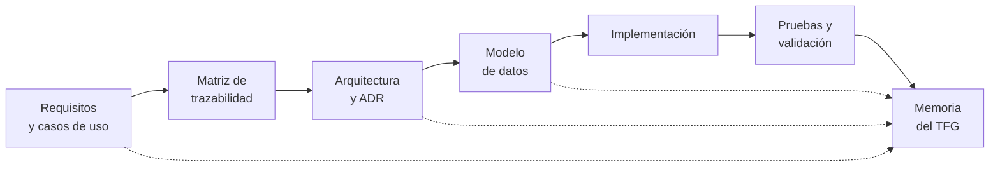

# Documentación de SetlistGen

Esta carpeta reúne toda la documentación del Trabajo de Fin de Grado: requisitos, arquitectura, diagramas, pruebas, gestión y memoria.

## Estructura

```text
docs/
├── architecture/        Arquitectura, componentes y registros de decisiones (ADR)
├── diagrams/            Diagramas UML en .svg y su fuente editable .puml
├── memory/              Memoria del TFG (LaTeX)
├── project-management/  Seguimiento del proyecto y reuniones con los tutores
├── requirements/        Requisitos, casos de uso y matriz de trazabilidad
└── testing/             Estrategia de pruebas y validación
```

## Contenido de cada carpeta

| Carpeta | Propósito | Contenido principal |
|---|---|---|
| [`architecture/`](architecture/) | Cómo está construido el sistema | [`README.md`](architecture/README.md) (componentes, capas y resumen de decisiones) y [`adrs/`](architecture/adrs/) (un registro por decisión relevante) |
| [`diagrams/`](diagrams/) | Fuente única de todos los diagramas UML | Componentes, casos de uso y secuencias. Cada diagrama tiene su `.svg` y su `.puml` |
| [`memory/`](memory/) | Memoria académica del TFG | Capítulos y apéndices en LaTeX sobre la plantilla oficial |
| [`project-management/`](project-management/) | Seguimiento del trabajo | Documentos de revisión y decisiones abiertas de las reuniones con tutor y cotutor |
| [`requirements/`](requirements/) | Qué debe hacer el sistema | [`requirements.md`](requirements/requirements.md), [`use-cases.md`](requirements/use-cases.md) y [`traceability-matrix.md`](requirements/traceability-matrix.md) |
| [`testing/`](testing/) | Cómo se comprueba | Estrategia de pruebas y validación de exactitud frente a Rekordbox |

## Convención de diagramas

| Tipo | Dónde | Formato |
|---|---|---|
| **UML formal** (componentes, casos de uso, secuencia) | `diagrams/` | `.puml` como fuente editable y `.svg` exportado. Se enlazan desde los documentos como imagen, con ruta relativa (`../diagrams/...`) |
| **Vistas estructurales y de flujo** (límites del sistema, estructura del SRS, trazabilidad) | Dentro del propio `.md` | Bloque Mermaid, que GitHub renderiza |

Si un diagrama UML cambia, se edita su `.puml`, se vuelve a exportar el `.svg` y se sustituyen ambos en `diagrams/`. Los documentos no se tocan, porque apuntan a esos ficheros.

## Flujo documental



La documentación se redacta de forma incremental: cada documento alimenta el capítulo correspondiente de la memoria, de modo que no se acumula trabajo al final.

## Estado actual

| Área | Estado |
|---|---|
| Requisitos, casos de uso y trazabilidad | Listos para revisión con el tutor |
| Arquitectura y ADR | Diagrama de componentes y decisiones principales cerrados |
| Modelo de datos | Siguiente entregable |
| Pruebas | Estrategia por completar tras el modelo de datos |
| Memoria | Capítulos 1 a 4 redactados. Pendiente actualizar el alcance tras el replanteamiento |