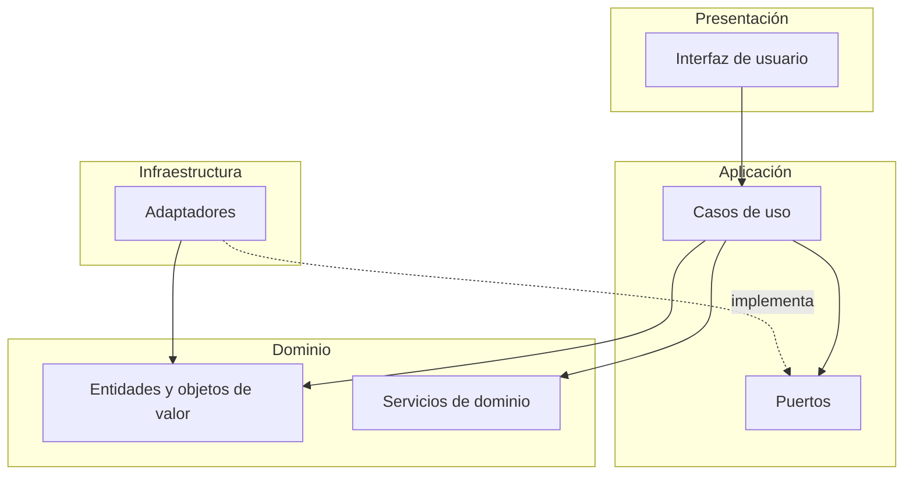
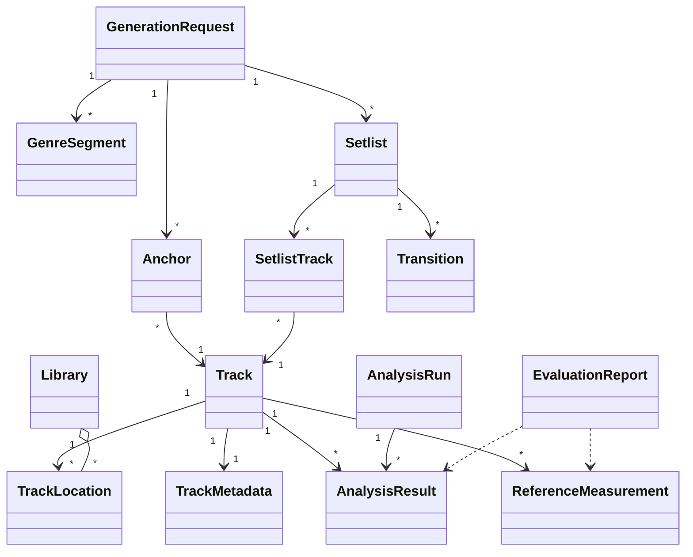

# Arquitectura de SetlistGen

> Destino en el repositorio: `docs/architecture/README.md`.

**Versión:** 2.0 · **Fecha:** 2026-10-30 · **Alineado con:** SRS v4.0, casos de uso v1.1, matriz de trazabilidad v3.0, glosario v2.1 y ADR-001 a ADR-010.

## Descripción

Este directorio contiene la documentación arquitectónica de SetlistGen y los registros de decisiones arquitectónicas (ADR) del proyecto.

La arquitectura proporciona una base desacoplada, mantenible y extensible para una herramienta capaz de analizar bibliotecas musicales locales, generar automáticamente setlists y exportarlos para su uso en Rekordbox.

Los términos que dependen de una decisión abierta se marcan como **[PROPUESTA · OD-xx]**. No cierran la decisión.

---

# Visión general

SetlistGen es una aplicación de escritorio desarrollada en Python que permite generar automáticamente setlists para DJs a partir de una biblioteca musical local.

El sistema:

- Importa bibliotecas musicales locales y reconoce las pistas de forma permanente, aunque cambien de nombre o de ubicación.
- Analiza BPM y tonalidad con motores de análisis intercambiables.
- Calcula compatibilidad armónica mediante la rueda Camelot.
- Almacena resultados de análisis, indicando qué motor y versión los produjo.
- Genera setlists mediante satisfacción de restricciones con una función de coste.
- Exporta playlists compatibles con Rekordbox.
- Contrasta los resultados del análisis con los valores de referencia de Rekordbox.

Todo el procesamiento es local (RNF-25).

---

# Stack tecnológico

| Ámbito | Tecnología | Estado |
|---|---|---|
| Lenguaje | Python | Adoptado; se formaliza en ADR-008 (propuesto) |
| Persistencia | SQLite | Aceptado (ADR-004) |
| Análisis musical | Essentia (principal previsto), librosa y madmom | Candidatos; selección tras la prueba de concepto (ADR-003) |
| Lectura de etiquetas | Mutagen | Candidato |
| Generación | Restricciones con función de coste | Aceptado (ADR-005) |
| Exportación | XML de Rekordbox y M3U8 | Aceptado; verificación pendiente (ADR-006) |
| Interfaz gráfica | PySide6 (alternativa: Tkinter) | Propuesto (ADR-008) |
| Pruebas | pytest | Adoptado |

Las licencias de las dependencias se revisan según ADR-007 (propuesto). Algunas librerías candidatas pueden tener condiciones de licencia o de instalación que condicionen la selección. Esas hipótesis están por verificar.

---

# Decisiones arquitectónicas

| ADR | Decisión | Estado |
|---|---|---|
| [ADR-001](adrs/ADR-001-distribucion-sistema.md) | Aplicación de escritorio | Aceptado |
| [ADR-002](adrs/ADR-002-arquitectura-general.md) | Clean Architecture, con puertos y adaptadores en los límites externos | Aceptado |
| [ADR-003](adrs/ADR-003-motor-analisis-musical.md) | Puerto `AudioAnalyzer` con adaptadores intercambiables; librería principal por prueba de concepto | Aceptado (librería pendiente) |
| [ADR-004](adrs/ADR-004-persistencia.md) | SQLite | Aceptado (esquema pendiente de `data-model.md`) |
| [ADR-005](adrs/ADR-005-generacion-setlists.md) | Restricciones con función de coste | Aceptado |
| [ADR-006](adrs/ADR-006-exportacion-rekordbox.md) | XML de Rekordbox como formato principal y M3U8 complementario | Aceptado (verificación pendiente) |
| [ADR-007](adrs/ADR-007-licencias-dependencias.md) | Licencias y compatibilidad legal de dependencias | Propuesto |
| [ADR-008](adrs/ADR-008-lenguaje-interfaz-empaquetado.md) | Lenguaje, interfaz gráfica y empaquetado | Propuesto |
| [ADR-009](adrs/ADR-009-evaluacion-validacion.md) | Conjunto de evaluación y protocolo de validación | Propuesto |
| [ADR-010](adrs/ADR-010-identificacion-pistas.md) | Identificación permanente de pistas (OD-03) | Propuesto |

---

# Arquitectura general

Las dependencias apuntan siempre hacia el dominio. Los puertos pertenecen a la capa de Aplicación, que los define, y los adaptadores de Infraestructura los implementan.



## Reglas de dependencia

| Capa | Puede importar | No puede importar |
|---|---|---|
| Dominio | Biblioteca estándar | Aplicación, infraestructura, presentación, librerías de audio, de base de datos o de interfaz |
| Aplicación | Dominio | Infraestructura, presentación, librerías externas |
| Infraestructura | Aplicación, dominio, librerías externas | Presentación |
| Presentación | Aplicación, dominio (solo para mostrar) | Infraestructura |

El ensamblado de los adaptadores con los casos de uso se realiza en el punto de entrada de la aplicación. La comprobación de estas reglas es automática en integración continua (RNF-22).

## Puertos

Vocabulario canónico del proyecto (SRS 7.0 y glosario, sección 8).

| Puerto | Responsabilidad | Adaptadores previstos | Estado |
|---|---|---|---|
| `LibraryScanner` | Recorrer carpetas y filtrar formatos | Sistema de archivos | Previsto |
| `MetadataReader` | Leer etiquetas | Basado en Mutagen (candidato) | Previsto |
| `AudioAnalyzer` | Estimar BPM y tonalidad | `EssentiaAdapter`, `LibrosaAdapter`, `MadmomAdapter` | Previsto (ADR-003) |
| `TrackIdentifier` | Calcular los datos de identificación de una pista | Según ADR-010 | **[PROPUESTA · OD-03]** |
| `TrackRepository` | Pistas, ubicaciones y resultados de análisis | `SQLiteTrackRepository` | Previsto (ADR-004) |
| `SetlistRepository` | Setlists, solicitudes e histórico | `SQLiteSetlistRepository` | Previsto (ADR-004) |
| `StatisticsRepository` | Consultas del panel | `SQLiteStatisticsRepository` | Previsto |
| `SetlistExporter` | Exportar setlists | `RekordboxXmlExporter`, `M3u8Exporter` | Previsto (ADR-006) |
| `ReferenceDataProvider` | Leer valores de referencia de Rekordbox | Lector de XML de colección, lector de CSV | Previsto |

Pendiente: las referencias y los informes de evaluación no tienen aún un puerto de repositorio. Se propone `EvaluationRepository` **[PROPUESTA]**, que se incorporará en la consolidación de la documentación.

---

# Modelo de dominio

Propuesta de trabajo. El modelo definitivo se diseña en `data-model.md` y depende de OD-03 a OD-07. `Library` (OD-05) y `Transition` (OD-06) son entidades condicionadas.



Cambios respecto a versiones anteriores:

- Una pista tiene varias ubicaciones, para detectar pistas movidas, duplicadas y ausentes (RF-09c).
- Una pista puede tener varios resultados de análisis, de distintos motores y versiones (RF-07, OD-04).
- Las anclas y los segmentos de género forman parte de la solicitud de generación (RF-15, RF-16).
- La pertenencia a una biblioteca se establece a través de la ubicación, y no de la pista (OD-05).

---

# Flujo principal

```mermaid
flowchart LR

    AUDIO["Biblioteca musical"]

    IMPORT["Importación y metadatos"]

    IDENT["Identificación de pistas"]

    ANALYSIS["Análisis musical<br/>(motor activo)"]

    DB[("SQLite")]

    GEN["Generador"]

    SETLIST["Setlist"]

    EXPORT["Exportación<br/>XML · M3U8"]

    RB["Rekordbox"]

    REF["XML de colección<br/>(referencia)"]

    EVAL["Evaluación<br/>por motor"]

    AUDIO --> IMPORT
    IMPORT --> IDENT
    IDENT --> ANALYSIS
    ANALYSIS --> DB
    DB --> GEN
    GEN --> SETLIST
    SETLIST --> EXPORT
    EXPORT --> RB

    RB -.exporta.-> REF
    REF --> EVAL
    DB --> EVAL
```



---

# Uso previsto de las librerías MIR

Reparto candidato. La selección definitiva depende de la prueba de concepto, de ADR-007 y del conjunto de evaluación de ADR-009.

| Funcionalidad | Tecnología candidata |
|---|---|
| Lectura de etiquetas | Mutagen |
| Lectura de audio, STFT y espectrogramas | Librosa |
| Cromagramas | Librosa o Essentia |
| BPM | Essentia o Madmom |
| Tonalidad | Essentia |
| Beat tracking | Madmom |
| Código Camelot | Implementación propia en el dominio (RF-06) |
| Validación comparativa | Cada motor frente a la referencia de Rekordbox |

---

# Estructura de paquetes

Propuesta de ADR-008, que sigue las capas anteriores.

```text
src/setlistgen/
├── domain/
├── application/
│   ├── use_cases/
│   └── ports/
├── infrastructure/
│   ├── analysis/
│   ├── metadata/
│   ├── scanning/
│   ├── identification/
│   ├── persistence/
│   ├── export/
│   └── reference/
├── presentation/
└── bootstrap/
```

---

# Estado actual

## Completado

- Anteproyecto, requisitos (SRS v4.0), casos de uso, matriz de trazabilidad y glosario.
- ADR-001 a ADR-006 aceptados y revisados.
- ADR-007 a ADR-010 redactados como propuestos.
- Estrategia de persistencia, de exportación y de generación de setlists.
- Capítulos 1 a 4 de la memoria.

## Pendiente

- Validación por tutor y cotutor de las decisiones abiertas OD-01 a OD-08 y de los ADR propuestos.
- Prueba de concepto de análisis (exactitud, instalación y licencias), de importación en Rekordbox, de identificación de pistas, de interfaz y de empaquetado.
- Modelo de dominio y modelo de datos (`data-model.md`): entidades, MER, modelo relacional y diseño físico de SQLite.
- Reorganización del repositorio según la estructura de paquetes.
- Implementación.
- Validación experimental frente a Rekordbox.

---

# Decisiones abiertas y riesgos principales

| Asunto | Referencia |
|---|---|
| Promover RF-29 (evaluación) a Must | OD-01 |
| Parámetro de salto máximo de BPM | OD-02 |
| Estrategia de identificación permanente de pistas | OD-03, ADR-010 |
| Resultados de varios motores por pista | OD-04 |
| Existencia de la entidad `Library` | OD-05 |
| Persistencia explícita de transiciones | OD-06 |
| Conjunto de entidades de dominio | OD-07 |
| Nuevos ADR (licencias, lenguaje e interfaz, evaluación) | OD-08, ADR-007 a ADR-009 |
| El fichero exportado no se carga bien en Rekordbox | Riesgo R-02 |
| Exactitud insuficiente de BPM y tonalidad | Riesgo R-01 |
| Licencias incompatibles con la del repositorio | Riesgo R-08 |

El detalle está en `open-decisions.md`.

---

# Control de cambios

| Versión | Fecha | Cambio |
|---|---|---|
| 1.0 | 2026-10-28 | README de arquitectura inicial |
| 2.0 | 2026-10-30 | Alineación con la línea base documental: vocabulario canónico de puertos, diagrama de dependencias corregido, modelo de dominio con ubicaciones, multi-motor, anclas y segmentos de género, flujo con identificación y evaluación, stack con estados, ADR-007 a ADR-010 y estado actual |
