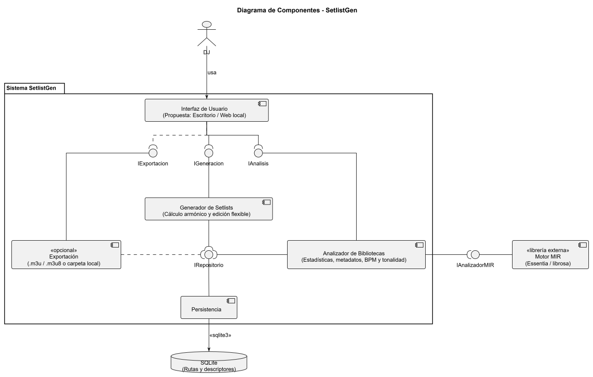
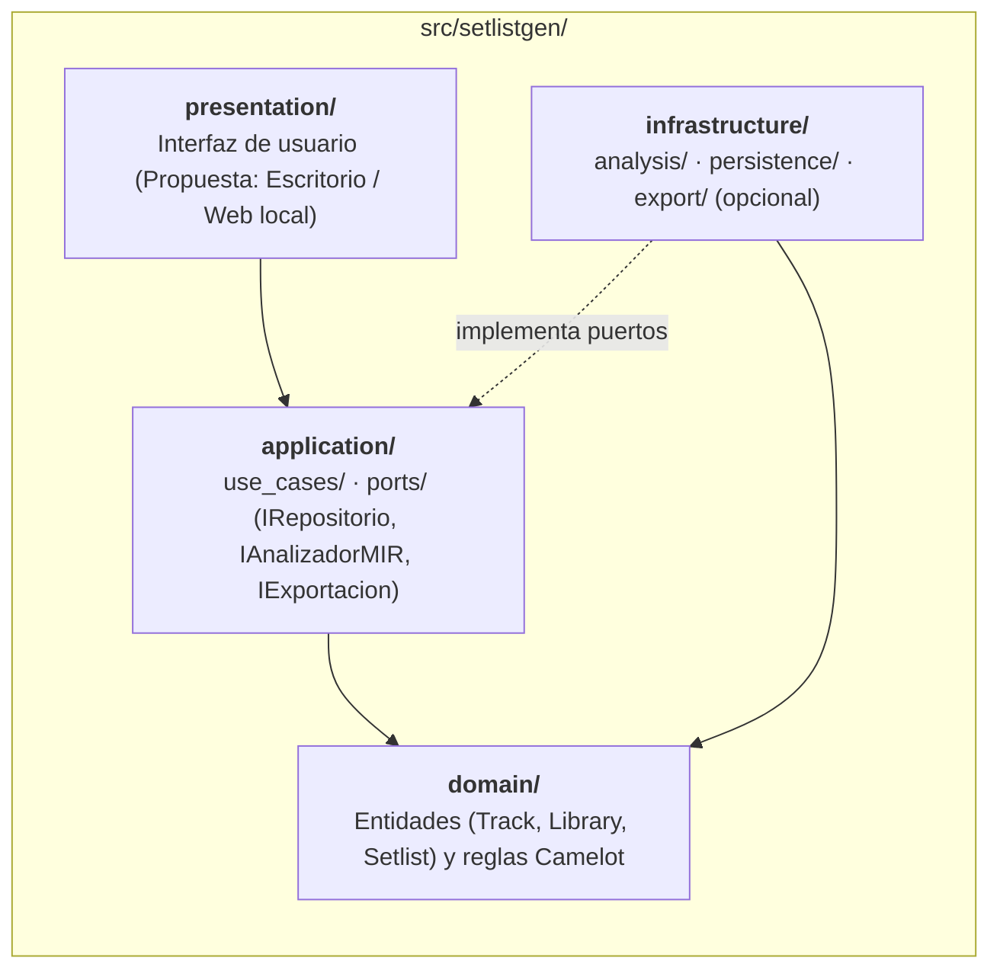

# Arquitectura de SetlistGen

> Destino en el repositorio: `docs/architecture/README.md`.

**Versión:** 4.0.0 · **Fecha:** 2026-11-20 · **Alineado con:** Fase 1 (Arquitectura simplificada), Diagrama de Componentes UML v1.0 y ADR-001 a ADR-010.

## Descripción

Este directorio recoge la arquitectura del sistema **SetlistGen**, sus registros de decisiones arquitectónicas (ADR) y los diagramas estructurales correspondientes.

> **Estado del proyecto.** Tras la reunión de seguimiento con el tutor, la fase de arquitectura se ha reorientado hacia un **alcance realista y defendible** (actor único `DJ`, persistencia ligera en SQLite basada en rutas locales sin binarios de audio y exportación a Rekordbox como ampliación opcional). La capa de interfaz gráfica permanece en estado **Propuesto** (aplicación de escritorio en Python o interfaz web local) hasta cerrar el análisis de requisitos y el modelo de datos.

SetlistGen es una aplicación local en Python que analiza bibliotecas musicales del equipo del DJ, genera setlists mediante satisfacción de restricciones armónicas y temporales, permite editarlos libremente y los guarda en SQLite. Todo el procesamiento se ejecuta de forma 100 % local.

---

# 1. Documentos de este directorio

## 1.1 Decisiones arquitectónicas (ADRs)

| ADR | Decisión y justificación resumida | Estado |
|---|---|---|
| [ADR-001](adrs/ADR-001-distribución-sistema.md) | **Ejecución 100 % local en el equipo del DJ.** Evita servidores externos y permite acceder directamente a las carpetas de audio del sistema de archivos. El formato de interfaz (escritorio Python o web local con backend Python) sigue abierto. | Simplificado · Interfaz Propuesta |
| [ADR-002](adrs/ADR-002-arquitectura-general.md) | **Clean Architecture con puertos y adaptadores** (véase la sección 4). Permite sustituir el motor MIR, la interfaz o el exportador sin modificar las reglas de negocio del dominio. | Aceptado |
| [ADR-003](adrs/ADR-003-motor-analisis-musical.md) | **Motor MIR desacoplado tras una interfaz (`IAnalizadorMIR`).** Essentia es el candidato principal y librosa permite contrastar resultados; la elección final depende de su precisión, licencia e instalación. | Aceptado · Librería pendiente |
| [ADR-004](adrs/ADR-004-persistencia.md) | **SQLite** como único fichero local sin servidor. Almacena únicamente rutas locales y descriptores básicos (nunca ficheros MP3/WAV), siguiendo un modelo simplificado de 5-6 tablas. | Aceptado · Esquema en Fase 3 |
| [ADR-005](adrs/ADR-005-generacion-setlists.md) | **Generación por restricciones (CSP)** según duración del evento, rango de BPM, compatibilidad armónica Camelot y no repetición de pistas, permitiendo edición posterior flexible por el DJ. | Aceptado · Alcance reducido |
| [ADR-006](adrs/ADR-006-exportacion-rekordbox.md) | **Exportación opcional** mediante copia en carpeta local (`mkdir` + `copy`) o lista `.m3u` / `.m3u8`. Se descarta el XML tras verificar en Rekordbox que no importa setlists XML. | Propuesto · Ampliación opcional |
| [ADR-007](adrs/ADR-007-licencias-dependencias.md) | **Licencia MIT y dependencias permisivas en el núcleo.** Cualquier librería con licencia restrictiva quedaría aislada como adaptador opcional. | Simplificado |
| [ADR-008](adrs/ADR-008-lenguaje-interfaz-empaquetado.md) | **Python** como lenguaje principal. El empaquetado en ejecutable queda como mejora opcional; la entrega base se ejecuta desde el código fuente. | Simplificado · Interfaz Propuesta |
| [ADR-009](adrs/ADR-009-evaluacion-validacion.md) | **Validación experimental sobre una muestra de la biblioteca real del autor**, contrastando el BPM y la tonalidad estimados frente a los valores de referencia de Rekordbox. | Simplificado |
| [ADR-010](adrs/ADR-010-identificacion-pistas.md) | **Detección simple de pistas ya analizadas** consultando su ruta local en SQLite para evitar duplicados y re-análisis innecesarios (se descarta la identificación por huellas acústicas). | Simplificado |

## 1.2 Documentación relacionada

* **Análisis de requisitos (Fase 2):** [`docs/requirements/README.md`](../requirements/README.md) (pendiente de reescritura simplificada).
* **Modelo de datos (Fase 3):** Se documentará en un único fichero unificado [`docs/architecture/data-model.md`](../architecture/data-model.md) tras cerrar los requisitos y casos de uso.
* **Memoria LaTeX:** [`docs/memory/`](../memory/).

---

# 2. Stack tecnológico

| Ámbito | Tecnología | Estado |
|---|---|---|
| Lenguaje | Python 3.10 o superior | Adoptado (ADR-008) |
| Persistencia | SQLite 3 (fichero local único) | Aceptado (ADR-004) |
| Análisis musical (MIR) | Essentia (principal) / librosa (alternativa) | Candidatos tras interfaz `IAnalizadorMIR` (ADR-003) |
| Lectura de etiquetas | Mutagen / biblioteca estándar | Candidato |
| Generación de setlists | Motor propio de restricciones en el dominio | Aceptado (ADR-005) |
| Exportación | Copia en carpeta local / lista `.m3u` o `.m3u8` | Propuesto · Ampliación opcional (ADR-006) |
| Interfaz de usuario | Escritorio Python (PySide6 / Tkinter) o Web local (HTML/CSS + Python) | Propuesto · Pendiente de decisión |
| Pruebas | `pytest` | Adoptado |

---

# 3. Diagrama de componentes del sistema (UML)

## 3.1 Flujo de trabajo del actor único (DJ)

El **DJ** es el único actor externo que interactúa con el sistema a través de la interfaz en tres etapas:

1. **Selección y análisis de biblioteca:** elige una carpeta local de su ordenador, visualiza un resumen rápido (tamaño total, número de archivos, subcarpetas y tiempo estimado de análisis) y lanza el procesamiento. El analizador extrae metadatos, BPM y tonalidad mediante el motor MIR, comprobando previamente en SQLite si cada pista ya fue analizada para evitar duplicados.
2. **Parametrización y generación:** introduce la duración objetivo del evento, el rango de BPM admisible y las reglas de compatibilidad armónica (código Camelot), y solicita la generación automática de una propuesta de setlist.
3. **Edición flexible, guardado y exportación opcional:** reordena pistas (por ejemplo, de forma ascendente por BPM), fija una canción inicial o añade pistas manualmente aunque incumplan las restricciones, guarda el setlist definitivo en SQLite y, como ampliación opcional, lo exporta a una carpeta local o fichero `.m3u`/`.m3u8`.

## 3.2 Responsabilidad de los componentes

| Componente | Responsabilidad |
|---|---|
| **Interfaz de Usuario** | Gestiona la interacción del DJ en los tres pasos del flujo sin contener lógica de negocio. Formato pendiente de decisión (escritorio o web local). |
| **Analizador de Bibliotecas** | Calcula estadísticas previas de la carpeta seleccionada y coordina la extracción de metadatos, BPM y tonalidad a través de `IAnalizadorMIR`, omitiendo pistas ya registradas en SQLite. |
| **Generador de Setlists** | Selecciona y ordena las pistas compatibles según las restricciones indicadas y permite la edición manual flexible del setlist resultante. |
| **Persistencia** | Gestiona la lectura y escritura en SQLite de bibliotecas, pistas (solo ruta local y descriptores, nunca audio) y setlists. |
| **Exportación `<<opcional>>`** | Genera una copia ordenada de los ficheros de audio en una carpeta local o una lista `.m3u`/`.m3u8` a partir de las rutas guardadas (ADR-006). |

## 3.3 Diagrama UML



* **Código fuente editable (PlantUML):** [`../diagrams/componentes.puml`](../diagrams/componentes.puml)

---

# 4. Arquitectura general y organización de `src/`

SetlistGen adopta una **arquitectura limpia por capas con puertos y adaptadores** (ADR-002), donde las dependencias apuntan siempre hacia el núcleo de dominio:

## 4.1 Reglas de dependencia entre capas

| Capa | Responsabilidad | Puede importar | No puede importar |
|---|---|---|---|
| **Dominio** | Entidades (`Track`, `Library`, `Setlist`), rueda de Camelot y reglas de compatibilidad/coste | Biblioteca estándar de Python | Aplicación, infraestructura, presentación o librerías externas |
| **Aplicación** | Casos de uso del DJ e interfaces/puertos (`IAnalizadorMIR`, `IRepositorio`, `IExportacion`) | Dominio | Infraestructura, presentación o librerías externas |
| **Infraestructura** | Adaptadores concretos para SQLite, motor MIR y exportación | Aplicación, dominio y librerías externas | Presentación |
| **Presentación** | Interfaz de usuario (escritorio o web local) | Aplicación y dominio (solo lectura para mostrar datos) | Infraestructura directamente |

## 4.2 Estructura del paquete `src/setlistgen/`

```text
src/setlistgen/
├── domain/                  Entidades y reglas de negocio (Camelot, compatibilidad, restricciones)
├── application/
│   ├── use_cases/           Acciones del DJ: analizar biblioteca, generar, editar y guardar setlist
│   └── ports/               Interfaces que requiere la aplicación (IRepositorio, IAnalizadorMIR, IExportacion)
├── infrastructure/
│   ├── analysis/            Adaptador del Motor MIR (Essentia / librosa) y lectura de metadatos
│   ├── persistence/         Implementación del repositorio en SQLite
│   └── export/              Adaptadores opcionales (copia en carpeta local y lista .m3u / .m3u8)
└── presentation/            Capa de interfaz de usuario (Propuesta: escritorio / web local)
```

### 4.2.1 Diagrama de organización y dependencias de `src/setlistgen/`


---

# 5. Estado actual y próximos hitos

## Completado
* **Fase 1 (Arquitectura):** Definición de la arquitectura simplificada, Diagrama de Componentes UML v1.0 y actualización de `ADR-006`.
* **Memoria base:** Anteproyecto y capítulos 1 a 4 redactados en `docs/memory/`.

## Pendiente
* **Fase 2:** Redacción de requisitos simplificados (`requirements.md`), casos de uso centrados en el actor único DJ (`use-cases.md`), matriz de trazabilidad directa y diagramas de secuencia UML de los flujos críticos.
* **Fase 3:** Documento único de modelo de datos (diccionario de datos, MER, modelo relacional y script DDL SQLite de ~5-6 tablas).
* **Fase 4:** Prueba de concepto MIR, implementación del núcleo funcional en `src/setlistgen/`, pruebas y actualización final de la memoria LaTeX.

---

# 6. Control de cambios

| Versión | Fecha | Cambio |
|---|---|---|
| 1.0 | 2026-10-28 | README de arquitectura inicial. |
| 2.0 | 2026-10-30 | Alineación con la línea base documental. |
| 3.0.1 | 2026-11-14 | Diseño detallado previo (20 tablas, 4 agregados; archivado en la rama `develop`). |
| 4.0.0 | 2026-11-20 | Reorientación a arquitectura simplificada tras reunión con el tutor: actor único `DJ`, diagrama de componentes UML v1.0, resumen de ADR-001 a ADR-010 (con ADR-006 actualizado a exportación opcional por carpeta/`.m3u8`) y estructura mínima de `src/setlistgen/`. |