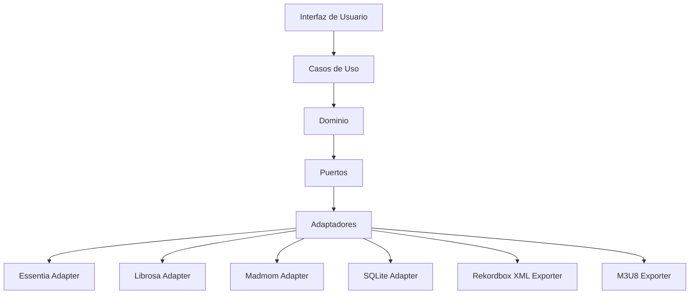
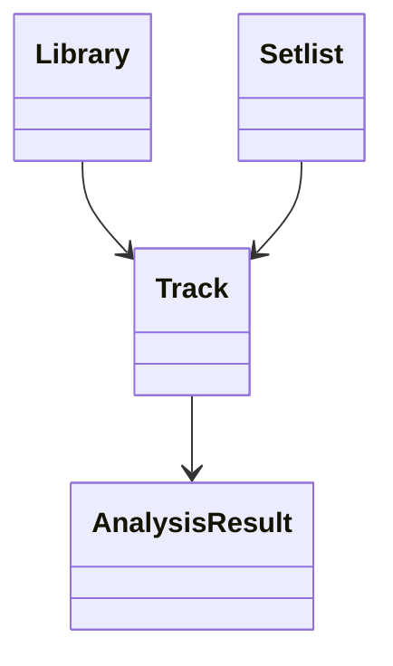
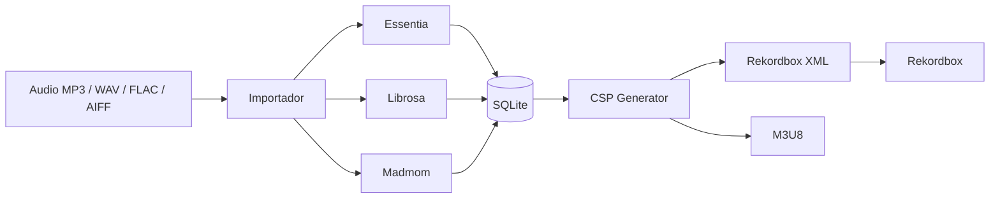

# Arquitectura de SetlistGen

## Descripción

Este directorio contiene la documentación arquitectónica de SetlistGen y los registros de decisiones arquitectónicas (ADR) del proyecto.

La arquitectura propuesta proporciona una base desacoplada, mantenible y extensible para una herramienta capaz de analizar bibliotecas musicales locales, generar automáticamente setlists y exportarlos para su uso en Rekordbox.

---

# Visión General

SetlistGen es una aplicación de escritorio desarrollada en Python que permite generar automáticamente setlists para DJs a partir de una biblioteca musical local.

El sistema:

- Importa bibliotecas musicales locales.
- Analiza BPM y tonalidad.
- Calcula compatibilidad armónica mediante la rueda Camelot.
- Almacena resultados de análisis.
- Genera setlists mediante restricciones.
- Exporta playlists compatibles con Rekordbox.

---

# Stack Tecnológico

## Lenguaje principal

```text
Python
```

### Motivos

- Excelente ecosistema para procesamiento de audio.
- Compatibilidad con Essentia.
- Compatibilidad con Librosa.
- Compatibilidad con Madmom.
- Buena integración con SQLite.
- Desarrollo rápido y mantenible.

---

## Persistencia

```text
SQLite
```

---

## Análisis Musical

```text
Essentia
Librosa
Madmom
```

---

## Exportación

```text
XML Rekordbox
M3U8
```

---

# Decisiones Arquitectónicas

## ADR-001: Forma de Distribución

**Decisión:** Aplicación de escritorio.

## ADR-002: Arquitectura General

**Decisión:** Clean Architecture.

## ADR-003: Motor de Análisis Musical

**Decisión:** Arquitectura desacoplada mediante puertos y adaptadores.

**Librería principal prevista:** Essentia.

**Librerías auxiliares:**

- Librosa
- Madmom

## ADR-004: Persistencia

**Decisión:** SQLite.

## ADR-005: Generación de Setlists

**Decisión:** Constraint Satisfaction Problem (CSP).

## ADR-006: Integración con Rekordbox

**Decisión:**

- XML Rekordbox como formato principal.
- M3U8 como formato complementario.

---

# Arquitectura General



---

# Modelo de Dominio



---

# Integración Completa



---

# Flujo Principal


---

# Uso previsto de las librerías MIR

| Funcionalidad | Tecnología principal |
|--------------|----------------------|
| Lectura de audio | Librosa |
| STFT | Librosa |
| Espectrogramas | Librosa |
| Cromagramas | Librosa / Essentia |
| BPM | Essentia |
| Tonalidad | Essentia |
| Beat Tracking | Madmom |
| Validación comparativa | Essentia + Librosa + Madmom |

---

# Directorio de ADRs

```text
docs/architecture/adrs/
```

ADRs actuales:

- ADR-001: Forma de Distribución del Sistema
- ADR-002: Arquitectura General del Sistema
- ADR-003: Motor de Análisis Musical
- ADR-004: Persistencia
- ADR-005: Algoritmo de Generación de Setlists
- ADR-006: Exportación e Integración con Rekordbox

---

# Estado Actual

## Completado

- Decisiones arquitectónicas principales.
- Selección del lenguaje principal.
- Arquitectura objetivo.
- Estrategia de persistencia.
- Estrategia de exportación.
- Estrategia de generación de setlists.

## Pendiente

- Prueba de concepto de análisis musical.
- Diseño detallado de entidades.
- Diseño físico de la base de datos.
- Implementación.
- Validación frente a Rekordbox.
