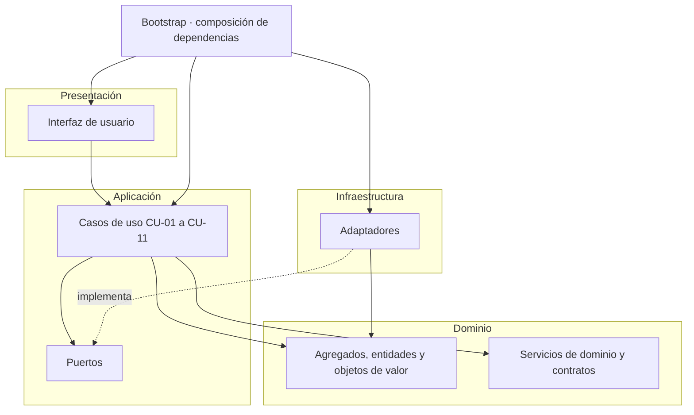
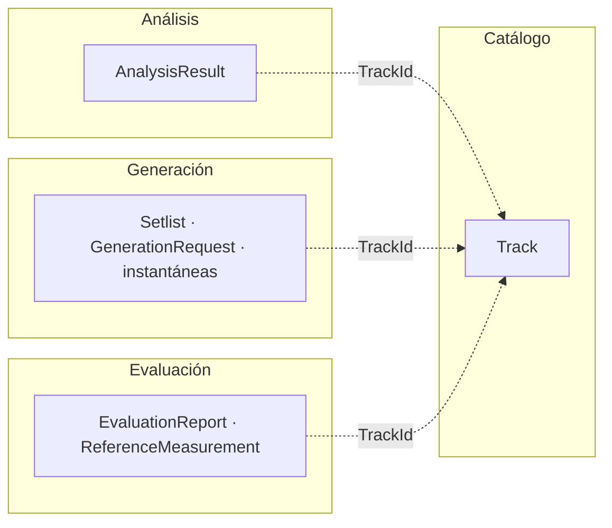

# Arquitectura de SetlistGen

> Destino en el repositorio: `docs/architecture/README.md`.

**Versión:** 3.0 · **Fecha:** 2026-11-14 · **Alineado con:** SRS v4.0, casos de uso v1.1, matriz v3.0, glosario v2.1, ADR-001 a ADR-010, `domain-model.md` v0.2, `conceptual-model.md` v0.1, `er-model.md` v0.1.1 y `database-schema.md` v0.1.

## Descripción

Este directorio contiene la arquitectura de SetlistGen, sus registros de decisiones (ADR) y el diseño detallado del dominio y de los datos.

> **Estado.** La fase de **diseño detallado está completada de forma provisional**: dominio, modelo conceptual, MER y esquema SQLite existen y se han verificado en sus límites, pero se apoyan en supuestos (OD-03 a OD-07) que **ningún tutor ha validado**. No hay código en `src/` ni prueba de concepto. Los términos que dependen de una decisión abierta se marcan **[PROPUESTA · OD-xx]** o **[SUPUESTO · OD-xx]** y no la cierran.

SetlistGen es una aplicación de escritorio en Python que analiza una biblioteca musical local, genera setlists mediante satisfacción de restricciones con una función de coste y los exporta a Rekordbox. Todo el procesamiento es local (RNF-25).

---

# 1. Documentos de este directorio

## 1.1 Decisiones arquitectónicas

| ADR | Decisión | Estado |
|---|---|---|
| [ADR-001](adrs/ADR-001-distribucion-sistema.md) | Aplicación de escritorio | Aceptado |
| [ADR-002](adrs/ADR-002-arquitectura-general.md) | Clean Architecture con puertos y adaptadores | Aceptado (pendiente de incorporar `AnalysisResultRepository`) |
| [ADR-003](adrs/ADR-003-motor-analisis-musical.md) | Puerto `AudioAnalyzer` con adaptadores intercambiables | Aceptado (librería pendiente de la prueba de concepto) |
| [ADR-004](adrs/ADR-004-persistencia.md) | SQLite | Aceptado (esquema provisional, véase `data-model.md`) |
| [ADR-005](adrs/ADR-005-generacion-setlists.md) | Restricciones con función de coste | Aceptado |
| [ADR-006](adrs/ADR-006-exportacion-rekordbox.md) | XML de Rekordbox y M3U8 complementario | Aceptado (verificación pendiente) |
| [ADR-007](adrs/ADR-007-licencias-dependencias.md) | Licencias y compatibilidad legal | Propuesto |
| [ADR-008](adrs/ADR-008-lenguaje-interfaz-empaquetado.md) | Lenguaje, interfaz, empaquetado y estructura de paquetes | Propuesto |
| [ADR-009](adrs/ADR-009-evaluacion-validacion.md) | Conjunto de evaluación y protocolo de validación | Propuesto |
| [ADR-010](adrs/ADR-010-identificacion-pistas.md) | Identificación permanente de pistas (OD-03) | Propuesto |

## 1.2 Diseño del dominio y de los datos

| Documento | Contenido | Versión | Estado |
|---|---|---|---|
| [`data-model.md`](data-model.md) | **Índice maestro** de la serie de datos y estado de los supuestos | 1.0 | Provisional |
| [`domain-model.md`](domain-model.md) | Agregados, invariantes, servicios y código de especificación del dominio | 0.2 | Provisional |
| [`conceptual-model.md`](conceptual-model.md) | Entidades y relaciones persistentes | 0.1 | Provisional |
| [`er-model.md`](er-model.md) | Modelo entidad-relación lógico | 0.1.1 | Provisional |
| [`database-schema.md`](database-schema.md) | Modelo relacional y diseño físico SQLite | 0.1 | Provisional |
| [`open-decisions.md`](../project-management/open-decisions.md) | Decisiones abiertas OD-01 a OD-10 | 3.1 | Para la reunión con tutores |
| [`audit-review.md`](../project-management/audit-review.md) | Auditoría técnica y hallazgos | 3.1 | Pendiente de añadir N-31 a N-46 |

## 1.3 Fuentes de análisis

[`requirements.md`](../requirements/requirements.md) (SRS v4.0), [`use-cases.md`](../requirements/use-cases.md) (v1.1), [`traceability-matrix.md`](../requirements/traceability-matrix.md) (v3.0) y [`glosario.md`](../requirements/glosario.md) (v2.1).

---

# 2. Stack tecnológico

| Ámbito | Tecnología | Estado |
|---|---|---|
| Lenguaje | Python 3.10 o superior | Adoptado; versión definitiva en ADR-008 (propuesto) |
| Persistencia | SQLite 3.37 o superior (tablas `STRICT`), modo `WAL` propuesto | Aceptado (ADR-004); esquema provisional |
| Análisis musical | Essentia (principal previsto), librosa y madmom | Candidatos; selección tras la prueba de concepto (ADR-003) |
| Lectura de etiquetas | Mutagen | Candidato |
| Generación | Restricciones con función de coste; resolutor propio en el dominio | Aceptado (ADR-005) |
| Exportación | XML de Rekordbox y M3U8 | Aceptado; verificación pendiente (ADR-006) |
| Interfaz gráfica | PySide6 (alternativa: Tkinter) | Propuesto (ADR-008) |
| Pruebas | pytest | Adoptado |

Las licencias se revisan según ADR-007 (propuesto); varias hipótesis siguen sin verificar.

---

# 3. Arquitectura resultante

Clean Architecture con puertos y adaptadores. Las dependencias apuntan siempre hacia el dominio. Los puertos pertenecen a la capa de Aplicación y los adaptadores de Infraestructura los implementan.



## 3.1 Reglas de dependencia

| Capa | Puede importar | No puede importar |
|---|---|---|
| Dominio | Biblioteca estándar | Aplicación, infraestructura, presentación, librerías de audio, de base de datos o de interfaz |
| Aplicación | Dominio | Infraestructura, presentación, librerías externas |
| Infraestructura | Aplicación, dominio, librerías externas | Presentación |
| Presentación | Aplicación, dominio (solo para mostrar) | Infraestructura |
| Bootstrap | Todas (es el único lugar donde se ensamblan) | — |

La comprobación es automática en integración continua (RNF-22, T-ARQ-01). Está **verificada por inspección** sobre los diez módulos del dominio v0.2, que solo importan la biblioteca estándar; la comprobación automática aún no existe.

## 3.2 Puertos

Vocabulario canónico del proyecto (SRS 7.0 y glosario, sección 8).

| Puerto | Responsabilidad | Adaptadores previstos | Estado |
|---|---|---|---|
| `LibraryScanner` | Recorrer carpetas y filtrar formatos | Sistema de archivos | Previsto |
| `MetadataReader` | Leer etiquetas | Basado en Mutagen (candidato) | Previsto |
| `AudioAnalyzer` | Estimar BPM y tonalidad | `EssentiaAdapter`, `LibrosaAdapter`, `MadmomAdapter` | Previsto (ADR-003) |
| `TrackIdentifier` | Calcular las huellas de una pista | Según ADR-010 | **[PROPUESTA · OD-03]** |
| `TrackRepository` | Agregado **Catálogo**: pistas, ubicaciones, metadatos y huellas | `SQLiteTrackRepository` | Previsto. **Alcance reducido** (N-32) |
| `AnalysisResultRepository` | Agregado **Análisis**: resultados por pista y motor | `SQLiteAnalysisResultRepository` | **Confirmado (N-32)**; supuesto OD-04. Pendiente de reflejarse en ADR-002 |
| `SetlistRepository` | Setlists, solicitudes, instantáneas e histórico | `SQLiteSetlistRepository` | Previsto (ADR-004) |
| `StatisticsRepository` | Consultas del panel | `SQLiteStatisticsRepository` | Previsto |
| `EvaluationRepository` | Referencias e informes de evaluación | `SQLiteEvaluationRepository` | **[PROPUESTA]** |
| `SetlistExporter` | Exportar setlists | `RekordboxXmlExporter`, `M3u8Exporter` | Previsto (ADR-006) |
| `ReferenceDataProvider` | Leer valores de referencia de Rekordbox | Lector de XML de colección, lector de CSV | Previsto |

**Contrato del dominio, no puerto:** `SetlistGenerator.generate(candidates, request)` devuelve `Solution`, `Infeasible` o `LimitReached`. Es el resolutor propio de ADR-005 y reside en el dominio. Si se adoptara una librería externa de restricciones, pasaría a ser un puerto con revisión de ADR-005 y ADR-007.

## 3.3 Dominio

Cuatro agregados que se referencian solo por identidad (detalle en [`domain-model.md`](domain-model.md)).



Servicios de dominio sin estado: `HarmonicCompatibilityService`, `TransitionEvaluatorService`, `SetlistValidatorService`, `SetlistAssemblyService`, `TrackRecognitionService`, `ReferenceMatchingService`, `EstimationErrorClassifier` y `EvaluationService`.

## 3.4 Flujo principal

```mermaid
flowchart LR
    AUDIO["Biblioteca musical"] --> IMPORT["Importación y metadatos"]
    IMPORT --> IDENT["Reconocimiento de pistas<br/>(dos niveles)"]
    IDENT --> ANALYSIS["Análisis musical<br/>(motor activo)"]
    ANALYSIS --> DB[("SQLite")]
    DB --> CAND["Selección de candidatas"]
    CAND --> GEN["Generador"]
    GEN --> SETLIST["Setlist"]
    SETLIST --> EXPORT["Exportación<br/>XML · M3U8"]
    EXPORT --> RB["Rekordbox"]
    RB -.exporta.-> REF["XML de colección<br/>(referencia)"]
    REF --> EVAL["Evaluación<br/>por motor"]
    DB --> EVAL
```



## 3.5 Uso previsto de las librerías MIR

Reparto candidato. La selección depende de la prueba de concepto, de ADR-007 y de ADR-009.

| Funcionalidad | Tecnología candidata |
|---|---|
| Lectura de etiquetas | Mutagen |
| Lectura de audio, STFT y espectrogramas | Librosa |
| Cromagramas | Librosa o Essentia |
| BPM | Essentia o Madmom |
| Tonalidad | Essentia |
| Beat tracking | Madmom |
| Código Camelot | Implementación propia en el dominio (RF-06) |

---

# 4. Estructura del repositorio (propuesta)

**Propuesta de ADR-008 (OD-08), que el diseño detallado confirma como conveniente.** No hay código que migrar, así que el coste de adoptarla es mínimo. Resuelve el hallazgo N-25.

```text
setlistgen/
├── src/setlistgen/                  Paquete de la aplicación
│   ├── domain/                      Dominio puro (solo biblioteca estándar)
│   ├── application/
│   │   ├── use_cases/               CU-01 a CU-11
│   │   └── ports/                   Puertos (Protocol)
│   ├── infrastructure/
│   │   ├── analysis/                Adaptadores de AudioAnalyzer
│   │   ├── metadata/                Adaptador de MetadataReader
│   │   ├── scanning/                Adaptador de LibraryScanner
│   │   ├── identification/          Adaptador de TrackIdentifier
│   │   ├── persistence/
│   │   │   ├── migrations/          0001_initial.sql y siguientes
│   │   │   │   └── pending/         Migraciones condicionales (OD-05)
│   │   │   └── repositories/        Repositorios SQLite
│   │   ├── export/                  Exportadores XML y M3U8
│   │   └── reference/               Lectores de referencia
│   ├── presentation/                Interfaz gráfica
│   └── bootstrap/                   Composición y punto de entrada
├── tests/
│   ├── unit/{domain,application}/
│   ├── integration/{persistence,infrastructure}/
│   ├── architecture/                Regla de dependencia (T-ARQ-01)
│   ├── performance/                 Benchmarks (RNF-01 a RNF-04, RNF-18)
│   └── fixtures/                    Datos de prueba, sin audio con derechos
├── scripts/                         Utilidades y comprobaciones documentales
├── docs/
│   ├── requirements/  architecture/  project-management/  testing/  memory/
├── .github/workflows/               Integración continua (pendiente)
├── pyproject.toml                   Diseño `src`, `requires-python >= 3.10`, datos de paquete `*.sql`
├── README.md  LICENSE  .gitignore
```

| Decisión | Motivo |
|---|---|
| Diseño `src/` con un único paquete | Evita importar sin instalar y es el que ADR-008 propone |
| `backend/`, `frontend/`, `database/` desaparecen | Son de una arquitectura cliente-servidor descartada (ADR-001, ADR-004). Sus contenidos pasan a `src/setlistgen/` |
| Migraciones **dentro del paquete** | La aplicación las lee en ejecución y deben viajar con cualquier empaquetado (ADR-008). Una carpeta `database/` externa exigiría rutas relativas frágiles |
| `migrations/pending/` | Una migración condicional no debe aplicarse sola: el aplicador ignora esa carpeta |
| `tests/architecture/` propia | La regla de dependencia es una prueba de primera clase (RNF-22) |
| `tests` refleja `src` | Criterio de ADR-008 |
| Datos de prueba sin audio | ADR-007 y ADR-009: el repositorio no contiene obras |

## 4.1 Correspondencia con la estructura actual

| Actual | Propuesta |
|---|---|
| `backend/README.md` | `src/setlistgen/README.md` |
| `database/README.md` | `src/setlistgen/infrastructure/persistence/README.md` |
| `database/schema/schema.sql` (previsto) | `src/setlistgen/infrastructure/persistence/migrations/0001_initial.sql` |
| `frontend/README.md` | `src/setlistgen/presentation/README.md` (conservar el contenido sobre principios y funcionalidades) |
| `tests/README.md`, `scripts/README.md` | Se mantienen; actualizar la estructura interna |

```bash
git switch develop && git switch -c feature/reorganizar-repositorio
mkdir -p src/setlistgen/{domain,application/{use_cases,ports},presentation,bootstrap}
mkdir -p src/setlistgen/infrastructure/{analysis,metadata,scanning,identification,export,reference}
mkdir -p src/setlistgen/infrastructure/persistence/{migrations/pending,repositories}
mkdir -p tests/{unit/{domain,application},integration/{persistence,infrastructure},architecture,performance,fixtures}
git mv backend/README.md src/setlistgen/README.md
git mv database/README.md src/setlistgen/infrastructure/persistence/README.md
git mv frontend/README.md src/setlistgen/presentation/README.md
git commit -m "refactor: reorganiza el repositorio según ADR-008 (propuesto)"
```

Git no versiona carpetas vacías: añadir un `.gitkeep` a las que aún no tengan ficheros.

Falta actualizar también `README.md`, `docs/README.md`, `tests/README.md` y `scripts/README.md` con esta estructura. Se recomienda hacerlo **en la misma rama** y después de que los tutores validen OD-08, o antes de escribir el primer código si no hay respuesta a tiempo.

---

# 5. Estado actual

## Completado (de forma provisional donde se indica)

- Anteproyecto, SRS v4.0, casos de uso v1.1, matriz v3.0 y glosario v2.1.
- ADR-001 a ADR-006 aceptados. ADR-007 a ADR-010 redactados como propuestos.
- Dominio v0.2, modelo conceptual v0.1, MER v0.1.1 y esquema SQLite v0.1 (**provisionales**).
- Comprobaciones: dominio contra los 11 casos de uso; esquema ejecutado en SQLite 3.45.1.
- Capítulos 1 a 4 de la memoria.

## Pendiente

- Validación por tutor y cotutor de OD-01 a OD-10 y de ADR-007 a ADR-010.
- Prueba de concepto: análisis (exactitud, instalación, licencias), importación en Rekordbox, identificación (coste del nivel 1b), interfaz y empaquetado.
- Reorganización del repositorio y actualización de ADR-002 y ADR-004.
- Diseño de los repositorios y del coordinador de escritura (H-37).
- Implementación, pruebas y validación experimental.
- Actualizar la memoria (capítulos 4 a 9 y apéndices).

---

# 6. Decisiones abiertas y supuestos aplicados

| OD | Supuesto en el diseño | Documento |
|---|---|---|
| OD-01 | RF-29 es Must | SRS v4.0 |
| OD-02 | Salto máximo de BPM configurable, 5 por defecto (P) | `domain-model.md` |
| OD-03 | Identificación en dos niveles; huellas por pista | `domain-model.md`, ADR-010 |
| OD-04 | Varios resultados por pista y motor activo; `AnalysisResultRepository` | `domain-model.md`, `er-model.md` |
| OD-05 | `Library` fuera de la migración 1; migración 2 condicional preparada | `database-schema.md` |
| OD-06 | Instantánea de descriptores y transiciones | `domain-model.md`, `database-schema.md` |
| OD-07 | Entidades de `domain-model.md` | `conceptual-model.md` |
| OD-08 | ADR-007 a ADR-010 sin validar; estructura de repositorio de ADR-008 | — |

El detalle y las cuestiones para la reunión están en `open-decisions.md`.

# 7. Riesgos principales

| Riesgo | Referencia |
|---|---|
| El fichero exportado no se carga en Rekordbox | R-02 |
| Exactitud insuficiente de BPM y tonalidad | R-01 |
| Licencias incompatibles | R-08 |
| Decisiones tecnológicas tardías | R-10 |
| La instalación de librerías MIR o la versión de SQLite del sistema fallan | R-11 |
| La identificación incumple RNF-04 o fusiona pistas | R-12 |
| El modelo de datos se congela antes de validar | R-13 |

---

# 8. Control de cambios

| Versión | Fecha | Cambio |
|---|---|---|
| 1.0 | 2026-10-28 | README de arquitectura inicial |
| 2.0 | 2026-10-30 | Alineación con la línea base documental |
| 3.0 | 2026-11-14 | Diseño detallado completado de forma provisional. Enlaces a `data-model.md` y a los cuatro documentos de modelado. Puerto `AnalysisResultRepository` (N-32) y alcance reducido de `TrackRepository`. Contrato `SetlistGenerator`. Servicios de dominio. Estructura de repositorio propuesta (N-25) con correspondencia desde la actual. Estado y supuestos por OD |
