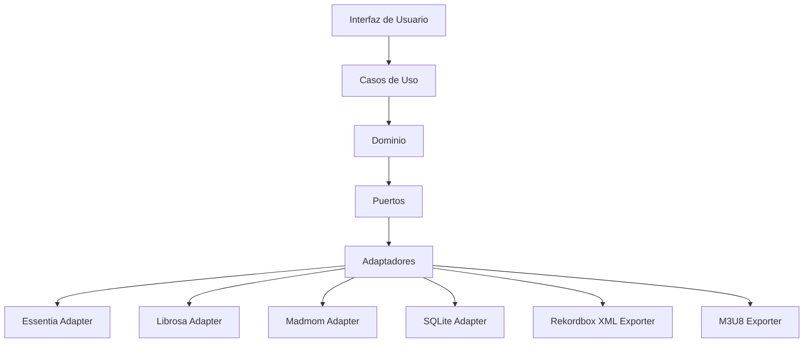

# Arquitectura de SetlistGen

## Descripción

Este directorio contiene la documentación arquitectónica de SetlistGen y los registros de decisiones arquitectónicas (ADR) del proyecto.

La arquitectura propuesta proporciona una base desacoplada, mantenible y extensible para una herramienta capaz de analizar bibliotecas musicales, generar automáticamente setlists compatibles con técnicas de mezcla armónica y exportar el resultado para su uso en Rekordbox.

---

# Visión General

SetlistGen es una aplicación de escritorio desarrollada en Python que permite generar automáticamente setlists para DJs a partir de una biblioteca musical local.

El sistema:

- Importa bibliotecas musicales locales.
- Analiza BPM y tonalidad.
- Calcula compatibilidad armónica mediante la rueda Camelot.
- Almacena resultados de análisis.
- Genera setlists mediante restricciones.
- Exporta playlists compatibles con Rekordbox.

---

# Stack Tecnológico

## Lenguaje principal

```text
Python
```

### Motivos

- Excelente ecosistema para procesamiento de audio.
- Compatibilidad con Librosa.
- Compatibilidad con Madmom.
- Bindings oficiales para Essentia.
- Integración sencilla con SQLite.
- Desarrollo rápido y mantenible.

---

## Persistencia

```text
SQLite
```

---

## Análisis Musical

```text
Essentia
Librosa
Madmom
```

---

## Exportación

```text
XML Rekordbox
M3U8
```

---

# Decisiones Arquitectónicas

## ADR-001: Forma de Distribución

### Decisión

Aplicación de escritorio.

### Motivación

- Acceso directo a bibliotecas musicales locales.
- Funcionamiento offline.
- Instalación sencilla.
- Integración natural con herramientas de análisis musical.

---

## ADR-002: Arquitectura General

### Decisión

Clean Architecture.

### Motivación

Separar la lógica de negocio de las tecnologías específicas.

Permitir sustituir:

- Librerías MIR.
- Base de datos.
- Exportadores.
- Interfaz gráfica.

sin afectar a la lógica del sistema.

---

## ADR-003: Motor de Análisis Musical

### Decisión

Arquitectura desacoplada mediante puertos y adaptadores.

### Librerías evaluadas

- Essentia
- Librosa
- Madmom

### Estrategia

Essentia será el motor principal de análisis.

Librosa y Madmom permanecerán disponibles para:

- Validación.
- Comparación de resultados.
- Sustitución futura.
- Pruebas de concepto.

### Uso previsto de cada librería

| Funcionalidad | Librería |
|--------------|----------|
| Lectura de audio | Librosa |
| STFT | Librosa |
| Espectrogramas | Librosa |
| Cromagramas | Librosa / Essentia |
| BPM | Essentia |
| Tonalidad | Essentia |
| Beat Tracking | Madmom |
| Validación de resultados | Essentia + Librosa + Madmom |

---

## ADR-004: Persistencia

### Decisión

SQLite.

### Motivación

- Integración nativa con Python.
- Sin instalación adicional.
- Un único fichero.
- Excelente portabilidad.
- Administración prácticamente nula.

---

## ADR-005: Generación de Setlists

### Decisión

Constraint Satisfaction Problem (CSP).

### Restricciones

- Rango BPM.
- Compatibilidad Camelot.
- Duración objetivo.
- Géneros.
- Pistas ancladas.
- No repetición de pistas.

### Ventajas

- Cumplimiento explícito de restricciones.
- Resultados reproducibles.
- Detección de configuraciones inviables.

---

## ADR-006: Integración con Rekordbox

### Decisión

- XML Rekordbox como formato principal.
- M3U8 como formato complementario.

### Restricciones

No se modificará directamente la base de datos interna de Rekordbox.

---

# Arquitectura General



---

# Modelo de Dominio

```mermaid
classDiagram

    class Library {
        tracks
        statistics
    }

    class Track {
        id
        title
        artist
        genre
        bpm
        key
        camelot
    }

    class AnalysisResult {
        bpm
        musical_key
        camelot
    }

    class Setlist {
        tracks
        duration
        constraints
    }

    Library "1" --> "*" Track
    Track "1" --> "1"*AnalysisResult*    Setlist "*" --> "*" Track
```

---

# Motor de Análi*is Musical

*``mermaid
flowchart TD

    TRACK*Track]

    PORT[AnalysisEngine*

    TRACK --> PORT

    PORT -->*ESS[Ess*ntia]
    PORT --> LIB[Librosa*
    PORT --> MAD[Madmom]

    ESS*--> BPM[BPM]
    ESS*--> KEY*Tonalidad]

    LIB --> STFT[*TFT]
    LIB --> CHROMA[C*omagramas]

    MAD --> BEAT[*eat Tracking]

    BPM --> CAM[Cam*l*t]
    KEY --> CAM
```

*--

# Gener*dor de Setlists

```mermaid
flowch*rt TD

    LIBRARY*Biblioteca]

    BPM[BPM válido*
    KEY[Compatibilidad Camelot]
 *  GEN*E[Géneros]
    DURATION[Dur*ción]
    ANCHORS[Pistas ancl*das]

    LIBRARY --> CSP[CSP Solv*r*

    BPM --> CSP
    KEY --> CSP*    GENRE --> CSP
    DURATION*--> CSP
    ANCHORS --> CSP

*   CSP --> VALID[Setlist válido*

    VALID --> EXPORT[Exportación*
```

*--

# Flujo Principal del Sistema
*```mermaid
flowchart LR

    AUDIO*Bibli*teca Musical]

    IMPORT[Importac*ón]

    ANALYSIS[Análisis Musical*

    DB[(SQLite)]

    CSP[Genera*or CSP*

    SETLIST[Setlist]

    XML[XM* Rekordbox]

    M3U8[M*U8]

    RB[Rekord*ox]

    AUDIO --> IMPORT
    IMPO*T -->*ANALYSIS
    ANALYSIS --> DB

   *DB --> CSP

    CSP --> SETLIST

*   SETLIST --> XML
   *SETLIST --> M3U8

    XML*--> RB
```

---

# Integración Com*le*a

```mermaid
flowchart LR

    AU*IO[Audio MP3 WAV*FLAC AIFF]

    IMPORT[Importador*

    ESS[Essentia*

    LIB[Librosa]

    MAD[Mad*om]

    SQLITE[(SQLite)]

    CSP*C*P Generator]

    XML[Rekordbox*XML]

    M3U8[M3U*]

    RB[Rekordbox*

    AUDIO --> IMPORT

    IMPORT*--> ESS
*   IMPORT --> LIB
    IMPORT --> M*D

*   ESS --> SQLITE
    LIB --> SQLI*E
    MAD --> SQLITE

    SQLITE -*> CSP

    CSP --> XML
    CSP -->*M3U8

    XML --> RB
```

*--

# Directorio de ADRs

*os registros de decisiones arquite*tónicas se*encuentran en:

```text
docs/archi*ecture/ad*s/
```

ADRs actuales*

- ADR-001: Forma de Distribución*del Sistema
- ADR-002: Arquitectur**General del Sistema
- ADR-003: Mot*r de Análisis Musical
- ADR-004:*Persistencia
- ADR-005: Algorit*o de Generación de Setlists
- ADR*006: Exportación e Integración con*Rek*rdbox

---

# Estado Actual

## Co*pletado

- Decisiones arquitectóni*as principales.
* Selección del lenguaje principal.** Arquitect*ra*objetivo.
- Estrategia de persiste*cia.
- Estrategia de exportación.
* Estrategia de generación de setli*ts.

## Pendiente

- Prueba de con*epto de análisis musical.
- Diseño*detallado de entidades.
- Diseño f*sico de la base de datos.
- Implem*ntación.
- Validación frente a Rek*rdbox.
