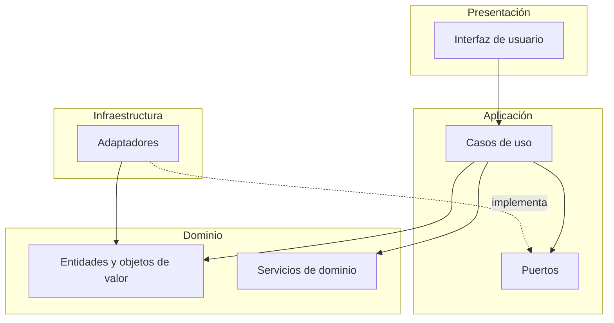

# ADR-002: Arquitectura General del Sistema

## Estado

Aceptado (revisado el 2026-10-30)

## Fecha

2026-10-28 (decisión original) · 2026-10-30 (revisión de alineación con la línea base documental)

## Requisitos relacionados

| Requisito | Relación |
|---|---|
| RNF-21 | La lógica de dominio no depende del formato de rutas del sistema operativo |
| RNF-22 | Regla de dependencia: dominio y aplicación no importan frameworks ni librerías externas |
| RNF-23 | Analizador, repositorio y exportador se acceden mediante puertos y son sustituibles |
| RNF-24 | Calidad de código: cobertura, tipado estático y análisis estático |
| RNF-25 | Procesamiento local: la arquitectura no incorpora servicios externos |
| RF-04, RF-05, RF-07 | Análisis con varios motores intercambiables |
| RF-08 a RF-11b | Persistencia tras un puerto |
| RF-21, RF-21b, RF-29b | Exportación y datos de referencia tras puertos |

Hallazgos de la auditoría atendidos: H-26 (actualizar este ADR), H-35 (modelo de dominio completo) y las incoherencias de vocabulario de puertos detectadas en la consolidación (SRS 7.0 y glosario, sección 8).

## Contexto

SetlistGen se distribuirá como una aplicación de escritorio (ADR-001) que debe:

- Importar bibliotecas musicales locales.
- Analizar archivos de audio mediante librerías especializadas, con varios motores intercambiables.
- Almacenar resultados de análisis y setlists.
- Generar secuencias de reproducción bajo restricciones.
- Exportar resultados compatibles con Rekordbox.
- Contrastar los resultados con datos de referencia de Rekordbox.
- Mantener independencia respecto a librerías concretas de análisis, persistencia o exportación.

Los requisitos no funcionales exigen mantenibilidad, facilidad de pruebas y capacidad de sustituir componentes tecnológicos sin afectar a la lógica de negocio (RNF-22, RNF-23, RNF-24).

## Problema

Determinar la arquitectura de software que permita desacoplar la lógica del dominio de las tecnologías concretas utilizadas para:

- Interfaz de usuario.
- Persistencia.
- Análisis musical.
- Lectura de metadatos.
- Exportación.
- Obtención de datos de referencia.

## Alternativas consideradas

### A1. Arquitectura en capas tradicional

Capas organizadas de forma jerárquica:

- Presentación
- Negocio
- Persistencia

#### Ventajas

- Fácil de comprender.
- Amplia documentación.
- Baja complejidad inicial.

#### Inconvenientes

- Dependencia fuerte de la persistencia.
- Dificulta sustituir adaptadores.
- Menor facilidad para pruebas aisladas.

---

### A2. Arquitectura Limpia (Clean Architecture)

Organización basada en:

- Dominio
- Casos de uso
- Puertos
- Adaptadores
- Interfaz

#### Ventajas

- Independencia tecnológica.
- Alta mantenibilidad.
- Alta testabilidad.
- Facilita sustituir motores MIR, bases de datos y exportadores.
- Encaja con la naturaleza experimental del proyecto.

#### Inconvenientes

- Mayor complejidad inicial.
- Más clases e interfaces.

---

### A3. Arquitectura Hexagonal

Modelo basado en puertos y adaptadores.

#### Ventajas

- Muy desacoplada.
- Excelente para pruebas.

#### Inconvenientes

- Mayor esfuerzo de diseño.
- Diferencias conceptuales reducidas respecto a Clean Architecture para este proyecto.

---

### A4. Monolito sin separación formal

Organización libre del código.

#### Ventajas

- Desarrollo inicial rápido.

#### Inconvenientes

- Alto acoplamiento.
- Baja mantenibilidad.
- Difícil evolución.

---

## Criterios de evaluación

| Criterio | Peso |
|-----------|------:|
| Separación de responsabilidades | 5 |
| Testabilidad | 5 |
| Mantenibilidad | 5 |
| Independencia tecnológica | 5 |
| Escalabilidad | 3 |
| Complejidad de implementación | 2 |

### Escala de valoración

| Valor | Significado |
|--------|-------------|
| 1 | Muy deficiente |
| 2 | Deficiente |
| 3 | Aceptable |
| 4 | Bueno |
| 5 | Excelente |

### Método de cálculo

Puntuación ponderada:

```text
Puntuación ponderada = Valoración × Peso
```

Puntuación total:

```text
Total = Σ (Valoración × Peso)
```

---

## Evaluación de alternativas

### Arquitectura en capas

| Criterio | Peso | Valoración | Resultado |
|-----------|------:|-----------:|----------:|
| Separación | 5 | 3 | 15 |
| Testabilidad | 5 | 3 | 15 |
| Mantenibilidad | 5 | 3 | 15 |
| Independencia tecnológica | 5 | 2 | 10 |
| Escalabilidad | 3 | 3 | 9 |
| Complejidad | 2 | 5 | 10 |

**Total: 74**

### Clean Architecture

| Criterio | Peso | Valoración | Resultado |
|-----------|------:|-----------:|----------:|
| Separación | 5 | 5 | 25 |
| Testabilidad | 5 | 5 | 25 |
| Mantenibilidad | 5 | 5 | 25 |
| Independencia tecnológica | 5 | 5 | 25 |
| Escalabilidad | 3 | 4 | 12 |
| Complejidad | 2 | 3 | 6 |

**Total: 118**

### Arquitectura Hexagonal

| Criterio | Peso | Valoración | Resultado |
|-----------|------:|-----------:|----------:|
| Separación | 5 | 5 | 25 |
| Testabilidad | 5 | 5 | 25 |
| Mantenibilidad | 5 | 4 | 20 |
| Independencia tecnológica | 5 | 5 | 25 |
| Escalabilidad | 3 | 4 | 12 |
| Complejidad | 2 | 2 | 4 |

**Total: 111**

### Monolito tradicional

| Criterio | Peso | Valoración | Resultado |
|-----------|------:|-----------:|----------:|
| Separación | 5 | 1 | 5 |
| Testabilidad | 5 | 1 | 5 |
| Mantenibilidad | 5 | 1 | 5 |
| Independencia tecnológica | 5 | 1 | 5 |
| Escalabilidad | 3 | 2 | 6 |
| Complejidad | 2 | 5 | 10 |

**Total: 36**

Los cuatro totales se han verificado y no se modifican en esta revisión.

---

## Decisión

Se adopta una arquitectura basada en los principios de **Clean Architecture**. Los límites con las tecnologías externas (análisis, metadatos, persistencia, exportación, datos de referencia e identificación de pistas) se implementan mediante **puertos y adaptadores**.

Las alternativas A2 y A3 son compatibles entre sí. La diferencia de puntuación entre ambas (118 frente a 111) es reducida y se debe a la complejidad percibida. El proyecto adopta la organización en capas de A2 y el mecanismo de puertos y adaptadores de A3.

## Justificación

La solución permite separar de forma clara:

- La lógica de negocio.
- Los casos de uso.
- La persistencia.
- El análisis musical.
- La exportación.
- La interfaz de usuario.

Esta decisión facilita sustituir tecnologías concretas sin modificar las reglas de negocio del sistema.

Resulta especialmente adecuada para un proyecto en el que varias decisiones técnicas siguen abiertas y deberán validarse mediante pruebas de concepto: la librería de análisis (ADR-003), la estrategia de identificación de pistas (ADR-010) y los detalles de la interfaz (ADR-008).

## Arquitectura prevista

### Capas y dependencias

Las dependencias apuntan siempre hacia el dominio. Los puertos pertenecen a la capa de Aplicación, que los define, y los adaptadores de Infraestructura los implementan.



El ensamblado de los adaptadores con los casos de uso (composición de dependencias) se realiza en el punto de entrada de la aplicación, fuera del dominio y de la aplicación.

### Reglas de dependencia

| Capa | Puede importar | No puede importar |
|---|---|---|
| Dominio | Biblioteca estándar | Aplicación, infraestructura, presentación, librerías de audio, de base de datos o de interfaz |
| Aplicación | Dominio | Infraestructura, presentación, librerías externas |
| Infraestructura | Aplicación, dominio, librerías externas | Presentación |
| Presentación | Aplicación, dominio (solo para mostrar) | Infraestructura |

La comprobación de estas reglas es automática en integración continua (RNF-22, T-ARQ-01).

### Dominio

Entidades y objetos de valor previstos (el modelo definitivo se diseña en `data-model.md` y depende de OD-03 a OD-07):

- **Entidades:** `Track`, `TrackLocation`, `TrackMetadata`, `AnalysisRun`, `AnalysisResult`, `GenerationRequest`, `Setlist`, `ReferenceMeasurement`, `EvaluationReport` y, según OD-05 y OD-06, `Library` y `Transition`.
- **Objetos de valor:** `CamelotKey` (RF-06) y los valores asociados a BPM, tonalidad y duración.
- **Servicios de dominio:** compatibilidad armónica según la política armónica (RF-14), evaluación de transiciones (RF-17, RF-20) y validación de setlists (RF-18, RNF-10). El resolutor de restricciones reside en el dominio si es propio, o tras un puerto si es una librería externa (ADR-005).

### Puertos

Vocabulario canónico, común al SRS (sección 7.0) y al glosario (sección 8). Sustituye a los nombres de la versión 1.0 de este ADR (`AnalysisEngine` y `Exporter`).

| Puerto | Responsabilidad | Adaptadores previstos | Requisitos | Estado |
|---|---|---|---|---|
| `LibraryScanner` | Recorrer carpetas y filtrar formatos | Adaptador de sistema de archivos | RF-01, RF-02 | Previsto |
| `MetadataReader` | Leer etiquetas de los ficheros | Basado en Mutagen (candidato) | RF-03 | Previsto |
| `AudioAnalyzer` | Estimar BPM y tonalidad | `EssentiaAdapter`, `LibrosaAdapter`, `MadmomAdapter` | RF-04, RF-05, RF-07 | Previsto (ADR-003) |
| `TrackIdentifier` | Reconocer una pista aunque cambie de nombre o ubicación | Según ADR-010 | RF-09, RF-09b, RF-09c | **[PROPUESTA · OD-03]** |
| `TrackRepository` | Persistir pistas, ubicaciones y resultados de análisis | `SQLiteTrackRepository` | RF-07 a RF-11b | Previsto (ADR-004) |
| `SetlistRepository` | Persistir setlists, solicitudes y su histórico | `SQLiteSetlistRepository` | RF-10 | Previsto (ADR-004) |
| `StatisticsRepository` | Consultas agregadas para el panel | `SQLiteStatisticsRepository` | RF-24 a RF-27 | Previsto |
| `EvaluationRepository` | Persistir valores de referencia de Rekordbox e informes de evaluación | `SQLiteEvaluationRepository` | RF-29, RF-29b | **[PROPUESTA]** |
| `SetlistExporter` | Exportar setlists | `RekordboxXmlExporter`, `M3u8Exporter` | RF-21, RF-21b, RF-22 | Previsto (ADR-006) |
| `ReferenceDataProvider` | Obtener valores de referencia de Rekordbox | Lector de XML de colección, lector de CSV | RF-29b | Previsto |

Observaciones:

- La exportación de datos del panel (RF-28) puede reutilizar un puerto de exportación o definir uno propio. Se decide en el diseño del panel.
- No se define un puerto para el resolutor de restricciones salvo que se adopte una librería externa (ADR-005).
- No se prevé ningún adaptador de PostgreSQL. La sustituibilidad de la persistencia se mantiene gracias a los puertos de repositorio, pero ADR-004 adopta SQLite como única tecnología.

### Estructura de adaptadores

```text
Puertos (en Aplicación)
│
├── LibraryScanner ········· Adaptador de sistema de archivos
├── MetadataReader ········· Adaptador de etiquetas
├── AudioAnalyzer
│   ├── EssentiaAdapter
│   ├── LibrosaAdapter
│   └── MadmomAdapter
├── TrackIdentifier ········ Según ADR-010 (OD-03)
├── TrackRepository ········ SQLiteTrackRepository
├── SetlistRepository ······ SQLiteSetlistRepository
├── StatisticsRepository ··· SQLiteStatisticsRepository
├── EvaluationRepository ··· SQLiteEvaluationRepository (propuesta)
├── SetlistExporter
│   ├── RekordboxXmlExporter
│   └── M3u8Exporter
└── ReferenceDataProvider
    ├── Lector de XML de colección
    └── Lector de CSV
```

## Consecuencias

### Positivas

- Alta mantenibilidad.
- Alta testabilidad: los puertos se sustituyen por dobles en memoria en las pruebas unitarias.
- Independencia tecnológica.
- Sustitución sencilla de componentes (RNF-23).
- Evolución controlada del sistema.
- Varios motores de análisis conviven y se comparan sin modificar la lógica de negocio (RF-07, RF-29).

### Negativas

- Mayor complejidad inicial.
- Mayor número de clases e interfaces.
- Necesidad de definir contratos explícitos entre capas.
- Coste de convertir entre entidades de dominio y registros de base de datos.
- Riesgo de sobreingeniería. Se mitiga definiendo puertos solo para las dependencias volátiles o externas de la tabla anterior, y no para elementos estables del dominio.

## Trazabilidad

| Elemento | Referencias |
|---|---|
| Requisitos no funcionales | RNF-21, RNF-22, RNF-23, RNF-24, RNF-25 |
| Requisitos funcionales | RF-01 a RF-11b, RF-21, RF-21b, RF-29b |
| Componentes | Todos (CMP-01 a CMP-09) |
| Casos de prueba | T-ARQ-01 (regla de dependencia), T-ARQ-02 (sustituibilidad), T-ARQ-03 (calidad de código), T-ARQ-09 (independencia de rutas) |
| Decisiones abiertas | OD-03, OD-05, OD-06, OD-07 (afectan al dominio y a los puertos) |

## Evidencias utilizadas

- Requisitos de mantenibilidad y sustituibilidad (RNF-22, RNF-23, RNF-24).
- Necesidad de evaluar distintas librerías MIR y compararlas con la referencia de Rekordbox (RF-07, RF-29).
- Necesidad de mantener abiertas decisiones tecnológicas posteriores (ADR-003, ADR-008, ADR-010).
- Incoherencias de vocabulario de puertos entre ADR-002, ADR-003, el SRS y el glosario.
- Hallazgos H-26 y H-35 de la auditoría técnica.

## Impacto en el proyecto

- Fija el vocabulario canónico de puertos que deben adoptar ADR-003, ADR-004, ADR-005, ADR-006 y el modelo de datos.
- Obliga a definir los puertos antes de implementar los adaptadores.
- Introduce comprobaciones automáticas de dependencias en integración continua (RNF-22).
- El dominio se modelará sin conocer SQLite, las librerías de audio ni el formato de Rekordbox, lo que condiciona el diseño de `data-model.md`.

## Impacto en la memoria

Guardar este contenido para la memoria del TFG.

- **Capítulo 4, sección 4.6:** la arquitectura deja de figurar como decisión abierta.
- **Capítulo 6, secciones 6.1 y 6.2:** arquitectura del sistema, capas, reglas de dependencia, catálogo de puertos y diagrama de dependencias.
- **Capítulo 7, sección 7.2:** estructura del código a partir de las capas y los puertos.
- **Apéndice B, sección B.2:** incluir este ADR en el registro de decisiones arquitectónicas.

Bloque reutilizable:

- **Contexto:** un sistema local que combina análisis de audio, persistencia, generación con restricciones y exportación, con tecnologías sujetas a prueba de concepto.
- **Problema:** aislar la lógica de negocio de las tecnologías concretas.
- **Alternativas:** arquitectura en capas, Clean Architecture, hexagonal y monolito.
- **Solución adoptada:** Clean Architecture, con puertos y adaptadores en los límites externos.
- **Justificación:** mayor puntuación (118 frente a 111, 74 y 36) y encaje con un proyecto con decisiones tecnológicas aún abiertas.
- **Ventajas:** testabilidad, sustituibilidad de motores, repositorios y exportadores, y evolución controlada.
- **Limitaciones:** más interfaces y conversiones entre capas, y riesgo de sobreingeniería.
- **Impacto:** condiciona el diseño del dominio y del modelo de datos, y exige comprobar la regla de dependencia en integración continua.

## Decisiones relacionadas

- ADR-001: Forma de Distribución del Sistema.
- ADR-003: Motor de Análisis Musical.
- ADR-004: Persistencia.
- ADR-005: Algoritmo de Generación de Setlists.
- ADR-006: Exportación e Integración con Rekordbox.
- ADR-007: Licencias y compatibilidad legal (propuesto).
- ADR-008: Lenguaje, interfaz gráfica y empaquetado (propuesto).
- ADR-009: Dataset y protocolo de evaluación (propuesto).
- ADR-010: Identificación permanente de pistas (propuesto, OD-03).

## Cambios respecto a la versión original (2026-10-28)

| Cambio | Motivo |
|---|---|
| Vocabulario canónico de puertos: `AudioAnalyzer` y `SetlistExporter` en lugar de `AnalysisEngine` y `Exporter` | Unificación con SRS 7.0 y glosario |
| Añadidos `LibraryScanner`, `MetadataReader`, `StatisticsRepository`, `EvaluationRepository` (propuesta), `ReferenceDataProvider` y `TrackIdentifier` | Puertos citados en el SRS y no recogidos en este ADR |
| Puertos ubicados en la capa de Aplicación; diagrama de dependencias corregido | El diagrama anterior mostraba una capa de puertos independiente y, en el README de arquitectura, una flecha del dominio a los puertos que invertía la regla de dependencia |
| Eliminado `PostgreSQLAdapter` | H-26 y ADR-004 |
| Añadido `MadmomAdapter` | ADR-003 |
| `RekordboxExporter` dividido en `RekordboxXmlExporter` y `M3u8Exporter` | RF-21 y RF-21b |
| Decisión aclarada: capas de A2 y puertos y adaptadores de A3 | Compatibilidad entre ambas alternativas |
| Añadidas reglas de dependencia verificables, entidades previstas, trazabilidad e impactos | Formato obligatorio de ADR y RNF-22 |

Las puntuaciones y los totales no se modifican.
