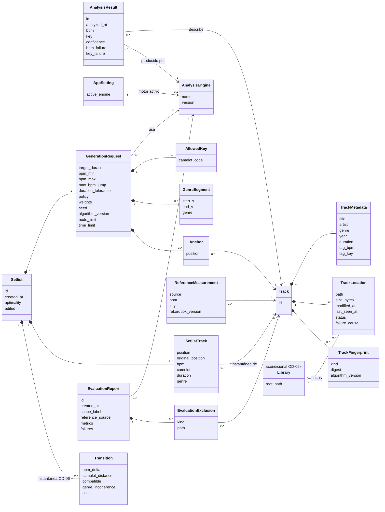

# Modelo Conceptual de SetlistGen (versión provisional)

> Destino en el repositorio: `docs/architecture/conceptual-model.md`. Paso 3 del plan. Parte de `domain-model.md` v0.2 y precede al MER.

**Versión:** 0.1 (provisional) · **Fecha:** 2026-11-07 · **Estado:** pendiente de validación por tutor y cotutor

> Es un modelo de **qué se persiste y cómo se relaciona**, no de tablas. Todo lo marcado **[SUPUESTO · OD-xx]** o **[PROPUESTA]** puede cambiar. No se congela hasta validar OD-03 a OD-07.

# 1. Diagrama

# 2. Entidades

| Entidad | Origen en el dominio | Identidad | Dependencia |
|---|---|---|---|
| `Track` | Raíz de Catálogo | `id` interno, independiente de la ruta | OD-03 |
| `TrackMetadata` | VO 1:1 con `Track` | Compartida con la pista | OD-07 |
| `TrackLocation` | Entidad de Catálogo | (pista, ruta normalizada) | OD-03, OD-05 |
| `TrackFingerprint` | VO de `Track` | (pista, tipo, versión de algoritmo) | OD-03 |
| `AnalysisEngine` | `EngineRef` promovido a entidad **[PROPUESTA]** | (nombre, versión) | OD-04 |
| `AnalysisResult` | Raíz de Análisis | (pista, motor), previsto único | OD-04 |
| `AppSetting` | Configuración de aplicación, fuera del dominio | Clave | OD-04 |
| `GenerationRequest` | VO dentro de `Setlist` | Compartida con el setlist (1:1) | OD-07 |
| `AllowedKey`, `GenreSegment`, `Anchor` | Colecciones de la solicitud | (solicitud, valor o posición) | RF-14 a RF-16 |
| `Setlist` | Raíz de Generación | `id` | — |
| `SetlistTrack` | Entidad con instantánea | (setlist, posición) | OD-06 |
| `Transition` | VO calculado, guardado como instantánea | (setlist, posición de origen) | **OD-06** |
| `ReferenceMeasurement` | Raíz de Evaluación | (pista, fuente, versión de Rekordbox) | OD-01 |
| `EvaluationReport` | Raíz de Evaluación | `id` | OD-01 |
| `EvaluationExclusion` | Listas de exclusión del informe **[PROPUESTA]** | (informe, orden) | OD-07 |
| `Library` | Ausente del dominio v0.2 | — | **OD-05** |

# 3. Decisiones conceptuales que condicionan el MER

| ID | Cuestión | Propuesta | Alternativa |
|---|---|---|---|
| CM-01 | `EngineRef` como entidad o como dos columnas repetidas | Entidad `AnalysisEngine`: evita repetir y permite consultar por motor activo (DM-02) | Columnas `engine_name` y `engine_version` en cada tabla |
| CM-02 | `TrackMetadata` como entidad 1:1 o columnas de `Track` | Mantener separada: las etiquetas cambian y no son identidad | Fusionar: menos uniones |
| CM-03 | Resultado indivisible: BPM y tonalidad con su fallo en la misma fila | Sí, una fila por (pista, motor). Fallo como columna de causa nula o no | Descriptores en filas separadas |
| CM-04 | `GenerationRequest` 1:1 con `Setlist` | Separada por claridad, con clave compartida | Fusionar en `Setlist` |
| CM-05 | Pesos, política armónica y `allowed_keys` | Columnas simples para pesos y política; `AllowedKey` como tabla hija | JSON: menos integridad |
| CM-06 | Métricas del informe | Columnas de conteo (aciertos y total por métrica) y tabla hija para errores por tipo | Una fila por pista evaluada: más trazabilidad, más volumen |
| CM-07 | `ReferenceMeasurement` frente a `ReferenceRecord` | Persistir solo la asociada; las huérfanas y ambiguas viven en `EvaluationExclusion` | Persistir también las sin pista |
| CM-08 | Referencia de `SetlistTrack` a `Track` | Clave foránea: una pista no se borra nunca, se marca ausente (RF-09c) | Sin clave |
| CM-09 | Una pista sin ubicación activa | Estado de la ubicación, nunca borrado de fila | — |
| CM-10 | `Library` | Hasta resolver OD-05, no entra; si entra, solo agrupa `TrackLocation` | — |

# 4. Mapa de dependencias con las decisiones abiertas

| OD | Entidades afectadas | Efecto si cambia |
|---|---|---|
| OD-03 | `Track`, `TrackLocation`, `TrackFingerprint` | Huellas por ubicación: otra clave en `TrackFingerprint` |
| OD-04 | `AnalysisResult`, `AnalysisEngine`, `AppSetting` | Un resultado por pista: desaparece la clave del motor |
| OD-05 | `Library`, `TrackLocation` | Nueva tabla y una clave foránea más |
| OD-06 | `Transition`, `SetlistTrack` | Se elimina la tabla de transiciones y la instantánea |
| OD-07 | Todas | Reajuste de nombres y fronteras |

# 5. Siguiente paso

Validar CM-01 a CM-10 y pasar al **MER** (paso 4), con cardinalidades, claves candidatas y atributos tipados de forma lógica, todavía sin SQL.
