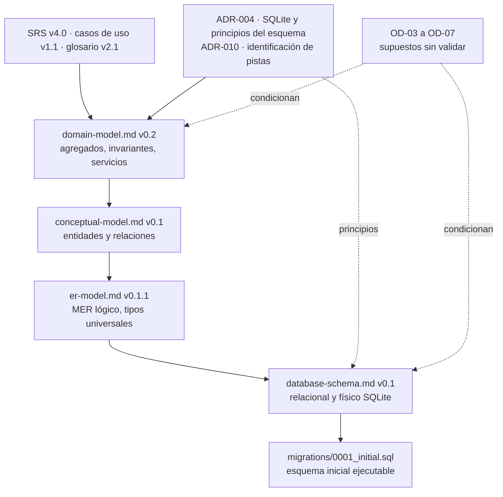

# Modelo de Datos de SetlistGen: índice maestro

> Destino en el repositorio: `docs/architecture/data-model.md`. Resuelve el hallazgo N-46: este documento es el **índice** del diseño de datos y lo que ADR-004 llama `data-model.md`. El detalle vive en cuatro documentos enlazados.

**Versión:** 1.0 (índice) · **Fecha:** 2026-11-14 · **Estado:** diseño **provisional**, pendiente de validación por tutor y cotutor
**Alineado con:** SRS v4.0, casos de uso v1.1, glosario v2.1, ADR-004 y ADR-010, `open-decisions.md` v3.1.

> Todo el diseño parte de supuestos sobre OD-03 a OD-07 que **ningún tutor ha validado**. La persistencia **no se considera cerrada** (ADR-004, riesgo R-13) hasta que se validen y se apruebe `database-schema.md`.

---

# 1. Qué contiene la serie

El diseño de datos se reparte en cuatro niveles. Cada nivel parte del anterior y no lo contradice.

| Nivel | Documento | Responde a | Versión | Estado |
|---|---|---|---|---|
| 1. Dominio | [`domain-model.md`](domain-model.md) | Qué reglas y agregados tiene el negocio, con independencia de la tecnología | 0.2 | Provisional. Código ejecutable de especificación |
| 2. Conceptual | [`conceptual-model.md`](conceptual-model.md) | Qué se persiste y cómo se relaciona | 0.1 | Provisional. CM-01 a CM-10 aprobadas por el autor |
| 3. MER | [`er-model.md`](er-model.md) | Tablas, claves, cardinalidades y tipos lógicos | 0.1.1 | Provisional. M-01 a M-07 resueltas |
| 4. Relacional y físico | [`database-schema.md`](database-schema.md) | Esquemas formales, formas normales y DDL de SQLite | 0.1 | Provisional. Verificado en SQLite 3.45.1 |
| Artefacto ejecutable | `src/setlistgen/infrastructure/persistence/migrations/0001_initial.sql` | El esquema inicial | 1 | Provisional |

Si hay discrepancia entre niveles, prevalece el nivel **inferior en número** (el dominio manda sobre la base de datos) y se corrige el superior.

# 2. Resumen por nivel

- **Dominio.** Cuatro agregados (Catálogo, Análisis, Generación, Evaluación) que se referencian solo por identidad. Ocho servicios de dominio sin estado, un contrato para el resolutor (`SetlistGenerator`) y 18 invariantes (IN-01 a IN-18). Solo biblioteca estándar de Python (RNF-22).
- **Conceptual.** Entidades persistentes y su relación. Promueve `EngineRef` a entidad (`AnalysisEngine`) y deja `Library` fuera hasta resolver OD-05.
- **MER.** 19 tablas y `LIBRARY` condicional. Las colecciones de la solicitud de generación pasan a tablas hijas, y `SETLIST_TRACK` y `TRANSITION` guardan instantáneas.
- **Esquema físico.** 20 tablas `STRICT` (19 del MER más `schema_migration`), con `CHECK` para enumeraciones e invariantes de fila, índice único parcial para la ruta vigente y columna generada para el código Camelot.

# 3. Del dominio a la tabla

| Concepto del dominio | Entidad conceptual | Tabla (MER y SQLite) | Observación |
|---|---|---|---|
| `Track` | `Track` | `track` | Identidad pura |
| `TrackMetadata` (VO) | `TrackMetadata` | `track_metadata` | 1:1 con la pista |
| `TrackLocation` | `TrackLocation` | `track_location` | Índice único parcial sobre la ruta vigente (M-01) |
| `TrackFingerprint` (VO) | `TrackFingerprint` | `track_fingerprint` | Clave (pista, tipo, versión) |
| `EngineRef` (VO) | `AnalysisEngine` | `analysis_engine` | Y la configuración `app_setting` (motor activo) |
| `AnalysisResult` | `AnalysisResult` | `analysis_result` | `camelot_code` generado y almacenado |
| `Setlist` | `Setlist` | `setlist` | |
| `GenerationRequest` y colecciones | `GenerationRequest` y tablas hijas | `generation_request`, `request_harmonic_move`, `allowed_key`, `genre_segment`, `anchor` | 1:1 con el setlist |
| `SetlistTrack` | `SetlistTrack` | `setlist_track` | Instantánea (OD-06) |
| `Transition` (VO) | `Transition` | `transition` | Instantánea; origen y destino implícitos |
| `ReferenceMeasurement` | `ReferenceMeasurement` | `reference_measurement` | `'unknown'` si no hay versión de Rekordbox |
| `EvaluationReport`, `ProportionMetric` | `EvaluationReport` | `evaluation_report`, `evaluation_error_count` | Conteos y desglose |
| `ReferenceRecord`, `ReferenceMatchResult` | `EvaluationExclusion` | `evaluation_exclusion` | Solo las listas de exclusión |
| `RecognitionOutcome`, `ValidationReport`, `GenerationOutcome`, `CandidateSelection` | — | **No se persisten** | Resultados transitorios de una operación |
| `Library` | `Library` (condicional) | Migración 2 pendiente | OD-05 |

# 4. Supuestos provisionales y coste de cambiarlos

| OD | Supuesto aplicado en toda la serie | Si los tutores lo rechazan |
|---|---|---|
| **OD-03** | Identificación en dos niveles. Huellas por pista, con tipo y versión | Medio. Mover la huella rápida a `track_location` (migración con copia de datos) y revisar `TrackIndex` |
| **OD-04** | Varios `AnalysisResult` indivisibles por pista y motor activo fuera del dominio | **Alto.** Cambia la unicidad de `analysis_result`, desaparece `analysis_engine` o `app_setting` y se revisa el flujo de evaluación |
| **OD-05** | `Library` no modelada | Bajo. La migración 2 está preparada (`migrations/pending/`) |
| **OD-06** | Instantánea de descriptores y transiciones, recalculada al editar | Medio. Eliminar `transition` y las columnas de instantánea de `setlist_track` |
| **OD-07** | Entidades de `domain-model.md`. Solicitud dentro del setlist; `TrackMetadata` como VO | Medio a alto según la entidad |

Las migraciones versionadas (RNF-27) acotan el coste: un cambio de supuesto se traduce en una migración y no en reconstruir la base.

# 5. Coherencia con ADR-004

Principios del esquema de ADR-004 y dónde se cumplen:

| Principio de ADR-004 | Requisito | Dónde |
|---|---|---|
| Clave de pista independiente de la ruta | RF-09 | `track.track_id` (UUID) |
| Ubicaciones aparte, con estado; una ausente se marca, no se borra | RF-09c | `track_location.status`; borrado de pista restringido |
| Un resultado identifica motor y versión | RF-07 | `analysis_result.engine_id` → `analysis_engine` |
| Índice de reconocimiento de pistas conocidas | RNF-04 | `ix_fingerprint_lookup`, `ix_track_location_path` |
| Consultas por BPM, tonalidad, género, año y duración, sobre el motor activo | RF-11, RF-11b | `ix_analysis_result_engine_*`, `ix_track_metadata_*` |
| Setlist con su solicitud y semilla | RF-10, RNF-11 | `generation_request` 1:1 con `setlist` |
| Escritura atómica por pista y lote; claves foráneas activas | RNF-17 | Transacciones del repositorio y `PRAGMA foreign_keys = ON` |
| Rutas como texto Unicode; conversión en infraestructura | RNF-16, RNF-21 | `track_location.path` |
| Migraciones versionadas | RNF-27 | `schema_migration`, `migrations/` |
| Un único fichero local | RNF-20, RNF-25 | Fichero SQLite. En modo `WAL` aparecen ficheros auxiliares (copia con la API de copia de seguridad) |
| Sin acceso a la base de datos de Rekordbox | SRS 2.5 | Ninguna tabla ni adaptador la usa |
| Único escritor simultáneo | ADR-004 | Un coordinador persiste los resultados (diseño de infraestructura pendiente, H-37) |

## Cambio propuesto en ADR-004 (no aplicado)

ADR-004 remite a `data-model.md` para el esquema y condiciona el cierre de la persistencia a ese documento. Con esta serie propongo dos cambios mínimos en su sección **Decisión** y en **Impacto en el proyecto**:

- Donde dice "El esquema, las claves, los índices y las migraciones se definen en `data-model.md`", escribir: "...se definen en `database-schema.md`, y el índice de la serie es `data-model.md`".
- Donde dice "Hasta que ese documento exista y esté validado, la persistencia se considera no cerrada", escribir: "Hasta que OD-03 a OD-07 estén validadas y `database-schema.md` esté aprobado, la persistencia se considera no cerrada".

Ambos cambios solo precisan el entregable y el criterio de cierre; no modifican la decisión (SQLite).

# 6. Cómo mantener la serie

Orden de actualización ante un cambio: dominio → conceptual → MER → esquema → migración. Una OD validada o rechazada exige:

1. Actualizar el supuesto en `domain-model.md` (sección de supuestos) y la versión.
2. Propagar el cambio a los niveles inferiores.
3. Si el esquema ya se aplicó, **añadir una migración**; nunca editar una aplicada.
4. Actualizar la tabla de la sección 4 y el control de cambios de este documento.
5. Registrar el hallazgo en `audit-review.md` y ejecutar las comprobaciones documentales (`scripts/`).

# 7. Hallazgos abiertos de la serie

Resumen de los que condicionan el diseño de datos. El detalle está en cada documento.

| ID | Gravedad | Asunto | Documento |
|---|---|---|---|
| N-36 | Media | Coste real del nivel 1b (lectura de ficheros) sin medir | `domain-model.md` |
| N-38 | Media | La asociación de referencias por ruta depende de la hipótesis H-17 | `domain-model.md` |
| N-40 | Media | Resolución de `modified_at` entre sistemas de ficheros | `database-schema.md` |
| N-41 | Media | Normalización de rutas ignora mayúsculas | `database-schema.md` |
| M-03 | Media | El informe de importación no se persiste | `er-model.md` |
| M-04 | Media | Un informe de evaluación no se recalcula pista a pista | `er-model.md` |

# 8. Control de cambios

| Versión | Fecha | Cambio |
|---|---|---|
| 1.0 | 2026-11-14 | Primera versión como índice maestro (resuelve N-46). Enlaza dominio v0.2, conceptual v0.1, MER v0.1.1 y esquema v0.1 |
