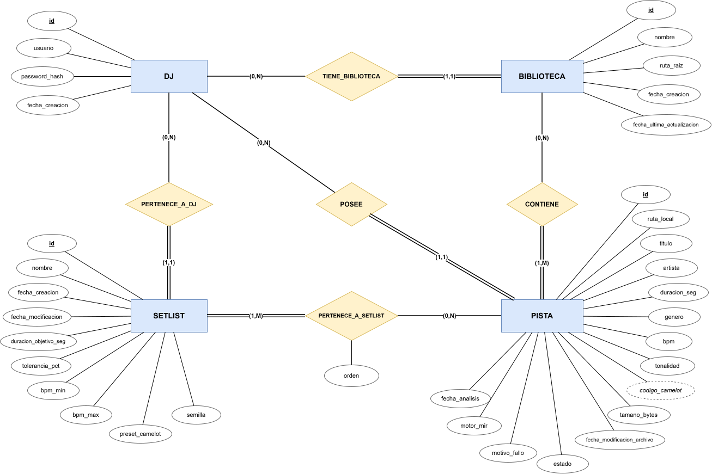

# Modelo de Datos de SetlistGen

**Versión:** 0.1 (borrador de trabajo) · **Estado:** en revisión
**Alineado con:** `requirements.md` v1.2.1, `use-cases.md` v1.2.1 y ADR-004 (SQLite)

## 1. Propósito y decisiones de diseño

Este documento especifica los datos que SetlistGen persiste, antes de su implantación física. Parte del esquema conceptual de 4 entidades y 4 relaciones acordado con el tutor y lo traduce al modelo relacional y a un esquema SQLite.

| Decisión | Detalle | Origen |
|---|---|---|
| Persistencia ligera | SQLite en un único fichero. Solo se guardan rutas locales y descriptores, nunca audio | RNF-08 |
| Aislamiento por cuenta | Cada DJ tiene sus propias bibliotecas, pistas y setlists. Una pista se identifica por `(dj_id, ruta_local)`, aunque dos cuentas registren la misma carpeta | RF-01, RNF-12 |
| Pistas nunca borradas | Una pista cuyo fichero desaparece pasa a `no_disponible`, para no romper los setlists guardados | RF-07, RF-20 |
| Pistas fallidas | Se guardan con estado `fallida` y su motivo, para no reanalizarlas mientras el fichero no cambie | RF-05, RF-06 |
| Detección de cambios | Por ruta, tamaño y fecha de modificación del fichero | RF-06, RF-07 |
| BPM decimal | `REAL` redondeado a 2 decimales por la aplicación | RF-05 |
| Setlist por referencias | Un setlist guarda referencias a pistas y su orden, sin copiar descriptores. La duración total y las transiciones se calculan | RF-19 |
| Género informativo | Se guarda, pero no interviene en la generación | RF-04 |
| Datos derivados no almacenados | El código Camelot es una columna generada a partir de la tonalidad; la duración total del setlist se calcula | 3FN |

El esquema anterior de 20 tablas queda sustituido por **6 tablas**: 4 de entidad y 2 asociativas.

## 2. Modelo Entidad-Relación (conceptual)



* **Código fuente editable (PlantUML):** [../diagrams/modelo-er.puml](../diagrams/modelo-er.puml)

### 2.1 Entidades y atributos

| Entidad | Atributos | Identificador |
|---|---|---|
| **DJ** | `id`, `usuario`, `password_hash`, `fecha_creacion` | `id`. Candidata: `usuario` |
| **Biblioteca** | `id`, `nombre`, `ruta_raiz`, `fecha_creacion`, `fecha_ultima_actualizacion` | `id` |
| **Pista** | `id`, `ruta_local`, `titulo`, `artista`, `duracion_seg`, `genero`, `bpm`, `tonalidad`, `codigo_camelot` *(derivado)*, `tamano_bytes`, `fecha_modificacion_archivo`, `estado`, `motivo_fallo` | `id`. Candidata: `(dj_id, ruta_local)` |
| **Setlist** | `id`, `nombre`, `fecha_creacion`, `fecha_modificacion`, `duracion_objetivo_seg`, `tolerancia_pct`, `bpm_min`, `bpm_max`, `preset_camelot`, `semilla` | `id`. Candidata: `(dj_id, nombre)` |

### 2.2 Relaciones, cardinalidades y participación

| Relación | Entidades | Cardinalidad | Participación | Atributos propios |
|---|---|---|---|---|
| **Tiene_Biblioteca** | DJ – Biblioteca | 1:N | DJ parcial (0..N), Biblioteca total (1..1) | — |
| **Contiene** | Biblioteca – Pista | N:M | Biblioteca parcial, Pista total (cada pista está en al menos una biblioteca) | — |
| **Pertenece_a_Setlist** | Pista – Setlist | N:M | Pista parcial (0..N), Setlist total (1..N: no se guarda un setlist vacío) | `orden` (1..N) |
| **Pertenece_a_DJ** | Setlist – DJ | N:1 | Setlist total (1..1), DJ parcial (0..N) | — |

### 2.3 Restricciones semánticas

- Una pista solo puede estar en bibliotecas y setlists del DJ al que pertenece.
- Un setlist no contiene la misma pista dos veces, y su `orden` es 1..N sin huecos.
- Una pista `fallida` no puede aparecer en un setlist.
- `bpm_min` ≤ `bpm_max`. `fecha_modificacion` ≥ `fecha_creacion`.

## 3. Paso a Modelo Relacional (lógico)


* **Código fuente editable (PlantUML):** [../diagrams/modelo-relacional.puml](../diagrams/modelo-relacional.puml)

### 3.1 Reglas de transformación aplicadas

| Elemento ER | Resultado relacional |
|---|---|
| Entidad | Una tabla, con su identificador como clave primaria |
| Relación 1:N (**Tiene_Biblioteca**, **Pertenece_a_DJ**) | Clave foránea `dj_id` en el lado N (`biblioteca`, `setlist`) |
| Relación N:M (**Contiene**) | Tabla asociativa `biblioteca_pista`, con clave primaria compuesta `(biblioteca_id, pista_id)` |
| Relación N:M con atributo (**Pertenece_a_Setlist**) | Tabla asociativa `setlist_pista`, con clave primaria compuesta `(setlist_id, pista_id)` y el atributo `orden` |
| Atributo derivado (`codigo_camelot`) | Columna generada a partir de `tonalidad` |
| Aislamiento por DJ | Clave foránea `dj_id` en `pista` y clave única `(dj_id, ruta_local)` (véase P-01) |

### 3.2 Esquemas de relación

**Clave primaria** subrayada con `*`; **FK** y **UK** indicadas.

```text
dj(*id, usuario [UK], password_hash, fecha_creacion)

biblioteca(*id, dj_id [FK→dj], nombre, ruta_raiz, fecha_creacion, fecha_ultima_actualizacion)
    UK (dj_id, ruta_raiz)

pista(*id, dj_id [FK→dj], ruta_local, titulo, artista, duracion_seg, genero, bpm, tonalidad,
      codigo_camelot [generada], tamano_bytes, fecha_modificacion_archivo, estado, motivo_fallo)
    UK (dj_id, ruta_local)

biblioteca_pista(*biblioteca_id [FK→biblioteca], *pista_id [FK→pista])

setlist(*id, dj_id [FK→dj], nombre, fecha_creacion, fecha_modificacion, duracion_objetivo_seg,
        tolerancia_pct, bpm_min, bpm_max, preset_camelot, semilla)
    UK (dj_id, nombre)

setlist_pista(*setlist_id [FK→setlist], *pista_id [FK→pista], orden)
    UK (setlist_id, orden)
```

### 3.3 Normalización

| Forma normal | Justificación |
|---|---|
| **1FN** | Todos los atributos son atómicos. No hay listas ni grupos repetidos |
| **2FN** | En las tablas asociativas, `orden` depende de la clave completa `(setlist_id, pista_id)`. `biblioteca_pista` no tiene atributos no clave |
| **3FN** | No hay dependencias transitivas entre atributos almacenados. El único caso, `tonalidad → codigo_camelot`, se resuelve con una columna generada que la base mantiene y que no puede divergir. La duración total del setlist, que se deduce de sus pistas, no se almacena |

## 4. Diccionario de datos

Tipos de SQLite. Fechas en `TEXT` ISO 8601 UTC (por ejemplo, `2026-11-23T10:15:00Z`).

### 4.1 `dj`

| Columna | Tipo | Nulo | Restricciones | Descripción |
|---|---|---|---|---|
| `id` | INTEGER | No | PK | Identificador |
| `usuario` | TEXT | No | UNIQUE, sin distinguir mayúsculas | Nombre de usuario |
| `password_hash` | TEXT | No | No vacío | Hash con sal y parámetros (por ejemplo, `scrypt`), nunca la contraseña |
| `fecha_creacion` | TEXT | No | | Alta de la cuenta |

### 4.2 `biblioteca`

| Columna | Tipo | Nulo | Restricciones | Descripción |
|---|---|---|---|---|
| `id` | INTEGER | No | PK | Identificador |
| `dj_id` | INTEGER | No | FK → `dj` (CASCADE) | Propietario |
| `nombre` | TEXT | No | No vacío | Nombre visible |
| `ruta_raiz` | TEXT | No | UNIQUE con `dj_id` | Carpeta raíz de la biblioteca |
| `fecha_creacion` | TEXT | No | | Primer registro |
| `fecha_ultima_actualizacion` | TEXT | No | ≥ `fecha_creacion` | Último procesamiento o actualización |

### 4.3 `pista`

| Columna | Tipo | Nulo | Restricciones | Descripción |
|---|---|---|---|---|
| `id` | INTEGER | No | PK | Identificador |
| `dj_id` | INTEGER | No | FK → `dj` (CASCADE) | Propietario |
| `ruta_local` | TEXT | No | UNIQUE con `dj_id`, no vacío | Ruta del fichero |
| `titulo`, `artista`, `genero` | TEXT | Sí | | Metadatos. Nulo si la etiqueta no existe |
| `duracion_seg` | REAL | Sí | > 0 | Duración. Obligatoria salvo en pistas `fallida` |
| `bpm` | REAL | Sí | > 0 | Redondeado a 2 decimales. Obligatorio salvo en `fallida` |
| `tonalidad` | TEXT | Sí | Una de 24 notaciones (véase 4.3.1) | Obligatoria salvo en `fallida` |
| `codigo_camelot` | TEXT | Sí | **Generada**, no se escribe | Derivada de `tonalidad` |
| `tamano_bytes` | INTEGER | No | ≥ 0 | Para detectar cambios |
| `fecha_modificacion_archivo` | INTEGER | No | | Marca de modificación del fichero en nanosegundos (`st_mtime_ns`) |
| `estado` | TEXT | No | `disponible`, `no_disponible`, `fallida` | Estado de la pista |
| `motivo_fallo` | TEXT | Sí | No nulo si y solo si `estado = 'fallida'` | Causa del fallo |

#### 4.3.1 Notación de tonalidad y código Camelot

La aplicación normaliza la salida del motor MIR a esta notación (solo sostenidos, `m` = menor):

| Camelot | Menor (A) | Mayor (B) | Camelot | Menor (A) | Mayor (B) |
|---|---|---|---|---|---|
| 1 | G#m | B | 7 | Dm | F |
| 2 | D#m | F# | 8 | Am | C |
| 3 | A#m | C# | 9 | Em | G |
| 4 | Fm | G# | 10 | Bm | D |
| 5 | Cm | D# | 11 | F#m | A |
| 6 | Gm | A# | 12 | C#m | E |

### 4.4 `biblioteca_pista` (Contiene, N:M)

| Columna | Tipo | Nulo | Restricciones | Descripción |
|---|---|---|---|---|
| `biblioteca_id` | INTEGER | No | PK, FK → `biblioteca` (CASCADE) | |
| `pista_id` | INTEGER | No | PK, FK → `pista` (CASCADE) | |

### 4.5 `setlist`

| Columna | Tipo | Nulo | Restricciones | Descripción |
|---|---|---|---|---|
| `id` | INTEGER | No | PK | Identificador |
| `dj_id` | INTEGER | No | FK → `dj` (CASCADE) | Propietario |
| `nombre` | TEXT | No | UNIQUE con `dj_id`, no vacío | Nombre del setlist |
| `fecha_creacion`, `fecha_modificacion` | TEXT | No | `fecha_modificacion` ≥ `fecha_creacion` | |
| `duracion_objetivo_seg` | REAL | No | > 0 | Duración objetivo |
| `tolerancia_pct` | REAL | No | 0 ≤ valor < 100. Por defecto 5 | Tolerancia de duración |
| `bpm_min`, `bpm_max` | REAL | No | `bpm_min` > 0 y `bpm_max` ≥ `bpm_min` | Rango de BPM |
| `preset_camelot` | TEXT | No | `estricta`, `energetica` | Compatibilidad armónica elegida |
| `semilla` | INTEGER | No | | Semilla de la generación |

### 4.6 `setlist_pista` (Pertenece_a_Setlist, N:M)

| Columna | Tipo | Nulo | Restricciones | Descripción |
|---|---|---|---|---|
| `setlist_id` | INTEGER | No | PK, FK → `setlist` (CASCADE) | |
| `pista_id` | INTEGER | No | PK, FK → `pista` (RESTRICT) | Una pista usada en un setlist no se borra |
| `orden` | INTEGER | No | ≥ 1, UNIQUE con `setlist_id` | Posición 1..N |

## 5. Esquema DDL preliminar para SQLite (`schema.sql`)

Requiere SQLite ≥ 3.31 (columnas generadas). Cada conexión debe ejecutar `PRAGMA foreign_keys = ON;`.

```sql
-- SetlistGen · esquema preliminar v0.1 (borrador)
PRAGMA foreign_keys = ON;

BEGIN;

CREATE TABLE dj (
    id             INTEGER PRIMARY KEY,
    usuario        TEXT NOT NULL COLLATE NOCASE UNIQUE CHECK (length(trim(usuario)) > 0),
    password_hash  TEXT NOT NULL CHECK (length(password_hash) > 0),
    fecha_creacion TEXT NOT NULL
);

CREATE TABLE biblioteca (
    id                         INTEGER PRIMARY KEY,
    dj_id                      INTEGER NOT NULL REFERENCES dj (id) ON DELETE CASCADE,
    nombre                     TEXT NOT NULL CHECK (length(trim(nombre)) > 0),
    ruta_raiz                  TEXT NOT NULL CHECK (length(trim(ruta_raiz)) > 0),
    fecha_creacion             TEXT NOT NULL,
    fecha_ultima_actualizacion TEXT NOT NULL,
    UNIQUE (dj_id, ruta_raiz),
    CHECK (fecha_ultima_actualizacion >= fecha_creacion)
);

CREATE TABLE pista (
    id                         INTEGER PRIMARY KEY,
    dj_id                      INTEGER NOT NULL REFERENCES dj (id) ON DELETE CASCADE,
    ruta_local                 TEXT NOT NULL CHECK (length(trim(ruta_local)) > 0),
    titulo                     TEXT,
    artista                    TEXT,
    duracion_seg               REAL CHECK (duracion_seg IS NULL OR duracion_seg > 0),
    genero                     TEXT,
    bpm                        REAL CHECK (bpm IS NULL OR bpm > 0),
    tonalidad                  TEXT CHECK (tonalidad IS NULL OR tonalidad IN (
                                   'G#m','D#m','A#m','Fm','Cm','Gm','Dm','Am','Em','Bm','F#m','C#m',
                                   'B','F#','C#','G#','D#','A#','F','C','G','D','A','E')),
    codigo_camelot             TEXT GENERATED ALWAYS AS (
                                   CASE tonalidad
                                       WHEN 'G#m' THEN '1A'  WHEN 'D#m' THEN '2A'  WHEN 'A#m' THEN '3A'
                                       WHEN 'Fm'  THEN '4A'  WHEN 'Cm'  THEN '5A'  WHEN 'Gm'  THEN '6A'
                                       WHEN 'Dm'  THEN '7A'  WHEN 'Am'  THEN '8A'  WHEN 'Em'  THEN '9A'
                                       WHEN 'Bm'  THEN '10A' WHEN 'F#m' THEN '11A' WHEN 'C#m' THEN '12A'
                                       WHEN 'B'   THEN '1B'  WHEN 'F#'  THEN '2B'  WHEN 'C#'  THEN '3B'
                                       WHEN 'G#'  THEN '4B'  WHEN 'D#'  THEN '5B'  WHEN 'A#'  THEN '6B'
                                       WHEN 'F'   THEN '7B'  WHEN 'C'   THEN '8B'  WHEN 'G'   THEN '9B'
                                       WHEN 'D'   THEN '10B' WHEN 'A'   THEN '11B' WHEN 'E'   THEN '12B'
                                   END) STORED,
    tamano_bytes               INTEGER NOT NULL CHECK (tamano_bytes >= 0),
    fecha_modificacion_archivo INTEGER NOT NULL,   -- st_mtime_ns
    estado                     TEXT NOT NULL CHECK (estado IN ('disponible', 'no_disponible', 'fallida')),
    motivo_fallo               TEXT CHECK (motivo_fallo IS NULL OR length(trim(motivo_fallo)) > 0),
    UNIQUE (dj_id, ruta_local),
    CHECK ((estado = 'fallida') = (motivo_fallo IS NOT NULL)),
    CHECK (estado = 'fallida'
           OR (duracion_seg IS NOT NULL AND bpm IS NOT NULL AND tonalidad IS NOT NULL))
);

CREATE TABLE biblioteca_pista (
    biblioteca_id INTEGER NOT NULL REFERENCES biblioteca (id) ON DELETE CASCADE,
    pista_id      INTEGER NOT NULL REFERENCES pista (id)      ON DELETE CASCADE,
    PRIMARY KEY (biblioteca_id, pista_id)
) WITHOUT ROWID;

CREATE TABLE setlist (
    id                    INTEGER PRIMARY KEY,
    dj_id                 INTEGER NOT NULL REFERENCES dj (id) ON DELETE CASCADE,
    nombre                TEXT NOT NULL CHECK (length(trim(nombre)) > 0),
    fecha_creacion        TEXT NOT NULL,
    fecha_modificacion    TEXT NOT NULL,
    duracion_objetivo_seg REAL NOT NULL CHECK (duracion_objetivo_seg > 0),
    tolerancia_pct        REAL NOT NULL DEFAULT 5 CHECK (tolerancia_pct >= 0 AND tolerancia_pct < 100),
    bpm_min               REAL NOT NULL CHECK (bpm_min > 0),
    bpm_max               REAL NOT NULL,
    preset_camelot        TEXT NOT NULL CHECK (preset_camelot IN ('estricta', 'energetica')),
    semilla               INTEGER NOT NULL,
    UNIQUE (dj_id, nombre),
    CHECK (bpm_max >= bpm_min),
    CHECK (fecha_modificacion >= fecha_creacion)
);

CREATE TABLE setlist_pista (
    setlist_id INTEGER NOT NULL REFERENCES setlist (id) ON DELETE CASCADE,
    pista_id   INTEGER NOT NULL REFERENCES pista (id)   ON DELETE RESTRICT,
    orden      INTEGER NOT NULL CHECK (orden >= 1),
    PRIMARY KEY (setlist_id, pista_id),
    UNIQUE (setlist_id, orden)
) WITHOUT ROWID;

-- Índices (las claves UNIQUE ya indexan (dj_id, ruta_local), (dj_id, nombre) y (dj_id, ruta_raiz))
CREATE INDEX ix_pista_candidatas      ON pista (dj_id, estado, bpm);        -- generación y búsqueda (RF-11, RF-16)
CREATE INDEX ix_biblioteca_pista_rev  ON biblioteca_pista (pista_id);       -- bibliotecas de una pista
CREATE INDEX ix_setlist_pista_rev     ON setlist_pista (pista_id);          -- RESTRICT y uso de una pista
CREATE INDEX ix_setlist_dj_fecha      ON setlist (dj_id, fecha_modificacion); -- lista de guardados (RF-20)

PRAGMA user_version = 1;

COMMIT;
```

## 6. Puntos abiertos para revisión

| ID | Tema | Problema | Propuesta |
|---|---|---|---|
| **P-01** | Relación implícita DJ–Pista | `pista` lleva `dj_id`, pero el esquema conceptual no tiene una relación DJ–Pista. La pista se identifica con `(dj_id, ruta_local)` | Añadir una quinta relación **Posee** (DJ 1:N Pista) y modelar Pista como **entidad débil** del DJ. Si el tutor prefiere mantener 4 relaciones, se documenta como identificación implícita |
| **P-02** | Coherencia entre cuentas | Nada impide insertar una pista del DJ A en una biblioteca o setlist del DJ B. La 3FN no permite añadir `dj_id` a las tablas asociativas sin crear una dependencia redundante | **a)** Garantizarlo en la aplicación y con tests de aislamiento (RNF-12). **b)** Claves foráneas compuestas con `dj_id` redundante en `biblioteca_pista` y `setlist_pista` (desnormalización controlada que lo impone en la base). Recomiendo (b) si se quiere que la privacidad esté en la base y no solo en el código |
| **P-03** | `estado` mezcla dos dimensiones | Disponibilidad del fichero y resultado del análisis comparten columna. Una pista `fallida` cuyo fichero desaparece no tiene estado propio | **a)** Mantener un único `estado` (la fallida que desaparece sigue `fallida`). **b)** Dos columnas: `disponible` (booleano) y `analisis` (`ok`/`fallida`) |
| **P-04** | Duración nula | RF-04 admite etiquetas ausentes, pero la generación necesita `duracion_seg` | La duración se obtiene del audio al decodificarlo si falta en la etiqueta. Si no se puede, la pista es `fallida`. Por eso el esquema exige duración en las no fallidas |
| **P-05** | Tonalidad y Camelot | Guardar ambos sería una dependencia transitiva | Se guarda solo `tonalidad` y `codigo_camelot` es una columna generada. El adaptador del motor MIR normaliza a la notación de 4.3.1 |
| **P-06** | Reordenar con `UNIQUE (setlist_id, orden)` | SQLite comprueba la unicidad fila a fila, así que intercambiar dos posiciones con `UPDATE` puede fallar | Al guardar o actualizar (RF-19) se reemplaza el contenido del setlist dentro de una transacción (`DELETE` + `INSERT`). La contigüidad 1..N la garantiza la aplicación |
| **P-07** | Participación DJ–Biblioteca | El enunciado dice que un DJ tiene "una o varias" bibliotecas, pero tras registrarse no tiene ninguna | Participación **parcial** (0..N) del DJ. La biblioteca sí es total (1..1) |
| **P-08** | Borrados sin caso de uso | No hay CU para borrar bibliotecas o cuentas. Borrar una biblioteca dejaría pistas sin biblioteca | Fuera de alcance. Si se añade, borrar la biblioteca solo elimina sus vínculos y las pistas que queden sin biblioteca ni setlist. Una cuenta se borra en cascada, salvo que haya pistas usadas en setlists (RESTRICT) |
| **P-09** | Trazabilidad del análisis | No se guarda qué motor MIR (ni qué versión) produjo cada BPM y tonalidad. Importa para RNF-02, RNF-03 y para saber cuándo reanalizar | Añadir `motor_mir` (TEXT) y `fecha_analisis` (TEXT) a `pista`. Son dos columnas y no rompen la 3FN |
| **P-10** | Detalles físicos | Compatibilidad de SQLite, sensibilidad a mayúsculas en rutas y resolución del `mtime` | Se evita `STRICT` (requiere 3.37) y se pide ≥ 3.31. La ruta se compara tal cual. `st_mtime_ns` como entero evita redondeos, aunque la resolución depende del sistema de ficheros |

### Decisiones que necesito que confirmes

1. **P-01** y **P-02** (las dos afectan al diagrama conceptual y al esquema).
2. **P-03** (cambia una columna).
3. **P-09** (si quieres trazabilidad del motor).

El resto lleva una propuesta por defecto ya aplicada en el borrador.

## 7. Control de cambios

| Versión | Cambio |
|---|---|
| 0.1 | Borrador: 4 entidades, 4 relaciones, 6 tablas, diccionario de datos, DDL y 10 puntos abiertos |