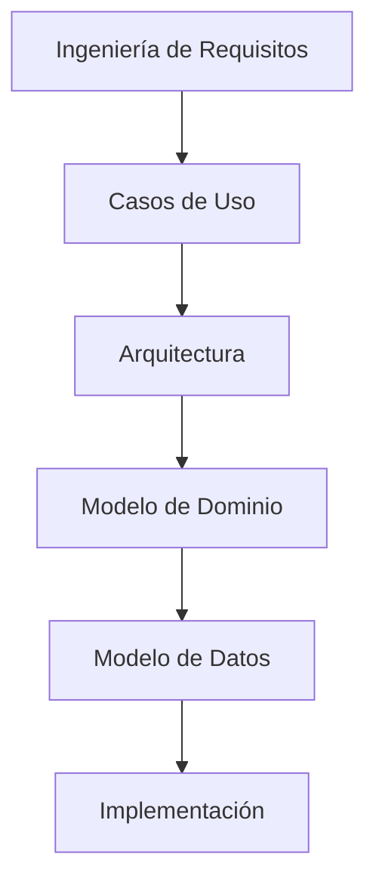

# Modelo de Datos

## Introducción

Este documento describe el modelo de dominio, el modelo conceptual y los principios de persistencia del sistema SetlistGen.

Su objetivo es servir como puente entre:



Antes de definir el modelo relacional definitivo y el esquema SQLite, es necesario comprender qué entidades forman parte del dominio y qué responsabilidades posee cada una.

Este documento constituye la base para:

- El modelo entidad-relación.
- El modelo relacional.
- El diseño físico SQLite.
- La implementación de repositorios y casos de uso.

---

# Objetivos de Diseño

El modelo debe garantizar:

- Identidad estable de las pistas.
- Independencia respecto a rutas y nombres de fichero.
- Soporte para múltiples motores de análisis.
- Persistencia de resultados de generación.
- Reproducibilidad de resultados.
- Escalabilidad razonable para bibliotecas de varios miles de pistas.
- Trazabilidad completa de análisis y validación.
- Compatibilidad con los requisitos RF y RNF.

---

# Principios de Diseño

## Persistencia local

Toda la información se almacena en SQLite.

---

## Identidad desacoplada de la ubicación

La identidad lógica de una pista es independiente de:

- Ruta.
- Nombre.
- Carpeta.

---

## Multi-motor

El sistema debe permitir almacenar resultados procedentes de:

- Essentia.
- Librosa.
- Madmom.

Sin sobrescribir resultados previos.

---

## Trazabilidad

Todo resultado debe indicar:

- Motor.
- Versión.
- Fecha.
- Configuración.

---

## Reproducibilidad

Todo setlist generado debe poder reproducirse a partir de:

- Parámetros.
- Semilla.
- Biblioteca.

---

## Separación de responsabilidades

Las entidades representan conceptos del dominio.

Las reglas de negocio se sitúan en servicios de dominio.

---

# Dependencias Arquitectónicas

Este modelo depende directamente de:

- ADR-001 Distribución.
- ADR-002 Arquitectura.
- ADR-003 Motor de Análisis.
- ADR-004 Persistencia.
- ADR-005 Generación.
- ADR-006 Exportación.
- ADR-009 Evaluación.
- ADR-010 Identificación de pistas.

---

# Modelo de Dominio

## Track

### Propósito

Representa una pista musical dentro del sistema.

Constituye la entidad principal del dominio.

### Responsabilidades

- Mantener identidad lógica.
- Agrupar metadatos.
- Asociar resultados de análisis.
- Participar en setlists.

### Atributos mínimos

```text
track_id
created_at
status
```

### Requisitos relacionados

- RF-09
- RF-09b
- RF-09c

---

## TrackLocation

### Propósito

Representa una ubicación física de una pista.

### Justificación

Una misma pista puede:

- cambiar de ruta,
- cambiar de nombre,
- aparecer duplicada.

La ubicación no forma parte de la identidad.

### Atributos mínimos

```text
location_id
track_id

file_path

last_seen_at

status
```

### Requisitos relacionados

- RF-09c
- RF-22
- RNF-21

---

## TrackMetadata

### Propósito

Representa los metadatos obtenidos a partir de etiquetas.

### Atributos mínimos

```text
title
artist
genre
year
duration_seconds
```

### Requisitos relacionados

- RF-03

---

## AnalysisRun

### Propósito

Representa una ejecución concreta de un motor MIR.

### Responsabilidades

Permitir trazabilidad y reproducibilidad.

### Atributos mínimos

```text
run_id

engine_name
engine_version

executed_at
```

### Requisitos relacionados

- RF-07

---

## AnalysisResult

### Propósito

Representa el resultado producido por un motor MIR.

### Responsabilidades

Almacenar:

- BPM
- Tonalidad
- Camelot

junto con la información del motor que los generó.

### Atributos mínimos

```text
analysis_id

track_id
run_id

bpm

key_tonic
key_mode

camelot_code

confidence
status
```

### Requisitos relacionados

- RF-04
- RF-05
- RF-06
- RF-07
- RF-29

---

## GenerationRequest

### Propósito

Representa una solicitud de generación.

### Responsabilidades

Agrupar todos los parámetros utilizados para generar un setlist.

### Atributos mínimos

```text
request_id

target_duration

bpm_min
bpm_max

harmonic_policy

random_seed
```

### Requisitos relacionados

- RF-12
- RF-13
- RF-13b
- RF-14

---

## GenreSegment

### Propósito

Representa restricciones temporales de género.

### Atributos mínimos

```text
segment_id

request_id

start_time
end_time

genre
```

### Requisitos relacionados

- RF-15

---

## Anchor

### Propósito

Representa una pista fijada en una posición concreta.

### Atributos mínimos

```text
anchor_id

request_id
track_id

position
```

### Requisitos relacionados

- RF-16

---

## Setlist

### Propósito

Representa un setlist generado.

### Responsabilidades

- Mantener el orden de reproducción.
- Mantener el histórico.
- Permitir exportación.

### Atributos mínimos

```text
setlist_id

request_id

created_at

status
```

### Requisitos relacionados

- RF-10
- RF-17
- RF-18
- RF-20

---

## SetlistTrack

### Propósito

Representa una pista perteneciente a un setlist.

### Atributos mínimos

```text
setlist_id
track_id

position
```

### Requisitos relacionados

- RF-18
- RF-20
- RF-20b

---

## Transition

### Propósito

Representa una transición entre dos pistas.

### Estado

Pendiente de validación (OD-06).

### Si se materializa

Atributos mínimos:

```text
transition_id

from_track_id
to_track_id

bpm_delta
camelot_distance

transition_score
```

### Requisitos relacionados

- RF-17
- RF-20

---

## ReferenceMeasurement

### Propósito

Representa valores de referencia obtenidos desde Rekordbox.

### Atributos mínimos

```text
reference_id

track_id

bpm_reference

key_reference

camelot_reference
```

### Requisitos relacionados

- RF-29
- RF-29b

---

## EvaluationReport

### Propósito

Representa resultados agregados de evaluación.

### Atributos mínimos

```text
report_id

generated_at

bpm_accuracy

key_accuracy

camelot_accuracy
```

### Requisitos relacionados

- RNF-05
- RNF-06
- RNF-07
- RNF-08
- RNF-09

---

# Objetos de Valor

## BpmRange

```text
minimum
maximum
```

Relacionado con:

- RF-13

---

## DurationTarget

```text
target_duration
tolerance
```

Relacionado con:

- RF-12

---

## HarmonicPolicy

Representa el nivel de compatibilidad armónica exigido.

Relacionado con:

- RF-14

---

## GenerationSeed

Representa la semilla utilizada para la generación.

Relacionado con:

- RNF-11

---

# Servicios de Dominio

## TrackIdentificationService

Responsable de identificar pistas.

Relacionado con:

- RF-09
- RF-09b
- RF-09c

---

## SetlistGenerationService

Responsable de generar setlists.

Relacionado con:

- ADR-005

---

## TransitionEvaluationService

Responsable de evaluar transiciones.

Relacionado con:

- RF-17
- RF-20

---

## EvaluationService

Responsable de comparar resultados frente a Rekordbox.

Relacionado con:

- RF-29
- RF-29b

---

# Cuestiones Abiertas

## OD-03

Identidad permanente de pistas.

---

## OD-04

Persistencia multi-motor.

---

## OD-05

Existencia de Library.

---

## OD-06

Persistencia de Transition.

---

## OD-07

Validación del modelo de dominio.

---

# Riesgos de Diseño

## RD-01

La estrategia definitiva de identificación de pistas aún no está validada.

Relacionado con:

- ADR-010

---

## RD-02

La persistencia de transiciones sigue abierta.

Relacionado con:

- OD-06

---

## RD-03

La selección definitiva del motor MIR depende de la prueba de concepto.

Relacionado con:

- ADR-003

---

# Próximos pasos

1. Validación de OD-03 a OD-07.
2. Diseño del MER.
3. Diseño del modelo relacional.
4. Diseño físico SQLite.
5. Estrategia de índices.
6. Estrategia de migraciones.
