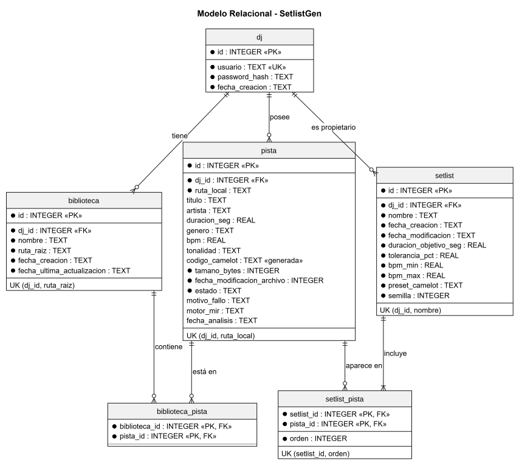

# Modelo de Datos de SetlistGen

**Versión:** 1.0 · **Estado:** cerrado, pendiente de validación con tutores y de las pruebas de integración
**Alineado con:** `requirements.md` v1.2.1, `use-cases.md` v1.2.1 y ADR-004 (SQLite)

## 1. Propósito y decisiones de diseño

Este documento especifica los datos que SetlistGen persiste. Parte del esquema conceptual de 4 entidades acordado con el tutor, enriquecido con la relación `Posee`, y lo traduce a un modelo relacional de **6 tablas** y a un esquema SQLite.

| Decisión | Detalle | Origen |
|---|---|---|
| Persistencia ligera | SQLite en un único fichero. Solo rutas locales y descriptores, nunca audio | RNF-08 |
| Aislamiento por cuenta | Cada DJ tiene sus propias bibliotecas, pistas y setlists. Una pista se identifica por `(dj_id, ruta_local)`, aunque dos cuentas registren la misma carpeta. La coherencia entre cuentas se impone con *triggers* | RF-01, RNF-12 |
| Pistas nunca borradas | Una pista cuyo fichero desaparece pasa a `no_disponible`, para no romper los setlists guardados | RF-07, RF-20 |
| Estado único | Una sola columna `estado` (`disponible`, `no_disponible`, `fallida`). Las transiciones están en la sección 6 | RF-05 a RF-07 |
| Trazabilidad del análisis | `motor_mir` (nombre y versión) y `fecha_analisis` en cada pista, para saber qué motor produjo cada valor | RNF-02, RNF-03 |
| BPM decimal | `REAL`, redondeado a 2 decimales por la aplicación | RF-05 |
| Setlist por referencias | Guarda referencias a pistas y su orden, sin copiar descriptores. La duración total y las transiciones se calculan | RF-19 |
| Género informativo | Se guarda, pero no interviene en la generación | RF-04 |
| Datos derivados no almacenados | `codigo_camelot` es una columna generada. La duración total del setlist se calcula | 3FN |

El esquema anterior de 20 tablas queda sustituido por 6: 4 de entidad y 2 asociativas.

## 2. Modelo Entidad-Relación (conceptual)


* **Archivo editable (.draw.io):** [`../diagrams/modelo-er.drawio`](../diagrams/modelo-er.drawio)

### 2.1 Entidades y atributos

| Entidad | Atributos | Identificador |
|---|---|---|
| **DJ** | `id`, `usuario`, `password_hash`, `fecha_creacion` | `id`. Candidata: `usuario` |
| **Biblioteca** | `id`, `nombre`, `ruta_raiz`, `fecha_creacion`, `fecha_ultima_actualizacion` | `id`. Candidata: `(dj_id, ruta_raiz)` |
| **Pista** | `id`, `ruta_local`, `titulo`, `artista`, `duracion_seg`, `genero`, `bpm`, `tonalidad`, `codigo_camelot` *(derivado)*, `tamano_bytes`, `fecha_modificacion_archivo`, `estado`, `motivo_fallo`, `motor_mir`, `fecha_analisis` | `id`. Candidata: `(dj_id, ruta_local)` |
| **Setlist** | `id`, `nombre`, `fecha_creacion`, `fecha_modificacion`, `duracion_objetivo_seg`, `tolerancia_pct`, `bpm_min`, `bpm_max`, `preset_camelot`, `semilla` | `id`. Candidata: `(dj_id, nombre)` |

### 2.2 Relaciones, cardinalidades y participación

| Relación | Entidades | Cardinalidad | Participación | Atributos propios |
|---|---|---|---|---|
| **Tiene_Biblioteca** | DJ – Biblioteca | 1:N | DJ parcial (0..N). Biblioteca total (1..1) | — |
| **Posee** | DJ – Pista | 1:N | DJ parcial (0..N). Pista total (1..1) | — |
| **Contiene** | Biblioteca – Pista | N:M | Biblioteca parcial. Pista total (está en al menos una biblioteca) | — |
| **Pertenece_a_Setlist** | Pista – Setlist | N:M | Pista parcial (0..N). Setlist total (1..N) | `orden` (1..N) |
| **Pertenece_a_DJ** | Setlist – DJ | N:1 | Setlist total (1..1). DJ parcial (0..N) | — |

`Posee` identifica a la pista junto con `ruta_local`: la misma ruta puede existir como pista de dos DJ distintos. Un DJ recién registrado no tiene aún bibliotecas, por eso su participación es parcial.

### 2.3 Restricciones semánticas

- Una pista solo puede estar en bibliotecas y setlists del DJ al que pertenece.
- Un setlist no contiene la misma pista dos veces y su `orden` es 1..N sin huecos.
- Una pista `fallida` no se añade a un setlist.
- `bpm_min` ≤ `bpm_max`. `fecha_modificacion` ≥ `fecha_creacion`.

## 3. Paso a Modelo Relacional (lógico)



* **Archivo editable (.draw.io):** [`../diagrams/modelo-relacional.drawio`](../diagrams/modelo-relacional.drawio)

### 3.1 Reglas de transformación aplicadas

| Elemento ER | Resultado relacional |
|---|---|
| Entidad | Una tabla con su identificador como clave primaria |
| Relación 1:N (**Tiene_Biblioteca**, **Posee**, **Pertenece_a_DJ**) | Clave foránea `dj_id` en el lado N (`biblioteca`, `pista`, `setlist`) |
| Relación N:M (**Contiene**) | Tabla asociativa `biblioteca_pista`, con clave primaria compuesta `(biblioteca_id, pista_id)` |
| Relación N:M con atributo (**Pertenece_a_Setlist**) | Tabla asociativa `setlist_pista`, con clave primaria compuesta `(setlist_id, pista_id)` y el atributo `orden` |
| Atributo derivado (`codigo_camelot`) | Columna generada a partir de `tonalidad` |

### 3.2 Esquemas de relación

`*` marca la clave primaria.

```text
dj(*id, usuario [UK], password_hash, fecha_creacion)

biblioteca(*id, dj_id [FK→dj], nombre, ruta_raiz, fecha_creacion, fecha_ultima_actualizacion)
    UK (dj_id, ruta_raiz)

pista(*id, dj_id [FK→dj], ruta_local, titulo, artista, duracion_seg, genero, bpm, tonalidad,
      codigo_camelot [generada], tamano_bytes, fecha_modificacion_archivo, estado, motivo_fallo,
      motor_mir, fecha_analisis)
    UK (dj_id, ruta_local)

biblioteca_pista(*biblioteca_id [FK→biblioteca], *pista_id [FK→pista])

setlist(*id, dj_id [FK→dj], nombre, fecha_creacion, fecha_modificacion, duracion_objetivo_seg,
        tolerancia_pct, bpm_min, bpm_max, preset_camelot, semilla)
    UK (dj_id, nombre)

setlist_pista(*setlist_id [FK→setlist], *pista_id [FK→pista], orden)
    UK (setlist_id, orden)
```

### 3.3 Normalización

| Forma normal | Justificación |
|---|---|
| **1FN** | Todos los atributos son atómicos. No hay listas ni grupos repetidos |
| **2FN** | En las tablas asociativas, `orden` depende de la clave completa. `biblioteca_pista` no tiene atributos no clave |
| **3FN** | No hay dependencias transitivas entre atributos almacenados. `tonalidad → codigo_camelot` se resuelve con una columna generada que no puede divergir. La duración total se calcula |

### 3.4 Dónde se garantiza cada restricción

| Restricción | Mecanismo |
|---|---|
| Unicidad de usuario, de ruta por DJ, de nombre de setlist por DJ y de `orden` | `UNIQUE` |
| Valores válidos de estado, tonalidad, preset y rangos | `CHECK` |
| Coherencia de `estado` con `motivo_fallo` y con los descriptores | `CHECK` |
| Integridad referencial y política de borrado | Claves foráneas (`foreign_keys = ON`) |
| Una pista, biblioteca o setlist no cambia de DJ. Pista y biblioteca (o setlist) del mismo DJ | *Triggers* |
| Cada pista está en al menos una biblioteca. Un setlist tiene al menos una pista. `orden` contiguo 1..N. Una pista `fallida` no entra en un setlist. Rutas en forma canónica | **Aplicación** (cubierto por tests) |

## 4. Diccionario de datos

Tipos de SQLite. Fechas en `TEXT` ISO 8601 UTC con formato fijo (por ejemplo, `2026-11-23T10:15:00Z`).

### 4.1 `dj`

| Columna | Tipo | Nulo | Restricciones | Descripción |
|---|---|---|---|---|
| `id` | INTEGER | No | PK | Identificador |
| `usuario` | TEXT | No | UNIQUE, sin distinguir mayúsculas | Nombre de usuario |
| `password_hash` | TEXT | No | No vacío | Hash con sal y parámetros (por ejemplo, `scrypt`). Nunca la contraseña |
| `fecha_creacion` | TEXT | No | | Alta de la cuenta |

### 4.2 `biblioteca`

| Columna | Tipo | Nulo | Restricciones | Descripción |
|---|---|---|---|---|
| `id` | INTEGER | No | PK | Identificador |
| `dj_id` | INTEGER | No | FK → `dj` (CASCADE). Inmodificable | Propietario |
| `nombre` | TEXT | No | No vacío | Nombre visible |
| `ruta_raiz` | TEXT | No | UNIQUE con `dj_id` | Carpeta raíz |
| `fecha_creacion` | TEXT | No | | Primer registro |
| `fecha_ultima_actualizacion` | TEXT | No | ≥ `fecha_creacion` | Último procesamiento o actualización |

### 4.3 `pista`

| Columna | Tipo | Nulo | Restricciones | Descripción |
|---|---|---|---|---|
| `id` | INTEGER | No | PK | Identificador |
| `dj_id` | INTEGER | No | FK → `dj` (CASCADE). Inmodificable | Propietario |
| `ruta_local` | TEXT | No | UNIQUE con `dj_id`, no vacío | Ruta absoluta en forma canónica (separador único, Unicode NFC) |
| `titulo`, `artista`, `genero` | TEXT | Sí | | Metadatos. Nulo si la etiqueta no existe |
| `duracion_seg` | REAL | Sí | > 0. Obligatoria salvo en `fallida` | Duración (de la etiqueta o, si falta, del audio) |
| `bpm` | REAL | Sí | > 0. Obligatorio salvo en `fallida` | Redondeado a 2 decimales |
| `tonalidad` | TEXT | Sí | Una de 24 notaciones (4.3.1). Obligatoria salvo en `fallida` | Tonalidad normalizada |
| `codigo_camelot` | TEXT | Sí | **Generada**, no se escribe | Derivada de `tonalidad` |
| `tamano_bytes` | INTEGER | No | ≥ 0 | Para detectar cambios |
| `fecha_modificacion_archivo` | INTEGER | No | | Marca de modificación del fichero en nanosegundos (`st_mtime_ns`) |
| `estado` | TEXT | No | `disponible`, `no_disponible`, `fallida` | Estado de la pista (sección 6) |
| `motivo_fallo` | TEXT | Sí | No nulo si y solo si `estado = 'fallida'` | Causa del fallo |
| `motor_mir` | TEXT | Sí | No vacío. Obligatorio salvo en `fallida` | Motor y versión que produjeron el análisis (por ejemplo, `essentia 2.1`) |
| `fecha_analisis` | TEXT | Sí | Obligatoria salvo en `fallida` | Fecha del último análisis |

#### 4.3.1 Notación de tonalidad y código Camelot

El adaptador del motor MIR normaliza su salida a esta notación (solo sostenidos, `m` = menor):

| Camelot | Menor (A) | Mayor (B) | Camelot | Menor (A) | Mayor (B) |
|---|---|---|---|---|---|
| 1 | G#m | B | 7 | Dm | F |
| 2 | D#m | F# | 8 | Am | C |
| 3 | A#m | C# | 9 | Em | G |
| 4 | Fm | G# | 10 | Bm | D |
| 5 | Cm | D# | 11 | F#m | A |
| 6 | Gm | A# | 12 | C#m | E |

### 4.4 `biblioteca_pista` (Contiene, N:M)

| Columna | Tipo | Nulo | Restricciones | Descripción |
|---|---|---|---|---|
| `biblioteca_id` | INTEGER | No | PK, FK → `biblioteca` (CASCADE) | |
| `pista_id` | INTEGER | No | PK, FK → `pista` (CASCADE) | Debe ser del mismo DJ (*trigger*) |

### 4.5 `setlist`

| Columna | Tipo | Nulo | Restricciones | Descripción |
|---|---|---|---|---|
| `id` | INTEGER | No | PK | Identificador |
| `dj_id` | INTEGER | No | FK → `dj` (CASCADE). Inmodificable | Propietario |
| `nombre` | TEXT | No | UNIQUE con `dj_id`, no vacío | Nombre |
| `fecha_creacion`, `fecha_modificacion` | TEXT | No | `fecha_modificacion` ≥ `fecha_creacion` | |
| `duracion_objetivo_seg` | REAL | No | > 0 | Duración objetivo |
| `tolerancia_pct` | REAL | No | 0 ≤ valor < 100. Por defecto 5 | Tolerancia de duración |
| `bpm_min`, `bpm_max` | REAL | No | `bpm_min` > 0, `bpm_max` ≥ `bpm_min` | Rango de BPM |
| `preset_camelot` | TEXT | No | `estricta`, `energetica` | Compatibilidad armónica elegida |
| `semilla` | INTEGER | No | ≥ 0 | Semilla de la generación |

### 4.6 `setlist_pista` (Pertenece_a_Setlist, N:M)

| Columna | Tipo | Nulo | Restricciones | Descripción |
|---|---|---|---|---|
| `setlist_id` | INTEGER | No | PK, FK → `setlist` (CASCADE) | |
| `pista_id` | INTEGER | No | PK, FK → `pista` (RESTRICT) | Una pista usada en un setlist no se borra. Mismo DJ (*trigger*) |
| `orden` | INTEGER | No | ≥ 1, UNIQUE con `setlist_id` | Posición 1..N |

## 5. Esquema DDL para SQLite (`schema.sql`)

Requiere SQLite ≥ 3.31 (columnas generadas). Cada conexión debe ejecutar `PRAGMA foreign_keys = ON;`.

```sql
-- SetlistGen · esquema v1.0
PRAGMA foreign_keys = ON;

BEGIN;

CREATE TABLE dj (
    id             INTEGER PRIMARY KEY,
    usuario        TEXT NOT NULL COLLATE NOCASE UNIQUE CHECK (length(trim(usuario)) > 0),
    password_hash  TEXT NOT NULL CHECK (length(password_hash) > 0),
    fecha_creacion TEXT NOT NULL
);

CREATE TABLE biblioteca (
    id                         INTEGER PRIMARY KEY,
    dj_id                      INTEGER NOT NULL REFERENCES dj (id) ON DELETE CASCADE,
    nombre                     TEXT NOT NULL CHECK (length(trim(nombre)) > 0),
    ruta_raiz                  TEXT NOT NULL CHECK (length(trim(ruta_raiz)) > 0),
    fecha_creacion             TEXT NOT NULL,
    fecha_ultima_actualizacion TEXT NOT NULL,
    UNIQUE (dj_id, ruta_raiz),
    CHECK (fecha_ultima_actualizacion >= fecha_creacion)
);

CREATE TABLE pista (
    id                         INTEGER PRIMARY KEY,
    dj_id                      INTEGER NOT NULL REFERENCES dj (id) ON DELETE CASCADE,
    ruta_local                 TEXT NOT NULL CHECK (length(trim(ruta_local)) > 0),
    titulo                     TEXT,
    artista                    TEXT,
    duracion_seg               REAL CHECK (duracion_seg IS NULL OR duracion_seg > 0),
    genero                     TEXT,
    bpm                        REAL CHECK (bpm IS NULL OR bpm > 0),
    tonalidad                  TEXT CHECK (tonalidad IS NULL OR tonalidad IN (
                                   'G#m','D#m','A#m','Fm','Cm','Gm','Dm','Am','Em','Bm','F#m','C#m',
                                   'B','F#','C#','G#','D#','A#','F','C','G','D','A','E')),
    codigo_camelot             TEXT GENERATED ALWAYS AS (
                                   CASE tonalidad
                                       WHEN 'G#m' THEN '1A'  WHEN 'D#m' THEN '2A'  WHEN 'A#m' THEN '3A'
                                       WHEN 'Fm'  THEN '4A'  WHEN 'Cm'  THEN '5A'  WHEN 'Gm'  THEN '6A'
                                       WHEN 'Dm'  THEN '7A'  WHEN 'Am'  THEN '8A'  WHEN 'Em'  THEN '9A'
                                       WHEN 'Bm'  THEN '10A' WHEN 'F#m' THEN '11A' WHEN 'C#m' THEN '12A'
                                       WHEN 'B'   THEN '1B'  WHEN 'F#'  THEN '2B'  WHEN 'C#'  THEN '3B'
                                       WHEN 'G#'  THEN '4B'  WHEN 'D#'  THEN '5B'  WHEN 'A#'  THEN '6B'
                                       WHEN 'F'   THEN '7B'  WHEN 'C'   THEN '8B'  WHEN 'G'   THEN '9B'
                                       WHEN 'D'   THEN '10B' WHEN 'A'   THEN '11B' WHEN 'E'   THEN '12B'
                                   END) STORED,
    tamano_bytes               INTEGER NOT NULL CHECK (tamano_bytes >= 0),
    fecha_modificacion_archivo INTEGER NOT NULL,   -- st_mtime_ns
    estado                     TEXT NOT NULL CHECK (estado IN ('disponible', 'no_disponible', 'fallida')),
    motivo_fallo               TEXT CHECK (motivo_fallo IS NULL OR length(trim(motivo_fallo)) > 0),
    motor_mir                  TEXT CHECK (motor_mir IS NULL OR length(trim(motor_mir)) > 0),
    fecha_analisis             TEXT,
    UNIQUE (dj_id, ruta_local),
    CHECK ((estado = 'fallida') = (motivo_fallo IS NOT NULL)),
    CHECK (estado = 'fallida'
           OR (duracion_seg IS NOT NULL AND bpm IS NOT NULL AND tonalidad IS NOT NULL
               AND motor_mir IS NOT NULL AND fecha_analisis IS NOT NULL))
);

CREATE TABLE biblioteca_pista (
    biblioteca_id INTEGER NOT NULL REFERENCES biblioteca (id) ON DELETE CASCADE,
    pista_id      INTEGER NOT NULL REFERENCES pista (id)      ON DELETE CASCADE,
    PRIMARY KEY (biblioteca_id, pista_id)
) WITHOUT ROWID;

CREATE TABLE setlist (
    id                    INTEGER PRIMARY KEY,
    dj_id                 INTEGER NOT NULL REFERENCES dj (id) ON DELETE CASCADE,
    nombre                TEXT NOT NULL CHECK (length(trim(nombre)) > 0),
    fecha_creacion        TEXT NOT NULL,
    fecha_modificacion    TEXT NOT NULL,
    duracion_objetivo_seg REAL NOT NULL CHECK (duracion_objetivo_seg > 0),
    tolerancia_pct        REAL NOT NULL DEFAULT 5 CHECK (tolerancia_pct >= 0 AND tolerancia_pct < 100),
    bpm_min               REAL NOT NULL CHECK (bpm_min > 0),
    bpm_max               REAL NOT NULL,
    preset_camelot        TEXT NOT NULL CHECK (preset_camelot IN ('estricta', 'energetica')),
    semilla               INTEGER NOT NULL CHECK (semilla >= 0),
    UNIQUE (dj_id, nombre),
    CHECK (bpm_max >= bpm_min),
    CHECK (fecha_modificacion >= fecha_creacion)
);

CREATE TABLE setlist_pista (
    setlist_id INTEGER NOT NULL REFERENCES setlist (id) ON DELETE CASCADE,
    pista_id   INTEGER NOT NULL REFERENCES pista (id)   ON DELETE RESTRICT,
    orden      INTEGER NOT NULL CHECK (orden >= 1),
    PRIMARY KEY (setlist_id, pista_id),
    UNIQUE (setlist_id, orden)
) WITHOUT ROWID;

-- Índices. Las claves UNIQUE ya indexan (dj_id, ruta_local), (dj_id, ruta_raiz) y (dj_id, nombre).
CREATE INDEX ix_pista_candidatas ON pista (dj_id, estado, bpm);              -- generación, búsqueda y recuentos
CREATE INDEX ix_setlist_pista_rev ON setlist_pista (pista_id);               -- RESTRICT y usos de una pista
CREATE INDEX ix_setlist_dj_fecha ON setlist (dj_id, fecha_modificacion);     -- lista de setlists guardados

-- Aislamiento entre cuentas (RNF-12): la pista y su biblioteca o setlist son del mismo DJ.
CREATE TRIGGER trg_biblioteca_pista_mismo_dj
BEFORE INSERT ON biblioteca_pista
WHEN (SELECT dj_id FROM biblioteca WHERE id = NEW.biblioteca_id)
     IS NOT (SELECT dj_id FROM pista WHERE id = NEW.pista_id)
BEGIN
    SELECT RAISE(ABORT, 'La biblioteca y la pista pertenecen a DJ distintos');
END;

CREATE TRIGGER trg_setlist_pista_mismo_dj
BEFORE INSERT ON setlist_pista
WHEN (SELECT dj_id FROM setlist WHERE id = NEW.setlist_id)
     IS NOT (SELECT dj_id FROM pista WHERE id = NEW.pista_id)
BEGIN
    SELECT RAISE(ABORT, 'El setlist y la pista pertenecen a DJ distintos');
END;

-- El propietario no puede cambiar.
CREATE TRIGGER trg_pista_dj_inmutable BEFORE UPDATE OF dj_id ON pista
WHEN NEW.dj_id IS NOT OLD.dj_id
BEGIN SELECT RAISE(ABORT, 'dj_id no es modificable'); END;

CREATE TRIGGER trg_biblioteca_dj_inmutable BEFORE UPDATE OF dj_id ON biblioteca
WHEN NEW.dj_id IS NOT OLD.dj_id
BEGIN SELECT RAISE(ABORT, 'dj_id no es modificable'); END;

CREATE TRIGGER trg_setlist_dj_inmutable BEFORE UPDATE OF dj_id ON setlist
WHEN NEW.dj_id IS NOT OLD.dj_id
BEGIN SELECT RAISE(ABORT, 'dj_id no es modificable'); END;

PRAGMA user_version = 1;

COMMIT;
```

## 6. Estados de la pista

| Estado actual | Evento | Nuevo estado |
|---|---|---|
| *(nueva)* | Análisis correcto | `disponible` |
| *(nueva)* | Fichero ilegible o el motor no devuelve BPM o tonalidad | `fallida` (con `motivo_fallo`) |
| `disponible` | Sin cambios | `disponible` |
| `disponible` | Fichero modificado y reanálisis correcto | `disponible` (descriptores actualizados) |
| `disponible` | Fichero modificado y reanálisis fallido | `fallida` |
| `disponible` | Fichero no encontrado | `no_disponible` |
| `no_disponible` | Reaparece con el mismo tamaño y fecha | `disponible` (sin reanalizar) |
| `no_disponible` | Reaparece modificado | Reanálisis: `disponible` o `fallida` |
| `fallida` | Sin cambios | `fallida` (no se reanaliza) |
| `fallida` | Fichero modificado | Reanálisis: `disponible` o `fallida` |
| `fallida` | Fichero no encontrado | `fallida` (no cambia) |

Al pasar de `fallida` a `disponible`, `motivo_fallo` se pone a nulo; el `CHECK` lo exige. Un fichero movido o renombrado es una pista nueva y su ruta antigua queda `no_disponible`.

## 7. Consultas críticas e índices

Parámetros con nombre (`:dj`, `:bib`…). **Toda consulta filtra por `dj_id`** (o parte de una fila ya filtrada por DJ), de modo que una cuenta nunca lee datos de otra. Los planes indicados son los esperados por el diseño de los índices y se comprueban con `EXPLAIN QUERY PLAN` en las pruebas de integración.

### 7.1 Cuenta (CU-01)

```sql
-- Q-01 · Inicio de sesión. UNIQUE de usuario (autoíndice, mismo COLLATE NOCASE).
SELECT id, password_hash FROM dj WHERE usuario = :usuario;

-- Q-02 · Registro. Un usuario repetido viola UNIQUE y se informa (CU-01 A2).
INSERT INTO dj (usuario, password_hash, fecha_creacion) VALUES (:usuario, :hash, :ahora);
```

### 7.2 Bibliotecas y análisis (CU-02, CU-03)

```sql
-- Q-03 · Registrar biblioteca. Una ruta repetida viola UNIQUE (dj_id, ruta_raiz): CU-02 A4.
INSERT INTO biblioteca (dj_id, nombre, ruta_raiz, fecha_creacion, fecha_ultima_actualizacion)
VALUES (:dj, :nombre, :ruta, :ahora, :ahora);

-- Q-04 · Cargar las pistas conocidas del DJ para clasificar los ficheros del escaneo
--        (nuevo, sin cambios, modificado). Una sola consulta y comparación en memoria.
--        Índice: autoíndice de UNIQUE (dj_id, ruta_local), búsqueda por dj_id.
SELECT id, ruta_local, tamano_bytes, fecha_modificacion_archivo, estado
FROM pista WHERE dj_id = :dj;

-- Q-05 · Insertar o actualizar una pista analizada (nunca INSERT OR REPLACE, que borraría la fila).
--        Índice: autoíndice UNIQUE (dj_id, ruta_local).
INSERT INTO pista (dj_id, ruta_local, titulo, artista, duracion_seg, genero, bpm, tonalidad,
                   tamano_bytes, fecha_modificacion_archivo, estado, motivo_fallo, motor_mir, fecha_analisis)
VALUES (:dj, :ruta, :titulo, :artista, :duracion, :genero, :bpm, :tonalidad,
        :tamano, :mtime_ns, :estado, :motivo, :motor, :fecha)
ON CONFLICT (dj_id, ruta_local) DO UPDATE SET
    titulo = excluded.titulo, artista = excluded.artista, duracion_seg = excluded.duracion_seg,
    genero = excluded.genero, bpm = excluded.bpm, tonalidad = excluded.tonalidad,
    tamano_bytes = excluded.tamano_bytes, fecha_modificacion_archivo = excluded.fecha_modificacion_archivo,
    estado = excluded.estado, motivo_fallo = excluded.motivo_fallo,
    motor_mir = excluded.motor_mir, fecha_analisis = excluded.fecha_analisis;

-- Q-06 · Vincular la pista a la biblioteca sin duplicar. Índice: PK (biblioteca_id, pista_id).
INSERT OR IGNORE INTO biblioteca_pista (biblioteca_id, pista_id) VALUES (:bib, :pista);

-- Q-07 · Pistas vinculadas a la biblioteca (para detectar las «no encontradas» al actualizar).
--        Solo cuentan las vinculadas a ESTA biblioteca, aunque otra se solape con ella.
--        Índice: PK de biblioteca_pista (prefijo biblioteca_id) y pista por clave.
SELECT p.id, p.ruta_local, p.estado
FROM biblioteca_pista bp JOIN pista p ON p.id = bp.pista_id
WHERE bp.biblioteca_id = :bib AND p.dj_id = :dj;

-- Q-08 · Marcar como no disponible o reactivar, con los ids calculados en memoria (executemany).
--        Índice: clave primaria de pista.
UPDATE pista SET estado = 'no_disponible' WHERE id = :pista AND dj_id = :dj AND estado = 'disponible';
UPDATE pista SET estado = 'disponible'    WHERE id = :pista AND dj_id = :dj AND estado = 'no_disponible';

-- Q-09 · Cerrar la actualización. Índice: clave primaria de biblioteca.
UPDATE biblioteca SET fecha_ultima_actualizacion = :ahora WHERE id = :bib AND dj_id = :dj;

-- Q-10 · Bibliotecas del DJ con recuentos. Índice: autoíndice (dj_id, ruta_raiz) y PK de biblioteca_pista.
SELECT b.id, b.nombre, b.ruta_raiz, b.fecha_ultima_actualizacion,
       (SELECT COUNT(*) FROM biblioteca_pista bp WHERE bp.biblioteca_id = b.id) AS n_pistas,
       (SELECT COUNT(*) FROM biblioteca_pista bp JOIN pista p ON p.id = bp.pista_id
         WHERE bp.biblioteca_id = b.id AND p.estado = 'no_disponible') AS n_no_disponibles,
       (SELECT COUNT(*) FROM biblioteca_pista bp JOIN pista p ON p.id = bp.pista_id
         WHERE bp.biblioteca_id = b.id AND p.estado = 'fallida') AS n_fallidas
FROM biblioteca b
WHERE b.dj_id = :dj;
```

### 7.3 Generación y edición (CU-04, CU-05)

```sql
-- Q-11 · Pistas candidatas (todas las bibliotecas del DJ: cada pista pertenece a una).
--        Índice: ix_pista_candidatas (dj_id, estado, bpm), búsqueda por rango, sin recorrer la tabla.
SELECT id, bpm, codigo_camelot, duracion_seg
FROM pista
WHERE dj_id = :dj AND estado = 'disponible' AND bpm BETWEEN :bpm_min AND :bpm_max;

-- Q-12 · Candidatas de una sola biblioteca. Índice: PK de biblioteca_pista y ix_pista por clave.
SELECT p.id, p.bpm, p.codigo_camelot, p.duracion_seg
FROM biblioteca_pista bp JOIN pista p ON p.id = bp.pista_id
WHERE bp.biblioteca_id = :bib AND p.dj_id = :dj AND p.estado = 'disponible'
  AND p.bpm BETWEEN :bpm_min AND :bpm_max;

-- Q-13 · Buscar pistas para añadir manualmente (RF-16).
--        Índice: ix_pista_candidatas acota por dj_id y estado (y bpm si se indica).
--        El LIKE '%texto%' no puede usar índice: recorre solo las pistas de ese DJ.
SELECT id, titulo, artista, bpm, codigo_camelot, duracion_seg
FROM pista
WHERE dj_id = :dj AND estado = 'disponible'
  AND (:texto IS NULL OR titulo LIKE '%' || :texto || '%' OR artista LIKE '%' || :texto || '%')
  AND (:bpm_min IS NULL OR bpm BETWEEN :bpm_min AND :bpm_max)
  AND (:camelot IS NULL OR codigo_camelot = :camelot)
ORDER BY titulo COLLATE NOCASE
LIMIT 50;
```

La ordenación por BPM o por Camelot de un setlist abierto (RF-13) se hace en memoria, porque un setlist tiene unas decenas de pistas. Si se hiciera en SQL, el orden Camelot es `ORDER BY CAST(codigo_camelot AS INTEGER), substr(codigo_camelot, -1)`.

### 7.4 Setlists guardados (CU-06, CU-07)

```sql
-- Q-14 · ¿Existe ya un setlist con ese nombre? (CU-06 A1). Índice: autoíndice UNIQUE (dj_id, nombre).
SELECT id FROM setlist WHERE dj_id = :dj AND nombre = :nombre;

-- Q-15 · Guardar un setlist nuevo, en una transacción.
INSERT INTO setlist (dj_id, nombre, fecha_creacion, fecha_modificacion, duracion_objetivo_seg,
                     tolerancia_pct, bpm_min, bpm_max, preset_camelot, semilla)
VALUES (:dj, :nombre, :ahora, :ahora, :duracion, :tolerancia, :bpm_min, :bpm_max, :preset, :semilla);
INSERT INTO setlist_pista (setlist_id, pista_id, orden) VALUES (:set, :pista, :orden);  -- executemany

-- Q-16 · Actualizar un setlist existente (RF-19): se sustituye el contenido en una transacción
--        (DELETE + INSERT), porque UNIQUE (setlist_id, orden) no admite intercambios con UPDATE.
--        Índices: PK de setlist y PK de setlist_pista (prefijo setlist_id).
UPDATE setlist SET fecha_modificacion = :ahora, duracion_objetivo_seg = :duracion, tolerancia_pct = :tolerancia,
                   bpm_min = :bpm_min, bpm_max = :bpm_max, preset_camelot = :preset
WHERE id = :set AND dj_id = :dj;
DELETE FROM setlist_pista WHERE setlist_id = :set;
INSERT INTO setlist_pista (setlist_id, pista_id, orden) VALUES (:set, :pista, :orden);  -- executemany

-- Q-17 · Lista de setlists con número de pistas y duración total (calculada, no almacenada).
--        Índice: ix_setlist_dj_fecha da el orden; PK de setlist_pista; pista por clave.
SELECT s.id, s.nombre, s.fecha_modificacion,
       (SELECT COUNT(*) FROM setlist_pista sp WHERE sp.setlist_id = s.id) AS n_pistas,
       (SELECT SUM(p.duracion_seg) FROM setlist_pista sp JOIN pista p ON p.id = sp.pista_id
         WHERE sp.setlist_id = s.id) AS duracion_total_seg
FROM setlist s
WHERE s.dj_id = :dj
ORDER BY s.fecha_modificacion DESC;

-- Q-18 · Abrir un setlist con el estado de cada pista (avisos de RF-20).
--        Índice: PK de setlist y UNIQUE (setlist_id, orden), que entrega el orden sin ordenar aparte.
SELECT sp.orden, p.id, p.titulo, p.artista, p.bpm, p.codigo_camelot, p.duracion_seg, p.estado, p.ruta_local
FROM setlist s
JOIN setlist_pista sp ON sp.setlist_id = s.id
JOIN pista p ON p.id = sp.pista_id
WHERE s.id = :set AND s.dj_id = :dj
ORDER BY sp.orden;

-- Q-19 · Eliminar un setlist. Las filas de setlist_pista caen por CASCADE
--        (PK con prefijo setlist_id, sin índice adicional).
DELETE FROM setlist WHERE id = :set AND dj_id = :dj;
```

### 7.5 Resumen de índices

| Índice | Consultas | Comentario |
|---|---|---|
| Autoíndice `UNIQUE (dj_id, ruta_local)` | Q-04, Q-05 | Identificación de pistas y detección de duplicados |
| `ix_pista_candidatas (dj_id, estado, bpm)` | Q-11, Q-12, Q-13 y recuentos por estado | Evita recorrer la tabla en la generación |
| PK `(biblioteca_id, pista_id)` | Q-06, Q-07, Q-10, Q-12 | Pistas de una biblioteca |
| Autoíndice `UNIQUE (dj_id, ruta_raiz)` | Q-03, Q-10 | |
| Autoíndice `UNIQUE (dj_id, nombre)` | Q-14 | |
| `ix_setlist_dj_fecha (dj_id, fecha_modificacion)` | Q-17 | Orden de la lista sin ordenar aparte |
| PK `(setlist_id, pista_id)` y `UNIQUE (setlist_id, orden)` | Q-15 a Q-19 | Pistas de un setlist y su orden |
| `ix_setlist_pista_rev (pista_id)` | Comprobación `RESTRICT` y usos de una pista | Se usa solo si se borran pistas. Es el único índice cuyo uso no es directo |
| Autoíndice `UNIQUE (usuario)` | Q-01, Q-02 | |

Para que SQLite elija bien entre índices con estadísticas reales, la aplicación ejecuta `PRAGMA optimize` al cerrar la conexión y `ANALYZE` tras una importación masiva.

Se descartó el índice `biblioteca_pista (pista_id)` de la v0.1: ninguna consulta lo usa. Se recupera si se añade un caso de uso de borrado de pistas o bibliotecas.

## 8. Puntos abiertos residuales

| ID | Tema | Estado |
|---|---|---|
| P-08 | No hay casos de uso de borrado de bibliotecas ni de cuentas. En SQLite ≥ 3.31 borrar un DJ elimina en cascada todo su árbol sin violar RESTRICT (cubierto por test) | Fuera de alcance |
| P-10 | SQLite ≥ 3.31 (columnas generadas) sin `STRICT`. La aplicación comprueba la versión al arrancar. La resolución del `mtime` depende del sistema de ficheros | Comprobar en Windows y macOS |
| P-11 | Una pista guardada en un setlist puede pasar a `fallida` si su fichero cambia y el reanálisis falla. RF-20 solo avisa de las no disponibles | Cerrado: Añadido «fallidas» a RF-20 y CU-07 en v1.2.2 |
| P-12 | Rango de plausibilidad del BPM (por ejemplo, 40 a 250) para descartar errores de octava extremos | Decisión de la aplicación, no del esquema |

## 9. Control de cambios

| Versión | Cambio |
|---|---|
| 0.1 | Borrador: 4 entidades, 4 relaciones, 6 tablas, DDL y 10 puntos abiertos |
| 1.0 | Cerrados P-01 (relación `Posee`), P-02 (3FN con *triggers* de aislamiento), P-03 (estado único) y P-09 (`motor_mir`, `fecha_analisis`). Añadidos tabla de estados, consultas críticas con su índice y mecanismos de integridad. `semilla >= 0`, `CHECK` de trazabilidad y tres *triggers* de inmutabilidad. Eliminado el índice de `biblioteca_pista (pista_id)` |
| 1.0.1 | Reescritas Q-10 y Q-17 con subconsultas correlacionadas tras comprobar planes de ejecución (`EXPLAIN QUERY PLAN`). Cerrado P-11 y verificado borrado en cascada en P-08 |