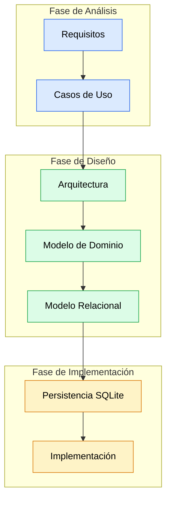
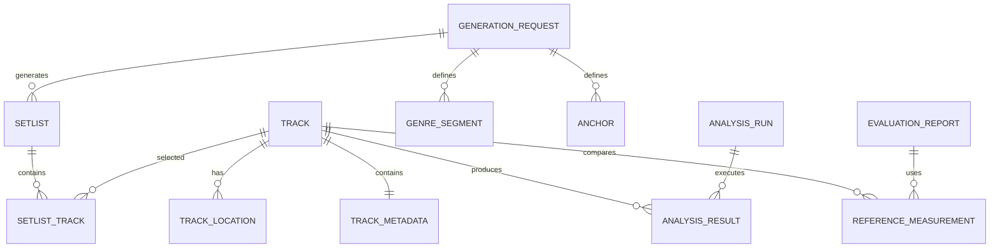
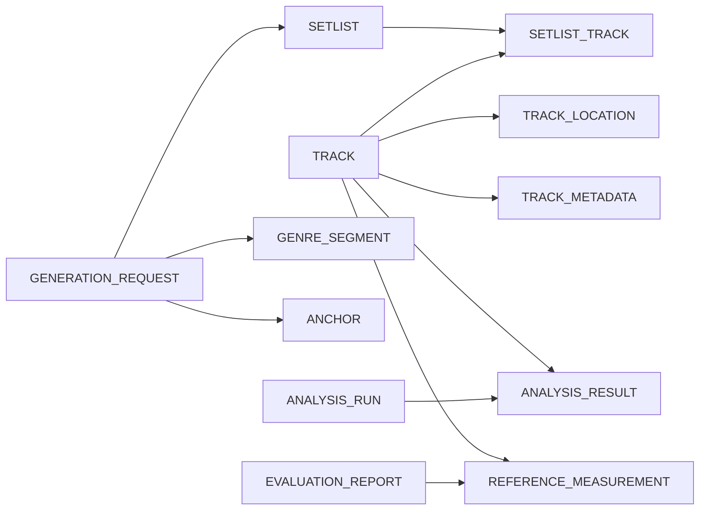

# Modelo de Datos

## Introducción

Este documento define el modelo de dominio y la estrategia de persistencia de SetlistGen.

Su propósito es establecer una representación consistente de la información gestionada por el sistema y servir como puente entre:



---

# Objetivos de Diseño

El modelo debe permitir:

- Identificar pistas de manera estable.
- Detectar nuevas pistas sin reanalizar toda la biblioteca.
- Gestionar múltiples motores de análisis.
- Mantener el histórico de análisis.
- Mantener el histórico de setlists.
- Permitir comparaciones con Rekordbox.
- Garantizar trazabilidad y reproducibilidad.

---

# Principios de Diseño

## P01. Identidad independiente de la ruta

La identidad de una pista no depende de:

- ruta,
- carpeta,
- nombre del fichero.

---

## P02. Soporte multi-motor

Una misma pista puede disponer de múltiples resultados de análisis.

Ejemplo:

```text
Track
 ├── Essentia
 ├── Librosa
 └── Madmom
```

---

## P03. Reproducibilidad

Toda generación debe poder reproducirse mediante:

- parámetros,
- semilla,
- biblioteca.

---

## P04. Historial completo

Los resultados históricos no se sobrescriben.

---

# Modelo de Dominio

## Track

Representa una pista musical única.

### Responsabilidades

- Mantener identidad lógica.
- Agrupar ubicaciones.
- Agrupar resultados de análisis.
- Participar en setlists.

### Atributos mínimos

```text
track_id
fingerprint
status
created_at
```

### Requisitos relacionados

- RF-09
- RF-09b
- RF-09c

---

## TrackLocation

Representa una ubicación física concreta.

### Responsabilidades

- Resolver rutas.
- Detectar movimientos.
- Detectar duplicados.
- Detectar ausencias.

### Atributos mínimos

```text
location_id
track_id

path
last_seen_at

status
```

Estados:

```text
ACTIVE
MOVED
MISSING
DUPLICATE
```

### Requisitos relacionados

- RF-09c
- RF-22

---

## TrackMetadata

Información obtenida desde etiquetas.

### Atributos mínimos

```text
title
artist
genre
year
duration
```

### Requisitos relacionados

- RF-03

---

## AnalysisRun

Representa una ejecución concreta.

### Atributos mínimos

```text
run_id

engine_name
engine_version

executed_at
```

### Requisitos relacionados

- RF-07

---

## AnalysisResult

Resultado producido por un motor.

### Atributos mínimos

```text
analysis_id

track_id
run_id

bpm

key_tonic
key_mode

camelot

confidence

status
```

Estados:

```text
SUCCESS
FAILED
LOW_CONFIDENCE
```

### Requisitos relacionados

- RF-04
- RF-05
- RF-06
- RF-07
- RF-29

---

## GenerationRequest

Petición de generación.

### Atributos mínimos

```text
request_id

target_duration

bpm_min
bpm_max

harmonic_policy

random_seed
```

### Requisitos relacionados

- RF-12
- RF-13
- RF-13b
- RF-14

---

## GenreSegment

Restricción temporal de género.

### Atributos mínimos

```text
segment_id

request_id

start_time
end_time

genre
```

### Requisitos relacionados

- RF-15

---

## Anchor

Pista fijada en una posición.

### Atributos mínimos

```text
anchor_id

request_id
track_id

position
```

### Requisitos relacionados

- RF-16

---

## Setlist

Setlist generado.

### Atributos mínimos

```text
setlist_id

request_id

created_at

status
```

Estados:

```text
GENERATED
EDITED
EXPORTED
```

### Requisitos relacionados

- RF-10
- RF-17
- RF-18
- RF-20

---

## SetlistTrack

Relación ordenada entre Setlist y Track.

### Atributos mínimos

```text
setlist_id
track_id

position
```

### Requisitos relacionados

- RF-20b

---

## Transition

Representa la evaluación de una transición.

### Estado

Pendiente de validación por tutor (OD-06).

### Atributos mínimos

```text
transition_id

from_track_id
to_track_id

bpm_delta

camelot_distance

score
```

### Requisitos relacionados

- RF-17
- RF-20

---

## ReferenceMeasurement

Datos importados desde Rekordbox.

### Atributos mínimos

```text
reference_id

track_id

bpm_reference

key_reference

camelot_reference
```

### Requisitos relacionados

- RF-29
- RF-29b

---

## EvaluationReport

Resultado agregado de evaluación.

### Atributos mínimos

```text
report_id

generated_at

bpm_accuracy

key_accuracy

camelot_accuracy
```

### Requisitos relacionados

- RNF-05
- RNF-06
- RNF-07
- RNF-08
- RNF-09

---

# Objetos de Valor

## BpmRange

```text
minimum
maximum
```

---

## GenerationSeed

```text
seed
```

---

## DurationTarget

```text
duration
tolerance
```

---

## HarmonicPolicy

Configuración de compatibilidad armónica.

---

# Servicios de Dominio

## TrackIdentificationService

Responsable de identificar pistas.

---

## SetlistGenerationService

Responsable de generar setlists.

---

## TransitionEvaluationService

Responsable de evaluar transiciones.

---

## EvaluationService

Responsable de comparar resultados frente a Rekordbox.

---

# MER (v0.1)



---

# Modelo Relacional (v0.1)



---

# Cuestiones Abiertas

## OD-03

Identidad definitiva de pistas.

---

## OD-04

Persistencia multi-motor.

---

## OD-05

Necesidad de Library.

---

## OD-06

Persistencia de Transition.

---

## OD-07

Validación definitiva del dominio.

---

# Riesgos

## RD-01

Cambio de estrategia de identificación.

---

## RD-02

Cambio de estrategia multi-motor.

---

## RD-03

Validación de las transiciones.

---

## RD-04

Cambios derivados de la PoC del motor MIR.

---

# Próximos pasos

1. Validar OD-03..OD-07 con tutor y cotutor.
2. Congelar entidades.
3. Diseñar modelo relacional definitivo.
4. Diseñar esquema SQLite.
5. Definir índices.
6. Diseñar migraciones.
