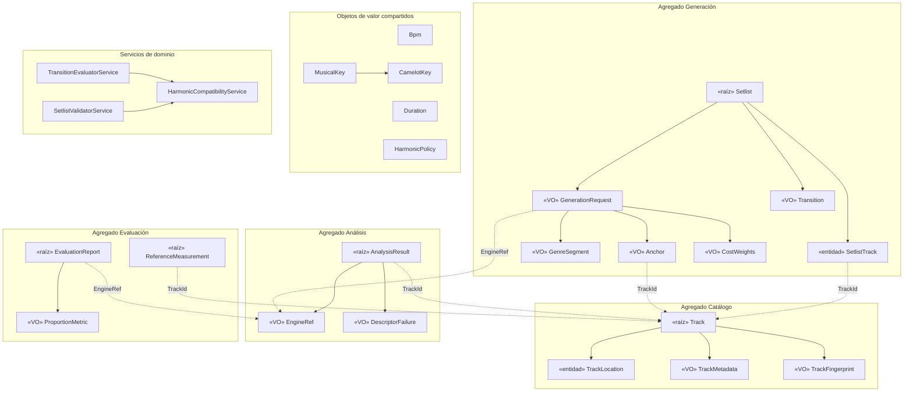

# Modelo de Dominio de SetlistGen (versión provisional)

> Destino en el repositorio: `docs/architecture/domain-model.md`. Paso 1 del plan de diseño detallado; precede a `data-model.md`.

**Versión:** 0.1 (provisional) · **Fecha:** 2026-11-07 · **Estado:** pendiente de validación por tutor y cotutor
**Alineado con:** SRS v4.0, casos de uso v1.1, matriz v3.0, glosario v2.1, ADR-001 a ADR-010, `open-decisions.md` v3.1.

> Todo lo que depende de una decisión abierta se marca **[SUPUESTO · OD-xx]**. No cierra la decisión. El modelo **no se congela** hasta validar OD-03 a OD-07 (riesgo R-13).

---

# 1. Alcance

Este documento fija agregados, entidades, objetos de valor, servicios de dominio e invariantes. No define tablas, MER ni SQL. El código de la sección 7 es **especificación ejecutable del dominio** (solo biblioteca estándar, RNF-22). No debe copiarse a `src/` hasta reorganizar el repositorio (N-25) y congelar el modelo. Requiere Python 3.10 o superior (`X | Y`, `slots=True`); la versión definitiva se fija en ADR-008 tras la prueba de concepto.

El código se ha comprobado con una batería de humo: sintaxis, las 24 tonalidades frente a la tabla 3.1 de la memoria, compatibilidad armónica, validación R1 a R7, reordenación y el intervalo de Wilson. No sustituye a las pruebas del catálogo (T-CU05-xx, T-CU01-05).

# 2. Decisiones de modelado

| ID | Decisión | Motivo | Dependencia |
|---|---|---|---|
| D-01 | `AnalysisResult` es **agregado propio**, no parte de `Track`. Se enlaza por `TrackId` | Con varios motores por pista, `Track` crecería sin límite y cada reanálisis tocaría el agregado de identidad | **[SUPUESTO · OD-04]** |
| D-02 | `AnalysisRun` desaparece como entidad. Motor, versión y fecha se absorben en `EngineRef` y `analyzed_at` | No tiene identidad ni comportamiento propios | OD-07 |
| D-03 | El **motor activo** es configuración de aplicación. El dominio solo conoce `EngineRef`, que queda registrado en `GenerationRequest` para reproducir el setlist (RNF-11) | Evita que la pista conozca la configuración | OD-04 |
| D-04 | `TrackFingerprint` es objeto de valor de `Track`, con tipo (rápida o contenido) y versión del algoritmo | Resuelve N-26. La huella rápida podría ser por ubicación (ADR-010 lo deja abierto) | **[SUPUESTO · OD-03]** |
| D-05 | `TrackMetadata` es objeto de valor. BPM y tonalidad de etiqueta viven en él, no como `AnalysisResult` | Una etiqueta no es una estimación de un motor (glosario, RF-03) | OD-07 |
| D-06 | `GenerationRequest` pertenece al agregado `Setlist` (un setlist, una solicitud). Regenerar crea otro `Setlist` | El README de arquitectura mostraba 1 solicitud a N setlists; se simplifica | **[SUPUESTO · OD-07]** |
| D-07 | `Transition` es objeto de valor calculado. `Setlist` guarda la instantánea **[SUPUESTO · OD-06]**; si OD-06 elige "recalcular siempre", se elimina el campo sin cambiar el resto | Mantiene el dominio válido con cualquier resultado de OD-06 | **[SUPUESTO · OD-06]** |
| D-08 | `Library` queda **fuera** del modelo hasta resolver OD-05 | Su definición varía entre documentos (N-17) | **[SUPUESTO · OD-05]** |
| D-09 | Un descriptor es un valor o un `DescriptorFailure` con causa. Nunca 0, -1 ni `None` | RF-04, RNF-15 | — |

# 3. Diagrama de agregados



# 4. Agregados

| Agregado | Raíz | Contiene | Referencia a otros | Consistencia |
|---|---|---|---|---|
| Catálogo | `Track` | `TrackLocation`, `TrackMetadata`, `TrackFingerprint` | — | Una pista, una transacción |
| Análisis | `AnalysisResult` | `EngineRef`, descriptores | `TrackId` | Único por (pista, motor) **[OD-04]** |
| Generación | `Setlist` | `SetlistTrack`, `GenerationRequest`, `Transition` | `TrackId` | Inmutable: editar produce un nuevo valor |
| Evaluación | `EvaluationReport`, `ReferenceMeasurement` | `ProportionMetric` | `TrackId`, `EngineRef` | Un informe por motor y ejecución |

Los agregados se referencian solo por identidad. El análisis paralelo calcula resultados fuera de la transacción y un coordinador los persiste (ADR-004).

# 5. Invariantes

| ID | Invariante | Origen | Se garantiza en |
|---|---|---|---|
| IN-01 | `Bpm` es finito y mayor que 0 | RF-04 | `Bpm` |
| IN-02 | `Duration` es finita y mayor que 0 | RF-12 | `Duration` |
| IN-03 | Tónica 0 a 11, número Camelot 1 a 12; las 24 tonalidades se corresponden de forma biyectiva con su código | RF-06 | `MusicalKey`, `CamelotKey` |
| IN-04 | Un descriptor es un valor o un `DescriptorFailure` con causa. Sin valores mágicos | RF-04, RNF-15 | `AnalysisResult` |
| IN-05 | Una pista tiene al menos una ubicación, con rutas distintas. Una ubicación ausente se marca, no se borra | RF-09c | `Track` |
| IN-06 | La identidad de la pista es su `TrackId`, nunca su ruta | RF-09 | `Track` |
| IN-07 | A lo sumo una huella por (tipo, versión de algoritmo) | ADR-010 | `Track` |
| IN-08 | Un resultado identifica motor y versión; previsto único por (pista, motor) | RF-07 | `AnalysisResult`, repositorio |
| IN-09 | Solicitud: `bpm_min` ≤ `bpm_max`, salto ≥ 0, tolerancia en [0, 1), pesos ≥ 0, segmentos sin solape, anclas con posición y pista distintas | RF-12 a RF-16, RF-13b | `GenerationRequest` |
| IN-10 | Setlist: posiciones contiguas, sin pistas repetidas y transiciones coherentes con el orden | RF-18, R1 | `Setlist` |
| IN-11 | Un setlist editado conserva el mismo conjunto de pistas y queda marcado | RF-20b | `Setlist.reordered` |
| IN-12 | La compatibilidad armónica **no es transitiva**: se evalúa solo entre pistas consecutivas (1A~2A y 2A~3A no implican 1A~3A) | RF-14 | Validador y evaluador |
| IN-13 | Una referencia aporta BPM o tonalidad. `ProportionMetric` exige 0 ≤ k ≤ n, n > 0. La exactitud con octava incluye a la estricta, y la de Camelot incluye a la exacta | RNF-05 a RNF-09 | `Evaluation*` |
| IN-14 | El dominio solo importa la biblioteca estándar | RNF-22 | Comprobación en CI (T-ARQ-01) |

# 6. Servicios de dominio

| Servicio | Contrato | Entrada | Salida | Requisitos |
|---|---|---|---|---|
| `HarmonicCompatibilityService` | `is_compatible(a, b, policy)` y `dissonance(a, b)` | Dos `CamelotKey`, `HarmonicPolicy` | `bool` / `float` ≥ 0 | RF-14 |
| `TransitionEvaluatorService` | `evaluate(prev, next, request)` y `evaluate_sequence(seq, request)` | `TrackDescriptors`, `GenerationRequest` | `Transition` con `cost` = α·\|ΔBPM\| + β·disonancia + γ·incoherencia de género | RF-17, RF-20 |
| `SetlistValidatorService` | `validate(sequence, request)` | Secuencia ordenada de `TrackDescriptors` | `ValidationReport` con violaciones R1 a R7 y su posición | RNF-10, RF-20b |

Los tres son deterministas, sin estado y sin efectos laterales. El validador **informa** y no lanza excepción, porque un setlist editado puede incumplir restricciones (RF-20b). R6 y R7 solo producen violaciones si hay anclas o segmentos. La política por defecto reproduce la regla básica de la rueda Camelot (ecuación 3.6 de la memoria); otros movimientos se añaden como `HarmonicMove`.

# 7. Código de dominio

Estructura: `src/setlistgen/domain/`.

## 7.1 `values.py`

```python
# src/setlistgen/domain/values.py
"""Identificadores y objetos de valor compartidos. Solo biblioteca estándar (RNF-22)."""
from __future__ import annotations

import math
from dataclasses import dataclass
from enum import Enum
from typing import NewType
from uuid import UUID

TrackId = NewType("TrackId", UUID)
AnalysisResultId = NewType("AnalysisResultId", UUID)
SetlistId = NewType("SetlistId", UUID)
EvaluationReportId = NewType("EvaluationReportId", UUID)


class DomainError(ValueError):
    """Violación de un invariante de dominio."""


def ensure(condition: bool, message: str) -> None:
    if not condition:
        raise DomainError(message)


def same_genre(a: str | None, b: str | None) -> bool:
    """Comparación de género insensible a mayúsculas y espacios (supuesto, H-20)."""

    def norm(g: str | None) -> str | None:
        return g.strip().casefold() if g else None

    return norm(a) == norm(b)


@dataclass(frozen=True, slots=True)
class Bpm:
    value: float

    def __post_init__(self) -> None:
        ensure(math.isfinite(self.value) and self.value > 0, f"BPM debe ser finito y > 0: {self.value}")


@dataclass(frozen=True, slots=True, order=True)
class Duration:
    seconds: float

    def __post_init__(self) -> None:
        ensure(math.isfinite(self.seconds) and self.seconds > 0, f"Duración debe ser > 0: {self.seconds}")


@dataclass(frozen=True, slots=True)
class Confidence:
    value: float

    def __post_init__(self) -> None:
        ensure(0.0 <= self.value <= 1.0, f"Confianza fuera de [0, 1]: {self.value}")


@dataclass(frozen=True, slots=True)
class EngineRef:
    """Motor de análisis y versión (RF-07). Sustituye a AnalysisRun como dato de origen."""

    name: str
    version: str

    def __post_init__(self) -> None:
        ensure(bool(self.name.strip()) and bool(self.version.strip()), "Motor y versión son obligatorios")


@dataclass(frozen=True, slots=True)
class DescriptorFailure:
    """Marca de fallo explícita: sustituye a valores mágicos (0, -1, None)."""

    cause: str

    def __post_init__(self) -> None:
        ensure(bool(self.cause.strip()), "Un fallo debe indicar su causa")


class KeyMode(Enum):
    MINOR = "A"
    MAJOR = "B"


@dataclass(frozen=True, slots=True)
class MusicalKey:
    """Tonalidad: clase de altura de la tónica (0 = Do ... 11 = Si) y modo."""

    tonic: int
    mode: KeyMode

    def __post_init__(self) -> None:
        ensure(isinstance(self.tonic, int) and 0 <= self.tonic <= 11, f"Tónica fuera de 0..11: {self.tonic}")

    def to_camelot(self) -> CamelotKey:
        major_pc = self.tonic if self.mode is KeyMode.MAJOR else (self.tonic + 3) % 12
        number = ((7 * major_pc) % 12 + 7) % 12 + 1
        return CamelotKey(number, self.mode)


@dataclass(frozen=True, slots=True)
class CamelotKey:
    number: int
    mode: KeyMode

    def __post_init__(self) -> None:
        ensure(1 <= self.number <= 12, f"Número Camelot fuera de 1..12: {self.number}")

    def __str__(self) -> str:
        return f"{self.number}{self.mode.value}"

    @classmethod
    def parse(cls, code: str) -> CamelotKey:
        code = code.strip().upper()
        ensure(len(code) in (2, 3) and code[-1] in "AB" and code[:-1].isdigit(), f"Código Camelot inválido: {code}")
        return cls(int(code[:-1]), KeyMode.MINOR if code[-1] == "A" else KeyMode.MAJOR)

    def circular_distance(self, other: CamelotKey) -> int:
        d = abs(self.number - other.number)
        return min(d, 12 - d)

    def signed_step(self, other: CamelotKey) -> int:
        """Desplazamiento en la rueda, en -5..6."""
        d = (other.number - self.number) % 12
        return d if d <= 6 else d - 12


@dataclass(frozen=True, slots=True)
class HarmonicMove:
    step: int
    switches_mode: bool

    def __post_init__(self) -> None:
        ensure(-5 <= self.step <= 6, f"Desplazamiento fuera de -5..6: {self.step}")


@dataclass(frozen=True, slots=True)
class HarmonicPolicy:
    """Conjunto de movimientos Camelot permitidos (RF-14)."""

    moves: frozenset[HarmonicMove]

    def __post_init__(self) -> None:
        ensure(len(self.moves) > 0, "La política armónica debe permitir al menos un movimiento")

    @classmethod
    def default(cls) -> HarmonicPolicy:
        return cls(frozenset({
            HarmonicMove(0, False),   # mismo código
            HarmonicMove(1, False),   # +1, misma letra
            HarmonicMove(-1, False),  # -1, misma letra
            HarmonicMove(0, True),    # mismo número, letra opuesta (relativa)
        }))
```

## 7.2 `catalog.py`

```python
# src/setlistgen/domain/catalog.py
"""Agregado Catálogo: raíz Track."""
from __future__ import annotations

from dataclasses import dataclass, field, replace
from datetime import datetime
from enum import Enum

from setlistgen.domain.values import Bpm, DomainError, Duration, MusicalKey, TrackId, ensure


class LocationStatus(Enum):
    ACTIVE = "active"
    ABSENT = "absent"
    MOVED = "moved"
    FAILED = "failed"


@dataclass(frozen=True, slots=True)
class TrackLocation:
    """Ruta como texto Unicode sin formato de SO (RNF-16, RNF-21). Nivel 1a de ADR-010."""

    path: str
    size_bytes: int
    modified_at: datetime
    last_seen_at: datetime
    status: LocationStatus = LocationStatus.ACTIVE

    def __post_init__(self) -> None:
        ensure(bool(self.path.strip()), "La ruta no puede estar vacía")
        ensure(self.size_bytes >= 0, "El tamaño no puede ser negativo")

    def with_status(self, status: LocationStatus, seen_at: datetime | None = None) -> TrackLocation:
        return replace(self, status=status, last_seen_at=seen_at or self.last_seen_at)


class FingerprintKind(Enum):
    QUICK = "quick"      # nivel 1b
    CONTENT = "content"  # nivel 2


@dataclass(frozen=True, slots=True)
class TrackFingerprint:
    kind: FingerprintKind
    digest: str
    algorithm_version: str

    def __post_init__(self) -> None:
        ensure(bool(self.digest) and bool(self.algorithm_version), "Huella y versión de algoritmo obligatorias")


@dataclass(frozen=True, slots=True)
class TrackMetadata:
    """Etiquetas (RF-03). BPM y tonalidad de etiqueta no son estimaciones: se guardan aparte."""

    title: str | None = None
    artist: str | None = None
    genre: str | None = None
    year: int | None = None
    duration: Duration | None = None
    tag_bpm: Bpm | None = None
    tag_key: MusicalKey | None = None

    def __post_init__(self) -> None:
        ensure(self.year is None or self.year > 0, "El año debe ser positivo")


@dataclass(slots=True, eq=False)
class Track:
    """Raíz del agregado. Identidad = id, nunca la ruta (RF-09)."""

    id: TrackId
    metadata: TrackMetadata
    locations: list[TrackLocation]
    fingerprints: list[TrackFingerprint] = field(default_factory=list)

    def __post_init__(self) -> None:
        ensure(len(self.locations) >= 1, "Una pista tiene al menos una ubicación")
        ensure(len({loc.path for loc in self.locations}) == len(self.locations), "Rutas duplicadas")

    @property
    def is_available(self) -> bool:
        return any(loc.status is LocationStatus.ACTIVE for loc in self.locations)

    def _index(self, path: str) -> int:
        for i, loc in enumerate(self.locations):
            if loc.path == path:
                return i
        raise DomainError(f"Ubicación desconocida: {path}")

    def add_location(self, location: TrackLocation) -> None:
        """Pista duplicada: misma pista en otra ruta (RF-09c)."""
        ensure(all(loc.path != location.path for loc in self.locations), "Ruta ya registrada")
        self.locations.append(location)

    def mark_absent(self, path: str) -> None:
        i = self._index(path)
        self.locations[i] = self.locations[i].with_status(LocationStatus.ABSENT)

    def reactivate(self, path: str, seen_at: datetime) -> None:
        i = self._index(path)
        self.locations[i] = self.locations[i].with_status(LocationStatus.ACTIVE, seen_at)

    def relocate(self, old_path: str, new_location: TrackLocation) -> None:
        """Pista movida: conserva id, descriptores e histórico (RF-09c)."""
        i = self._index(old_path)
        self.add_location(new_location)
        self.locations[i] = self.locations[i].with_status(LocationStatus.MOVED)

    def add_fingerprint(self, fp: TrackFingerprint) -> None:
        ensure(
            all((f.kind, f.algorithm_version) != (fp.kind, fp.algorithm_version) for f in self.fingerprints),
            "Ya existe una huella de ese tipo y versión",
        )
        self.fingerprints.append(fp)

    def update_metadata(self, metadata: TrackMetadata) -> None:
        self.metadata = metadata
```

## 7.3 `analysis.py`

```python
# src/setlistgen/domain/analysis.py
"""Agregado Análisis: AnalysisResult (valor indivisible por pista y motor)."""
from __future__ import annotations

from dataclasses import dataclass
from datetime import datetime

from setlistgen.domain.values import (
    AnalysisResultId, Bpm, CamelotKey, Confidence, DescriptorFailure, EngineRef, MusicalKey, TrackId,
)


@dataclass(frozen=True, slots=True)
class AnalysisResult:
    """Unicidad prevista por (track_id, engine). Referencia a Track solo por identidad."""

    id: AnalysisResultId
    track_id: TrackId
    engine: EngineRef
    analyzed_at: datetime
    bpm: Bpm | DescriptorFailure
    key: MusicalKey | DescriptorFailure
    confidence: Confidence | None = None

    @property
    def camelot(self) -> CamelotKey | None:
        return self.key.to_camelot() if isinstance(self.key, MusicalKey) else None

    @property
    def is_usable(self) -> bool:
        """Candidata para generar: ambos descriptores estimados (CU-05, paso 5)."""
        return isinstance(self.bpm, Bpm) and isinstance(self.key, MusicalKey)
```

## 7.4 `generation.py`

```python
# src/setlistgen/domain/generation.py
"""Agregado Generación: raíz Setlist."""
from __future__ import annotations

from collections.abc import Sequence
from dataclasses import dataclass, field, replace
from datetime import datetime

from setlistgen.domain.values import (
    Bpm, CamelotKey, Duration, EngineRef, HarmonicPolicy, SetlistId, TrackId, ensure,
)


@dataclass(frozen=True, slots=True)
class CostWeights:
    """Pesos α, β, γ de J(s). Valores por defecto provisionales (ADR-005)."""

    alpha: float = 1.0
    beta: float = 1.0
    gamma: float = 1.0

    def __post_init__(self) -> None:
        ensure(min(self.alpha, self.beta, self.gamma) >= 0, "Los pesos no pueden ser negativos")


@dataclass(frozen=True, slots=True)
class GenreSegment:
    start_s: float
    end_s: float
    genre: str

    def __post_init__(self) -> None:
        ensure(0 <= self.start_s < self.end_s, "Segmento de género con intervalo inválido")
        ensure(bool(self.genre.strip()), "El género del segmento es obligatorio")


@dataclass(frozen=True, slots=True)
class Anchor:
    position: int  # base 0
    track_id: TrackId

    def __post_init__(self) -> None:
        ensure(self.position >= 0, "Posición de ancla negativa")


@dataclass(frozen=True, slots=True)
class GenerationRequest:
    target_duration: Duration
    bpm_min: Bpm
    bpm_max: Bpm
    engine: EngineRef  # motor activo usado: necesario para RNF-11
    seed: int
    algorithm_version: str
    max_bpm_jump: float = 5.0  # (P) OD-02
    duration_tolerance: float = 0.05
    policy: HarmonicPolicy = field(default_factory=HarmonicPolicy.default)
    weights: CostWeights = field(default_factory=CostWeights)
    genre_segments: tuple[GenreSegment, ...] = ()
    anchors: tuple[Anchor, ...] = ()

    def __post_init__(self) -> None:
        ensure(self.bpm_min.value <= self.bpm_max.value, "bpm_min > bpm_max")
        ensure(self.max_bpm_jump >= 0, "El salto máximo de BPM no puede ser negativo")
        ensure(0 <= self.duration_tolerance < 1, "Tolerancia de duración fuera de [0, 1)")
        ensure(bool(self.algorithm_version.strip()), "Versión de algoritmo obligatoria")
        ordered = sorted(self.genre_segments, key=lambda s: s.start_s)
        ensure(all(a.end_s <= b.start_s for a, b in zip(ordered, ordered[1:])), "Segmentos de género solapados")
        ensure(len({a.position for a in self.anchors}) == len(self.anchors), "Posiciones de ancla repetidas")
        ensure(len({a.track_id for a in self.anchors}) == len(self.anchors), "Pista anclada más de una vez")


@dataclass(frozen=True, slots=True)
class TrackDescriptors:
    """Proyección de entrada del generador: resultado del motor activo + metadatos."""

    track_id: TrackId
    bpm: Bpm
    key: CamelotKey
    duration: Duration
    genre: str | None = None


@dataclass(frozen=True, slots=True)
class Transition:
    """Objeto de valor calculado. Su persistencia depende de OD-06."""

    from_track: TrackId
    to_track: TrackId
    bpm_delta: float
    camelot_distance: int
    harmonically_compatible: bool
    genre_incoherence: float
    cost: float

    def __post_init__(self) -> None:
        ensure(self.bpm_delta >= 0 and self.cost >= 0 and self.camelot_distance >= 0, "Transición con valores negativos")


@dataclass(frozen=True, slots=True)
class SetlistTrack:
    position: int
    track_id: TrackId


@dataclass(frozen=True, slots=True)
class Setlist:
    id: SetlistId
    request: GenerationRequest
    entries: tuple[SetlistTrack, ...]
    transitions: tuple[Transition, ...]
    created_at: datetime
    edited: bool = False

    def __post_init__(self) -> None:
        ids = [e.track_id for e in self.entries]
        ensure([e.position for e in self.entries] == list(range(len(ids))), "Posiciones no contiguas")
        ensure(len(set(ids)) == len(ids), "Pista repetida en el setlist (RF-18)")
        ensure(len(self.transitions) == max(len(ids) - 1, 0), "Número de transiciones incoherente")
        for i, t in enumerate(self.transitions):
            ensure(t.from_track == ids[i] and t.to_track == ids[i + 1], f"Transición {i} no corresponde al orden")

    @property
    def track_ids(self) -> tuple[TrackId, ...]:
        return tuple(e.track_id for e in self.entries)

    @property
    def total_cost(self) -> float:
        return sum(t.cost for t in self.transitions)

    def reordered(self, new_order: Sequence[TrackId], transitions: Sequence[Transition]) -> Setlist:
        """Edición manual (RF-20b): mismo conjunto de pistas, nuevo orden, marcado como editado."""
        ensure(sorted(map(str, new_order)) == sorted(map(str, self.track_ids)), "Solo se permite permutar las pistas")
        entries = tuple(SetlistTrack(i, t) for i, t in enumerate(new_order))
        return replace(self, entries=entries, transitions=tuple(transitions), edited=True)
```

## 7.5 `evaluation.py`

```python
# src/setlistgen/domain/evaluation.py
"""Agregado Evaluación: referencias de Rekordbox e informes por motor."""
from __future__ import annotations

import math
from collections.abc import Mapping
from dataclasses import dataclass
from datetime import datetime
from enum import Enum

from setlistgen.domain.values import Bpm, EngineRef, EvaluationReportId, MusicalKey, TrackId, ensure


class ReferenceSource(Enum):
    REKORDBOX_XML = "rekordbox_xml"
    CSV = "csv"


class BpmErrorKind(Enum):
    OCTAVE = "octave"
    OTHER = "other"


class KeyErrorKind(Enum):
    RELATIVE = "relative"
    FIFTH = "fifth"
    PARALLEL = "parallel"
    OTHER = "other"


@dataclass(frozen=True, slots=True)
class ReferenceMeasurement:
    track_id: TrackId
    source: ReferenceSource
    bpm: Bpm | None = None
    key: MusicalKey | None = None
    rekordbox_version: str | None = None

    def __post_init__(self) -> None:
        ensure(self.bpm is not None or self.key is not None, "La referencia debe aportar BPM o tonalidad")


@dataclass(frozen=True, slots=True)
class ProportionMetric:
    successes: int
    total: int

    def __post_init__(self) -> None:
        ensure(self.total > 0 and 0 <= self.successes <= self.total, "Proporción inválida")

    @property
    def proportion(self) -> float:
        return self.successes / self.total

    def wilson_interval(self, z: float = 1.96) -> tuple[float, float]:
        """Intervalo de Wilson (RNF-09)."""
        n, p = self.total, self.proportion
        denom = 1 + z * z / n
        centre = (p + z * z / (2 * n)) / denom
        half = z * math.sqrt(p * (1 - p) / n + z * z / (4 * n * n)) / denom
        return max(0.0, centre - half), min(1.0, centre + half)


@dataclass(frozen=True, slots=True)
class EvaluationReport:
    id: EvaluationReportId
    engine: EngineRef
    reference_source: ReferenceSource
    created_at: datetime
    bpm_strict: ProportionMetric       # RNF-05
    bpm_octave: ProportionMetric       # RNF-06
    key_exact: ProportionMetric | None  # RNF-07 (None si la referencia no trae tonalidad, CU-11 A1)
    key_camelot: ProportionMetric | None  # RNF-08
    bpm_errors: Mapping[BpmErrorKind, int]
    key_errors: Mapping[KeyErrorKind, int]
    excluded_without_reference: int = 0
    excluded_ambiguous: int = 0

    def __post_init__(self) -> None:
        ensure(self.bpm_octave.successes >= self.bpm_strict.successes, "La exactitud con octava incluye la estricta")
        ensure((self.key_exact is None) == (self.key_camelot is None), "Métricas de tonalidad incompletas")
        if self.key_exact is not None and self.key_camelot is not None:
            ensure(self.key_camelot.successes >= self.key_exact.successes, "Camelot incluye la coincidencia exacta")
        ensure(self.excluded_without_reference >= 0 and self.excluded_ambiguous >= 0, "Exclusiones negativas")
```

## 7.6 `services.py`

```python
# src/setlistgen/domain/services.py
"""Servicios de dominio sin estado."""
from __future__ import annotations

from collections.abc import Sequence
from dataclasses import dataclass
from enum import Enum

from setlistgen.domain.generation import GenerationRequest, TrackDescriptors, Transition
from setlistgen.domain.values import CamelotKey, HarmonicMove, HarmonicPolicy, same_genre

_EPS = 1e-9


class HarmonicCompatibilityService:
    def is_compatible(self, a: CamelotKey, b: CamelotKey, policy: HarmonicPolicy) -> bool:
        """No es transitiva: solo se evalúa entre pistas consecutivas."""
        return HarmonicMove(a.signed_step(b), a.mode is not b.mode) in policy.moves

    def dissonance(self, a: CamelotKey, b: CamelotKey) -> float:
        """Medida fina para el coste: distancia circular (+1 si cambia el modo). Forma provisional (H-21)."""
        return float(a.circular_distance(b) + (1 if a.mode is not b.mode else 0)) if a != b else 0.0


class TransitionEvaluatorService:
    def __init__(self, harmony: HarmonicCompatibilityService) -> None:
        self._harmony = harmony

    def evaluate(self, prev: TrackDescriptors, nxt: TrackDescriptors, request: GenerationRequest) -> Transition:
        """J por transición = α·|ΔBPM| + β·disonancia + γ·incoherencia de género (ADR-005)."""
        delta = abs(nxt.bpm.value - prev.bpm.value)
        dissonance = self._harmony.dissonance(prev.key, nxt.key)
        genre_incoh = 0.0 if same_genre(prev.genre, nxt.genre) else 1.0
        w = request.weights
        return Transition(
            from_track=prev.track_id,
            to_track=nxt.track_id,
            bpm_delta=delta,
            camelot_distance=prev.key.circular_distance(nxt.key),
            harmonically_compatible=self._harmony.is_compatible(prev.key, nxt.key, request.policy),
            genre_incoherence=genre_incoh,
            cost=w.alpha * delta + w.beta * dissonance + w.gamma * genre_incoh,
        )

    def evaluate_sequence(self, sequence: Sequence[TrackDescriptors], request: GenerationRequest) -> tuple[Transition, ...]:
        return tuple(self.evaluate(a, b, request) for a, b in zip(sequence, sequence[1:]))


class ConstraintId(Enum):
    R1 = "R1"  # sin repeticiones
    R2 = "R2"  # rango de BPM
    R3 = "R3"  # salto máximo de BPM
    R4 = "R4"  # política armónica
    R5 = "R5"  # duración con tolerancia
    R6 = "R6"  # anclas
    R7 = "R7"  # género por intervalo


@dataclass(frozen=True, slots=True)
class ConstraintViolation:
    constraint: ConstraintId
    position: int | None
    detail: str


@dataclass(frozen=True, slots=True)
class ValidationReport:
    violations: tuple[ConstraintViolation, ...]

    @property
    def is_valid(self) -> bool:
        return not self.violations


class SetlistValidatorService:
    """Determinista y sin efectos. Sirve a RNF-10 y a la reevaluación tras RF-20b."""

    def __init__(self, harmony: HarmonicCompatibilityService) -> None:
        self._harmony = harmony

    def validate(self, sequence: Sequence[TrackDescriptors], request: GenerationRequest) -> ValidationReport:
        v: list[ConstraintViolation] = []
        seen: set[object] = set()
        offset = 0.0
        for pos, t in enumerate(sequence):
            if t.track_id in seen:
                v.append(ConstraintViolation(ConstraintId.R1, pos, "Pista repetida"))
            seen.add(t.track_id)
            if not (request.bpm_min.value - _EPS <= t.bpm.value <= request.bpm_max.value + _EPS):
                v.append(ConstraintViolation(ConstraintId.R2, pos, f"BPM {t.bpm.value} fuera de rango"))
            if pos > 0:
                prev = sequence[pos - 1]
                if abs(t.bpm.value - prev.bpm.value) > request.max_bpm_jump + _EPS:
                    v.append(ConstraintViolation(ConstraintId.R3, pos, "Salto de BPM excesivo"))
                if not self._harmony.is_compatible(prev.key, t.key, request.policy):
                    v.append(ConstraintViolation(ConstraintId.R4, pos, f"{prev.key} → {t.key} no compatible"))
            seg = next((s for s in request.genre_segments if s.start_s <= offset < s.end_s), None)
            if seg is not None and not same_genre(t.genre, seg.genre):
                v.append(ConstraintViolation(ConstraintId.R7, pos, f"Se esperaba género {seg.genre}"))
            offset += t.duration.seconds
        target = request.target_duration.seconds
        lo, hi = (1 - request.duration_tolerance) * target, (1 + request.duration_tolerance) * target
        if not (lo - _EPS <= offset <= hi + _EPS):
            v.append(ConstraintViolation(ConstraintId.R5, None, f"Duración {offset:.0f}s fuera de [{lo:.0f}, {hi:.0f}]"))
        for a in request.anchors:
            if a.position >= len(sequence) or sequence[a.position].track_id != a.track_id:
                v.append(ConstraintViolation(ConstraintId.R6, a.position, "Ancla no respetada"))
        return ValidationReport(tuple(v))
```

# 8. Supuestos derivados de decisiones abiertas

| OD | Supuesto aplicado | Qué cambia si se rechaza |
|---|---|---|
| OD-03 | Huellas como VO de `Track`, con tipo y versión. Estados `ACTIVE`, `ABSENT`, `MOVED`, `FAILED` de la ubicación | Mover la huella rápida a `TrackLocation`; revisar `Track` y T-ID-xx |
| OD-04 | Varios `AnalysisResult` por pista, indivisibles (BPM y tonalidad del mismo motor), motor activo fuera del dominio | `AnalysisResult` pasaría a ser un VO de `Track` y desaparecería `EngineRef` en la solicitud |
| OD-05 | `Library` no modelada; la pertenencia se deduce de la ubicación | Añadir entidad (¿`LibraryRoot` o `Import`?) y su relación con `TrackLocation` |
| OD-06 | `Setlist.transitions` como instantánea | Eliminar el campo y calcular con `TransitionEvaluatorService` al consultar |
| OD-07 | Entidades de este documento; `TrackMetadata` como VO; solicitud dentro del setlist | Reajustar agregados y glosario sección 6 |

# 9. Hallazgos nuevos

| ID | Gravedad | Problema | Propuesta |
|---|---|---|---|
| N-31 | Media | El glosario y ADR-002 listan `AnalysisRun`, pero no tiene identidad ni comportamiento propios | Absorberla en `EngineRef` y `analyzed_at`; reflejarlo en OD-07 |
| N-32 | Media | `TrackRepository` (ADR-002) incluye los resultados de análisis, pero D-01 los separa en otro agregado | Opción A: mantener un solo puerto con dos métodos. Opción B: `AnalysisResultRepository`. Decidir en OD-07 |
| N-33 | Media | Falta un criterio de clasificación de errores (octava, relativa, quinta, paralela) para RNF-09 | Crear `EstimationErrorClassifier`, cuarto servicio de dominio, en el diseño de CU-11 |
| N-34 | Baja | La incoherencia de género es 0 o 1 y la disonancia es la distancia Camelot (+1 si cambia el modo); ambas son formas provisionales | Ratificar con el benchmark y la PoC (H-20, H-21) |
| N-35 | Baja | La instrucción de "transitividad Camelot" es inexacta: la compatibilidad no es transitiva | Recogido en IN-12 |

# 10. Puertos por agregado

| Agregado | Puerto | Estado |
|---|---|---|
| Catálogo | `TrackRepository`, `TrackIdentifier` | Previsto / **[PROPUESTA · OD-03]** |
| Análisis | `AudioAnalyzer`; persistencia en `TrackRepository` o `AnalysisResultRepository` | Previsto / N-32 |
| Generación | `SetlistRepository` | Previsto |
| Evaluación | `EvaluationRepository`, `ReferenceDataProvider` | **[PROPUESTA]** / Previsto |

# 11. Impacto y siguiente paso

- **Documentación:** anotar N-31 a N-33 en `audit-review.md` y las propuestas en OD-07. Sin cambios en SRS, CU, matriz ni glosario.
- **ADR:** no se recomienda una nueva ADR todavía. Si se confirman D-01 y N-32, ADR-002 y ADR-004 necesitan una revisión menor.
- **Siguiente paso:** comprobar este modelo contra los 11 casos de uso (paso 2 del plan).

Guardar este contenido para la memoria del TFG (capítulo 6, sección 6.2):

- **Contexto:** el sistema necesita un modelo independiente de SQLite y de las librerías MIR.
- **Problema:** ordenar entidades candidatas con decisiones aún abiertas.
- **Alternativas:** lista plana de entidades o agregados con límites transaccionales.
- **Solución adoptada:** cuatro agregados que se referencian por identidad.
- **Justificación:** aísla el crecimiento por motor y cumple la regla de dependencia.
- **Ventajas:** el modelo tolera el resultado de OD-03 a OD-06 con cambios locales.
- **Limitaciones:** provisional hasta validar los tutores.
- **Impacto:** condiciona el modelo conceptual y el relacional.
