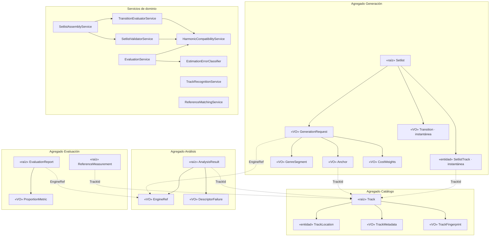

# Modelo de Dominio de SetlistGen (versión provisional)

> Destino en el repositorio: `docs/architecture/domain-model.md`. Paso 1 del plan de diseño detallado, revisado tras el paso 2 (comprobación contra los 11 casos de uso). Precede a `conceptual-model.md` y a `data-model.md`.

**Versión:** 0.2 (provisional) · **Fecha:** 2026-11-07 · **Estado:** pendiente de validación por tutor y cotutor
**Alineado con:** SRS v4.0, casos de uso v1.1, matriz v3.0, glosario v2.1, ADR-001 a ADR-010, `open-decisions.md` v3.1.

> Lo que depende de una decisión abierta se marca **[SUPUESTO · OD-xx]**. El autor ha adoptado estos supuestos para avanzar, pero **no cierran la decisión**: siguen pendientes de tutor y cotutor. El modelo no se congela hasta validar OD-03 a OD-07 (riesgo R-13).

---

# 1. Alcance y verificación

El documento fija agregados, entidades, objetos de valor, servicios, contratos e invariantes. No define tablas, MER ni SQL. El código de la sección 8 es **especificación ejecutable del dominio** (solo biblioteca estándar, RNF-22). No debe copiarse a `src/` hasta reorganizar el repositorio (N-25) y congelar el modelo. Requiere Python 3.10 o superior; la versión definitiva se fija en ADR-008.

Se ha comprobado con pruebas de humo que cubren: sintaxis, las 24 tonalidades frente a la tabla 3.1 de la memoria, compatibilidad no transitiva, los siete resultados de reconocimiento, selección de candidatas, ensamblado y edición con instantáneas, emparejamiento de referencias y métricas con fallos en el denominador. No sustituyen al catálogo de pruebas de la matriz (T-CU05-xx, T-ID-xx, T-CU11-xx).

# 2. Cambios respecto a v0.1

| ID | Cambio | CU | Estado |
|---|---|---|---|
| C-01 | `TrackRecognitionService`, `TrackIndex`, `FileObservation` y `RecognitionOutcome`. Se añade el resultado `NEEDS_FINGERPRINT` (nivel 1a insuficiente, hay que calcular la huella rápida) | 01, 02 | Aplicado |
| C-02 | `TrackLocation.failure_cause` con el invariante `FAILED ⇔ causa`. `Track.mark_failed`, `refresh_location` y `last_known_location` | 01, 02, 07 | Aplicado |
| C-03 | `build_descriptors` y `select_candidates`, con motivo de exclusión por pista y `unmet_anchors` | 05 | Aplicado |
| C-04 | `ConstraintId` pasa a `generation.py`. `OptimalityStatus`, resultados `Solution`, `Infeasible` y `LimitReached`, contrato `SetlistGenerator`, `node_limit` y `time_limit_s` | 05 | Aplicado |
| C-05 | `allowed_keys` como **pre-filtro** de candidatas (RF-14), sin restricción R8 | 04, 05 | Aplicado (decisión del autor) |
| C-06 | `ReferenceRecord`, `ReferenceMatchResult`, `ReferenceMatchingService`, `EvaluationService` y `EstimationErrorClassifier` (N-33). Informe con listas, ámbito y `estimation_failures` | 11 | Aplicado |
| C-07 | `check_request_inputs`: todas las incidencias a la vez, con acción sugerida (RNF-14) | 04, 05 | Aplicado |
| C-08 | `SetlistTrack` con instantánea (`Bpm`, `CamelotKey`, `Duration`, género) y `original_position`. `SetlistAssemblyService` para ensamblar y reordenar | 05, 08 | Aplicado **[SUPUESTO · OD-06]** |

Aclaración sobre C-08: el campo `original_position` se guarda **por entrada** y no como una lista aparte. Es equivalente a un `original_order` y evita inconsistencias entre ambos.

# 3. Decisiones de modelado

| ID | Decisión | Dependencia |
|---|---|---|
| D-01 | `AnalysisResult` es agregado propio, enlazado por `TrackId`. Puerto `AnalysisResultRepository` en Aplicación; `TrackRepository` solo para Catálogo | **[SUPUESTO · OD-04]** |
| D-02 | `AnalysisRun` desaparece: motor, versión y fecha se absorben en `EngineRef` y `analyzed_at` | OD-07 |
| D-03 | El motor activo es configuración de aplicación. `GenerationRequest` guarda el `EngineRef` usado (RNF-11) | OD-04 |
| D-04 | `TrackFingerprint` es objeto de valor de `Track`, con tipo y versión de algoritmo | **[SUPUESTO · OD-03]** |
| D-05 | `TrackMetadata` es objeto de valor. BPM y tonalidad de etiqueta viven ahí, no como `AnalysisResult` | OD-07 |
| D-06 | `GenerationRequest` pertenece a `Setlist`. Regenerar crea otro `Setlist` | **[SUPUESTO · OD-07]** |
| D-07 | `Setlist` guarda instantáneas de descriptores y transiciones. Tras editar se **recalculan** las transiciones y se conserva la posición generada | **[SUPUESTO · OD-06]** |
| D-08 | `Library` fuera del modelo hasta resolver OD-05 | **[SUPUESTO · OD-05]** |
| D-09 | Un descriptor es un valor o un `DescriptorFailure` con causa. Sin valores mágicos | — |
| D-10 | `allowed_keys` filtra candidatas antes de buscar y no se valida como restricción. Una ancla excluida se informa como conflicto (RF-19) | RF-14, ADR-005 |
| D-11 | Un fallo de estimación **cuenta en el total** de la métrica y se informa aparte. Una pista sin resultado del motor queda **excluida** (CU-11 A4) | RNF-05 a RNF-09 |
| D-12 | El filtro de candidatas **no** filtra por género: los segmentos pueden no cubrir todo el setlist | ADR-005 |

# 4. Diagrama de agregados



# 5. Agregados

| Agregado | Raíz | Contiene | Referencia a otros | Consistencia |
|---|---|---|---|---|
| Catálogo | `Track` | `TrackLocation`, `TrackMetadata`, `TrackFingerprint` | — | Una pista, una transacción |
| Análisis | `AnalysisResult` | `EngineRef`, descriptores | `TrackId` | Único por (pista, motor) **[OD-04]** |
| Generación | `Setlist` | `SetlistTrack`, `GenerationRequest`, `Transition` | `TrackId` | Inmutable: editar produce un valor nuevo |
| Evaluación | `EvaluationReport`, `ReferenceMeasurement` | `ProportionMetric`, listas de exclusión | `TrackId`, `EngineRef` | Un informe por motor y ejecución |

Los agregados se referencian solo por identidad. El análisis paralelo calcula fuera de la transacción y un coordinador persiste (ADR-004).

# 6. Invariantes

| ID | Invariante | Origen | Se garantiza en |
|---|---|---|---|
| IN-01 | `Bpm` es finito y mayor que 0 | RF-04 | `Bpm` |
| IN-02 | `Duration` es finita y mayor que 0 | RF-12 | `Duration` |
| IN-03 | Tónica 0 a 11, número Camelot 1 a 12; las 24 tonalidades corresponden de forma biyectiva a su código | RF-06 | `MusicalKey`, `CamelotKey` |
| IN-04 | Un descriptor es un valor o un `DescriptorFailure` con causa | RF-04, RNF-15 | `AnalysisResult` |
| IN-05 | Una pista tiene al menos una ubicación con rutas distintas. Una ubicación ausente se marca, no se borra | RF-09c | `Track` |
| IN-06 | La identidad de la pista es su `TrackId`, nunca su ruta | RF-09 | `Track` |
| IN-07 | A lo sumo una huella por (tipo, versión de algoritmo) | ADR-010 | `Track` |
| IN-08 | Un resultado identifica motor y versión; previsto único por (pista, motor) | RF-07 | `AnalysisResult`, repositorio |
| IN-09 | Solicitud: `bpm_min` ≤ `bpm_max`, salto ≥ 0, tolerancia en [0, 1), pesos ≥ 0, `node_limit` > 0, `allowed_keys` no vacío si existe, segmentos sin solape, anclas distintas | RF-12 a RF-16, RF-13b | `GenerationRequest` |
| IN-10 | Setlist: posiciones contiguas, sin pistas repetidas y transiciones coherentes con el orden | RF-18, R1 | `Setlist` |
| IN-11 | Un setlist editado conserva el conjunto de pistas, su posición generada y pierde la marca de óptimo | RF-20b | `Setlist.reordered` |
| IN-12 | La compatibilidad armónica **no es transitiva**: se evalúa solo entre pistas consecutivas | RF-14 | Validador y evaluador |
| IN-13 | `ProportionMetric` exige 0 ≤ k ≤ n y n > 0. La exactitud con octava incluye a la estricta, y la de Camelot a la exacta | RNF-05 a RNF-08 | `Evaluation*` |
| IN-14 | El dominio solo importa la biblioteca estándar | RNF-22 | CI (T-ARQ-01) |
| IN-15 | `FAILED` exige `failure_cause` y solo `FAILED` la admite | CU-01 A2 | `TrackLocation` |
| IN-16 | En cada métrica: errores clasificados + fallos de estimación = total − aciertos | D-11, RNF-09 | `EvaluationReport` |
| IN-17 | `original_position` solo existe en setlists editados | RF-20b | `Setlist` |
| IN-18 | `Infeasible` identifica al menos una restricción en conflicto | RF-19 | `Infeasible` |

# 7. Servicios y contratos

| Servicio | Contrato | Salida | Requisitos |
|---|---|---|---|
| `HarmonicCompatibilityService` | `is_compatible(a, b, policy)`, `dissonance(a, b)` | `bool` / `float` | RF-14 |
| `TransitionEvaluatorService` | `evaluate`, `evaluate_sequence` | `Transition` con coste α·\|ΔBPM\| + β·disonancia + γ·incoherencia | RF-17, RF-20 |
| `SetlistValidatorService` | `validate(sequence, request)` | `ValidationReport` (R1 a R7). Informa, no lanza | RNF-10, RF-20b |
| `SetlistAssemblyService` | `assemble(...)`, `reorder(setlist, new_order)` | `Setlist` / (`Setlist`, `ValidationReport`) | CU-05, CU-08 |
| `TrackRecognitionService` | `recognize(obs, index, scanned_paths)` | `RecognitionOutcome` | RF-09, RF-09b, RF-09c, ADR-010 |
| `ReferenceMatchingService` | `match(records, location_index, track_ids)` | `ReferenceMatchResult` | RF-29b |
| `EstimationErrorClassifier` | `classify_bpm`, `classify_key` | Tipo de error o `None` | RNF-09 |
| `EvaluationService` | `evaluate(...)` | `EvaluationReport` | RF-29, RNF-05 a RNF-09 |

Contratos sin implementación en el dominio:

- `SetlistGenerator.generate(candidates, request) -> Solution | Infeasible | LimitReached`. Es el resolutor propio de ADR-005. Con los mismos datos, solicitud y semilla produce el mismo resultado; si se usa `time_limit_s`, la reproducibilidad no está garantizada y se indica.
- Tras `NEEDS_FINGERPRINT`, la aplicación calcula la huella con `TrackIdentifier` y vuelve a llamar a `recognize`. Tras cada `NEW`, añade la ubicación al `TrackIndex` para detectar duplicados dentro de la misma importación (CU-01 A5).
- `scanned_paths` y `location_index` usan rutas normalizadas con `normalize_path`. Las rutas llegan al dominio ya decodificadas; la conversión del XML de Rekordbox es de infraestructura (RNF-21).

# 8. Código de dominio

Estructura: `src/setlistgen/domain/`.

## 8.1 `values.py`

```python
# src/setlistgen/domain/values.py
"""Identificadores y objetos de valor compartidos. Solo biblioteca estándar (RNF-22)."""
from __future__ import annotations

import math
from dataclasses import dataclass
from enum import Enum
from typing import NewType
from uuid import UUID

TrackId = NewType("TrackId", UUID)
AnalysisResultId = NewType("AnalysisResultId", UUID)
SetlistId = NewType("SetlistId", UUID)
EvaluationReportId = NewType("EvaluationReportId", UUID)


class DomainError(ValueError):
    """Violación de un invariante de dominio."""


def ensure(condition: bool, message: str) -> None:
    if not condition:
        raise DomainError(message)


def same_genre(a: str | None, b: str | None) -> bool:
    """Comparación de género insensible a mayúsculas y espacios (supuesto, H-20)."""

    def norm(g: str | None) -> str | None:
        return g.strip().casefold() if g else None

    return norm(a) == norm(b)


@dataclass(frozen=True, slots=True)
class Bpm:
    value: float

    def __post_init__(self) -> None:
        ensure(math.isfinite(self.value) and self.value > 0, f"BPM debe ser finito y > 0: {self.value}")


@dataclass(frozen=True, slots=True, order=True)
class Duration:
    seconds: float

    def __post_init__(self) -> None:
        ensure(math.isfinite(self.seconds) and self.seconds > 0, f"Duración debe ser > 0: {self.seconds}")


@dataclass(frozen=True, slots=True)
class Confidence:
    value: float

    def __post_init__(self) -> None:
        ensure(0.0 <= self.value <= 1.0, f"Confianza fuera de [0, 1]: {self.value}")


@dataclass(frozen=True, slots=True)
class EngineRef:
    """Motor de análisis y versión (RF-07). Sustituye a AnalysisRun como dato de origen."""

    name: str
    version: str

    def __post_init__(self) -> None:
        ensure(bool(self.name.strip()) and bool(self.version.strip()), "Motor y versión son obligatorios")


@dataclass(frozen=True, slots=True)
class DescriptorFailure:
    """Marca de fallo explícita: sustituye a valores mágicos (0, -1, None)."""

    cause: str

    def __post_init__(self) -> None:
        ensure(bool(self.cause.strip()), "Un fallo debe indicar su causa")


class KeyMode(Enum):
    MINOR = "A"
    MAJOR = "B"


@dataclass(frozen=True, slots=True)
class MusicalKey:
    """Tonalidad: clase de altura de la tónica (0 = Do ... 11 = Si) y modo."""

    tonic: int
    mode: KeyMode

    def __post_init__(self) -> None:
        ensure(isinstance(self.tonic, int) and 0 <= self.tonic <= 11, f"Tónica fuera de 0..11: {self.tonic}")

    def to_camelot(self) -> CamelotKey:
        major_pc = self.tonic if self.mode is KeyMode.MAJOR else (self.tonic + 3) % 12
        number = ((7 * major_pc) % 12 + 7) % 12 + 1
        return CamelotKey(number, self.mode)


@dataclass(frozen=True, slots=True)
class CamelotKey:
    number: int
    mode: KeyMode

    def __post_init__(self) -> None:
        ensure(1 <= self.number <= 12, f"Número Camelot fuera de 1..12: {self.number}")

    def __str__(self) -> str:
        return f"{self.number}{self.mode.value}"

    @classmethod
    def parse(cls, code: str) -> CamelotKey:
        code = code.strip().upper()
        ensure(len(code) in (2, 3) and code[-1] in "AB" and code[:-1].isdigit(), f"Código Camelot inválido: {code}")
        return cls(int(code[:-1]), KeyMode.MINOR if code[-1] == "A" else KeyMode.MAJOR)

    def circular_distance(self, other: CamelotKey) -> int:
        d = abs(self.number - other.number)
        return min(d, 12 - d)

    def signed_step(self, other: CamelotKey) -> int:
        """Desplazamiento en la rueda, en -5..6."""
        d = (other.number - self.number) % 12
        return d if d <= 6 else d - 12


@dataclass(frozen=True, slots=True)
class HarmonicMove:
    step: int
    switches_mode: bool

    def __post_init__(self) -> None:
        ensure(-5 <= self.step <= 6, f"Desplazamiento fuera de -5..6: {self.step}")


@dataclass(frozen=True, slots=True)
class HarmonicPolicy:
    """Conjunto de movimientos Camelot permitidos (RF-14)."""

    moves: frozenset[HarmonicMove]

    def __post_init__(self) -> None:
        ensure(len(self.moves) > 0, "La política armónica debe permitir al menos un movimiento")

    @classmethod
    def default(cls) -> HarmonicPolicy:
        return cls(frozenset({
            HarmonicMove(0, False),   # mismo código
            HarmonicMove(1, False),   # +1, misma letra
            HarmonicMove(-1, False),  # -1, misma letra
            HarmonicMove(0, True),    # mismo número, letra opuesta (relativa)
        }))
```

## 8.2 `catalog.py`

```python
# src/setlistgen/domain/catalog.py
"""Agregado Catálogo: raíz Track."""
from __future__ import annotations

from dataclasses import dataclass, field, replace
from datetime import datetime
from enum import Enum

from setlistgen.domain.values import Bpm, DomainError, Duration, MusicalKey, TrackId, ensure


class LocationStatus(Enum):
    ACTIVE = "active"
    ABSENT = "absent"
    MOVED = "moved"
    FAILED = "failed"


@dataclass(frozen=True, slots=True)
class TrackLocation:
    """Ruta como texto Unicode sin formato de SO (RNF-16, RNF-21). Nivel 1a de ADR-010."""

    path: str
    size_bytes: int
    modified_at: datetime
    last_seen_at: datetime
    status: LocationStatus = LocationStatus.ACTIVE
    failure_cause: str | None = None  # obligatoria si y solo si status es FAILED (CU-01 A2)

    def __post_init__(self) -> None:
        ensure(bool(self.path.strip()), "La ruta no puede estar vacía")
        ensure(self.size_bytes >= 0, "El tamaño no puede ser negativo")
        ensure((self.status is LocationStatus.FAILED) == (self.failure_cause is not None),
               "FAILED exige causa y solo FAILED la admite")
        ensure(self.failure_cause is None or bool(self.failure_cause.strip()), "La causa del fallo no puede estar vacía")

    def with_status(self, status: LocationStatus, seen_at: datetime | None = None,
                    failure_cause: str | None = None) -> TrackLocation:
        return replace(self, status=status, last_seen_at=seen_at or self.last_seen_at, failure_cause=failure_cause)


class FingerprintKind(Enum):
    QUICK = "quick"      # nivel 1b
    CONTENT = "content"  # nivel 2


@dataclass(frozen=True, slots=True)
class TrackFingerprint:
    kind: FingerprintKind
    digest: str
    algorithm_version: str

    def __post_init__(self) -> None:
        ensure(bool(self.digest) and bool(self.algorithm_version), "Huella y versión de algoritmo obligatorias")


@dataclass(frozen=True, slots=True)
class TrackMetadata:
    """Etiquetas (RF-03). BPM y tonalidad de etiqueta no son estimaciones: se guardan aparte."""

    title: str | None = None
    artist: str | None = None
    genre: str | None = None
    year: int | None = None
    duration: Duration | None = None
    tag_bpm: Bpm | None = None
    tag_key: MusicalKey | None = None

    def __post_init__(self) -> None:
        ensure(self.year is None or self.year > 0, "El año debe ser positivo")


@dataclass(slots=True, eq=False)
class Track:
    """Raíz del agregado. Identidad = id, nunca la ruta (RF-09)."""

    id: TrackId
    metadata: TrackMetadata
    locations: list[TrackLocation]
    fingerprints: list[TrackFingerprint] = field(default_factory=list)

    def __post_init__(self) -> None:
        ensure(len(self.locations) >= 1, "Una pista tiene al menos una ubicación")
        ensure(len({loc.path for loc in self.locations}) == len(self.locations), "Rutas duplicadas")

    @property
    def is_available(self) -> bool:
        return any(loc.status is LocationStatus.ACTIVE for loc in self.locations)

    def _index(self, path: str) -> int:
        for i, loc in enumerate(self.locations):
            if loc.path == path:
                return i
        raise DomainError(f"Ubicación desconocida: {path}")

    def add_location(self, location: TrackLocation) -> None:
        """Pista duplicada: misma pista en otra ruta (RF-09c)."""
        ensure(all(loc.path != location.path for loc in self.locations), "Ruta ya registrada")
        self.locations.append(location)

    def mark_absent(self, path: str) -> None:
        i = self._index(path)
        self.locations[i] = self.locations[i].with_status(LocationStatus.ABSENT)

    def reactivate(self, path: str, seen_at: datetime) -> None:
        i = self._index(path)
        self.locations[i] = self.locations[i].with_status(LocationStatus.ACTIVE, seen_at)

    def relocate(self, old_path: str, new_location: TrackLocation) -> None:
        """Pista movida: conserva id, descriptores e histórico (RF-09c)."""
        i = self._index(old_path)
        self.add_location(new_location)
        self.locations[i] = self.locations[i].with_status(LocationStatus.MOVED)

    def mark_failed(self, path: str, cause: str, seen_at: datetime | None = None) -> None:
        i = self._index(path)
        self.locations[i] = self.locations[i].with_status(LocationStatus.FAILED, seen_at, cause)

    def refresh_location(self, path: str, size_bytes: int, modified_at: datetime, seen_at: datetime) -> None:
        """Fichero modificado en la misma ubicación con identidad conservada (CU-02 A3, ADR-010)."""
        i = self._index(path)
        self.locations[i] = replace(self.locations[i], size_bytes=size_bytes, modified_at=modified_at,
                                    last_seen_at=seen_at, status=LocationStatus.ACTIVE, failure_cause=None)

    def last_known_location(self) -> TrackLocation:
        """Ubicación activa más reciente o, si no hay, la última vista (CU-07 A1)."""
        pool = [loc for loc in self.locations if loc.status is LocationStatus.ACTIVE] or self.locations
        return max(pool, key=lambda loc: loc.last_seen_at)

    def add_fingerprint(self, fp: TrackFingerprint) -> None:
        ensure(
            all((f.kind, f.algorithm_version) != (fp.kind, fp.algorithm_version) for f in self.fingerprints),
            "Ya existe una huella de ese tipo y versión",
        )
        self.fingerprints.append(fp)

    def update_metadata(self, metadata: TrackMetadata) -> None:
        self.metadata = metadata
```

## 8.3 `analysis.py`

```python
# src/setlistgen/domain/analysis.py
"""Agregado Análisis: AnalysisResult (valor indivisible por pista y motor)."""
from __future__ import annotations

from dataclasses import dataclass
from datetime import datetime

from setlistgen.domain.values import (
    AnalysisResultId, Bpm, CamelotKey, Confidence, DescriptorFailure, EngineRef, MusicalKey, TrackId,
)


@dataclass(frozen=True, slots=True)
class AnalysisResult:
    """Unicidad prevista por (track_id, engine). Referencia a Track solo por identidad."""

    id: AnalysisResultId
    track_id: TrackId
    engine: EngineRef
    analyzed_at: datetime
    bpm: Bpm | DescriptorFailure
    key: MusicalKey | DescriptorFailure
    confidence: Confidence | None = None

    @property
    def camelot(self) -> CamelotKey | None:
        return self.key.to_camelot() if isinstance(self.key, MusicalKey) else None

    @property
    def is_usable(self) -> bool:
        """Candidata para generar: ambos descriptores estimados (CU-05, paso 5)."""
        return isinstance(self.bpm, Bpm) and isinstance(self.key, MusicalKey)
```

## 8.4 `generation.py`

```python
# src/setlistgen/domain/generation.py
"""Agregado Generación: raíz Setlist."""
from __future__ import annotations

from collections.abc import Sequence
from dataclasses import dataclass, field, replace
from datetime import datetime
from enum import Enum
from typing import Protocol

from setlistgen.domain.values import (
    Bpm, CamelotKey, Duration, EngineRef, HarmonicPolicy, SetlistId, TrackId, ensure,
)


class ConstraintId(Enum):
    R1 = "R1"  # sin repeticiones
    R2 = "R2"  # rango de BPM
    R3 = "R3"  # salto máximo de BPM
    R4 = "R4"  # política armónica
    R5 = "R5"  # duración con tolerancia
    R6 = "R6"  # anclas
    R7 = "R7"  # género por intervalo


class OptimalityStatus(Enum):
    PROVEN = "proven"
    NOT_PROVEN = "not_proven"


@dataclass(frozen=True, slots=True)
class CostWeights:
    """Pesos α, β, γ de J(s). Valores por defecto provisionales (ADR-005)."""

    alpha: float = 1.0
    beta: float = 1.0
    gamma: float = 1.0

    def __post_init__(self) -> None:
        ensure(min(self.alpha, self.beta, self.gamma) >= 0, "Los pesos no pueden ser negativos")


@dataclass(frozen=True, slots=True)
class GenreSegment:
    start_s: float
    end_s: float
    genre: str

    def __post_init__(self) -> None:
        ensure(0 <= self.start_s < self.end_s, "Segmento de género con intervalo inválido")
        ensure(bool(self.genre.strip()), "El género del segmento es obligatorio")


@dataclass(frozen=True, slots=True)
class Anchor:
    position: int  # base 0
    track_id: TrackId

    def __post_init__(self) -> None:
        ensure(self.position >= 0, "Posición de ancla negativa")


@dataclass(frozen=True, slots=True)
class GenerationRequest:
    target_duration: Duration
    bpm_min: Bpm
    bpm_max: Bpm
    engine: EngineRef  # motor activo usado: necesario para RNF-11
    seed: int
    algorithm_version: str
    max_bpm_jump: float = 5.0  # (P) OD-02
    duration_tolerance: float = 0.05
    policy: HarmonicPolicy = field(default_factory=HarmonicPolicy.default)
    allowed_keys: frozenset[CamelotKey] | None = None  # pre-filtro de candidatas (RF-14), no es una restricción
    weights: CostWeights = field(default_factory=CostWeights)
    genre_segments: tuple[GenreSegment, ...] = ()
    anchors: tuple[Anchor, ...] = ()
    node_limit: int = 100_000  # (P) límite determinista de la búsqueda (RNF-11)
    time_limit_s: float | None = None  # límite de reloj de seguridad: rompe la reproducibilidad

    def __post_init__(self) -> None:
        ensure(self.bpm_min.value <= self.bpm_max.value, "bpm_min > bpm_max")
        ensure(self.max_bpm_jump >= 0, "El salto máximo de BPM no puede ser negativo")
        ensure(0 <= self.duration_tolerance < 1, "Tolerancia de duración fuera de [0, 1)")
        ensure(bool(self.algorithm_version.strip()), "Versión de algoritmo obligatoria")
        ensure(self.node_limit > 0, "El límite de nodos debe ser positivo")
        ensure(self.time_limit_s is None or self.time_limit_s > 0, "El límite de tiempo debe ser positivo")
        ensure(self.allowed_keys is None or len(self.allowed_keys) > 0, "allowed_keys no puede ser un conjunto vacío")
        ordered = sorted(self.genre_segments, key=lambda s: s.start_s)
        ensure(all(a.end_s <= b.start_s for a, b in zip(ordered, ordered[1:])), "Segmentos de género solapados")
        ensure(len({a.position for a in self.anchors}) == len(self.anchors), "Posiciones de ancla repetidas")
        ensure(len({a.track_id for a in self.anchors}) == len(self.anchors), "Pista anclada más de una vez")


@dataclass(frozen=True, slots=True)
class TrackDescriptors:
    """Proyección de entrada del generador: resultado del motor activo + metadatos."""

    track_id: TrackId
    bpm: Bpm
    key: CamelotKey
    duration: Duration
    genre: str | None = None


@dataclass(frozen=True, slots=True)
class Transition:
    """Objeto de valor calculado. Se guarda como instantánea en el setlist [SUPUESTO · OD-06]."""

    from_track: TrackId
    to_track: TrackId
    bpm_delta: float
    camelot_distance: int
    harmonically_compatible: bool
    genre_incoherence: float
    cost: float

    def __post_init__(self) -> None:
        ensure(self.bpm_delta >= 0 and self.cost >= 0 and self.camelot_distance >= 0, "Transición con valores negativos")


@dataclass(frozen=True, slots=True)
class SetlistTrack:
    """Instantánea de los descriptores en el momento de generar (inmutable ante cambios de etiquetas)."""

    position: int
    track_id: TrackId
    bpm: Bpm
    key: CamelotKey
    duration: Duration
    genre: str | None = None
    original_position: int | None = None  # posición generada, si el setlist se editó (RF-20b)

    @classmethod
    def from_descriptors(cls, position: int, d: TrackDescriptors) -> SetlistTrack:
        return cls(position, d.track_id, d.bpm, d.key, d.duration, d.genre)

    def descriptors(self) -> TrackDescriptors:
        return TrackDescriptors(self.track_id, self.bpm, self.key, self.duration, self.genre)


@dataclass(frozen=True, slots=True)
class Setlist:
    id: SetlistId
    request: GenerationRequest
    entries: tuple[SetlistTrack, ...]
    transitions: tuple[Transition, ...]
    created_at: datetime
    optimality: OptimalityStatus = OptimalityStatus.NOT_PROVEN
    edited: bool = False

    def __post_init__(self) -> None:
        ids = [e.track_id for e in self.entries]
        ensure([e.position for e in self.entries] == list(range(len(ids))), "Posiciones no contiguas")
        ensure(len(set(ids)) == len(ids), "Pista repetida en el setlist (RF-18)")
        ensure(len(self.transitions) == max(len(ids) - 1, 0), "Número de transiciones incoherente")
        for i, t in enumerate(self.transitions):
            ensure(t.from_track == ids[i] and t.to_track == ids[i + 1], f"Transición {i} no corresponde al orden")
        ensure(self.edited or all(e.original_position is None for e in self.entries),
               "original_position solo existe en setlists editados")

    @property
    def track_ids(self) -> tuple[TrackId, ...]:
        return tuple(e.track_id for e in self.entries)

    @property
    def total_cost(self) -> float:
        return sum(t.cost for t in self.transitions)

    def descriptors(self) -> tuple[TrackDescriptors, ...]:
        return tuple(e.descriptors() for e in self.entries)

    def reordered(self, new_order: Sequence[TrackId], transitions: Sequence[Transition]) -> Setlist:
        """Edición manual (RF-20b): mismo conjunto de pistas. Conserva la posición generada."""
        ensure(sorted(map(str, new_order)) == sorted(map(str, self.track_ids)), "Solo se permite permutar las pistas")
        by_id = {e.track_id: e for e in self.entries}
        entries = tuple(
            replace(by_id[t], position=i,
                    original_position=by_id[t].original_position if by_id[t].original_position is not None
                    else by_id[t].position)
            for i, t in enumerate(new_order)
        )
        # la optimalidad deja de ser válida tras una edición
        return replace(self, entries=entries, transitions=tuple(transitions), edited=True,
                       optimality=OptimalityStatus.NOT_PROVEN)


# ---- Resultado del generador (CU-05, RF-19) -------------------------------------------------

@dataclass(frozen=True, slots=True)
class Solution:
    setlist: Setlist


@dataclass(frozen=True, slots=True)
class Infeasible:
    """Inviabilidad demostrada con al menos un subconjunto de restricciones en conflicto."""

    conflicting: tuple[ConstraintId, ...]
    detail: str

    def __post_init__(self) -> None:
        ensure(len(self.conflicting) > 0, "Una inviabilidad debe identificar restricciones en conflicto")


@dataclass(frozen=True, slots=True)
class LimitReached:
    """Límite agotado sin demostrar inviabilidad. Se informa de forma distinta (RF-19)."""

    nodes_explored: int
    best: Setlist | None = None


GenerationOutcome = Solution | Infeasible | LimitReached


class SetlistGenerator(Protocol):
    """Contrato del resolutor propio (ADR-005). Determinista para los mismos datos, solicitud y semilla."""

    def generate(self, candidates: Sequence[TrackDescriptors], request: GenerationRequest) -> GenerationOutcome: ...
```

## 8.5 `candidates.py`

```python
# src/setlistgen/domain/candidates.py
"""Selección de candidatas: reducción previa de ADR-005 y paso 5 de CU-05."""
from __future__ import annotations

from collections.abc import Iterable
from dataclasses import dataclass
from enum import Enum

from setlistgen.domain.analysis import AnalysisResult
from setlistgen.domain.catalog import Track
from setlistgen.domain.generation import GenerationRequest, TrackDescriptors
from setlistgen.domain.values import Bpm, MusicalKey, TrackId


class ExclusionReason(Enum):
    NOT_AVAILABLE = "not_available"        # sin ubicación activa
    NO_RESULT = "no_result"                # sin resultado del motor activo
    ANALYSIS_FAILED = "analysis_failed"    # BPM o tonalidad con marca de fallo
    NO_DURATION = "no_duration"            # sin duración en los metadatos
    BPM_OUT_OF_RANGE = "bpm_out_of_range"  # RF-13
    KEY_NOT_ALLOWED = "key_not_allowed"    # RF-14, allowed_keys


@dataclass(frozen=True, slots=True)
class Exclusion:
    track_id: TrackId
    reason: ExclusionReason


@dataclass(frozen=True, slots=True)
class CandidateSelection:
    candidates: tuple[TrackDescriptors, ...]
    excluded: tuple[Exclusion, ...]

    def unmet_anchors(self, request: GenerationRequest) -> tuple[Exclusion, ...]:
        """Anclas cuya pista fue excluida o no existe: conflicto para RF-19, no se relaja."""
        kept = {c.track_id for c in self.candidates}
        reasons = {e.track_id: e for e in self.excluded}
        return tuple(reasons.get(a.track_id) or Exclusion(a.track_id, ExclusionReason.NO_RESULT)
                     for a in request.anchors if a.track_id not in kept)


def build_descriptors(track: Track, result: AnalysisResult | None,
                      request: GenerationRequest) -> TrackDescriptors | Exclusion:
    tid = track.id
    if not track.is_available:
        return Exclusion(tid, ExclusionReason.NOT_AVAILABLE)
    if result is None or result.track_id != tid or result.engine != request.engine:
        return Exclusion(tid, ExclusionReason.NO_RESULT)
    if not result.is_usable:
        return Exclusion(tid, ExclusionReason.ANALYSIS_FAILED)
    if track.metadata.duration is None:
        return Exclusion(tid, ExclusionReason.NO_DURATION)
    bpm, key = result.bpm, result.key
    assert isinstance(bpm, Bpm) and isinstance(key, MusicalKey)  # garantizado por is_usable
    camelot = key.to_camelot()
    if not (request.bpm_min.value <= bpm.value <= request.bpm_max.value):
        return Exclusion(tid, ExclusionReason.BPM_OUT_OF_RANGE)
    if request.allowed_keys is not None and camelot not in request.allowed_keys:
        return Exclusion(tid, ExclusionReason.KEY_NOT_ALLOWED)
    return TrackDescriptors(tid, bpm, camelot, track.metadata.duration, track.metadata.genre)


def select_candidates(items: Iterable[tuple[Track, AnalysisResult | None]],
                      request: GenerationRequest) -> CandidateSelection:
    """Orden estable por identificador (RNF-11). No filtra por género: los segmentos pueden no cubrir todo el setlist."""
    kept: list[TrackDescriptors] = []
    excluded: list[Exclusion] = []
    for track, result in items:
        out = build_descriptors(track, result, request)
        (excluded if isinstance(out, Exclusion) else kept).append(out)  # type: ignore[arg-type]
    kept.sort(key=lambda d: str(d.track_id))
    excluded.sort(key=lambda e: str(e.track_id))
    return CandidateSelection(tuple(kept), tuple(excluded))
```

## 8.6 `request_checks.py`

```python
# src/setlistgen/domain/request_checks.py
"""Validación completa de parámetros antes de construir GenerationRequest (CU-04, CU-05 A3, RNF-14)."""
from __future__ import annotations

import math
from collections.abc import Sequence
from dataclasses import dataclass

from setlistgen.domain.values import TrackId


@dataclass(frozen=True, slots=True)
class RequestIssue:
    field: str
    message: str
    suggested_action: str


def check_request_inputs(
    *, target_duration_s: float, bpm_min: float, bpm_max: float, max_bpm_jump: float,
    duration_tolerance: float, weights: tuple[float, float, float], node_limit: int,
    time_limit_s: float | None = None,
    segments: Sequence[tuple[float, float, str]] = (),
    anchors: Sequence[tuple[int, TrackId]] = (),
) -> tuple[RequestIssue, ...]:
    """Devuelve todos los problemas a la vez. El constructor de GenerationRequest sigue lanzando excepción."""
    issues: list[RequestIssue] = []

    def add(field: str, message: str, action: str) -> None:
        issues.append(RequestIssue(field, message, action))

    if not (math.isfinite(target_duration_s) and target_duration_s > 0):
        add("target_duration", "La duración debe ser positiva", "Indique una duración mayor que 0")
    for name, v in (("bpm_min", bpm_min), ("bpm_max", bpm_max)):
        if not (math.isfinite(v) and v > 0):
            add(name, "El BPM debe ser positivo", "Indique un BPM mayor que 0")
    if bpm_min > bpm_max:
        add("bpm_range", "El BPM mínimo supera al máximo", "Intercambie o corrija los límites")
    if max_bpm_jump < 0:
        add("max_bpm_jump", "El salto máximo no puede ser negativo", "Use 0 o un valor positivo")
    if not 0 <= duration_tolerance < 1:
        add("duration_tolerance", "La tolerancia debe estar en [0, 1)", "Use un valor como 0,05 (5 %)")
    if min(weights) < 0:
        add("weights", "Los pesos no pueden ser negativos", "Use pesos mayores o iguales que 0")
    if node_limit <= 0:
        add("node_limit", "El límite de nodos debe ser positivo", "Indique un límite mayor que 0")
    if time_limit_s is not None and time_limit_s <= 0:
        add("time_limit", "El límite de tiempo debe ser positivo", "Indique segundos > 0 o desactívelo")
    for i, (a, b, g) in enumerate(segments):
        if not (0 <= a < b) or not g.strip():
            add(f"segments[{i}]", "Intervalo o género inválido", "Corrija el inicio, el fin o el género")
    ordered = sorted(segments, key=lambda s: s[0])
    if any(x[1] > y[0] for x, y in zip(ordered, ordered[1:])):
        add("segments", "Hay intervalos de género solapados", "Separe los intervalos")
    if any(p < 0 for p, _ in anchors):
        add("anchors", "Hay posiciones de ancla negativas", "Use posiciones desde 0")
    if len({p for p, _ in anchors}) != len(anchors):
        add("anchors", "Dos anclas comparten posición", "Asigne posiciones distintas")
    if len({t for _, t in anchors}) != len(anchors):
        add("anchors", "Una pista está anclada más de una vez", "Ancle cada pista una sola vez")
    return tuple(issues)
```

## 8.7 `recognition.py`

```python
# src/setlistgen/domain/recognition.py
"""Reconocimiento de pistas en dos niveles (ADR-010, CU-01 y CU-02). Lógica pura, probable con dobles."""
from __future__ import annotations

import unicodedata
from collections.abc import Collection, Iterable
from dataclasses import dataclass
from datetime import datetime
from enum import Enum

from setlistgen.domain.catalog import LocationStatus, TrackFingerprint
from setlistgen.domain.values import TrackId


def normalize_path(path: str) -> str:
    """Comparación de rutas: NFC, separador único y sin distinguir mayúsculas (supuesto Windows/macOS)."""
    return unicodedata.normalize("NFC", path).replace("\\", "/").casefold()


class RecognitionKind(Enum):
    UNCHANGED = "unchanged"
    NEEDS_FINGERPRINT = "needs_fingerprint"  # el nivel 1a no basta; calcular la huella rápida (nivel 1b)
    MOVED = "moved"
    DUPLICATE = "duplicate"
    MODIFIED = "modified"      # misma ubicación, mismo audio: se conserva la identidad
    AMBIGUOUS = "ambiguous"    # varias pistas coinciden: resolver con el nivel 2
    NEW = "new"
    UNREADABLE = "unreadable"


@dataclass(frozen=True, slots=True)
class FileObservation:
    path: str
    size_bytes: int
    modified_at: datetime
    quick_fingerprint: TrackFingerprint | None = None  # se calcula solo si hace falta (RNF-04)
    read_failure: str | None = None


@dataclass(frozen=True, slots=True)
class IndexedLocation:
    track_id: TrackId
    path: str
    size_bytes: int
    modified_at: datetime
    status: LocationStatus
    quick_digest: str | None = None


class TrackIndex:
    """Instantánea de solo lectura construida por la aplicación. Se amplía con add() tras cada NEW (CU-01 A5)."""

    def __init__(self, entries: Iterable[IndexedLocation] = ()) -> None:
        self._by_path: dict[str, IndexedLocation] = {}
        self._by_quick: dict[str, list[IndexedLocation]] = {}
        self._by_track: dict[TrackId, list[IndexedLocation]] = {}
        for e in entries:
            self.add(e)

    def add(self, e: IndexedLocation) -> None:
        self._by_path[normalize_path(e.path)] = e
        self._by_track.setdefault(e.track_id, []).append(e)
        if e.quick_digest:
            self._by_quick.setdefault(e.quick_digest, []).append(e)

    def by_path(self, path: str) -> IndexedLocation | None:
        return self._by_path.get(normalize_path(path))

    def by_quick(self, digest: str) -> tuple[IndexedLocation, ...]:
        return tuple(self._by_quick.get(digest, ()))

    def locations_of(self, track_id: TrackId) -> tuple[IndexedLocation, ...]:
        return tuple(self._by_track.get(track_id, ()))


@dataclass(frozen=True, slots=True)
class RecognitionOutcome:
    kind: RecognitionKind
    track_id: TrackId | None = None
    candidates: tuple[TrackId, ...] = ()
    previous_path: str | None = None
    previous_track_id: TrackId | None = None  # NEW sobre una ubicación cuyo audio cambió
    reactivate: bool = False                  # UNCHANGED sobre una ubicación ausente (CU-02 A2)
    failure_cause: str | None = None


class TrackRecognitionService:
    def recognize(self, obs: FileObservation, index: TrackIndex, scanned_paths: Collection[str]) -> RecognitionOutcome:
        """`scanned_paths`: rutas del escaneo actual ya normalizadas con normalize_path (conjunto)."""
        K = RecognitionKind
        known = index.by_path(obs.path)
        if obs.read_failure is not None:
            return RecognitionOutcome(K.UNREADABLE, track_id=known.track_id if known else None,
                                      failure_cause=obs.read_failure)
        if (known is not None and known.status in (LocationStatus.ACTIVE, LocationStatus.ABSENT)
                and known.size_bytes == obs.size_bytes and known.modified_at == obs.modified_at):
            return RecognitionOutcome(K.UNCHANGED, track_id=known.track_id,
                                      reactivate=known.status is LocationStatus.ABSENT)
        fp = obs.quick_fingerprint
        if fp is None:
            return RecognitionOutcome(K.NEEDS_FINGERPRINT, track_id=known.track_id if known else None)
        if known is not None:
            if known.quick_digest == fp.digest:
                return RecognitionOutcome(K.MODIFIED, track_id=known.track_id)
            return RecognitionOutcome(K.NEW, previous_track_id=known.track_id, previous_path=known.path)
        matches = index.by_quick(fp.digest)
        track_ids = tuple(dict.fromkeys(m.track_id for m in matches))
        if not track_ids:
            return RecognitionOutcome(K.NEW)
        if len(track_ids) > 1:
            return RecognitionOutcome(K.AMBIGUOUS, candidates=track_ids)  # se prefiere no fusionar
        tid = track_ids[0]
        locs = index.locations_of(tid)
        if any(normalize_path(loc.path) in scanned_paths for loc in locs):
            return RecognitionOutcome(K.DUPLICATE, track_id=tid)
        return RecognitionOutcome(K.MOVED, track_id=tid, previous_path=locs[0].path)
```

## 8.8 `evaluation.py`

```python
# src/setlistgen/domain/evaluation.py
"""Agregado Evaluación: referencias de Rekordbox e informes por motor (CU-11)."""
from __future__ import annotations

import math
from collections.abc import Mapping
from dataclasses import dataclass
from datetime import datetime
from enum import Enum

from setlistgen.domain.values import Bpm, EngineRef, EvaluationReportId, MusicalKey, TrackId, ensure


class ReferenceSource(Enum):
    REKORDBOX_XML = "rekordbox_xml"
    CSV = "csv"


class DescriptorKind(Enum):
    BPM = "bpm"
    KEY = "key"


class BpmErrorKind(Enum):
    OCTAVE = "octave"
    OTHER = "other"


class KeyErrorKind(Enum):
    RELATIVE = "relative"
    FIFTH = "fifth"
    PARALLEL = "parallel"
    OTHER = "other"


@dataclass(frozen=True, slots=True)
class ReferenceRecord:
    """Registro leído de la fuente, aún sin asociar a una pista. La ruta llega ya decodificada (RNF-21)."""

    path: str
    source: ReferenceSource
    bpm: Bpm | None = None
    key: MusicalKey | None = None
    rekordbox_version: str | None = None

    def __post_init__(self) -> None:
        ensure(bool(self.path.strip()), "El registro de referencia necesita ruta")
        ensure(self.bpm is not None or self.key is not None, "La referencia debe aportar BPM o tonalidad")


@dataclass(frozen=True, slots=True)
class ReferenceMeasurement:
    """Referencia ya asociada de forma inequívoca a una pista."""

    track_id: TrackId
    source: ReferenceSource
    bpm: Bpm | None = None
    key: MusicalKey | None = None
    rekordbox_version: str | None = None

    def __post_init__(self) -> None:
        ensure(self.bpm is not None or self.key is not None, "La referencia debe aportar BPM o tonalidad")


@dataclass(frozen=True, slots=True)
class ReferenceMatchResult:
    matched: tuple[ReferenceMeasurement, ...]
    references_without_track: tuple[ReferenceRecord, ...]
    ambiguous_references: tuple[ReferenceRecord, ...]
    tracks_without_reference: tuple[TrackId, ...]


@dataclass(frozen=True, slots=True)
class ProportionMetric:
    successes: int
    total: int  # incluye los fallos de estimación

    def __post_init__(self) -> None:
        ensure(self.total > 0 and 0 <= self.successes <= self.total, "Proporción inválida")

    @property
    def proportion(self) -> float:
        return self.successes / self.total

    def wilson_interval(self, z: float = 1.96) -> tuple[float, float]:
        """Intervalo de Wilson (RNF-09)."""
        n, p = self.total, self.proportion
        denom = 1 + z * z / n
        centre = (p + z * z / (2 * n)) / denom
        half = z * math.sqrt(p * (1 - p) / n + z * z / (4 * n * n)) / denom
        return max(0.0, centre - half), min(1.0, centre + half)


@dataclass(frozen=True, slots=True)
class EvaluationReport:
    id: EvaluationReportId
    engine: EngineRef
    reference_source: ReferenceSource
    created_at: datetime
    scope_label: str                     # conjunto o estrato evaluado (ADR-009)
    bpm_strict: ProportionMetric         # RNF-05
    bpm_octave: ProportionMetric         # RNF-06
    key_exact: ProportionMetric | None   # RNF-07 (None si ninguna referencia trae tonalidad, CU-11 A1)
    key_camelot: ProportionMetric | None  # RNF-08
    bpm_errors: Mapping[BpmErrorKind, int]
    key_errors: Mapping[KeyErrorKind, int]
    estimation_failures: Mapping[DescriptorKind, int]  # cuentan como fallo en el total de cada métrica
    not_analyzed: tuple[TrackId, ...] = ()              # sin resultado del motor: excluidas (CU-11 A4)
    tracks_without_reference: tuple[TrackId, ...] = ()
    references_without_track: tuple[ReferenceRecord, ...] = ()
    ambiguous_references: tuple[ReferenceRecord, ...] = ()

    def __post_init__(self) -> None:
        ensure(bool(self.scope_label.strip()), "El informe necesita un ámbito")
        ensure(self.bpm_strict.total == self.bpm_octave.total, "Las métricas de BPM comparten denominador")
        ensure(self.bpm_octave.successes >= self.bpm_strict.successes, "La exactitud con octava incluye la estricta")
        bpm_fail = self.estimation_failures.get(DescriptorKind.BPM, 0)
        ensure(sum(self.bpm_errors.values()) + bpm_fail == self.bpm_strict.total - self.bpm_strict.successes,
               "Errores de BPM + fallos no cuadran con el total")
        ensure((self.key_exact is None) == (self.key_camelot is None), "Métricas de tonalidad incompletas")
        if self.key_exact is not None and self.key_camelot is not None:
            ensure(self.key_exact.total == self.key_camelot.total, "Las métricas de tonalidad comparten denominador")
            ensure(self.key_camelot.successes >= self.key_exact.successes, "Camelot incluye la coincidencia exacta")
            key_fail = self.estimation_failures.get(DescriptorKind.KEY, 0)
            ensure(sum(self.key_errors.values()) + key_fail == self.key_exact.total - self.key_exact.successes,
                   "Errores de tonalidad + fallos no cuadran con el total")
```

## 8.9 `services.py`

```python
# src/setlistgen/domain/services.py
"""Servicios de dominio sin estado."""
from __future__ import annotations

from collections.abc import Sequence
from dataclasses import dataclass
from datetime import datetime

from setlistgen.domain.generation import (
    ConstraintId, GenerationRequest, OptimalityStatus, Setlist, SetlistTrack, TrackDescriptors, Transition,
)
from setlistgen.domain.values import CamelotKey, HarmonicMove, HarmonicPolicy, SetlistId, TrackId, same_genre

_EPS = 1e-9


class HarmonicCompatibilityService:
    def is_compatible(self, a: CamelotKey, b: CamelotKey, policy: HarmonicPolicy) -> bool:
        """No es transitiva: solo se evalúa entre pistas consecutivas."""
        return HarmonicMove(a.signed_step(b), a.mode is not b.mode) in policy.moves

    def dissonance(self, a: CamelotKey, b: CamelotKey) -> float:
        """Medida fina para el coste: distancia circular (+1 si cambia el modo). Forma provisional (H-21)."""
        return float(a.circular_distance(b) + (1 if a.mode is not b.mode else 0)) if a != b else 0.0


class TransitionEvaluatorService:
    def __init__(self, harmony: HarmonicCompatibilityService) -> None:
        self._harmony = harmony

    def evaluate(self, prev: TrackDescriptors, nxt: TrackDescriptors, request: GenerationRequest) -> Transition:
        """J por transición = α·|ΔBPM| + β·disonancia + γ·incoherencia de género (ADR-005)."""
        delta = abs(nxt.bpm.value - prev.bpm.value)
        dissonance = self._harmony.dissonance(prev.key, nxt.key)
        genre_incoh = 0.0 if same_genre(prev.genre, nxt.genre) else 1.0
        w = request.weights
        return Transition(
            from_track=prev.track_id,
            to_track=nxt.track_id,
            bpm_delta=delta,
            camelot_distance=prev.key.circular_distance(nxt.key),
            harmonically_compatible=self._harmony.is_compatible(prev.key, nxt.key, request.policy),
            genre_incoherence=genre_incoh,
            cost=w.alpha * delta + w.beta * dissonance + w.gamma * genre_incoh,
        )

    def evaluate_sequence(self, sequence: Sequence[TrackDescriptors], request: GenerationRequest) -> tuple[Transition, ...]:
        return tuple(self.evaluate(a, b, request) for a, b in zip(sequence, sequence[1:]))


@dataclass(frozen=True, slots=True)
class ConstraintViolation:
    constraint: ConstraintId
    position: int | None
    detail: str


@dataclass(frozen=True, slots=True)
class ValidationReport:
    violations: tuple[ConstraintViolation, ...]

    @property
    def is_valid(self) -> bool:
        return not self.violations


class SetlistValidatorService:
    """Determinista y sin efectos. Sirve a RNF-10 y a la reevaluación tras RF-20b."""

    def __init__(self, harmony: HarmonicCompatibilityService) -> None:
        self._harmony = harmony

    def validate(self, sequence: Sequence[TrackDescriptors], request: GenerationRequest) -> ValidationReport:
        v: list[ConstraintViolation] = []
        seen: set[object] = set()
        offset = 0.0
        for pos, t in enumerate(sequence):
            if t.track_id in seen:
                v.append(ConstraintViolation(ConstraintId.R1, pos, "Pista repetida"))
            seen.add(t.track_id)
            if not (request.bpm_min.value - _EPS <= t.bpm.value <= request.bpm_max.value + _EPS):
                v.append(ConstraintViolation(ConstraintId.R2, pos, f"BPM {t.bpm.value} fuera de rango"))
            if pos > 0:
                prev = sequence[pos - 1]
                if abs(t.bpm.value - prev.bpm.value) > request.max_bpm_jump + _EPS:
                    v.append(ConstraintViolation(ConstraintId.R3, pos, "Salto de BPM excesivo"))
                if not self._harmony.is_compatible(prev.key, t.key, request.policy):
                    v.append(ConstraintViolation(ConstraintId.R4, pos, f"{prev.key} → {t.key} no compatible"))
            seg = next((s for s in request.genre_segments if s.start_s <= offset < s.end_s), None)
            if seg is not None and not same_genre(t.genre, seg.genre):
                v.append(ConstraintViolation(ConstraintId.R7, pos, f"Se esperaba género {seg.genre}"))
            offset += t.duration.seconds
        target = request.target_duration.seconds
        lo, hi = (1 - request.duration_tolerance) * target, (1 + request.duration_tolerance) * target
        if not (lo - _EPS <= offset <= hi + _EPS):
            v.append(ConstraintViolation(ConstraintId.R5, None, f"Duración {offset:.0f}s fuera de [{lo:.0f}, {hi:.0f}]"))
        for a in request.anchors:
            if a.position >= len(sequence) or sequence[a.position].track_id != a.track_id:
                v.append(ConstraintViolation(ConstraintId.R6, a.position, "Ancla no respetada"))
        return ValidationReport(tuple(v))


class SetlistAssemblyService:
    """Construye un Setlist con instantáneas (CU-05, paso 7) y reevalúa tras una edición (CU-08, RF-20b)."""

    def __init__(self, evaluator: TransitionEvaluatorService, validator: SetlistValidatorService) -> None:
        self._evaluator = evaluator
        self._validator = validator

    def assemble(self, setlist_id: SetlistId, request: GenerationRequest, sequence: Sequence[TrackDescriptors],
                 created_at: datetime, optimality: OptimalityStatus = OptimalityStatus.NOT_PROVEN) -> Setlist:
        return Setlist(
            id=setlist_id, request=request,
            entries=tuple(SetlistTrack.from_descriptors(i, d) for i, d in enumerate(sequence)),
            transitions=self._evaluator.evaluate_sequence(sequence, request),
            created_at=created_at, optimality=optimality,
        )

    def reorder(self, setlist: Setlist, new_order: Sequence[TrackId]) -> tuple[Setlist, ValidationReport]:
        """Devuelve el setlist editado y su informe: puede incumplir restricciones y se señala, no se impide."""
        by_id = {d.track_id: d for d in setlist.descriptors()}
        sequence = [by_id[t] for t in new_order]
        edited = setlist.reordered(new_order, self._evaluator.evaluate_sequence(sequence, setlist.request))
        return edited, self._validator.validate(edited.descriptors(), edited.request)
```

## 8.10 `evaluation_services.py`

```python
# src/setlistgen/domain/evaluation_services.py
"""Servicios de dominio de la evaluación (CU-11, RF-29, RF-29b, RNF-05 a RNF-09)."""
from __future__ import annotations

from collections import Counter
from collections.abc import Collection, Mapping, Sequence
from datetime import datetime

from setlistgen.domain.analysis import AnalysisResult
from setlistgen.domain.evaluation import (
    BpmErrorKind, DescriptorKind, EvaluationReport, KeyErrorKind, ProportionMetric,
    ReferenceMatchResult, ReferenceMeasurement, ReferenceRecord, ReferenceSource,
)
from setlistgen.domain.recognition import normalize_path
from setlistgen.domain.services import HarmonicCompatibilityService
from setlistgen.domain.values import (
    Bpm, DescriptorFailure, EngineRef, EvaluationReportId, HarmonicPolicy, MusicalKey, TrackId, ensure,
)

_BPM_TOLERANCE = 0.04  # RNF-05
_OCTAVE_FACTORS = (2.0, 0.5, 3.0, 1 / 3)  # RNF-06
_EPS = 1e-9


class EstimationErrorClassifier:
    """None significa acierto (BPM estricto o tonalidad exacta)."""

    @staticmethod
    def _within(estimate: float, target: float) -> bool:
        return abs(estimate - target) <= _BPM_TOLERANCE * target + _EPS

    def classify_bpm(self, estimate: Bpm, reference: Bpm) -> BpmErrorKind | None:
        if self._within(estimate.value, reference.value):
            return None
        if any(self._within(estimate.value, reference.value * f) for f in _OCTAVE_FACTORS):
            return BpmErrorKind.OCTAVE
        return BpmErrorKind.OTHER

    def classify_key(self, estimate: MusicalKey, reference: MusicalKey) -> KeyErrorKind | None:
        if estimate == reference:
            return None
        a, b = estimate.to_camelot(), reference.to_camelot()
        if a.number == b.number:
            return KeyErrorKind.RELATIVE
        if estimate.tonic == reference.tonic:
            return KeyErrorKind.PARALLEL
        if a.mode is b.mode and a.circular_distance(b) == 1:
            return KeyErrorKind.FIFTH
        return KeyErrorKind.OTHER


class ReferenceMatchingService:
    """Asocia registros de referencia a pistas por ruta normalizada. Supuesto H-17 sin verificar."""

    def match(self, records: Sequence[ReferenceRecord], location_index: Mapping[str, Collection[TrackId]],
              track_ids: Collection[TrackId]) -> ReferenceMatchResult:
        """`location_index`: ruta normalizada (normalize_path) -> pistas que la tienen o la tuvieron."""
        unmatched: list[ReferenceRecord] = []
        ambiguous: list[ReferenceRecord] = []
        tentative: list[tuple[ReferenceRecord, TrackId]] = []
        for rec in records:
            ids = tuple(dict.fromkeys(location_index.get(normalize_path(rec.path), ())))
            if not ids:
                unmatched.append(rec)
            elif len(ids) > 1:
                ambiguous.append(rec)
            else:
                tentative.append((rec, ids[0]))
        per_track = Counter(tid for _, tid in tentative)
        matched: list[ReferenceMeasurement] = []
        for rec, tid in tentative:
            if per_track[tid] > 1:  # dos referencias para una pista: no se asocia ninguna (CU-11 A2)
                ambiguous.append(rec)
            else:
                matched.append(ReferenceMeasurement(tid, rec.source, rec.bpm, rec.key, rec.rekordbox_version))
        covered = {tid for _, tid in tentative}
        without = tuple(t for t in track_ids if t not in covered)
        return ReferenceMatchResult(tuple(matched), tuple(unmatched), tuple(ambiguous), without)


class EvaluationService:
    def __init__(self, harmony: HarmonicCompatibilityService, classifier: EstimationErrorClassifier) -> None:
        self._harmony = harmony
        self._classifier = classifier

    def evaluate(
        self, *, report_id: EvaluationReportId, engine: EngineRef, source: ReferenceSource, created_at: datetime,
        scope_label: str, pairs: Sequence[tuple[ReferenceMeasurement, AnalysisResult | None]],
        match: ReferenceMatchResult,
    ) -> EvaluationReport:
        """Un fallo de estimación cuenta en el denominador. Un par sin resultado del motor queda excluido.
        La compatibilidad de RNF-08 usa siempre la política por defecto, no la del DJ."""
        policy = HarmonicPolicy.default()
        b_tot = b_strict = b_oct = b_fail = 0
        k_tot = k_exact = k_cam = k_fail = 0
        b_err: Counter[BpmErrorKind] = Counter()
        k_err: Counter[KeyErrorKind] = Counter()
        not_analyzed: list[TrackId] = []
        for ref, res in pairs:
            if res is None:
                not_analyzed.append(ref.track_id)
                continue
            if ref.bpm is not None:
                b_tot += 1
                if isinstance(res.bpm, DescriptorFailure):
                    b_fail += 1
                else:
                    kind = self._classifier.classify_bpm(res.bpm, ref.bpm)
                    if kind is None:
                        b_strict += 1
                        b_oct += 1
                    else:
                        b_err[kind] += 1
                        b_oct += kind is BpmErrorKind.OCTAVE
            if ref.key is not None:
                k_tot += 1
                if isinstance(res.key, DescriptorFailure):
                    k_fail += 1
                else:
                    kind_k = self._classifier.classify_key(res.key, ref.key)
                    if kind_k is None:
                        k_exact += 1
                        k_cam += 1
                    else:
                        k_err[kind_k] += 1
                        k_cam += self._harmony.is_compatible(res.key.to_camelot(), ref.key.to_camelot(), policy)
        ensure(b_tot > 0, "Sin referencias de BPM evaluables para este motor (CU-11 A4)")
        return EvaluationReport(
            id=report_id, engine=engine, reference_source=source, created_at=created_at, scope_label=scope_label,
            bpm_strict=ProportionMetric(b_strict, b_tot), bpm_octave=ProportionMetric(b_oct, b_tot),
            key_exact=ProportionMetric(k_exact, k_tot) if k_tot else None,
            key_camelot=ProportionMetric(k_cam, k_tot) if k_tot else None,
            bpm_errors=dict(b_err), key_errors=dict(k_err),
            estimation_failures={DescriptorKind.BPM: b_fail, DescriptorKind.KEY: k_fail},
            not_analyzed=tuple(not_analyzed), tracks_without_reference=match.tracks_without_reference,
            references_without_track=match.references_without_track, ambiguous_references=match.ambiguous_references,
        )
```


# 9. Supuestos derivados de decisiones abiertas

| OD | Supuesto aplicado | Qué cambia si se rechaza |
|---|---|---|
| OD-03 | Huellas como VO de `Track`; huella rápida por pista en el índice; estados `ACTIVE`, `ABSENT`, `MOVED`, `FAILED` | Mover la huella rápida a `TrackLocation` y revisar `TrackIndex` |
| OD-04 | Varios `AnalysisResult` indivisibles por pista; motor activo fuera del dominio | `AnalysisResult` pasaría a VO de `Track` |
| OD-05 | `Library` no modelada | Añadir entidad y su relación con `TrackLocation` |
| OD-06 | Instantánea de descriptores y transiciones en `Setlist`, recalculadas al editar | Quitar `transitions` y la instantánea, y calcular al consultar |
| OD-07 | Entidades de este documento; solicitud dentro del setlist; `TrackMetadata` como VO | Reajustar agregados y glosario (sección 6) |

# 10. Hallazgos nuevos y abiertos

| ID | Gravedad | Problema | Propuesta |
|---|---|---|---|
| N-31 | Media | `AnalysisRun` sin identidad ni comportamiento propios | Absorbida en `EngineRef` (aplicado) |
| N-32 | Media | ADR-002 mete resultados en `TrackRepository` | Nuevo puerto `AnalysisResultRepository`: revisar ADR-002 y ADR-004 |
| N-34 | Baja | Género 0 o 1 y disonancia por distancia: formas provisionales | Ratificar con PoC y benchmark (H-20, H-21) |
| N-36 | Media | El nivel 1b exige una pasada de lectura por fichero nuevo o modificado; su coste real no está medido | Medir en la PoC de identificación (T-ID-08) |
| N-37 | Baja | `normalize_path` ignora mayúsculas: puede conflar rutas en sistemas sensibles | Confirmar en la prueba de importación (R-02) |
| N-38 | Media | `ReferenceMatchingService` asocia por ruta; depende de que el XML de Rekordbox traiga ubicación y BPM/tonalidad | Hipótesis H-17: verificar en la PoC |
| N-39 | Baja | `OptimalityStatus` solo sirve si el resolutor puede demostrarlo | Confirmar en el prototipo (H-32, N-28) |

# 11. Puertos por agregado

| Agregado | Puerto | Estado |
|---|---|---|
| Catálogo | `TrackRepository`, `TrackIdentifier`, `LibraryScanner`, `MetadataReader` | Previsto / **[PROPUESTA · OD-03]** |
| Análisis | `AudioAnalyzer`, `AnalysisResultRepository` | Previsto / **[PROPUESTA]** (N-32) |
| Generación | `SetlistRepository` | Previsto |
| Evaluación | `EvaluationRepository`, `ReferenceDataProvider` | **[PROPUESTA]** / Previsto |

# 12. Impacto y siguiente paso

- **Documentación:** registrar N-31 a N-39 en `audit-review.md`; revisar ADR-002 y ADR-004 por `AnalysisResultRepository`. SRS, casos de uso, matriz y glosario no cambian.
- **ADR:** ninguna nueva por ahora.
- **Siguiente paso:** `conceptual-model.md` (paso 3) y, tras validarlo, MER.

Guardar este contenido para la memoria del TFG (capítulo 6, sección 6.2):

- **Contexto:** el dominio debía ser independiente de SQLite y de las librerías MIR y cubrir los once casos de uso.
- **Problema:** validar un conjunto de entidades candidatas con decisiones abiertas.
- **Alternativas:** lista plana o agregados con límites transaccionales.
- **Solución adoptada:** cuatro agregados referenciados por identidad, servicios sin estado y contratos para el resolutor.
- **Justificación:** el dry-run contra los casos de uso detectó ocho huecos antes de modelar la persistencia.
- **Ventajas:** el modelo tolera el resultado de OD-03 a OD-06 con cambios locales.
- **Limitaciones:** provisional hasta la validación de los tutores.
- **Impacto:** condiciona el modelo conceptual, el MER y el diseño de SQLite.
