# Modelo Entidad-Relación de SetlistGen (versión provisional)

> Destino en el repositorio: `docs/architecture/er-model.md`. Paso 4 del plan. Parte de `conceptual-model.md` v0.1 (CM-01 a CM-10 aprobadas) y precede al modelo relacional.

**Versión:** 0.1 (provisional) · **Fecha:** 2026-11-10 · **Estado:** pendiente de validación por tutor y cotutor

> Nivel **lógico**: tipos universales, sin SQL ni tipos de SQLite. Lo marcado **[SUPUESTO · OD-xx]** o **[PROPUESTA]** puede cambiar. No se congela hasta validar OD-03 a OD-07 (R-13).

# 1. Diagrama ER

```mermaid
erDiagram
    ANALYSIS_ENGINE ||--o{ ANALYSIS_RESULT : "produce"
    ANALYSIS_ENGINE ||--o{ GENERATION_REQUEST : "usado en"
    ANALYSIS_ENGINE ||--o{ EVALUATION_REPORT : "evaluado en"
    ANALYSIS_ENGINE |o--o| APP_SETTING : "motor activo"

    TRACK ||--|| TRACK_METADATA : "tiene"
    TRACK ||--|{ TRACK_LOCATION : "se encuentra en"
    TRACK ||--o{ TRACK_FINGERPRINT : "se identifica por"
    TRACK ||--o{ ANALYSIS_RESULT : "es descrita por"
    TRACK ||--o{ REFERENCE_MEASUREMENT : "tiene referencia"
    TRACK ||--o{ ANCHOR : "es anclada en"
    TRACK ||--o{ SETLIST_TRACK : "aparece en"
    TRACK |o--o{ EVALUATION_EXCLUSION : "excluida en"
    LIBRARY |o--o{ TRACK_LOCATION : "agrupa (OD-05)"

    SETLIST ||--|| GENERATION_REQUEST : "se genera con"
    GENERATION_REQUEST ||--o{ REQUEST_HARMONIC_MOVE : "permite"
    GENERATION_REQUEST ||--o{ ALLOWED_KEY : "restringe a"
    GENERATION_REQUEST ||--o{ GENRE_SEGMENT : "define"
    GENERATION_REQUEST ||--o{ ANCHOR : "fija"
    SETLIST ||--|{ SETLIST_TRACK : "contiene"
    SETLIST_TRACK ||--o| TRANSITION : "origen de"

    EVALUATION_REPORT ||--o{ EVALUATION_ERROR_COUNT : "desglosa"
    EVALUATION_REPORT ||--o{ EVALUATION_EXCLUSION : "excluye"

    ANALYSIS_ENGINE {
        UUID engine_id PK
        String name UK
        String version UK
    }
    APP_SETTING {
        Integer settings_id PK "fila única"
        UUID active_engine_id FK "nulo si no hay motor"
    }
    LIBRARY {
        UUID library_id PK
        String root_path "condicional OD-05"
    }
    TRACK {
        UUID track_id PK "identidad pura"
    }
    TRACK_METADATA {
        UUID track_id PK, FK
        String title
        String artist
        String genre
        Integer year
        Float duration_s
        Float tag_bpm
        Integer tag_key_tonic
        String tag_key_mode
    }
    TRACK_LOCATION {
        UUID location_id PK
        UUID track_id FK
        UUID library_id FK "condicional OD-05"
        String path
        String path_normalized
        Integer size_bytes
        DateTime modified_at
        DateTime last_seen_at
        String status
        String failure_cause
    }
    TRACK_FINGERPRINT {
        UUID track_id PK, FK
        String kind PK
        String algorithm_version PK
        String digest
    }
    ANALYSIS_RESULT {
        UUID result_id PK
        UUID track_id FK
        UUID engine_id FK
        DateTime analyzed_at
        Float bpm
        String bpm_failure_cause
        Integer key_tonic
        String key_mode
        String key_failure_cause
        Float confidence
        String camelot_code "derivado"
    }
    SETLIST {
        UUID setlist_id PK
        DateTime created_at
        String optimality
        Boolean edited
    }
    GENERATION_REQUEST {
        UUID setlist_id PK, FK
        UUID engine_id FK
        Float target_duration_s
        Float bpm_min
        Float bpm_max
        Float max_bpm_jump
        Float duration_tolerance
        Float weight_alpha
        Float weight_beta
        Float weight_gamma
        Integer seed
        String algorithm_version
        Integer node_limit
        Float time_limit_s
    }
    REQUEST_HARMONIC_MOVE {
        UUID setlist_id PK, FK
        Integer step PK
        Boolean switches_mode PK
    }
    ALLOWED_KEY {
        UUID setlist_id PK, FK
        String camelot_code PK
    }
    GENRE_SEGMENT {
        UUID setlist_id PK, FK
        Integer segment_order PK
        Float start_s
        Float end_s
        String genre
    }
    ANCHOR {
        UUID setlist_id PK, FK
        Integer position PK
        UUID track_id FK
    }
    SETLIST_TRACK {
        UUID setlist_id PK, FK
        Integer position PK
        UUID track_id FK
        Float bpm
        String camelot_code
        Float duration_s
        String genre
        Integer original_position
    }
    TRANSITION {
        UUID setlist_id PK, FK
        Integer from_position PK, FK
        Float bpm_delta
        Integer camelot_distance
        Boolean harmonically_compatible
        Float genre_incoherence
        Float cost
    }
    REFERENCE_MEASUREMENT {
        UUID reference_id PK
        UUID track_id FK
        String source
        String rekordbox_version
        Float bpm
        Integer key_tonic
        String key_mode
    }
    EVALUATION_REPORT {
        UUID report_id PK
        UUID engine_id FK
        String reference_source
        DateTime created_at
        String scope_label
        Integer bpm_total
        Integer bpm_strict_hits
        Integer bpm_octave_hits
        Integer key_total
        Integer key_exact_hits
        Integer key_camelot_hits
        Integer bpm_failures
        Integer key_failures
    }
    EVALUATION_ERROR_COUNT {
        UUID report_id PK, FK
        String descriptor PK
        String error_kind PK
        Integer error_count
    }
    EVALUATION_EXCLUSION {
        UUID report_id PK, FK
        Integer exclusion_order PK
        String kind
        UUID track_id FK
        String path
        Float ref_bpm
        Integer ref_key_tonic
        String ref_key_mode
    }
```



Dieciocho tablas, más `LIBRARY` condicionada a OD-05. `TRACK` es identidad pura: su único atributo es la clave.

# 2. Diccionario de datos lógico

Convenciones: **PK** clave primaria, **FK** foránea, **UK** única, **N** admite nulo. Tipos: `UUID`, `String`, `Integer` (`size_bytes` y `seed` necesitan rango de 64 bits), `Float`, `Boolean`, `DateTime`.

## 2.1 Catálogo

**TRACK**: `track_id` UUID PK.

**TRACK_METADATA** (1:1 con `TRACK`, dominio `TrackMetadata`)

| Atributo | Tipo | Clave | N | Nota |
|---|---|---|---|---|
| track_id | UUID | PK, FK | No | → TRACK |
| title, artist, genre | String | | Sí | RF-03 |
| year | Integer | | Sí | > 0 |
| duration_s | Float | | Sí | > 0 |
| tag_bpm | Float | | Sí | > 0. BPM de etiqueta, no estimación |
| tag_key_tonic, tag_key_mode | Integer, String | | Sí | Ambos nulos o ambos presentes. Tónica 0 a 11 |

**TRACK_LOCATION** (dominio `TrackLocation`)

| Atributo | Tipo | Clave | N | Nota |
|---|---|---|---|---|
| location_id | UUID | PK | No | Sustituto |
| track_id | UUID | FK, UK1 | No | → TRACK |
| library_id | UUID | FK | Sí | **[SUPUESTO · OD-05]** → LIBRARY |
| path | String | | No | Unicode, sin formato de SO (RNF-16, RNF-21) |
| path_normalized | String | UK1 | No | Derivado con `normalize_path`. UK1 = (track_id, path_normalized) |
| size_bytes | Integer | | No | ≥ 0 |
| modified_at, last_seen_at | DateTime | | No | |
| status | String | | No | `LocationStatus` |
| failure_cause | String | | Sí | Obligatoria si y solo si `status = failed` (IN-15) |

**TRACK_FINGERPRINT** (dominio `TrackFingerprint`)

| Atributo | Tipo | Clave | N |
|---|---|---|---|
| track_id | UUID | PK, FK | No |
| kind | String | PK | No |
| algorithm_version | String | PK | No |
| digest | String | | No |

PK compuesta: refleja IN-07 (una huella por tipo y versión). **[SUPUESTO · OD-03]**.

## 2.2 Análisis y configuración

**ANALYSIS_ENGINE** (CM-01): `engine_id` UUID PK; `name` String, `version` String, con UK (name, version).

**APP_SETTING**: `settings_id` Integer PK (fila única); `active_engine_id` UUID FK nulo. Configuración de aplicación, fuera del dominio.

**ANALYSIS_RESULT** **[SUPUESTO · OD-04]**

| Atributo | Tipo | Clave | N | Nota |
|---|---|---|---|---|
| result_id | UUID | PK | No | |
| track_id, engine_id | UUID | FK, UK | No | UK = (track_id, engine_id). Cada versión es un motor distinto |
| analyzed_at | DateTime | | No | |
| bpm, bpm_failure_cause | Float, String | | Sí | Exactamente uno de los dos presente (IN-04) |
| key_tonic, key_mode, key_failure_cause | Integer, String, String | | Sí | O la tonalidad completa, o la causa del fallo |
| confidence | Float | | Sí | De 0 a 1 |
| camelot_code | String | | Sí | **Derivado** de la tonalidad. Se decide en el paso 5 si se almacena (RF-11, RNF-03) |

## 2.3 Generación

**SETLIST**: `setlist_id` UUID PK; `created_at` DateTime; `optimality` String; `edited` Boolean.

**GENERATION_REQUEST** (1:1 con `SETLIST`, CM-04)

| Atributo | Tipo | Clave | N | Nota |
|---|---|---|---|---|
| setlist_id | UUID | PK, FK | No | Clave compartida |
| engine_id | UUID | FK | No | Motor usado (RNF-11) |
| target_duration_s, bpm_min, bpm_max | Float | | No | > 0, y bpm_min ≤ bpm_max |
| max_bpm_jump | Float | | No | ≥ 0. Por defecto 5 (P) |
| duration_tolerance | Float | | No | En [0, 1) |
| weight_alpha, weight_beta, weight_gamma | Float | | No | ≥ 0 |
| seed | Integer | | No | |
| algorithm_version | String | | No | |
| node_limit | Integer | | No | > 0 |
| time_limit_s | Float | | Sí | > 0 |

**Hijas de la solicitud** (composición: se borran con ella)

| Tabla | PK | Atributos | Restricciones |
|---|---|---|---|
| REQUEST_HARMONIC_MOVE | (setlist_id, step, switches_mode) | | step de -5 a 6. Al menos una fila por solicitud |
| ALLOWED_KEY | (setlist_id, camelot_code) | | Sin filas = sin pre-filtro (`allowed_keys = None`) |
| GENRE_SEGMENT | (setlist_id, segment_order) | start_s, end_s, genre | 0 ≤ start_s < end_s. Sin solapes (dominio) |
| ANCHOR | (setlist_id, position) | track_id FK | UK (setlist_id, track_id). position ≥ 0 |

**SETLIST_TRACK** (instantánea, **[SUPUESTO · OD-06]**)

| Atributo | Tipo | Clave | N | Nota |
|---|---|---|---|---|
| setlist_id | UUID | PK, FK | No | → SETLIST |
| position | Integer | PK | No | Base 0, contigua |
| track_id | UUID | FK, UK | No | UK = (setlist_id, track_id): sin repetidas (RF-18) |
| bpm, duration_s | Float | | No | > 0. Congelados al generar |
| camelot_code | String | | No | Congelado |
| genre | String | | Sí | Congelado |
| original_position | Integer | | Sí | Solo si `SETLIST.edited` (IN-17) |

**TRANSITION** (instantánea)

| Atributo | Tipo | Clave | N |
|---|---|---|---|
| setlist_id, from_position | UUID, Integer | PK, FK | No |
| bpm_delta, genre_incoherence, cost | Float | | No |
| camelot_distance | Integer | | No |
| harmonically_compatible | Boolean | | No |

La FK compuesta (setlist_id, from_position) apunta a `SETLIST_TRACK`. Origen y destino no se guardan: son las posiciones `from_position` y `from_position + 1`.

## 2.4 Evaluación

**REFERENCE_MEASUREMENT**: `reference_id` UUID PK; `track_id` FK; `source` String; `rekordbox_version` String N; `bpm` Float N; `key_tonic` Integer N; `key_mode` String N. Al menos uno de BPM o tonalidad. Único previsto por (track_id, source, rekordbox_version).

**EVALUATION_REPORT** (CM-06)

| Atributo | Tipo | N | Nota |
|---|---|---|---|
| report_id | UUID PK | No | |
| engine_id | UUID FK | No | |
| reference_source, scope_label | String | No | |
| created_at | DateTime | No | |
| bpm_total, bpm_strict_hits, bpm_octave_hits | Integer | No | Total incluye los fallos (D-11) |
| key_total, key_exact_hits, key_camelot_hits | Integer | Sí | Los tres nulos si la referencia no trae tonalidad (CU-11 A1) |
| bpm_failures, key_failures | Integer | No | Fallos de estimación |

**EVALUATION_ERROR_COUNT**: PK (report_id, descriptor, error_kind); `error_count` Integer ≥ 0. Combinaciones válidas: `bpm` con `octave` y `other`; `key` con `relative`, `fifth`, `parallel` y `other`.

**EVALUATION_EXCLUSION**: PK (report_id, exclusion_order); `kind` String; `track_id` FK N; `path` String N; `ref_bpm` Float N; `ref_key_tonic` Integer N; `ref_key_mode` String N. Reglas por `kind`:

| kind | track_id | path y referencia |
|---|---|---|
| not_analyzed, track_without_reference | Obligatorio | Nulos |
| reference_without_track, ambiguous_reference | Nulo | Ruta obligatoria; BPM y tonalidad, los que haya |

# 3. Relaciones complejas

## 3.1 Solicitud de generación y tablas hijas de valor

`GenerationRequest` es un objeto de valor con colecciones. Cada colección se vuelve una tabla hija con clave (solicitud, identificador de la colección), y las colecciones de un solo valor no tienen columnas propias:

| Colección del dominio | Tabla | Identificador | Vacía significa |
|---|---|---|---|
| `policy.moves` | REQUEST_HARMONIC_MOVE | (step, switches_mode) | No válida: la política exige un movimiento |
| `allowed_keys` | ALLOWED_KEY | camelot_code | Sin pre-filtro |
| `genre_segments` | GENRE_SEGMENT | segment_order | Sin progresión de géneros |
| `anchors` | ANCHOR | position | Sin anclas |

La clave de las tres tablas hijas incluye `setlist_id`, que es también la clave de `GENERATION_REQUEST`: la relación es identificadora, 1 a N.

## 3.2 Setlist, entradas e instantánea de transiciones

```text
SETLIST (setlist_id)
 └─ 1:1  GENERATION_REQUEST (setlist_id)         parámetros y semilla
 └─ 1:N  SETLIST_TRACK (setlist_id, position)    instantánea de cada pista
            └─ 0..1  TRANSITION (setlist_id, from_position)   hacia la posición siguiente
```

- Un setlist de n pistas tiene n entradas y n − 1 transiciones (IN-10); la última entrada no tiene transición.
- Al **editar** (RF-20b): las entradas se reordenan, las transiciones se **recalculan** y `edited = true`. En cada entrada, `original_position` conserva la posición generada y no cambia en ediciones posteriores.
- Las entradas copian bpm, camelot, duración y género. Si el DJ edita las etiquetas después, el setlist histórico no cambia.
- `SETLIST_TRACK.track_id` y `ANCHOR.track_id` son claves foráneas con restricción de borrado: una pista nunca se borra, se marca ausente (RF-09c).

# 4. Enumeraciones

**Decisión propuesta:** todas se guardan como **String** con un conjunto cerrado de valores comprobado en el modelo, usando `Enum.value` del dominio.

| Motivo | Detalle |
|---|---|
| Migraciones (RNF-27) | Añadir un valor no obliga a reasignar números |
| Legibilidad | Una base inspeccionada a mano o exportada es comprensible |
| Coste | El volumen es pequeño: no justifica enteros ni tablas de catálogo |

| Enum | Persiste | Valores |
|---|---|---|
| `LocationStatus` | String | active, absent, moved, failed |
| `FingerprintKind` | String | quick, content |
| `KeyMode` | String (1) | A (menor), B (mayor) |
| `OptimalityStatus` | String | proven, not_proven |
| `ReferenceSource` | String | rekordbox_xml, csv |
| `DescriptorKind` | String | bpm, key |
| `BpmErrorKind`, `KeyErrorKind` | String | octave, other / relative, fifth, parallel, other |
| `ExclusionKind` (nuevo) | String | not_analyzed, track_without_reference, reference_without_track, ambiguous_reference |
| `RecognitionKind`, `ExclusionReason`, `ConstraintId` | **No se persiste** | Resultados transitorios de una operación |

# 5. Restricciones de integridad

| ID | Restricción | Dónde |
|---|---|---|
| RI-01 | (track_id, engine_id) único en `ANALYSIS_RESULT` | Base de datos |
| RI-02 | Exactamente uno de valor o causa de fallo en BPM y en tonalidad | Base de datos |
| RI-03 | `failure_cause` presente si y solo si `status = failed` | Base de datos |
| RI-04 | Una huella por (pista, tipo, versión) | Base de datos |
| RI-05 | (setlist_id, track_id) único en `SETLIST_TRACK` y en `ANCHOR` | Base de datos |
| RI-06 | Una ruta tiene como máximo una ubicación con estado distinto de `moved` | Base de datos (ver M-01) |
| RI-07 | Posiciones contiguas, n − 1 transiciones, segmentos sin solape y `original_position` solo si `edited` | **Dominio** (afecta a varias filas) |
| RI-08 | La suma de errores y fallos coincide con el total menos los aciertos (IN-16) | **Dominio** |
| RI-09 | Borrado: las hijas de composición se borran con su raíz; las referencias a `TRACK` y a `ANALYSIS_ENGINE` lo impiden | Base de datos |

Las restricciones de varias filas no se pueden expresar de forma portable en el modelo lógico: se mantienen en el dominio y se comprueban con pruebas de integridad (DM-05).

# 6. Trazabilidad con los requisitos

| Requisito | Tablas |
|---|---|
| RF-03 | TRACK_METADATA |
| RF-04 a RF-07 | ANALYSIS_RESULT, ANALYSIS_ENGINE |
| RF-09, RF-09b, RF-09c | TRACK, TRACK_LOCATION, TRACK_FINGERPRINT |
| RF-10, RNF-11 | SETLIST, GENERATION_REQUEST y tablas hijas |
| RF-11, RF-11b | ANALYSIS_RESULT y TRACK_METADATA (motor activo desde APP_SETTING) |
| RF-13b, RF-14 a RF-16 | GENERATION_REQUEST, REQUEST_HARMONIC_MOVE, ALLOWED_KEY, GENRE_SEGMENT, ANCHOR |
| RF-20, RF-20b | SETLIST_TRACK, TRANSITION |
| RF-24 a RF-27 | SETLIST, SETLIST_TRACK, TRANSITION y consultas sobre ANALYSIS_RESULT |
| RF-29, RF-29b, RNF-05 a RNF-09 | REFERENCE_MEASUREMENT, EVALUATION_REPORT, EVALUATION_ERROR_COUNT, EVALUATION_EXCLUSION |
| RNF-04 | Acceso por ruta normalizada y por huella (índices en el paso 6) |
| RNF-17, RNF-27 | Transacciones por pista y migraciones (paso 6) |

Rutas de acceso críticas para los índices del paso 6: (kind, algorithm_version, digest) en `TRACK_FINGERPRINT`; `path_normalized` en `TRACK_LOCATION`; (engine_id, bpm) y (engine_id, camelot_code) en `ANALYSIS_RESULT`.

# 7. Hallazgos y puntos a validar

| ID | Gravedad | Problema | Propuesta |
|---|---|---|---|
| M-01 | **Alta** | Una ruta puede reaparecer en otra pista cuando la anterior quedó como `moved`: la ruta no es única globalmente. El dominio lo permite (`TrackIndex.by_path` devuelve la última) | Unicidad parcial (RI-06) o prohibir reutilizar la ruta mientras exista una ubicación `moved`. Decidir en el paso 5 |
| M-02 | Media | CM-05 proponía "columnas simples" para la política armónica, pero es un conjunto de movimientos | Tabla hija `REQUEST_HARMONIC_MOVE` (sección 3.1). Ajuste menor a CM-05 |
| M-03 | Media | El informe de importación (CU-01, paso 10) no se persiste. Solo quedan las causas de fallo por ubicación | Aceptable si el informe se calcula al momento. Si se quiere histórico, necesita una entidad de importación (OD-05) |
| M-04 | Media | Con métricas como conteos (CM-06), un informe no se puede recalcular pista a pista | La trazabilidad por pista vive en el manifiesto del conjunto de ADR-009; confirmar |
| M-05 | Baja | `rekordbox_version` nulo complica la unicidad (NULL en claves únicas) | Resolver en el paso 6 |
| M-06 | Baja | `camelot_code` es derivado y está repetido en tres tablas | Decidir en el paso 5 entre almacenarlo y calcularlo; la instantánea de `SETLIST_TRACK` es la única copia necesaria |
| M-07 | Baja | `APP_SETTING` como tabla de una fila es una convención | Alternativa: fichero de configuración fuera de la base de datos |

# 8. Siguiente paso

Paso 5, **modelo relacional**: esquemas con la notación formal, comprobación de formas normales (3FN o BCNF), índices lógicos y las decisiones M-01, M-05 y M-06. Después, el diseño físico en SQLite (paso 6).

Guardar este contenido para la memoria del TFG (capítulo 6, sección 6.3):

- **Contexto:** hay que persistir el dominio sin acoplarlo a una tecnología concreta.
- **Problema:** traducir agregados y objetos de valor a entidades relacionadas.
- **Alternativas:** colecciones como JSON o como tablas hijas; enums como entero o texto.
- **Solución adoptada:** tablas hijas con clave compuesta, instantáneas en el setlist y enums de texto.
- **Justificación:** integridad verificable, histórico reproducible y migraciones simples.
- **Ventajas:** un setlist antiguo no cambia al editar etiquetas.
- **Limitaciones:** varias restricciones de varias filas quedan en el dominio.
- **Impacto:** condiciona el modelo relacional y el diseño físico.
