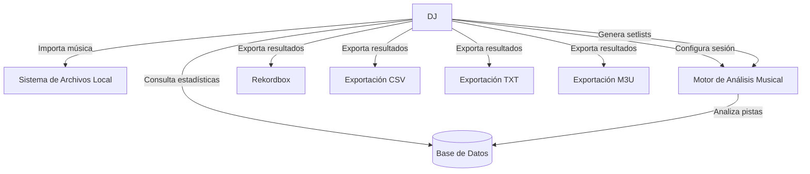

# Actores del Sistema

## Introducción

Los actores representan las entidades que interactúan directa o indirectamente con el sistema de generación automática de setlists.

---

# A1 - DJ

## Descripción

Actor principal del sistema.

Representa al usuario que utiliza la aplicación para gestionar su biblioteca musical y generar setlists.

## Responsabilidades

- Importar música.
- Configurar parámetros de sesión.
- Generar setlists.
- Consultar estadísticas.
- Exportar resultados.
- Gestionar la biblioteca musical.

## Casos de uso asociados

- CU-01 Importar biblioteca musical.
- CU-02 Analizar biblioteca.
- CU-03 Configurar sesión.
- CU-04 Generar setlist.
- CU-05 Consultar estadísticas.
- CU-06 Exportar setlist.

---

# A2 - Sistema de Archivos Local

## Descripción

Sistema externo desde el que se obtienen los archivos musicales.

## Responsabilidades

- Proporcionar acceso a los archivos de audio.
- Facilitar la lectura de metadatos.

## Interacción

- Proporciona las canciones al sistema para su análisis.

---

# A3 - Rekordbox

## Descripción

Software externo utilizado por DJs para la preparación de sesiones.

## Responsabilidades

- Importar los archivos exportados por la aplicación.
- Gestionar playlists generadas.

## Interacción

- Recibe los setlists exportados.

---

# A4 - Motor de Análisis Musical

## Descripción

Componente software encargado del análisis automático de las pistas importadas.

## Responsabilidades

- Detección de BPM.
- Detección de tonalidad.
- Conversión a notación Camelot.
- Procesamiento de características musicales.

## Interacción

- Procesa los archivos importados.
- Devuelve resultados de análisis al sistema.

---
# Diagrama Conceptual de Actores

