# Matriz de Trazabilidad

## Introducción

La matriz de trazabilidad permite establecer la relación entre los requisitos funcionales, los casos de uso, los módulos del sistema, las tareas de desarrollo y las futuras pruebas de validación.

Este documento garantiza que todos los requisitos definidos durante la fase de análisis estén cubiertos por la solución propuesta y puedan verificarse mediante pruebas.

---

# Componentes del Sistema

| Código | Componente |
|----------|----------|
| CMP-01 | Módulo de Importación |
| CMP-02 | Módulo de Gestión de Biblioteca |
| CMP-03 | Motor de Análisis Musical |
| CMP-04 | Motor de Generación de Setlists |
| CMP-05 | Módulo de Exportación |
| CMP-06 | Dashboard Estadístico |
| CMP-07 | Base de Datos |
| CMP-08 | API REST |
| CMP-09 | Frontend Web |

---

# Relación Requisitos → Casos de Uso → Componentes

| Requisito | Descripción | Caso de Uso | Componentes |
|------------|------------|------------|-------------|
| RF-001 | Importar biblioteca musical | CU-01 | CMP-01, CMP-09 |
| RF-002 | Detectar formatos compatibles | CU-01 | CMP-01 |
| RF-003 | Extraer metadatos | CU-03 | CMP-03 |
| RF-004 | Analizar BPM | CU-03 | CMP-03 |
| RF-005 | Analizar tonalidad | CU-03 | CMP-03 |
| RF-006 | Calcular notación Camelot | CU-03 | CMP-03 |
| RF-007 | Almacenar información musical | CU-02, CU-10 | CMP-02, CMP-07 |
| RF-008 | Evitar reanálisis | CU-02 | CMP-02, CMP-07 |
| RF-009 | Crear setlist | CU-05 | CMP-04 |
| RF-010 | Configurar duración objetivo | CU-04 | CMP-04, CMP-09 |
| RF-011 | Configurar rango BPM | CU-04 | CMP-04, CMP-09 |
| RF-012 | Configurar progresión de géneros | CU-04 | CMP-04, CMP-09 |
| RF-013 | Configurar compatibilidad armónica | CU-04 | CMP-04, CMP-09 |
| RF-014 | Definir canciones ancla | CU-06 | CMP-04, CMP-09 |
| RF-015 | Validar transiciones | CU-05 | CMP-04 |
| RF-016 | Exportar a Rekordbox | CU-08 | CMP-05 |
| RF-017 | Exportar M3U | CU-08 | CMP-05 |
| RF-018 | Exportar CSV | CU-08 | CMP-05 |
| RF-019 | Exportar TXT | CU-08 | CMP-05 |
| RF-020 | Consultar histórico | CU-09 | CMP-02, CMP-07, CMP-09 |
| RF-021 | Mostrar estadísticas BPM | CU-07 | CMP-06, CMP-07 |
| RF-022 | Mostrar estadísticas de tonalidad | CU-07 | CMP-06, CMP-07 |
| RF-023 | Mostrar estadísticas de géneros | CU-07 | CMP-06, CMP-07 |
| RF-024 | Mostrar canciones más utilizadas | CU-07 | CMP-06, CMP-07 |

---

# Relación Casos de Uso → Issues GitHub

| Caso de Uso | Issue Principal |
|-------------|----------------|
| CU-01 Importar Biblioteca Musical | #10 Implementación sistema de importación |
| CU-02 Registrar Biblioteca Musical | #6 Diseñar modelo de datos |
| CU-03 Analizar Biblioteca Musical | #11 Desarrollo motor de análisis |
| CU-04 Configurar Sesión | #12 Desarrollo configuración de sesión |
| CU-05 Generar Setlist | #13 Desarrollo motor de generación |
| CU-06 Gestionar Canciones Ancla | #13 Desarrollo motor de generación |
| CU-07 Consultar Estadísticas | #15 Dashboard y estadísticas |
| CU-08 Exportar Setlist | #14 Sistema de exportación |
| CU-09 Consultar Histórico | #15 Dashboard y estadísticas |
| CU-10 Gestionar Biblioteca Musical | #6 Diseñar modelo de datos |

---

# Relación Requisitos → Casos de Prueba

| Requisito | Test |
|------------|-------|
| RF-001 | CP-001 |
| RF-002 | CP-002 |
| RF-003 | CP-003 |
| RF-004 | CP-004 |
| RF-005 | CP-005 |
| RF-006 | CP-006 |
| RF-007 | CP-007 |
| RF-008 | CP-008 |
| RF-009 | CP-009 |
| RF-010 | CP-010 |
| RF-011 | CP-011 |
| RF-012 | CP-012 |
| RF-013 | CP-013 |
| RF-014 | CP-014 |
| RF-015 | CP-015 |
| RF-016 | CP-016 |
| RF-017 | CP-017 |
| RF-018 | CP-018 |
| RF-019 | CP-019 |
| RF-020 | CP-020 |
| RF-021 | CP-021 |
| RF-022 | CP-022 |
| RF-023 | CP-023 |
| RF-024 | CP-024 |

---

# Cobertura de Requisitos

## Resumen

| Elemento | Cantidad |
|-----------|----------|
| Requisitos Funcionales | 24 |
| Casos de Uso | 10 |
| Componentes | 9 |
| Casos de Prueba | 24 |

---

# Diagrama General de Trazabilidad

---

# Cobertura por Módulo

```mermaid
graph TD

    CMP1[Módulo Importación]
    CMP2[Gestión Biblioteca]
    CMP3[Motor Análisis]
    CMP4[Motor Generación]
    CMP5[Módulo Exportación]
    CMP6[Dashboard Estadístico]
    CMP7[Base de Datos]
    CMP8[API REST]
    CMP9[Frontend]

    CMP1 --> RF001
    CMP1 --> RF002

    CMP2 --> RF007
    CMP2 --> RF008
    CMP2 --> RF020

    CMP3 --> RF003
    CMP3 --> RF004
    CMP3 --> RF005
    CMP3 --> RF006

    CMP4 --> RF009
    CMP4 --> RF010
    CMP4 --> RF011
    CMP4 --> RF012
    CMP4 --> RF013
    CMP4 --> RF014
    CMP4 --> RF015

    CMP5 --> RF016
    CMP5 --> RF017
    CMP5 --> RF018
    CMP5 --> RF019

    CMP6 --> RF021
    CMP6 --> RF022
    CMP6 --> RF023
    CMP6 --> RF024
```

---

# Conclusión

Todos los requisitos funcionales definidos durante la fase de análisis se encuentran trazados hacia:

- Casos de uso asociados.
- Componentes de la arquitectura.
- Issues de desarrollo del proyecto.
- Casos de prueba de validación.

Esta matriz garantiza la cobertura completa de requisitos y facilitará la verificación y validación del sistema durante las fases posteriores del proyecto.
