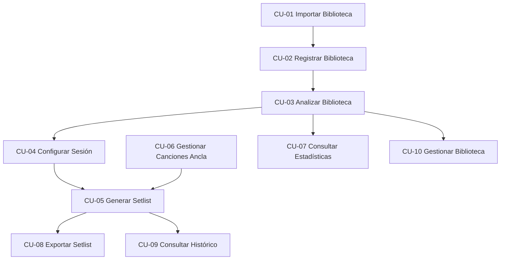

# Casos de Uso

## Introducción

Este documento describe los casos de uso del Sistema de Generación Automática de Setlists para DJs.

Cada caso de uso representa una interacción entre los actores identificados y el sistema, permitiendo definir el comportamiento esperado y establecer la trazabilidad con los requisitos funcionales.

---

# CU-01 Importar Biblioteca Musical

## Objetivo

Permitir al usuario seleccionar una carpeta musical para importar las canciones disponibles.

## Actor Principal

DJ

## Actores Secundarios

- Sistema de Archivos Local

## Requisitos Relacionados

- RF-001
- RF-002

## Precondiciones

- La aplicación está ejecutándose.
- El usuario dispone de una carpeta con archivos musicales.

## Flujo Principal

1. El DJ selecciona la opción "Importar Biblioteca".
2. El sistema solicita una carpeta de origen.
3. El DJ selecciona una carpeta.
4. El sistema busca archivos compatibles.
5. El sistema valida los formatos encontrados.
6. El sistema muestra un resumen de la importación.

## Flujos Alternativos

### A1. No existen archivos compatibles

1. El sistema no encuentra archivos válidos.
2. Se informa al usuario.

### A2. Error de acceso

1. El sistema no puede acceder a la carpeta.
2. Se muestra un mensaje de error.

## Postcondiciones

- Las canciones quedan disponibles para su registro.

---

# CU-02 Registrar Biblioteca Musical

## Objetivo

Registrar las canciones importadas dentro del sistema.

## Actor Principal

DJ

## Requisitos Relacionados

- RF-007
- RF-008

## Precondiciones

- Se ha realizado una importación de canciones.

## Flujo Principal

1. El sistema identifica las canciones importadas.
2. Comprueba si existen registros previos.
3. Registra únicamente las nuevas canciones.
4. Guarda la información básica de cada pista.
5. Actualiza la base de datos.

## Flujos Alternativos

### A1. Canción ya registrada

1. El sistema detecta una canción previamente almacenada.
2. Evita su duplicación.

## Postcondiciones

- La biblioteca musical queda registrada.

---

# CU-03 Analizar Biblioteca Musical

## Objetivo

Obtener automáticamente las características musicales de cada canción.

## Actor Principal

DJ

## Actores Secundarios

- Motor de Análisis Musical

## Requisitos Relacionados

- RF-003
- RF-004
- RF-005
- RF-006

## Precondiciones

- Existen canciones registradas.

## Flujo Principal

1. El usuario inicia el análisis.
2. El sistema extrae metadatos.
3. El sistema calcula el BPM.
4. El sistema detecta la tonalidad.
5. El sistema calcula la notación Camelot.
6. El sistema actualiza la información almacenada.

## Flujos Alternativos

### A1. Archivo corrupto

1. El sistema detecta errores en el archivo.
2. Se registra la incidencia.
3. La canción es omitida.

## Postcondiciones

- Las canciones contienen información musical completa.

---

# CU-04 Configurar Sesión

## Objetivo

Definir los parámetros que utilizará el generador de setlists.

## Actor Principal

DJ

## Requisitos Relacionados

- RF-010
- RF-011
- RF-012
- RF-013

## Precondiciones

- Existe una biblioteca analizada.

## Flujo Principal

1. El DJ accede al configurador de sesión.
2. Define la duración objetivo.
3. Define el rango BPM permitido.
4. Define restricciones armónicas.
5. Define preferencias de géneros musicales.
6. Guarda la configuración.

## Flujos Alternativos

### A1. Parámetros inválidos

1. El sistema detecta valores incorrectos.
2. Solicita su corrección.

## Postcondiciones

- La configuración queda almacenada.

---

# CU-05 Generar Setlist

## Objetivo

Generar automáticamente una propuesta de setlist.

## Actor Principal

DJ

## Requisitos Relacionados

- RF-009
- RF-015

## Precondiciones

- Existe una biblioteca analizada.
- Existe una configuración de sesión válida.

## Flujo Principal

1. El usuario solicita generar un setlist.
2. El sistema recupera las canciones disponibles.
3. Evalúa la compatibilidad BPM.
4. Evalúa la compatibilidad armónica.
5. Calcula las transiciones óptimas.
6. Genera el orden final de reproducción.
7. Presenta el resultado al usuario.

## Flujos Alternativos

### A1. Número insuficiente de canciones compatibles

1. El sistema detecta incompatibilidades.
2. Genera una propuesta parcial.
3. Informa al usuario.

## Postcondiciones

- Existe un nuevo setlist generado.

---

# CU-06 Gestionar Canciones Ancla

## Objetivo

Permitir fijar canciones concretas dentro de la sesión.

## Actor Principal

DJ

## Requisitos Relacionados

- RF-014

## Precondiciones

- Existen canciones analizadas.

## Flujo Principal

1. El DJ selecciona una canción.
2. Selecciona una posición dentro del setlist.
3. El sistema registra la restricción.
4. La canción queda marcada como ancla.

## Flujos Alternativos

### A1. Posición no válida

1. El usuario selecciona una posición incorrecta.
2. El sistema muestra una advertencia.

## Postcondiciones

- Las canciones ancla serán respetadas durante la generación.

---

# CU-07 Consultar Estadísticas

## Objetivo

Visualizar información estadística de la biblioteca musical.

## Actor Principal

DJ

## Requisitos Relacionados

- RF-021
- RF-022
- RF-023
- RF-024

## Precondiciones

- Existen canciones analizadas.

## Flujo Principal

1. El DJ accede al panel de estadísticas.
2. El sistema consulta la base de datos.
3. Calcula las métricas estadísticas.
4. Genera visualizaciones.
5. Muestra los resultados.

## Información Mostrada

- Distribución de BPM.
- Distribución de tonalidades.
- Distribución de géneros.
- Ranking de canciones más utilizadas.

## Postcondiciones

- El usuario dispone de información analítica de la biblioteca.

---

# CU-08 Exportar Setlist

## Objetivo

Exportar la sesión generada para su utilización en software externo.

## Actor Principal

DJ

## Actor Secundario

- Rekordbox

## Requisitos Relacionados

- RF-016
- RF-017
- RF-018
- RF-019

## Precondiciones

- Existe un setlist generado.

## Flujo Principal

1. El DJ selecciona la opción Exportar.
2. Selecciona el formato de salida.
3. El sistema genera el archivo correspondiente.
4. El sistema guarda el resultado.
5. El usuario recibe confirmación.

## Formatos Disponibles

- Rekordbox XML
- CSV
- TXT
- M3U

## Flujos Alternativos

### A1. Error de escritura

1. El sistema no puede almacenar el archivo.
2. Se muestra una notificación de error.

## Postcondiciones

- El setlist queda disponible para su uso externo.

---

# CU-09 Consultar Histórico

## Objetivo

Permitir consultar los setlists generados anteriormente.

## Actor Principal

DJ

## Requisitos Relacionados

- RF-020

## Precondiciones

- Existen sesiones previamente almacenadas.

## Flujo Principal

1. El usuario accede al histórico.
2. El sistema recupera los registros disponibles.
3. Muestra la lista de sesiones.
4. El usuario selecciona una sesión.
5. El sistema muestra el detalle completo.

## Flujos Alternativos

### A1. Histórico vacío

1. No existen registros.
2. El sistema informa al usuario.

## Postcondiciones

- El usuario puede revisar sesiones anteriores.

---

# CU-10 Gestionar Biblioteca Musical

## Objetivo

Permitir la consulta y administración de las canciones almacenadas.

## Actor Principal

DJ

## Requisitos Relacionados

- RF-007
- RF-020

## Precondiciones

- Existen canciones registradas.

## Flujo Principal

1. El usuario accede a la biblioteca.
2. El sistema muestra las canciones disponibles.
3. El usuario realiza búsquedas o filtros.
4. El sistema actualiza los resultados.
5. El usuario consulta la información de una canción.

## Flujos Alternativos

### A1. Sin resultados

1. El filtro aplicado no devuelve resultados.
2. El sistema informa al usuario.

## Postcondiciones

- El usuario puede gestionar eficazmente la biblioteca musical.

---

# Diagrama General de Casos de Uso

---

# Resumen

| Código | Caso de Uso |
|----------|------------|
| CU-01 | Importar Biblioteca Musical |
| CU-02 | Registrar Biblioteca Musical |
| CU-03 | Analizar Biblioteca Musical |
| CU-04 | Configurar Sesión |
| CU-05 | Generar Setlist |
| CU-06 | Gestionar Canciones Ancla |
| CU-07 | Consultar Estadísticas |
| CU-08 | Exportar Setlist |
| CU-09 | Consultar Histórico |
| CU-10 | Gestionar Biblioteca Musical |
