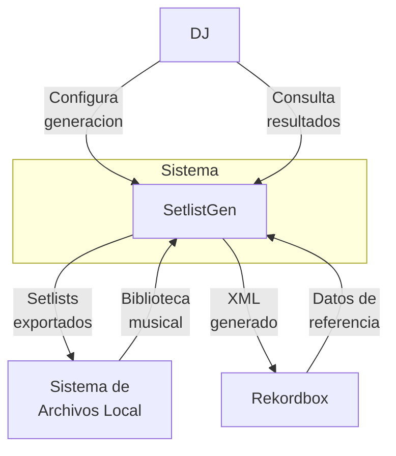
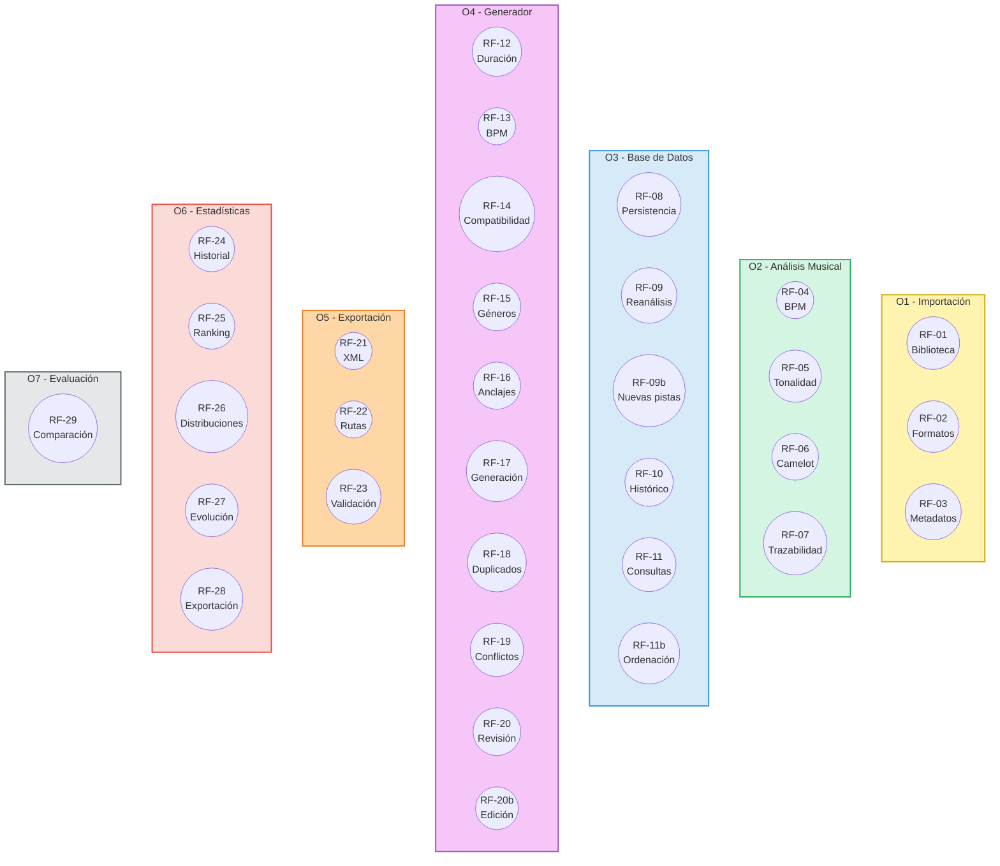
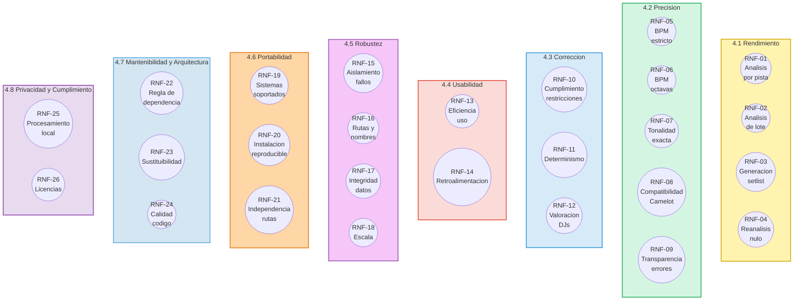
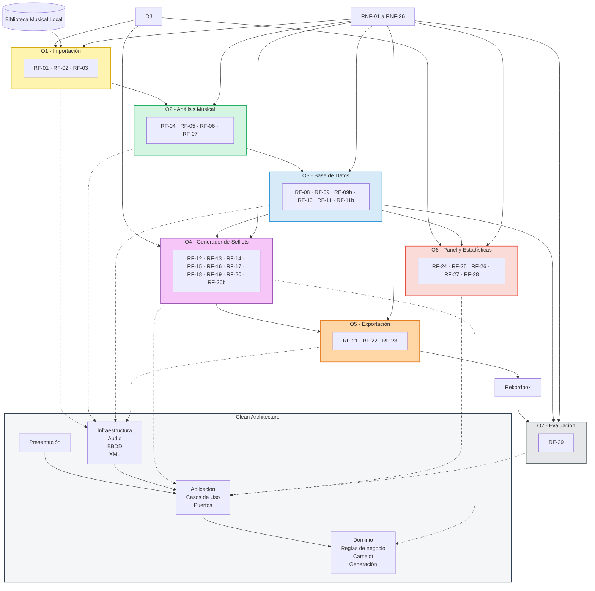

# Especificación de Requisitos del Software (SRS)

**Proyecto:** Sistema de Generación Automática de Setlists para DJs a partir del Análisis Musical de una Biblioteca de Audio Local
**Autor:** Pablo Hernández Borregón · **Titulación:** Grado en Ingeniería en Sistemas de Información (UAH, EPS)
**Versión:** 1.0 (propuesta de línea base H1) · **Fecha:** 2026-10-09 · **Estado:** pendiente de validación por tutor y cotutor

---

## 1. Introducción

### 1.1 Propósito
Este documento especifica los requisitos funcionales y no funcionales del sistema descrito en el anteproyecto. Es la referencia para el diseño, la implementación, las pruebas y la evaluación, y la base del capítulo de requisitos de la memoria.

### 1.2 Fuentes
- Anteproyecto de TFG (objetivos específicos O1-O7, secciones 2 y 3).
- `TFG_OBJECTIVES.md` y `PROJECT_VISION.md`.
- Normativa de TFG de la EPS (tipo de trabajo: diseño y realización de un sistema informático).

Los términos técnicos se definen en `glosario.md`.

### 1.3 Convenciones
- **Identificadores:** RF-XX (funcionales) y RNF-XX (no funcionales). Una vez asignado, un identificador no se reutiliza.
- **Prioridad (MoSCoW):** **M**ust, **S**hould, **C**ould, **W**on't.
- **Obj.:** objetivo específico del anteproyecto del que deriva el requisito.
- **Capa:** capa principal de Clean Architecture: **D**ominio, **A**plicación, **I**nfraestructura, **P**resentación/interfaz.
- **Umbrales:** los valores numéricos de los RNF son objetivos iniciales. Se ratificarán o ajustarán tras la prueba de concepto (hito H2, ADR-009). Cualquier cambio se registra en el control de cambios (sección 8).

---

## 2. Descripción general

### 2.1 Perspectiva del producto
El sistema se integra en el flujo de trabajo del DJ, no lo sustituye. Analiza una biblioteca de audio local, almacena los descriptores en una base de datos propia, genera un setlist a partir de parámetros del DJ y lo exporta a un formato importable por Rekordbox, donde el DJ lo revisa y ajusta antes de la actuación.

### 2.2 Actores
| Actor | Tipo | Descripción |
|---|---|---|
| DJ | Principal | DJ semiprofesional o profesional que prepara setlists a partir de su biblioteca |
| Rekordbox | Sistema externo | Entorno de importación del setlist y fuente de valores de referencia para la evaluación |
| Sistema de archivos local | Sistema externo | Origen del audio y destino de las exportaciones |

### 2.2.1 Diagrama de actores

### 2.3 Restricciones
- El audio y los datos se procesan en local.
- La implementación del análisis se propone en Python y la librería concreta se decide en ADR-002.
- Base de datos ligera local, a concretar en ADR-004.
- El formato de distribución (aplicación de escritorio, web local o complemento) queda abierto hasta ADR-001.

### 2.4 Supuestos y dependencias
- El DJ dispone de una biblioteca de audio en MP3, WAV, FLAC o AIFF y de Rekordbox instalado.
- Los valores de Rekordbox sobre las mismas pistas se usan como referencia de evaluación. No constituyen una verdad absoluta, y la memoria lo discutirá.

### 2.5 Fuera de alcance (Won't)
Reproducción de audio y mezcla en directo (tiempo real); streaming o catálogos online; entrenamiento de modelos propios; clasificación automática de género (el género se lee de las etiquetas); edición del audio; servicios en la nube y gestión multiusuario; escritura directa en la base de datos interna de Rekordbox.

---

## 3. Requisitos funcionales

### 3.1 Importación de fuentes musicales (O1)
| ID | Requisito | Obj. | MoSCoW | Capa | Criterio de aceptación |
|---|---|---|---|---|---|
| RF-01 | El sistema permitirá al DJ indicar una carpeta raíz y recorrerá su contenido de forma recursiva | O1 | Must | A/I | Todas las pistas de subcarpetas son detectadas |
| RF-02 | El sistema identificará las pistas válidas en formato MP3, WAV, FLAC y AIFF y descartará los demás ficheros, informando de los descartados | O1 | Must | A/I | El informe lista cada fichero descartado y su motivo |
| RF-03 | El sistema extraerá de las etiquetas de cada pista título, artista, género, año y duración | O1 | Must | I | Un campo ausente queda como nulo y no interrumpe el proceso |

### 3.2 Motor de análisis musical (O2)
| ID | Requisito | Obj. | MoSCoW | Capa | Criterio de aceptación |
|---|---|---|---|---|---|
| RF-04 | El sistema estimará el BPM de cada pista a partir de la señal de audio | O2 | Must | I (puerto en A) | Cada pista analizada tiene BPM o una marca de fallo |
| RF-05 | El sistema estimará la tonalidad (tónica y modo) de cada pista a partir de la señal | O2 | Must | I (puerto en A) | Ídem |
| RF-06 | El sistema derivará de la tonalidad su notación Camelot | O2 | Must | D | Las 24 tonalidades se corresponden con su código Camelot; conversión verificada con tests |
| RF-07 | El sistema registrará el origen de cada descriptor (estimado o etiqueta) y el analizador y versión empleados | O2 | Should | D/I | Cada descriptor almacenado incluye origen y versión |

### 3.3 Base de datos local (O3)
| ID | Requisito | Obj. | MoSCoW | Capa | Criterio de aceptación |
|---|---|---|---|---|---|
| RF-08 | El sistema persistirá las pistas analizadas y sus descriptores en una base de datos local | O3 | Must | I (puerto en A) | Los datos sobreviven al reinicio de la aplicación |
| RF-09 | El sistema identificará cada pista de forma única y solo la analizará la primera vez que aparezca en la biblioteca | O3 | Must | D/A | Una segunda importación de la misma carpeta no reanaliza ninguna pista |
| RF-09b | El sistema detectará nuevas pistas incorporadas a una biblioteca previamente importada y analizará únicamente aquellas que no existan en la base de datos. | O3 | Must | D/A | Tras añadir nuevas pistas a una biblioteca ya indexada, únicamente dichas pistas son analizadas |
| RF-10 | El sistema persistirá los setlists generados, sus parámetros y su histórico | O3 | Must | I (puerto en A) | Un setlist es recuperable con sus parámetros originales |
| RF-11 | El sistema permitirá consultar las pistas por BPM, tonalidad, título, género, año y duración | O3, O4 | Must | A/I | Las consultas devuelven solo pistas que cumplen los filtros |
| RF-11b | El sistema permitirá ordenar los resultados de las consultas de pistas por BPM, tonalidad, título, año o duración, tanto en orden ascendente como descendente. | O3, O4 | Must | A/I | Tras seleccionar un campo de ordenación y una dirección (ascendente o descendente), las pistas se muestran ordenadas correctamente según el criterio elegido. |

### 3.4 Generador de setlists (O4)
| ID | Requisito | Obj. | MoSCoW | Capa | Criterio de aceptación |
|---|---|---|---|---|---|
| RF-12 | El DJ podrá fijar la duración total del setlist | O4 | Must | A | La duración resultante está dentro de la tolerancia documentada (por defecto ±5 %) |
| RF-13 | El DJ podrá fijar el rango de BPM admisible | O4 | Must | A | Ninguna pista queda fuera del rango |
| RF-14 | El DJ podrá fijar las tonalidades admitidas o la compatibilidad armónica exigida | O4 | Must | A/D | Las transiciones respetan la compatibilidad Camelot configurada |
| RF-15 | El DJ podrá definir una progresión de géneros por intervalos de tiempo | O4 | Should | A/D | Las pistas de cada intervalo pertenecen al género indicado |
| RF-16 | El DJ podrá anclar pistas en posiciones concretas del setlist | O4 | Should | A/D | Cada pista anclada ocupa su posición en el resultado |
| RF-17 | El sistema propondrá un orden de reproducción que respete las restricciones, con saltos de tempo moderados y tonalidades compatibles según la Rueda Camelot | O4 | Must | D | Se cumple RNF-10 |
| RF-18 | El sistema no repetirá una pista dentro de un mismo setlist | O4 | Must | D | Ninguna pista aparece dos veces |
| RF-19 | Cuando las restricciones definidas por el usuario no puedan satisfacerse simultáneamente, el sistema informará de la imposibilidad de generar el setlist e identificará las restricciones en conflicto | O4 | Must | A | Si no existe una combinación de pistas que satisfaga todas las restricciones establecidas, el sistema muestra un mensaje identificando las restricciones incompatibles y no genera ni almacena un setlist inválido |
| RF-20 | El sistema mostrará el setlist generado con el orden, los descriptores de cada pista y la evaluación de cada transición | O4 | Must | P | El DJ puede revisar el resultado antes de exportarlo |
| RF-20b | El sistema permitira editar el setlist generado cambiando parámetros y reordenando de forma manual | O4 | Could | P | El DJ puede editar el resultado tras exportarlo |

### 3.5 Exportación a Rekordbox (O5)
| ID | Requisito | Obj. | MoSCoW | Capa | Criterio de aceptación |
|---|---|---|---|---|---|
| RF-21 | El sistema exportará los setlists en formato XML compatible con Rekordbox | O5 | Must | I (puerto en A) | El fichero es válido según la especificación del formato |
| RF-22 | El sistema incluirá en la exportación las rutas de las pistas resueltas, de modo que Rekordbox las localice | O5 | Must | I | Ninguna pista queda con ruta no resuelta, salvo aviso explícito |
| RF-23 | La lista exportada se cargará correctamente en Rekordbox con sus pistas resueltas | O5 | Must | — | Verificado manualmente en Rekordbox sobre un conjunto de setlists de prueba, con registro del resultado |

### 3.6 Panel de gestión y estadísticas (O6, objetivo ampliable)
| ID | Requisito | Obj. | MoSCoW | Capa | Criterio de aceptación |
|---|---|---|---|---|---|
| RF-24 | El sistema mostrará el historial de setlists generados | O6 | Could | P/A | El historial lista todos los setlists persistidos |
| RF-25 | El sistema mostrará las pistas más utilizadas | O6 | Could | A | El ranking coincide con el recuento en el histórico |
| RF-26 | El sistema mostrará la distribución de BPM, tonalidades (incluyendo su representación mediante la Rueda Camelot) y géneros musicales presentes en la biblioteca mediante gráficos estadísticos | O6 | Could | A | Los valores mostrados coinciden con los datos almacenados en la base de datos y las representaciones gráficas reflejan correctamente su distribución. |
| RF-27 | El sistema mostrará la evolución temporal de los géneros musicales, la media de BPM y las tonalidades empleadas en los setlists generados mediante gráficos de líneas múltiples | O6 | Could | A | Las series temporales representadas se calculan correctamente a partir del histórico de setlists almacenado. |
| RF-28 | El sistema exportará los datos del panel en TXT, M3U y CSV | O6 | Could | I | Los ficheros se generan con el contenido mostrado |

### 3.7 Evaluación (O7)
| ID | Requisito | Obj. | MoSCoW | Capa | Criterio de aceptación |
|---|---|---|---|---|---|
| RF-29 | El sistema permitirá contrastar los descriptores estimados con valores de referencia de Rekordbox para las mismas pistas y producirá un informe de discrepancias | O7 | Should | A/I | El informe incluye las métricas de RNF-05 a RNF-09 |

### 3.8 Mapa de requisitos funcionales

---

## 4. Requisitos no funcionales

Los valores marcados con (P) son provisionales hasta H2.

### 4.1 Rendimiento
| ID | Requisito | Métrica y umbral | Verificación | MoSCoW |
|---|---|---|---|---|
| RNF-01 | Tiempo de análisis por pista | Media ≤ 10 % de la duración de la pista por núcleo (P) | Medición sobre el dataset en el equipo de referencia | Must |
| RNF-02 | Análisis de lote | El sistema deberá analizar un lote de 500 pistas en un tiempo compatible con RNF-01 | Medición | Should |
| RNF-03 | Generación de setlist | Setlist de 2 h sobre 5 000 pistas en ≤ 60 s, percentil 95 (P) | Benchmark automatizado | Must |
| RNF-04 | Reanálisis nulo | 0 pistas reanalizadas en una segunda importación; detección en ≤ 2 min para 5 000 pistas (P) | Test de integración | Must |

### 4.2 Precisión de las estimaciones
Referencia: valores de Rekordbox sobre las mismas pistas. Las métricas se reportan sobre un dataset definido en ADR-009.

| ID | Requisito | Métrica y umbral | Verificación | MoSCoW |
|---|---|---|---|---|
| RNF-05 | Exactitud de BPM estricta | ≥ 85 % de pistas con BPM dentro de ±4 % de la referencia (P) | RF-29 | Must |
| RNF-06 | Exactitud de BPM tolerando errores de octava | ≥ 92 % admitiendo factores 2, 1/2, 3 y 1/3 (P) | RF-29 | Must |
| RNF-07 | Exactitud de tonalidad exacta | ≥ 65 % de coincidencia de tónica y modo (P) | RF-29 | Must |
| RNF-08 | Exactitud de tonalidad en términos de compatibilidad | ≥ 80 % con código Camelot idéntico o mezclable con el de referencia (P) | RF-29 | Must |
| RNF-09 | Transparencia de errores | Se informa del desglose de errores (octava, relativa, quinta, otros) con intervalos de confianza | Informe de evaluación | Must |

### 4.3 Corrección del resultado
| ID | Requisito | Métrica y umbral | Verificación | MoSCoW |
|---|---|---|---|---|
| RNF-10 | Cumplimiento de restricciones | 100 % de las transiciones de un setlist válido cumplen el salto de BPM y la compatibilidad Camelot configurados | Tests de propiedades del dominio | Must |
| RNF-11 | Determinismo | Misma biblioteca, parámetros y semilla producen el mismo setlist | Test automatizado | Must |
| RNF-12 | Valoración por DJs | Al menos 3 DJs valoran la coherencia de los setlists; media objetivo ≥ 3,5/5 (P, si es viable según el anteproyecto) | Cuestionario anónimo | Should |

### 4.4 Usabilidad
| ID | Requisito | Métrica y umbral | Verificación | MoSCoW |
|---|---|---|---|---|
| RNF-13 | Eficiencia de uso | Un DJ nuevo genera y exporta su primer setlist en ≤ 10 min con la biblioteca ya analizada (P) | Prueba con usuarios | Should |
| RNF-14 | Retroalimentación | Progreso en operaciones de más de 5 s; mensajes de error con causa y acción sugerida | Revisión y pruebas funcionales | Must |

### 4.5 Robustez
| ID | Requisito | Métrica y umbral | Verificación | MoSCoW |
|---|---|---|---|---|
| RNF-15 | Aislamiento de fallos | El fallo en una pista no interrumpe el lote; el 100 % de los fallos queda registrado con su causa | Test con ficheros corruptos | Must |
| RNF-16 | Rutas y nombres | Funciona con espacios, tildes, caracteres Unicode y rutas largas en ambos sistemas | Tests en CI y pruebas manuales | Must |
| RNF-17 | Integridad de datos | Una interrupción no deja la BD inconsistente; las operaciones se confirman de forma atómica | Test de interrupción | Must |
| RNF-18 | Escala | El sistema mantendrá un crecimiento aproximadamente lineal del tiempo de generación al aumentar el tamaño de la biblioteca | Benchmark | Should |

### 4.6 Portabilidad
| ID | Requisito | Métrica y umbral | Verificación | MoSCoW |
|---|---|---|---|---|
| RNF-19 | Sistemas soportados | Windows 10/11 y macOS vigente, con los mismos resultados funcionales | CI en ambos sistemas y pruebas manuales | Must |
| RNF-20 | Instalación reproducible | Entorno completo desde cero en ≤ 30 min siguiendo el manual, con dependencias fijadas | Prueba de instalación limpia | Must |
| RNF-21 | Independencia de rutas | La lógica de dominio no depende del formato de rutas del sistema operativo; la adaptación se hace en infraestructura | Revisión de diseño y tests | Must |

### 4.7 Mantenibilidad y arquitectura
| ID | Requisito | Métrica y umbral | Verificación | MoSCoW |
|---|---|---|---|---|
| RNF-22 | Regla de dependencia | Dominio y aplicación no importan frameworks, librerías de audio, de base de datos ni de interfaz | Comprobación automática en CI | Must |
| RNF-23 | Sustituibilidad | El analizador, el repositorio y el exportador se acceden mediante puertos; cambiar su implementación no modifica dominio ni aplicación | Tests con dobles y con una segunda implementación | Must |
| RNF-24 | Calidad de código | Cobertura ≥ 80 % en dominio y aplicación; tipado estático sin errores; análisis estático sin incidencias bloqueantes | CI | Must |

### 4.8 Privacidad y cumplimiento
| ID | Requisito | Métrica y umbral | Verificación | MoSCoW |
|---|---|---|---|---|
| RNF-25 | Procesamiento local | Ningún fichero de audio ni dato de la biblioteca sale del equipo del DJ | Revisión de diseño | Must |
| RNF-26 | Licencias | Inventario de licencias de las dependencias; compatibilidad con la licencia del repositorio | ADR-007 | Must |

### 4.9 Mapa de requisitos no funcionales

---

## 5. Trazabilidad

| Objetivo del anteproyecto | Requisitos funcionales asociados | Requisitos no funcionales principales |
|---|---|---|
| O1 Importación de fuentes musicales | RF-01, RF-02, RF-03 | RNF-15, RNF-16 |
| O2 Motor de análisis musical | RF-04, RF-05, RF-06, RF-07 | RNF-01, RNF-02, RNF-05, RNF-06, RNF-07, RNF-08, RNF-09 |
| O3 Base de datos local | RF-08, RF-09, RF-09b, RF-10, RF-11, RF-11b | RNF-04, RNF-17, RNF-18 |
| O4 Generador de setlists | RF-11, RF-11b, RF-12, RF-13, RF-14, RF-15, RF-16, RF-17, RF-18, RF-19, RF-20, RF-20b | RNF-03, RNF-10, RNF-11, RNF-12, RNF-13, RNF-14 |
| O5 Exportación a Rekordbox | RF-21, RF-22, RF-23 | RNF-16, RNF-21 |
| O6 Panel de gestión y estadísticas | RF-24, RF-25, RF-26, RF-27, RF-28 | RNF-13, RNF-14 |
| O7 Evaluación | RF-29 | RNF-05, RNF-06, RNF-07, RNF-08, RNF-09, RNF-12 |

## 6. Resumen MoSCoW

### Requisitos funcionales

- Must: 22 RF.
- Should: 4 RF (RF-07, RF-15, RF-16 y RF-29).
- Could: 6 RF (RF-20b y RF-24 a RF-28).
- Won't: ver sección 2.5.

### Requisitos no funcionales

- Must: 22 RNF.
- Should: 4 RNF (RNF-02, RNF-12, RNF-13 y RNF-18).
- Could: 0 RNF.
- Won't: ver sección 2.5.

RF-15 (progresión de géneros) constituye el principal candidato a ser promovido a Must si la calidad y completitud de las etiquetas de género disponibles en el dataset resultan suficientes durante la implementación y validación experimental.

RNF-12 (valoración por DJs) y RNF-13 (eficiencia de uso) están condicionados a la disponibilidad de participantes para la realización de pruebas con usuarios durante la fase de evaluación.

## 7. Implicaciones arquitectónicas (Clean Architecture)

- **Dominio:** Pista, Descriptor, Biblioteca, Setlist, Parámetros de generación, Transición, Notación Camelot y reglas de negocio asociadas a la compatibilidad armónica, restricciones de generación y validación de setlists (RF-06, RF-14, RF-17 y RF-18).

- **Aplicación:** Casos de uso, orquestación y definición de puertos:
  - `LibraryScanner`
  - `MetadataReader`
  - `AudioAnalyzer`
  - `TrackRepository`
  - `SetlistRepository`
  - `StatisticsRepository`
  - `SetlistExporter`
  - `ReferenceDataProvider`

- **Infraestructura:** Adaptadores de lectura de etiquetas, análisis de audio, persistencia, exportación XML e integración con sistemas externos.

- **Presentación:** Interfaz gráfica responsable de la interacción con el DJ, visualización de resultados, estadísticas, evaluación y gestión de setlists.

- La separación entre capas viene impuesta principalmente por los requisitos **RNF-22 (Regla de dependencia)** y **RNF-23 (Sustituibilidad)**.

- La calidad interna de la implementación deberá verificarse mediante **RNF-24 (Calidad de código)**.

### 7.1 Correspondencia entre requisitos y capas

| Capa | Requisitos principales |
|---|---|
| Dominio | RF-06, RF-14, RF-17, RF-18, RNF-10, RNF-11 |
| Aplicación | RF-01, RF-04, RF-05, RF-09, RF-09b, RF-10, RF-11, RF-11b, RF-12, RF-13, RF-15, RF-16, RF-19, RF-24, RF-25, RF-26, RF-27, RF-29 |
| Infraestructura | RF-02, RF-03, RF-08, RF-21, RF-22, RF-23, RF-28, RNF-01, RNF-02, RNF-04, RNF-15, RNF-16, RNF-17, RNF-19, RNF-20, RNF-21 |
| Presentación | RF-20, RF-20b, RF-24, RF-25, RF-26, RF-27, RNF-13, RNF-14 |

### 7.2 Mapa de Clean Architecture

## 8. Control de cambios

| Versión | Fecha | Cambio | Autor |
|---|---|---|---|
| 1.0 | 2026-10-09 | Versión inicial de la especificación de requisitos | P. Hernández |
| 2.0 | 2026-10-15 | Consolidación de la especificación de requisitos previa al diseño arquitectónico. Revisión y ampliación de requisitos funcionales y no funcionales, actualización de trazabilidad, diagramas, priorización MoSCoW e implicaciones arquitectónicas. | P. Hernández |
| 3.0 | 2026-10-16 | Revisión final de la especificación. Corrección y renumeración de requisitos no funcionales, actualización de la trazabilidad entre objetivos, RF y RNF, ajuste del resumen MoSCoW, refinamiento de las implicaciones arquitectónicas basadas en Clean Architecture y actualización de los mapas de requisitos funcionales y no funcionales. | P. Hernández |
