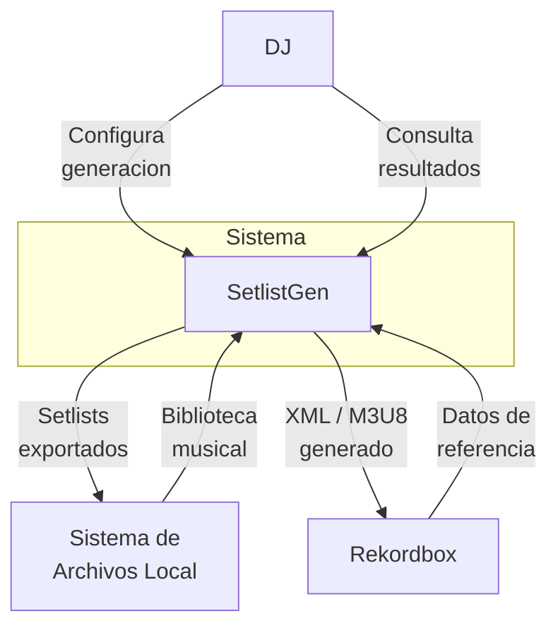
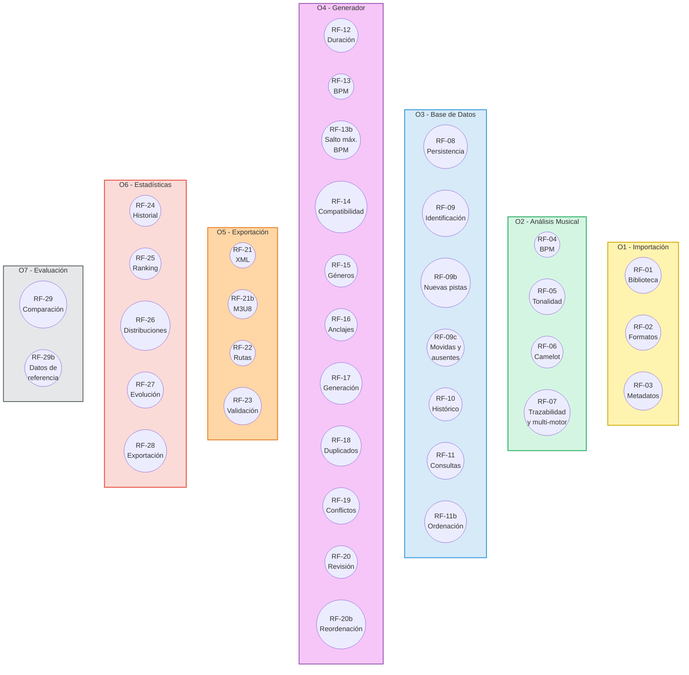
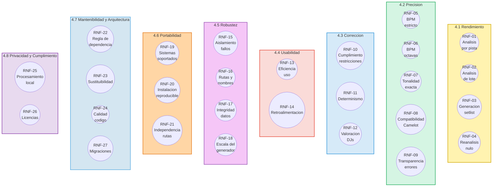
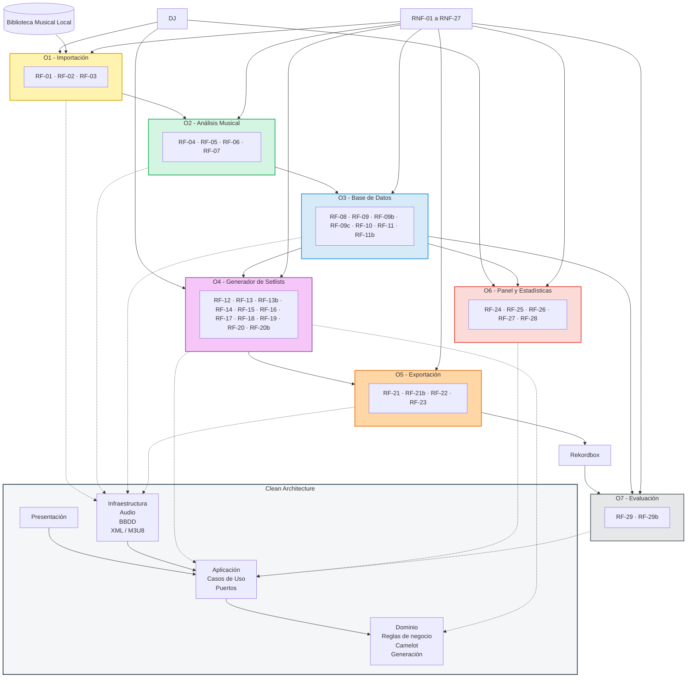

# Especificación de Requisitos del Software (SRS)

**Proyecto:** Sistema de Generación Automática de Setlists para DJs a partir del Análisis Musical de una Biblioteca de Audio Local
**Autor:** Pablo Hernández Borregón · **Titulación:** Grado en Ingeniería en Sistemas de Información (UAH, EPS)
**Versión:** 4.0 (propuesta de línea base de diseño) · **Fecha:** 2026-10-30 · **Estado:** pendiente de validación por tutor y cotutor

> **Convención de este documento (v4.0).** Los cambios que dependen de una decisión abierta de `open-decisions.md` se marcan como **[PROPUESTA · OD-xx]**. No cierran la decisión: la dejan reflejada como supuesto explícito hasta su validación por tutor y cotutor. La columna **Δ** indica el cambio respecto a v3.0: **N** = nuevo, **M** = modificado, **—** = sin cambios.

---

## 1. Introducción

### 1.1 Propósito
Este documento especifica los requisitos funcionales y no funcionales del sistema descrito en el anteproyecto. Es la referencia para el diseño, la implementación, las pruebas y la evaluación, y la base del capítulo de requisitos de la memoria.

### 1.2 Fuentes
- Anteproyecto de TFG aprobado (objetivos específicos O1-O7, secciones 2 y 3).
- Normativa de TFG de la UAH y normativa específica de la EPS (tipo de trabajo: diseño y realización de un sistema informático).
- ADR-001 a ADR-006 (aceptados) y ADR-007 a ADR-010 (propuestos, véase sección 10).
- `audit-review.md` (hallazgos aceptados H-01, H-03, H-04, H-07, H-08, H-17, H-19, H-26, H-35) y `open-decisions.md` (OD-01 a OD-08).

Los términos técnicos se definen en `glosario.md`.

> Nota: v3.0 citaba como fuentes `TFG_OBJECTIVES.md` y `PROJECT_VISION.md`. Esos ficheros no forman parte de la documentación versionada del proyecto y se han retirado de las fuentes.

### 1.3 Convenciones
- **Identificadores:** RF-XX (funcionales) y RNF-XX (no funcionales). Una vez asignado, un identificador no se reutiliza. El sufijo de letra (RF-09b, RF-09c...) indica un requisito derivado o refinado de otro.
- **Prioridad (MoSCoW):** **M**ust, **S**hould, **C**ould, **W**on't.
- **Obj.:** objetivo específico del anteproyecto del que deriva el requisito.
- **Capa:** capa principal de Clean Architecture: **D**ominio, **A**plicación, **I**nfraestructura, **P**resentación/interfaz. Esta columna es la fuente de verdad de la asignación a capas; la tabla de la sección 7.1 la resume.
- **Umbrales:** los valores numéricos de los RNF y los valores por defecto de parámetros marcados (P) son objetivos iniciales. Se ratificarán o ajustarán tras la prueba de concepto (hito H2, ADR-009). Cualquier cambio se registra en el control de cambios (sección 8).

---

## 2. Descripción general

### 2.1 Perspectiva del producto
El sistema se integra en el flujo de trabajo del DJ, no lo sustituye. Analiza una biblioteca de audio local, almacena los descriptores en una base de datos propia, genera un setlist a partir de parámetros del DJ y lo exporta a un formato importable por Rekordbox, donde el DJ lo revisa y ajusta antes de la actuación.

### 2.2 Actores
| Actor | Tipo | Descripción |
|---|---|---|
| DJ | Principal | DJ semiprofesional o profesional que prepara setlists a partir de su biblioteca |
| Rekordbox | Sistema externo | Entorno de importación del setlist y fuente de valores de referencia para la evaluación |
| Sistema de archivos local | Sistema externo | Origen del audio y destino de las exportaciones |

### 2.2.1 Diagrama de actores

### 2.3 Restricciones
- El audio y los datos se procesan en local (ADR-001, RNF-25).
- Distribución como aplicación de escritorio (ADR-001, aceptado).
- Implementación en Python. El análisis se encapsula tras el puerto `AudioAnalyzer`; la librería principal prevista es Essentia, con librosa y madmom como apoyo y validación, y su selección definitiva depende de la prueba de concepto (ADR-003).
- Persistencia en SQLite (ADR-004, aceptado).
- Arquitectura Clean Architecture con puertos y adaptadores (ADR-002, aceptado).
- Generación mediante formulación de restricciones (ADR-005, aceptado).
- Exportación a Rekordbox mediante XML, con M3U8 como formato complementario (ADR-006, aceptado). No se escribe en la base de datos interna de Rekordbox.
- Pendientes de decisión formal: licencias de dependencias (ADR-007), interfaz gráfica y empaquetado (ADR-008), dataset y protocolo de evaluación (ADR-009) e identificación permanente de pistas (ADR-010, OD-03).

### 2.4 Supuestos y dependencias
- El DJ dispone de una biblioteca de audio en MP3, WAV, FLAC o AIFF y de Rekordbox instalado.
- Los valores de Rekordbox sobre las mismas pistas se usan como referencia de evaluación. No constituyen una verdad absoluta, y la memoria lo discutirá.
- **[PROPUESTA · H-17]** Los valores de referencia se obtienen del XML de colección que el propio DJ exporta desde Rekordbox, no de su base de datos interna. Se da por supuesto que ese XML incluye BPM y tonalidad por pista. Este supuesto debe comprobarse en la prueba de concepto (riesgo R-02); si no se cumple, se recurrirá a un fichero CSV de referencia preparado por el DJ (véase RF-29b).
- Las librerías de análisis candidatas pueden imponer restricciones de licencia o de instalación en Windows y macOS. Se verifican en la prueba de concepto (ADR-003, ADR-007, riesgo R-08).

### 2.5 Fuera de alcance (Won't)
Reproducción de audio y mezcla en directo (tiempo real); streaming o catálogos online; entrenamiento de modelos propios; clasificación automática de género (el género se lee de las etiquetas); edición del audio; servicios en la nube y gestión multiusuario; escritura directa en la base de datos interna de Rekordbox.

---

## 3. Requisitos funcionales

### 3.1 Importación de fuentes musicales (O1)
| ID | Requisito | Obj. | MoSCoW | Capa | Criterio de aceptación | Δ |
|---|---|---|---|---|---|---|
| RF-01 | El sistema permitirá al DJ indicar una carpeta raíz y recorrerá su contenido de forma recursiva | O1 | Must | A/I | Todas las pistas de subcarpetas son detectadas | — |
| RF-02 | El sistema identificará las pistas válidas en formato MP3, WAV, FLAC y AIFF y descartará los demás ficheros, informando de los descartados | O1 | Must | A/I | El informe lista cada fichero descartado y su motivo | — |
| RF-03 | El sistema extraerá de las etiquetas de cada pista título, artista, género, año y duración. Si las etiquetas contienen además BPM o tonalidad, los almacenará como descriptores con origen «etiqueta» | O1 | Must | I | Un campo ausente queda como nulo y no interrumpe el proceso. Un BPM o tonalidad presente en etiqueta se almacena con origen «etiqueta» y no sustituye a la estimación | M |

### 3.2 Motor de análisis musical (O2)
| ID | Requisito | Obj. | MoSCoW | Capa | Criterio de aceptación | Δ |
|---|---|---|---|---|---|---|
| RF-04 | El sistema estimará el BPM de cada pista a partir de la señal de audio | O2 | Must | I (puerto en A) | Cada pista analizada tiene BPM o una marca de fallo | — |
| RF-05 | El sistema estimará la tonalidad (tónica y modo) de cada pista a partir de la señal | O2 | Must | I (puerto en A) | Ídem | — |
| RF-06 | El sistema derivará de la tonalidad su notación Camelot | O2 | Must | D | Las 24 tonalidades se corresponden con su código Camelot; conversión verificada con tests | — |
| RF-07 | El sistema registrará, para cada descriptor, su origen (estimado o etiqueta), el motor de análisis y su versión. **[PROPUESTA · OD-04]** Una misma pista podrá tener varios resultados de análisis de distintos motores o versiones, que coexisten sin sobrescribirse, y existirá un motor activo configurable que determina qué resultado consume el generador | O2 | Must | D/I | Cada descriptor almacenado incluye origen, motor y versión. Dos motores sobre la misma pista conservan ambos resultados. Cambiar el motor activo cambia el resultado utilizado por el generador sin reanalizar | M (Should → Must) |

### 3.3 Base de datos local (O3)
| ID | Requisito | Obj. | MoSCoW | Capa | Criterio de aceptación | Δ |
|---|---|---|---|---|---|---|
| RF-08 | El sistema persistirá las pistas analizadas y sus descriptores en una base de datos local | O3 | Must | I (puerto en A) | Los datos sobreviven al reinicio de la aplicación | — |
| RF-09 | El sistema asignará a cada pista un identificador único e independiente de su nombre o ubicación, y reconocerá como la misma pista a un fichero ya conocido. **[PROPUESTA · OD-03]** La estrategia de identificación (hash, fingerprint acústico o combinación en dos niveles) se fija en ADR-010 | O3 | Must | D/A | Una misma pista conserva el mismo identificador aunque cambie de nombre o ubicación | M |
| RF-09b | El sistema detectará nuevas pistas incorporadas a una biblioteca previamente importada y analizará únicamente aquellas cuyo identificador no exista en la base de datos | O3 | Must | D/A | Tras añadir nuevas pistas a una biblioteca ya indexada, únicamente dichas pistas son analizadas | — |
| RF-09c | El sistema detectará pistas movidas (misma pista en nueva ubicación), duplicadas (misma pista en varias ubicaciones) y ausentes (ubicación que ya no existe), y actualizará su estado sin reanalizarlas ni perder su histórico de setlists. Avisará de las pistas ausentes al exportar | O3 | Must | D/A | Tras mover una pista, se conserva su identificador, sus descriptores y su aparición en setlists previos. Una pista ausente queda marcada y se avisa de ella en la exportación | N (H-19) |
| RF-10 | El sistema persistirá los setlists generados, sus parámetros (incluida la semilla) y su histórico | O3 | Must | I (puerto en A) | Un setlist es recuperable con sus parámetros originales, y regenerarlo con los mismos parámetros y semilla produce el mismo resultado | M |
| RF-11 | El sistema permitirá consultar las pistas por BPM, tonalidad, título, género, año y duración | O3, O4 | Must | A/I | Las consultas devuelven solo pistas que cumplen los filtros | — |
| RF-11b | El sistema permitirá ordenar los resultados de las consultas de pistas por BPM, tonalidad, título, año o duración, tanto en orden ascendente como descendente | O3, O4 | Must | A/I | Tras seleccionar un campo de ordenación y una dirección, las pistas se muestran ordenadas correctamente según el criterio elegido | — |

### 3.4 Generador de setlists (O4)
| ID | Requisito | Obj. | MoSCoW | Capa | Criterio de aceptación | Δ |
|---|---|---|---|---|---|---|
| RF-12 | El DJ podrá fijar la duración total del setlist | O4 | Must | A | La duración resultante está dentro de la tolerancia documentada (por defecto ±5 %) | — |
| RF-13 | El DJ podrá fijar el rango de BPM admisible | O4 | Must | A | Ninguna pista queda fuera del rango | — |
| RF-13b | El DJ podrá fijar el salto máximo de BPM admisible entre pistas consecutivas. **[PROPUESTA · OD-02]** Valor por defecto: 5 BPM (P) | O4 | Must | A/D | Ninguna transición del setlist supera el salto máximo configurado | N (H-04) |
| RF-14 | El DJ podrá fijar las tonalidades admitidas o la política de compatibilidad armónica exigida. Por defecto se aplica la regla básica de la rueda Camelot: mismo código, ±1 con la misma letra, o mismo número con letra opuesta | O4 | Must | A/D | Las transiciones respetan la política de compatibilidad configurada | M |
| RF-15 | El DJ podrá definir una progresión de géneros por intervalos de tiempo | O4 | Should | A/D | Las pistas de cada intervalo pertenecen al género indicado | — |
| RF-16 | El DJ podrá anclar pistas en posiciones concretas del setlist | O4 | Should | A/D | Cada pista anclada ocupa su posición en el resultado | — |
| RF-17 | El sistema propondrá un orden de reproducción que respete las restricciones, con saltos de tempo no superiores al máximo configurado y tonalidades compatibles según la política armónica, y que minimice una función de coste entre las soluciones válidas | O4 | Must | D | Se cumple RNF-10 | M |
| RF-18 | El sistema no repetirá una pista dentro de un mismo setlist | O4 | Must | D | Ninguna pista aparece dos veces | — |
| RF-19 | Cuando las restricciones definidas por el usuario no puedan satisfacerse simultáneamente, el sistema informará de la imposibilidad de generar el setlist e identificará al menos un subconjunto de restricciones en conflicto. Si la búsqueda se interrumpe por tiempo límite sin haber demostrado la inviabilidad, lo informará como tal y no como conflicto | O4 | Must | A | Si no existe una combinación de pistas que satisfaga todas las restricciones, el sistema muestra un mensaje identificando las restricciones incompatibles y no genera ni almacena un setlist inválido. Un agotamiento de tiempo se distingue en el mensaje de una inviabilidad demostrada | M |
| RF-20 | El sistema mostrará el setlist generado con el orden, los descriptores de cada pista y la evaluación de cada transición | O4 | Must | P | El DJ puede revisar el resultado antes de exportarlo | — |
| RF-20b | El sistema permitirá modificar manualmente el orden de reproducción de un setlist generado antes de su exportación. Las transiciones se reevalúan tras cada cambio y se señalan las que incumplen restricciones; el setlist queda marcado como editado | O4 | Could | P | El DJ puede reordenar pistas y guardar la nueva secuencia. Las transiciones mostradas corresponden al orden actual | M |

### 3.5 Exportación a Rekordbox (O5)
| ID | Requisito | Obj. | MoSCoW | Capa | Criterio de aceptación | Δ |
|---|---|---|---|---|---|---|
| RF-21 | El sistema exportará los setlists en formato XML compatible con Rekordbox | O5 | Must | I (puerto en A) | El fichero es válido según la especificación del formato | — |
| RF-21b | El sistema exportará los setlists en formato M3U8 (UTF-8), como formato complementario al XML | O5 | Should | I (puerto en A) | El fichero contiene una ruta por pista, en el orden del setlist, y se abre correctamente en un reproductor compatible | N |
| RF-22 | El sistema incluirá en la exportación las rutas de las pistas resueltas, de modo que Rekordbox las localice | O5 | Must | I | Ninguna pista queda con ruta no resuelta, salvo aviso explícito | — |
| RF-23 | La lista exportada se cargará correctamente en Rekordbox con sus pistas resueltas | O5 | Must | — | Verificado manualmente en Rekordbox sobre un conjunto de setlists de prueba, con registro del resultado | — |

### 3.6 Panel de gestión y estadísticas (O6, objetivo ampliable)
| ID | Requisito | Obj. | MoSCoW | Capa | Criterio de aceptación | Δ |
|---|---|---|---|---|---|---|
| RF-24 | El sistema mostrará el historial de setlists generados | O6 | Could | P/A | El historial lista todos los setlists persistidos | — |
| RF-25 | El sistema mostrará las pistas más utilizadas | O6 | Could | A | El ranking coincide con el recuento en el histórico | — |
| RF-26 | El sistema mostrará la distribución de BPM, tonalidades (incluyendo su representación mediante la Rueda Camelot) y géneros musicales presentes en la biblioteca mediante gráficos estadísticos | O6 | Could | A | Los valores mostrados coinciden con los datos almacenados en la base de datos y las representaciones gráficas reflejan correctamente su distribución | — |
| RF-27 | El sistema mostrará la evolución temporal de los géneros musicales, la media de BPM y las tonalidades empleadas en los setlists generados mediante gráficos de líneas múltiples | O6 | Could | A | Las series temporales representadas se calculan correctamente a partir del histórico de setlists almacenado | — |
| RF-28 | El sistema exportará los datos del panel en TXT, M3U y CSV (el M3U se genera en codificación UTF-8) | O6 | Could | I | Los ficheros se generan con el contenido mostrado | M |

### 3.7 Evaluación (O7)
| ID | Requisito | Obj. | MoSCoW | Capa | Criterio de aceptación | Δ |
|---|---|---|---|---|---|---|
| RF-29 | El sistema permitirá contrastar los descriptores estimados por cada motor de análisis con valores de referencia de Rekordbox para las mismas pistas y producirá un informe de discrepancias. **[PROPUESTA · OD-01]** Se promueve a Must porque RNF-05 a RNF-09 dependen de él | O7 | Must | A/I | El informe incluye las métricas de RNF-05 a RNF-09, desglosadas por motor | M (Should → Must) |
| RF-29b | El sistema importará los valores de referencia (BPM y tonalidad) de Rekordbox desde el XML de colección exportado por el DJ y los asociará a las pistas del sistema. Si el XML no los proporciona, admitirá un fichero CSV de referencia equivalente | O7 | Must | I (puerto en A) | El informe lista las pistas sin referencia y las referencias sin pista asociada. Ninguna pista se asocia a una referencia de forma ambigua sin avisarlo | N (H-17) |

### 3.8 Mapa de requisitos funcionales

---

## 4. Requisitos no funcionales

Los valores marcados con (P) son provisionales hasta H2.

### 4.1 Rendimiento
| ID | Requisito | Métrica y umbral | Verificación | MoSCoW | Δ |
|---|---|---|---|---|---|
| RNF-01 | Tiempo de análisis por pista | Media ≤ 10 % de la duración de la pista por núcleo (P) | Medición sobre el dataset en el equipo de referencia | Must | — |
| RNF-02 | Análisis de lote | Un lote de 500 pistas se analiza con el mismo umbral de RNF-01 aplicado a la duración acumulada del lote (P) | Medición | Should | M |
| RNF-03 | Generación de setlist | Setlist de 2 h sobre 5 000 pistas en ≤ 60 s, percentil 95 (P) | Benchmark automatizado | Must | — |
| RNF-04 | Reanálisis nulo | 0 pistas reanalizadas en una segunda importación; detección en ≤ 2 min para 5 000 pistas (P) | Test de integración | Must | — |

### 4.2 Precisión de las estimaciones
Referencia: valores de Rekordbox sobre las mismas pistas (RF-29b). Las métricas se reportan sobre un dataset definido en ADR-009 y por cada motor de análisis (RF-07).

| ID | Requisito | Métrica y umbral | Verificación | MoSCoW | Δ |
|---|---|---|---|---|---|
| RNF-05 | Exactitud de BPM estricta | ≥ 85 % de pistas con BPM dentro de ±4 % de la referencia (P) | RF-29 | Must | — |
| RNF-06 | Exactitud de BPM tolerando errores de octava | ≥ 92 % admitiendo factores 2, 1/2, 3 y 1/3 (P) | RF-29 | Must | — |
| RNF-07 | Exactitud de tonalidad exacta | ≥ 65 % de coincidencia de tónica y modo (P) | RF-29 | Must | — |
| RNF-08 | Exactitud de tonalidad en términos de compatibilidad | ≥ 80 % con código Camelot idéntico o mezclable con el de referencia (P) | RF-29 | Must | — |
| RNF-09 | Transparencia de errores | Se informa del desglose de errores (BPM: octava y otros; tonalidad: relativa, quinta, paralela y otros) con intervalos de confianza | Informe de evaluación | Must | — |

### 4.3 Corrección del resultado
| ID | Requisito | Métrica y umbral | Verificación | MoSCoW | Δ |
|---|---|---|---|---|---|
| RNF-10 | Cumplimiento de restricciones | 100 % de las transiciones de un setlist generado y no editado manualmente cumplen el salto máximo de BPM (RF-13b) y la política de compatibilidad armónica (RF-14) configurados | Tests de propiedades del dominio | Must | M |
| RNF-11 | Determinismo | Misma biblioteca, parámetros, motor activo y semilla producen el mismo setlist | Test automatizado | Must | M |
| RNF-12 | Valoración por DJs | Al menos 3 DJs valoran la coherencia de los setlists; media objetivo ≥ 3,5/5 (P, si es viable según el anteproyecto) | Cuestionario anónimo | Should | — |

### 4.4 Usabilidad
| ID | Requisito | Métrica y umbral | Verificación | MoSCoW | Δ |
|---|---|---|---|---|---|
| RNF-13 | Eficiencia de uso | Un DJ nuevo genera y exporta su primer setlist en ≤ 10 min con la biblioteca ya analizada (P) | Prueba con usuarios | Should | — |
| RNF-14 | Retroalimentación | Progreso en operaciones de más de 5 s; mensajes de error con causa y acción sugerida | Revisión y pruebas funcionales | Must | — |

### 4.5 Robustez
| ID | Requisito | Métrica y umbral | Verificación | MoSCoW | Δ |
|---|---|---|---|---|---|
| RNF-15 | Aislamiento de fallos | El fallo en una pista no interrumpe el lote; el 100 % de los fallos queda registrado con su causa | Test con ficheros corruptos | Must | — |
| RNF-16 | Rutas y nombres | Funciona con espacios, tildes, caracteres Unicode y rutas largas en ambos sistemas | Tests en CI y pruebas manuales | Must | — |
| RNF-17 | Integridad de datos | Una interrupción no deja la BD inconsistente; las operaciones se confirman de forma atómica | Test de interrupción | Must | — |
| RNF-18 | Escala del generador | El tiempo de generación crece de forma aproximadamente lineal con el tamaño de la biblioteca: T(10 000 pistas) / T(5 000 pistas) ≤ 2,5 (P) | Benchmark | Should | M |

### 4.6 Portabilidad
| ID | Requisito | Métrica y umbral | Verificación | MoSCoW | Δ |
|---|---|---|---|---|---|
| RNF-19 | Sistemas soportados | Windows 10/11 y macOS vigente, con los mismos resultados funcionales | CI en ambos sistemas y pruebas manuales | Must | — |
| RNF-20 | Instalación reproducible | Entorno completo desde cero en ≤ 30 min siguiendo el manual, con dependencias fijadas | Prueba de instalación limpia | Must | — |
| RNF-21 | Independencia de rutas | La lógica de dominio no depende del formato de rutas del sistema operativo; la adaptación se hace en infraestructura | Revisión de diseño y tests | Must | — |

### 4.7 Mantenibilidad y arquitectura
| ID | Requisito | Métrica y umbral | Verificación | MoSCoW | Δ |
|---|---|---|---|---|---|
| RNF-22 | Regla de dependencia | Dominio y aplicación no importan frameworks, librerías de audio, de base de datos ni de interfaz | Comprobación automática en CI | Must | — |
| RNF-23 | Sustituibilidad | El analizador, el repositorio y el exportador se acceden mediante puertos; cambiar su implementación no modifica dominio ni aplicación | Tests con dobles y con una segunda implementación | Must | — |
| RNF-24 | Calidad de código | Cobertura ≥ 80 % en dominio y aplicación; tipado estático sin errores; análisis estático sin incidencias bloqueantes | CI | Must | — |
| RNF-27 | Evolución del esquema | Los cambios de esquema de la base de datos se aplican mediante migraciones versionadas; una base de datos de versión anterior se migra sin pérdida de datos | Test de migración sobre una base de datos de versión previa | Should | N |

> RNF-27 mantiene la numeración correlativa de identificadores (no se reutilizan) y se ubica aquí por afinidad temática.

### 4.8 Privacidad y cumplimiento
| ID | Requisito | Métrica y umbral | Verificación | MoSCoW | Δ |
|---|---|---|---|---|---|
| RNF-25 | Procesamiento local | Ningún fichero de audio ni dato de la biblioteca sale del equipo del DJ | Revisión de diseño | Must | — |
| RNF-26 | Licencias | Inventario de licencias de las dependencias; compatibilidad con la licencia del repositorio (MIT) y con su distribución | ADR-007 | Must | M |

### 4.9 Mapa de requisitos no funcionales

---

## 5. Trazabilidad

Cada RF y cada RNF aparece al menos una vez en esta tabla. Los RNF que no pertenecen a un objetivo concreto se agrupan como transversales.

| Objetivo del anteproyecto | Requisitos funcionales asociados | Requisitos no funcionales principales |
|---|---|---|
| O1 Importación de fuentes musicales | RF-01, RF-02, RF-03 | RNF-15, RNF-16 |
| O2 Motor de análisis musical | RF-04, RF-05, RF-06, RF-07 | RNF-01, RNF-02, RNF-05, RNF-06, RNF-07, RNF-08, RNF-09 |
| O3 Base de datos local | RF-08, RF-09, RF-09b, RF-09c, RF-10, RF-11, RF-11b | RNF-04, RNF-17, RNF-27 |
| O4 Generador de setlists | RF-11, RF-11b, RF-12, RF-13, RF-13b, RF-14, RF-15, RF-16, RF-17, RF-18, RF-19, RF-20, RF-20b | RNF-03, RNF-10, RNF-11, RNF-12, RNF-13, RNF-14, RNF-18 |
| O5 Exportación a Rekordbox | RF-21, RF-21b, RF-22, RF-23 | RNF-16, RNF-21 |
| O6 Panel de gestión y estadísticas | RF-24, RF-25, RF-26, RF-27, RF-28 | RNF-13, RNF-14 |
| O7 Evaluación | RF-29, RF-29b | RNF-05, RNF-06, RNF-07, RNF-08, RNF-09, RNF-12 |
| Transversales | — | RNF-19, RNF-20, RNF-22, RNF-23, RNF-24, RNF-25, RNF-26 |

## 6. Resumen MoSCoW

### Requisitos funcionales (36)

- Must: 27 RF (RF-01 a RF-06, RF-07, RF-08, RF-09, RF-09b, RF-09c, RF-10, RF-11, RF-11b, RF-12, RF-13, RF-13b, RF-14, RF-17, RF-18, RF-19, RF-20, RF-21, RF-22, RF-23, RF-29 y RF-29b).
- Should: 3 RF (RF-15, RF-16 y RF-21b).
- Could: 6 RF (RF-20b y RF-24 a RF-28).
- Won't: ver sección 2.5.

### Requisitos no funcionales (27)

- Must: 22 RNF.
- Should: 5 RNF (RNF-02, RNF-12, RNF-13, RNF-18 y RNF-27).
- Could: 0 RNF.
- Won't: ver sección 2.5.

### Cambios de prioridad respecto a v3.0

| Requisito | v3.0 | v4.0 | Motivo |
|---|---|---|---|
| RF-07 | Should | Must | Sustenta la trazabilidad por motor, RF-29 y RNF-09 (H-08) |
| RF-29 | Should | Must | RNF-05 a RNF-09 (Must) dependen de él (H-07, OD-01) |

RF-15 (progresión de géneros) sigue siendo el principal candidato a ser promovido a Must si la calidad y completitud de las etiquetas de género disponibles en el dataset resultan suficientes (riesgo R-03).

RNF-12 (valoración por DJs) y RNF-13 (eficiencia de uso) están condicionados a la disponibilidad de participantes para la realización de pruebas con usuarios durante la fase de evaluación.

## 7. Implicaciones arquitectónicas (Clean Architecture)

- **Dominio:** Pista, ubicación de pista, Descriptor/resultado de análisis, Biblioteca, Setlist, Solicitud de generación, Transición, Notación Camelot y reglas de negocio asociadas a la compatibilidad armónica, restricciones de generación y validación de setlists (RF-06, RF-14, RF-17 y RF-18).

- **Aplicación:** Casos de uso, orquestación y definición de puertos (los puertos pertenecen a la capa de Aplicación; las implementaciones son adaptadores de Infraestructura):
  - `LibraryScanner`
  - `MetadataReader`
  - `AudioAnalyzer`
  - `TrackRepository`
  - `SetlistRepository`
  - `StatisticsRepository`
  - **[PROPUESTA]** `EvaluationRepository` (valores de referencia e informes de evaluación, RF-29 y RF-29b).
  - `SetlistExporter`
  - `ReferenceDataProvider`
  - **[PROPUESTA · OD-03]** `TrackIdentifier` (estrategia de identificación permanente de pistas).

- **Infraestructura:** Adaptadores de lectura de etiquetas, análisis de audio, persistencia, exportación XML y M3U8 e integración con sistemas externos.

- **Presentación:** Interfaz gráfica responsable de la interacción con el DJ, visualización de resultados, estadísticas, evaluación y gestión de setlists.

- Si el generador se apoya en una librería externa de resolución de restricciones, se accederá a ella mediante un puerto (RNF-22). Si se implementa de forma propia, residirá en el dominio. La decisión corresponde a ADR-005.

- La separación entre capas viene impuesta principalmente por los requisitos **RNF-22 (Regla de dependencia)** y **RNF-23 (Sustituibilidad)**.

- La calidad interna de la implementación deberá verificarse mediante **RNF-24 (Calidad de código)**.

### 7.0 Vocabulario canónico de puertos y entidades (propuesta)

Este vocabulario unifica nombres que hasta ahora variaban entre el SRS, el glosario, ADR-002 y `open-decisions.md`. Debe aplicarse en todos los documentos de la línea base.

| Concepto | Nombre canónico | Nombres anteriores que sustituye |
|---|---|---|
| Puerto de análisis de audio | `AudioAnalyzer` | `AnalysisEngine` (ADR-002, ADR-003) |
| Puerto de exportación | `SetlistExporter` | `Exporter` (ADR-002) |
| Solicitud de generación **[PROPUESTA · OD-07]** | `GenerationRequest` | `GenerationParameters` (glosario) |
| Resultado de análisis **[PROPUESTA · OD-04, OD-07]** | `AnalysisResult` | `Descriptor` (glosario, para los descriptores estimados) |

### 7.1 Correspondencia entre requisitos y capas

Resumen de la columna **Capa** de las secciones 3 y 4. Cuando un requisito interviene en varias capas, aparece en la de su responsabilidad principal.

| Capa | Requisitos principales |
|---|---|
| Dominio | RF-06, RF-07, RF-09, RF-09c, RF-14, RF-17, RF-18, RNF-03, RNF-10, RNF-11, RNF-18, RNF-21 |
| Aplicación | RF-01, RF-04, RF-05, RF-09b, RF-10, RF-11, RF-11b, RF-12, RF-13, RF-13b, RF-15, RF-16, RF-19, RF-29, RNF-09 |
| Infraestructura | RF-02, RF-03, RF-08, RF-21, RF-21b, RF-22, RF-23, RF-28, RF-29b, RNF-01, RNF-02, RNF-04, RNF-05, RNF-06, RNF-07, RNF-08, RNF-15, RNF-16, RNF-17, RNF-19, RNF-20, RNF-27 |
| Presentación | RF-20, RF-20b, RF-24, RF-25, RF-26, RF-27, RNF-13, RNF-14 |
| Transversal (verificación en CI, revisión o evaluación con usuarios) | RNF-12, RNF-22, RNF-23, RNF-24, RNF-25, RNF-26 |

### 7.2 Mapa de Clean Architecture

## 8. Control de cambios

| Versión | Fecha | Cambio | Autor |
|---|---|---|---|
| 1.0 | 2026-10-09 | Versión inicial de la especificación de requisitos | P. Hernández |
| 2.0 | 2026-10-15 | Consolidación de la especificación de requisitos previa al diseño arquitectónico. Revisión y ampliación de requisitos funcionales y no funcionales, actualización de trazabilidad, diagramas, priorización MoSCoW e implicaciones arquitectónicas. | P. Hernández |
| 3.0 | 2026-10-16 | Revisión final de la especificación. Corrección y renumeración de requisitos no funcionales, actualización de la trazabilidad entre objetivos, RF y RNF, ajuste del resumen MoSCoW, refinamiento de las implicaciones arquitectónicas basadas en Clean Architecture y actualización de los mapas de requisitos funcionales y no funcionales. | P. Hernández |
| 4.0 | 2026-10-30 | Consolidación de la línea base de diseño tras la auditoría técnica (H-01, H-03, H-04, H-07, H-08, H-17, H-19, H-26) y `open-decisions.md`. Alineación con ADR-001 a ADR-006 y referencias a ADR-007 a ADR-010. **Nuevos:** RF-09c, RF-13b, RF-21b, RF-29b, RNF-27. **Modificados:** RF-03, RF-07 (a Must), RF-09, RF-10, RF-14, RF-17, RF-19, RF-20b, RF-28, RF-29 (a Must), RNF-02, RNF-09, RNF-10, RNF-11, RNF-18, RNF-26. Vocabulario canónico de puertos (7.0), trazabilidad que cubre todos los RF y RNF, capas ampliadas, cabecera de versión corregida, fuentes inexistentes retiradas y correcciones de referencias a ADR. Los cambios dependientes de OD se marcan como propuesta. | P. Hernández |

## 9. Cambios pendientes de validación (propuestas dependientes de decisiones abiertas)

| Cambio | Requisitos afectados | OD | Tutor y cotutor |
|---|---|---|---|
| Promover RF-29 a Must | RF-29 | OD-01 | Pendiente |
| Parámetro explícito de salto máximo de BPM (5 BPM por defecto) | RF-13b, RF-17, RNF-10 | OD-02 | Pendiente |
| Identificación permanente en dos niveles / fingerprint | RF-09, RF-09b, RF-09c, RNF-04 | OD-03 | Pendiente |
| Múltiples resultados de análisis por pista y motor activo | RF-07, RF-29, RNF-11 | OD-04 | Pendiente |
| Entidad `Library` explícita | Modelo de dominio | OD-05 | Pendiente |
| Persistencia explícita de transiciones | RF-17, RF-20, RF-20b | OD-06 | Pendiente |
| Conjunto de entidades de dominio y nombres canónicos | Sección 7.0 | OD-07 | Pendiente |
| ADR-007 a ADR-009 | RNF-26, RNF-13, RNF-14, RNF-05 a RNF-09 | OD-08 | Pendiente |

### 9.1 Requisitos que amplían el texto literal del anteproyecto

La memoria (sección 4.1.4) establece que cualquier requisito que exceda los objetivos del anteproyecto se consulta con los tutores antes de incorporarse. Estos requisitos se derivan de los objetivos O1 a O7 pero añaden precisión no escrita en el anteproyecto:

| Requisito | Objetivo del que deriva | Justificación |
|---|---|---|
| RF-09c | O3 | Consecuencia de RF-09 y de la «fuente única de verdad» |
| RF-13b | O4 | Hace verificable el «salto de tempo moderado» del anteproyecto |
| RF-29b | O7 | Mecanismo necesario para «contrastar con los valores de Rekordbox» |
| RNF-27 | O3 | Evolución del esquema de la base de datos |

## 10. Referencias cruzadas con los ADR

| ADR | Estado | Requisitos que condiciona o satisface |
|---|---|---|
| ADR-001 Forma de distribución | Aceptado | Sección 2.3, RNF-19, RNF-20, RNF-25 |
| ADR-002 Arquitectura general | Aceptado | RNF-21, RNF-22, RNF-23, RNF-24 |
| ADR-003 Motor de análisis musical | Aceptado (selección de librería pendiente de la prueba de concepto) | RF-03, RF-04, RF-05, RF-06, RF-07, RF-29, RNF-01, RNF-02, RNF-05 a RNF-09, RNF-23 |
| ADR-004 Persistencia | Aceptado | RF-08, RF-09, RF-09b, RF-09c, RF-10, RF-11, RF-11b, RNF-04, RNF-17, RNF-27 |
| ADR-005 Generación de setlists | Aceptado | RF-12 a RF-19, RNF-03, RNF-10, RNF-11, RNF-18 |
| ADR-006 Exportación a Rekordbox | Aceptado (verificación manual condicionada por RF-23) | RF-21, RF-21b, RF-22, RF-23, RNF-16, RNF-21 |
| ADR-007 Licencias y compatibilidad legal | Propuesto | RNF-26 |
| ADR-008 Lenguaje, interfaz gráfica y empaquetado | Propuesto | RNF-13, RNF-14, RNF-19, RNF-20 |
| ADR-009 Dataset y protocolo de evaluación | Propuesto | RF-29, RF-29b, RNF-05 a RNF-09, RNF-12 |
| ADR-010 Identificación permanente de pistas | Propuesto (OD-03) | RF-09, RF-09b, RF-09c, RNF-04 |

## 11. Verificación frente al anteproyecto

| Objetivo del anteproyecto | Cobertura en v4.0 | Observación |
|---|---|---|
| O1 Importación y metadatos (título, artista, género, año, duración) | RF-01, RF-02, RF-03 | Cubierto |
| O2 Estimación de BPM y tonalidad; notación Camelot | RF-04 a RF-07 | Cubierto |
| O3 Base de datos como fuente única de verdad; evitar reanalizar | RF-08 a RF-11b, RF-09c | Cubierto; RF-09c es una ampliación (9.1) |
| O4 Parámetros: duración, BPM, géneros por intervalos, tonalidades, pistas ancladas | RF-12 a RF-20b | Cubierto; RF-13b es una ampliación (9.1) |
| O5 Exportación importable por Rekordbox («XML o M3U/M3U8» en la sección 3 del anteproyecto) | RF-21, RF-21b, RF-22, RF-23 | Cubierto; la sección 3 del anteproyecto ampara RF-21b |
| O6 Panel con historial, pistas más usadas, distribuciones y exportación TXT, M3U y CSV | RF-24 a RF-28 | Cubierto; objetivo ampliable |
| O7 Evaluación frente a Rekordbox y, si es posible, valoración de DJs | RF-29, RF-29b, RNF-05 a RNF-09, RNF-12 | Cubierto |
