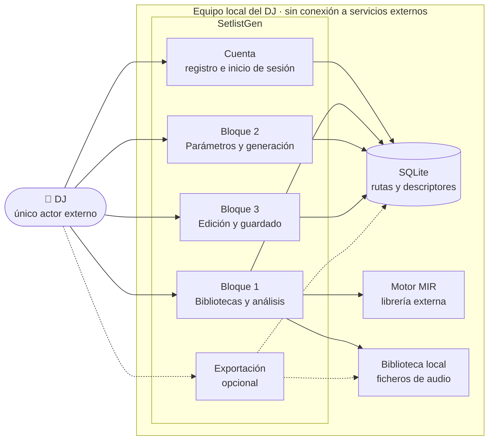
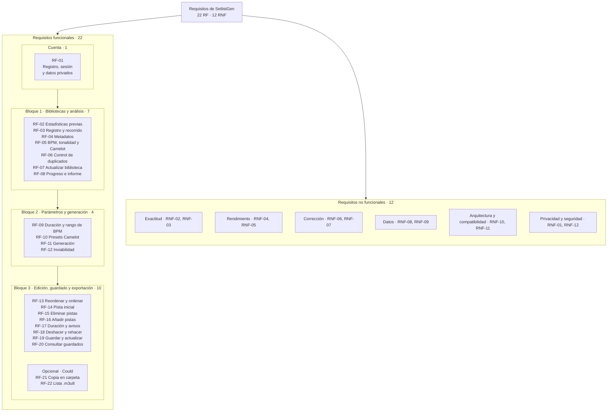

# Requisitos de SetlistGen

**Versión:** 1.2.1 · **Estado:** pendiente de revisión por el tutor

## 1. Propósito y alcance

Este documento especifica los requisitos funcionales (RF) y no funcionales (RNF) de SetlistGen: una aplicación local que analiza bibliotecas musicales del DJ, genera setlists según parámetros musicales y los guarda en SQLite.

**Dentro del alcance**

- Cuentas locales de DJ con datos privados.
- Registro y análisis de bibliotecas locales (metadatos, BPM, tonalidad y código Camelot).
- Actualización de bibliotecas ya registradas.
- Generación de setlists por restricciones.
- Edición flexible y guardado de setlists.
- Exportación opcional (ampliación, ADR-006).

**Fuera del alcance**

- Reproducción o mezcla de audio.
- Servicios en la nube, streaming y funciones sociales.
- Uso del género en la generación (progresión o filtro de género). El género se extrae y se muestra, pero no interviene.
- Clasificación automática de género por audio.
- Importación de XML de Rekordbox y escritura en su base de datos.
- Almacenamiento de audio en la base de datos.
- Validación de exactitud dentro de la aplicación (se hace con un script externo, véase la sección 6).

## 2. Actor y convenciones

**Actor único: el DJ.** Los procesos internos (análisis de pistas, detección de duplicados, cálculo del setlist) son pasos del sistema dentro de las acciones del DJ, no actores.

- **Prioridad (MoSCoW):** Must, Should, Could.
- **(P):** umbral provisional, que se ratifica tras una prueba con datos reales.
- Los identificadores no se reutilizan.

### 2.1 Actor y límites del sistema

El DJ es el único actor externo. Todo lo demás ocurre dentro del equipo local: la aplicación, la base de datos SQLite y la librería del motor MIR. Los ficheros de audio forman parte de la biblioteca local del DJ y se leen sin salir del equipo.

## 3. Requisitos funcionales

### 3.1 Cuenta de DJ

| ID | Requisito | Prioridad | Criterio de aceptación |
|---|---|---|---|
| RF-01 | El DJ podrá registrar una cuenta con usuario y contraseña, iniciar sesión y cerrarla. Las bibliotecas, pistas y setlists de cada cuenta son privados: ninguna otra cuenta puede verlos ni modificarlos | Must | Con dos cuentas, ninguna ve los datos de la otra. Un usuario ya existente o una contraseña incorrecta se rechazan con un mensaje claro |

### 3.2 Bloque 1: Bibliotecas y análisis

| ID | Requisito | Prioridad | Criterio de aceptación |
|---|---|---|---|
| RF-02 | El DJ seleccionará una carpeta local y, antes de procesarla, el sistema mostrará el tamaño total, el número de archivos de audio, el número de subcarpetas y el tiempo estimado de análisis (por muestreo de pistas) | Must | Los valores coinciden con la carpeta. La estimación se muestra antes de ordenar el procesamiento y se desvía ≤ 30 % del tiempo real (P) |
| RF-03 | Al ordenar el procesamiento, el sistema registrará la carpeta como biblioteca del DJ, la recorrerá de forma recursiva y reconocerá los formatos MP3, WAV, FLAC y AIFF, informando de los ficheros descartados y su motivo | Must | Se detectan todas las pistas de las subcarpetas. Cada descarte aparece en el informe con su motivo |
| RF-04 | El sistema extraerá de cada pista título, artista, duración y género | Must | Un campo ausente queda como nulo o «desconocido» y no interrumpe el análisis |
| RF-05 | El sistema estimará el BPM y la tonalidad de cada pista con el motor MIR y derivará su código Camelot. El BPM se almacenará como **número decimal en coma flotante (`REAL`, con 2 decimales)**, sin redondearlo a entero. Si no se obtiene alguno de los dos descriptores, la pista se guarda con estado «fallida» y su causa | Must | Cada pista analizada tiene BPM y tonalidad válidos, o estado «fallida» con causa. Un BPM de 127,5 se guarda y se recupera como 127,50. Las 24 tonalidades se corresponden con su código Camelot |
| RF-06 | Antes de analizar cada pista, el sistema comprobará en SQLite si el DJ ya la tiene registrada (por ruta, tamaño y fecha de modificación) y no la analizará ni la duplicará. Una pista «fallida» solo se reanaliza si el fichero cambia | Must | Un segundo procesamiento de la misma carpeta no reanaliza ninguna pista ni crea duplicados, incluidas las fallidas |
| RF-07 | El DJ podrá actualizar una biblioteca ya registrada. El sistema recorrerá de nuevo la carpeta, detectará pistas nuevas, modificadas y no encontradas, y analizará únicamente las nuevas y las modificadas. Las no encontradas se marcarán como «no disponibles» sin borrarlas. Un fichero movido o renombrado se tratará como pista nueva. Una pista no disponible que reaparece en su ruta se reactivará sin reanalizarla si tamaño y fecha coinciden | Must | Tras añadir pistas, solo esas se analizan. Tras modificar un fichero, solo ese se reanaliza. Una pista eliminada del disco queda «no disponible» y sigue existiendo en los setlists guardados. Una actualización sin cambios no reanaliza nada |
| RF-08 | El sistema mostrará el progreso del procesamiento y, al terminar, un informe con pistas analizadas, omitidas, descartadas, fallidas y no disponibles. El fallo de una pista no interrumpe el resto. El DJ podrá cancelar y se conservarán las pistas ya guardadas | Must | Con un fichero corrupto, el proceso termina y el fallo figura con su causa. Tras cancelar, las pistas ya procesadas siguen en la base |

### 3.3 Bloque 2: Parámetros y generación

| ID | Requisito | Prioridad | Criterio de aceptación |
|---|---|---|---|
| RF-09 | El DJ fijará la duración objetivo del setlist (por ejemplo, 2 h 30 min), con una tolerancia configurable (5 % por defecto), y el rango de BPM admisible (por ejemplo, 85–110) | Must | La duración resultante está dentro de la tolerancia. Ninguna pista queda fuera del rango |
| RF-10 | El DJ elegirá la compatibilidad armónica entre dos presets. **Estricta:** mismo código, ±1 con la misma letra, o mismo número con letra opuesta. **Energética:** la Estricta más el salto de +2 con la misma letra | Must | Con cada preset, todas las transiciones del setlist generado pertenecen a los movimientos que ese preset permite |
| RF-11 | El sistema generará una propuesta de setlist ordenada a partir de las pistas candidatas (disponibles, con BPM y tonalidad válidos, de las bibliotecas del DJ, o de una concreta si la elige), sin repetir pistas, que cumpla RF-09 y RF-10 y minimice los saltos de BPM y la disonancia armónica entre pistas consecutivas. El DJ podrá indicar una semilla; si no lo hace, el sistema generará y mostrará una | Must | Ninguna pista aparece dos veces ni es «fallida» o «no disponible». Con la misma biblioteca, parámetros y semilla se obtiene el mismo setlist |
| RF-12 | Si no existe una combinación válida, el sistema lo indicará, señalará al menos un conjunto de restricciones en conflicto y no generará un setlist inválido. Si la búsqueda se agota por límite de esfuerzo sin demostrar la inviabilidad, lo informará de forma distinta | Must | Con parámetros contradictorios se muestra el conflicto, y el mensaje distingue «inviable» de «límite agotado». Los parámetros inválidos se rechazan indicando todas las incidencias y una acción sugerida |

### 3.4 Bloque 3: Edición, guardado y exportación

| ID | Requisito | Prioridad | Criterio de aceptación |
|---|---|---|---|
| RF-13 | El DJ podrá reordenar manualmente las pistas del setlist y ordenarlo por BPM o por tonalidad Camelot, en sentido ascendente o descendente. Tras cada cambio, el sistema recalculará el número de orden (1..N) y reevaluará las transiciones | Must | Tras mover una pista o ordenar, las posiciones son 1..N sin huecos y las transiciones mostradas corresponden al orden actual |
| RF-14 | El DJ podrá fijar una pista del setlist como canción inicial. El sistema la colocará en la posición 1 una sola vez; no queda anclada, de modo que una ordenación posterior puede moverla | Should | La pista elegida ocupa la posición 1 y el resto conserva su orden relativo |
| RF-15 | El DJ podrá eliminar pistas del setlist | Must | La pista desaparece, el orden se renumera y las transiciones se recalculan |
| RF-16 | El DJ podrá añadir manualmente al setlist cualquier pista disponible de sus bibliotecas, buscándola por título, artista, BPM o tonalidad, aunque incumpla el rango de BPM o la compatibilidad. Se mostrará un aviso visual no bloqueante. No se admiten pistas ya incluidas ni pistas fallidas o no disponibles | Must | Se añade una pista fuera del rango con aviso y sin impedirlo. Una pista repetida, fallida o no disponible se rechaza indicando el motivo |
| RF-17 | El sistema mostrará en tiempo real la duración total del setlist en pantalla (suma de las duraciones de sus pistas) y avisará, sin bloquear, si sale de la tolerancia objetivo. Señalará con aviso visual las transiciones que incumplan la compatibilidad elegida | Must | La duración se actualiza tras cada edición. Un setlist fuera de tolerancia muestra el aviso. Una transición incompatible aparece señalada |
| RF-18 | El DJ podrá deshacer y rehacer un nivel de cambios de edición en pantalla antes de guardar | Could | Tras deshacer, el setlist vuelve al estado anterior al último cambio. Rehacer lo restablece |
| RF-19 | El DJ guardará el setlist en SQLite, ya sea como setlist nuevo o actualizando uno existente tras editarlo. Se almacenan la cuenta propietaria, el nombre, la fecha de creación y de última modificación, los parámetros de generación, la semilla y las referencias a las pistas con su número de orden. No se guardan ficheros de audio ni copias de los descriptores | Must | Un setlist nuevo se recupera con el mismo orden y parámetros. Tras editar uno guardado y actualizarlo, al abrirlo se ve el orden editado y no se crea un duplicado |
| RF-20 | El DJ podrá consultar, abrir y eliminar sus setlists guardados. Al abrir uno, el sistema avisará de las pistas marcadas como «no disponibles» o «fallidas», o cuyo fichero ya no exista | Must | La lista muestra solo los setlists de la cuenta activa. Una pista movida o borrada en disco, o cuyo reanálisis falló, se señala al abrir. Eliminar un setlist no afecta a la biblioteca |
| RF-21 | El DJ podrá exportar un setlist guardado copiando sus pistas, en orden, a una carpeta local, con un prefijo numérico que conserva el orden (ADR-006) | Could | La carpeta contiene los ficheros numerados en el orden del setlist. Las pistas con ruta rota se avisan antes de copiar |
| RF-22 | El DJ podrá exportar un setlist guardado como lista `.m3u8` (UTF-8) con las rutas locales de sus pistas (ADR-006) | Could | La lista se importa en Rekordbox con las pistas resueltas. Las rutas con tildes y espacios funcionan |

## 4. Requisitos no funcionales

| ID | Requisito | Métrica y umbral | Verificación | Prioridad |
|---|---|---|---|---|
| RNF-01 | **Procesamiento local.** Ningún fichero de audio ni dato de la biblioteca sale del equipo | 0 conexiones de red en el análisis, la generación y el guardado | Revisión de diseño y de dependencias | Must |
| RNF-02 | **Exactitud de BPM.** Frente a los valores de Rekordbox sobre una muestra de la biblioteca | ≥ 85 % dentro de ±4 %, y ≥ 92 % admitiendo errores de octava (factores 2, 1/2, 3, 1/3) (P) | Script de métricas sobre un CSV anotado, con desglose de errores | Must |
| RNF-03 | **Exactitud de tonalidad.** Misma muestra | ≥ 65 % de coincidencia exacta y ≥ 80 % de compatibilidad Camelot (P) | Misma muestra y script | Must |
| RNF-04 | **Tiempo de análisis** | Media ≤ 10 % de la duración de la pista por núcleo (P) | Benchmark sobre la biblioteca de prueba | Should |
| RNF-05 | **Tiempo de generación** | Setlist de 2 h sobre **500 pistas candidatas en ≤ 30 s**, percentil 95 (P) | Benchmark con 500 pistas candidatas | Should |
| RNF-06 | **Determinismo** | Misma biblioteca, parámetros y semilla producen el mismo setlist | Test automatizado | Must |
| RNF-07 | **Cumplimiento de restricciones** | 100 % de las transiciones de un setlist generado y no editado cumplen el rango de BPM y el preset armónico elegido | Tests de propiedades | Must |
| RNF-08 | **Persistencia ligera.** SQLite en un único fichero, solo rutas y descriptores, sin audio | 0 binarios de audio en la base. 0 pistas reanalizadas en un segundo procesamiento | Test de integración | Must |
| RNF-09 | **Integridad.** Una interrupción no deja la base inconsistente | La escritura de cada pista y de cada setlist es atómica; un fallo al guardar no deja un setlist a medias | Test de interrupción | Must |
| RNF-10 | **Arquitectura desacoplada y calidad.** El dominio y la aplicación no importan librerías de audio, de base de datos ni de interfaz. El motor MIR y el almacenamiento se acceden por interfaces sustituibles | Comprobación automática de dependencias. Cobertura ≥ 80 % en dominio y aplicación | Integración continua | Must |
| RNF-11 | **Compatibilidad.** Windows 10/11 y macOS vigente, con rutas con espacios, tildes y caracteres Unicode | Mismos resultados funcionales en ambos sistemas | Pruebas en ambos sistemas | Must |
| RNF-12 | **Seguridad de la cuenta.** Las contraseñas no se guardan en claro: se almacenan con hash con sal. Cada consulta de datos se filtra por la cuenta activa | 0 contraseñas en claro en la base. Ninguna consulta devuelve datos de otra cuenta | Revisión y tests de aislamiento | Must |

## 5. Resumen MoSCoW

| | Must | Should | Could | Total |
|---|---:|---:|---:|---:|
| RF | 18 | 1 (RF-14) | 3 (RF-18, RF-21, RF-22) | 22 |
| RNF | 10 | 2 (RNF-04, RNF-05) | 0 | 12 |

## 6. Decisiones funcionales y límites

| Tema | Decisión |
|---|---|
| Identificación de pistas | Por (cuenta, ruta), con tamaño y fecha de modificación para detectar cambios. Un fichero movido o renombrado es una pista nueva |
| Pistas no disponibles | Se marcan y no se borran, para no romper los setlists guardados |
| Pistas fallidas | Se guardan con estado y causa. Se excluyen de la generación y de la edición. No se reanalizan salvo que el fichero cambie |
| Precisión de BPM | El BPM se almacena como número decimal en coma flotante (`REAL`, 2 decimales), sin redondeo a entero. La interfaz puede mostrarlo redondeado, pero los cálculos (saltos de BPM, rango, métricas) usan el valor decimal |
| Orden del setlist generado | Lo determina el generador al minimizar el coste de las transiciones. La ordenación por BPM o por tonalidad es una acción posterior del DJ (RF-13) y puede introducir transiciones incompatibles, que se señalan |
| Aislamiento entre cuentas | Cada cuenta tiene sus propias filas de pistas, aunque dos cuentas registren la misma carpeta |
| Seguridad | La privacidad es la de la aplicación. No cifra los ficheros ni la base de datos, y no hay recuperación de contraseña |
| Género | Atributo informativo, fuera de la generación. Se justificará en la memoria como acotación de alcance |
| Validación de exactitud | Fuera de la aplicación: el DJ anota en un CSV (`ruta,bpm,tonalidad`) los valores de Rekordbox de una muestra de unas 100-150 pistas y un script de `scripts/` calcula las métricas. Los valores de Rekordbox son una referencia práctica, no una verdad absoluta |
| Interfaz | Escritorio Python o web local: por decidir (ADR-001). No condiciona estos requisitos |

Los umbrales (P) se ratifican tras una prueba con datos reales.

## 7. Estructura del SRS

Los 22 requisitos funcionales se agrupan por el flujo del DJ, y los 12 no funcionales por la cualidad que garantizan.

## 8. Control de cambios

| Versión | Cambio |
|---|---|
| 1.2 | Requisitos reescritos tras cerrar el comportamiento funcional: cuentas de DJ con contraseña, actualización de bibliotecas, estados de pista, presets Camelot, edición completa, género fuera de la generación y validación externa. 22 RF y 12 RNF |
| 1.2.1 | RNF-05 reducido a 500 pistas candidatas en ≤ 30 s. BPM como `REAL` con 2 decimales en RF-05 y en las decisiones. Añadidos el diagrama de actor y límites (2.1) y el diagrama estructural del SRS (7) |
| 1.2.2 | RF-20 avisa también de pistas fallidas |