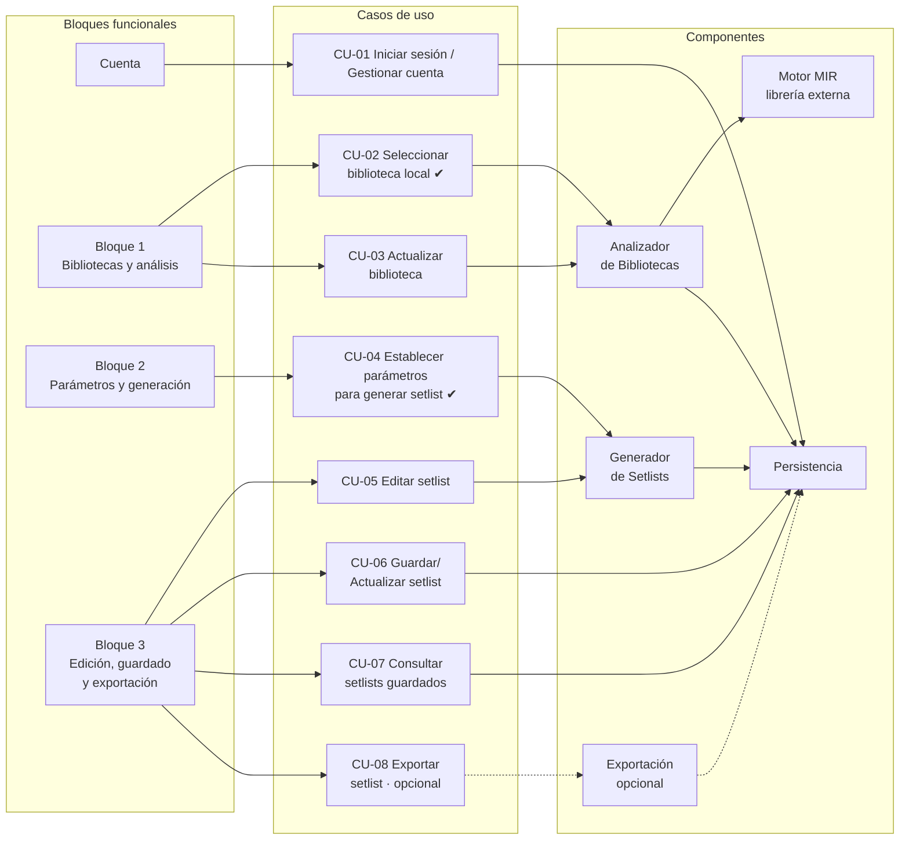

# Matriz de Trazabilidad de SetlistGen

**Versión:** 1.0 · **Estado:** pendiente de revisión por el tutor
**Alineada con:** `requirements.md` v1.2.1 y `use-cases.md` v1.2

## 1. Cómo leer este documento

Cada fila relaciona una acción del DJ (caso de uso) con lo que la especifica (RF y RNF), lo que la implementa (componentes) y cómo se comprueba. Los componentes son los del diagrama de la arquitectura: **UI** (Interfaz de Usuario), **AB** (Analizador de Bibliotecas), **GS** (Generador de Setlists), **PE** (Persistencia), **EX** (Exportación, opcional) y **MIR** (motor MIR, librería externa). La UI participa en todos los casos de uso y no se repite en la tabla.

**Tipos de prueba:** **U** unitaria · **I** integración · **P** propiedades del dominio · **B** benchmark · **S** script externo de métricas · **M** manual · **R** revisión o comprobación en integración continua.

## 2. Matriz por caso de uso

| Caso de uso | RF | RNF | Componentes | Verificación / prueba prevista |
|---|---|---|---|---|
| **CU-01** Iniciar sesión / Gestionar cuenta de DJ | RF-01 | RNF-12 | PE | **I:** registro, inicio y cierre de sesión; usuario duplicado y credenciales incorrectas. **I:** con dos cuentas, ninguna ve los datos de la otra. **R:** ninguna contraseña en claro en la base |
| **CU-02** Seleccionar biblioteca local ✔ | RF-02, RF-03, RF-04, RF-05, RF-06, RF-08 | RNF-02, RNF-03, RNF-04, RNF-08, RNF-09 | AB, MIR, PE | **I:** carpeta de prueba con subcarpetas, formatos no soportados y un fichero corrupto. **I:** segundo procesamiento con 0 reanálisis y sin duplicados, incluidas las fallidas. **U:** conversión de las 24 tonalidades a Camelot; BPM decimal con 2 decimales. **S:** exactitud de BPM y tonalidad frente a un CSV anotado (RNF-02, RNF-03). **B:** tiempo de análisis (RNF-04). **I:** interrupción sin base inconsistente |
| **CU-03** Actualizar biblioteca | RF-07, RF-08 | RNF-04, RNF-08, RNF-09 | AB, MIR, PE | **I:** añadir, modificar, borrar y mover ficheros; solo se analizan las pistas nuevas y modificadas. **I:** una pista borrada queda «no disponible» y reaparece reactivada sin reanalizar. **I:** una actualización sin cambios no reanaliza nada |
| **CU-04** Establecer parámetros para generar setlist ✔ | RF-09, RF-10, RF-11, RF-12 | RNF-05, RNF-06, RNF-07 | GS, PE | **P:** 100 % de transiciones dentro del rango de BPM y del preset elegido; sin pistas repetidas, fallidas ni no disponibles. **U:** validación de parámetros con todas las incidencias. **I:** misma biblioteca, parámetros y semilla producen el mismo setlist. **U:** restricciones en conflicto devuelven el motivo y se distingue «inviable» de «límite agotado». **B:** 500 pistas candidatas en ≤ 30 s, percentil 95 |
| **CU-05** Editar setlist (extiende CU-04) | RF-13, RF-14, RF-15, RF-16, RF-17, RF-18 | — | GS, PE | **U:** reordenar y ordenar por BPM y por Camelot; fijar pista inicial; eliminar; deshacer y rehacer. **U:** añadir una pista fuera de rango con aviso; rechazar repetida, fallida o no disponible. **U:** la duración total y las transiciones señaladas se actualizan tras cada cambio. **M:** usabilidad de la edición en la interfaz |
| **CU-06** Guardar/Actualizar setlist | RF-19 | RNF-08, RNF-09 | PE | **I:** guardar un setlist nuevo y recuperarlo con el mismo orden y parámetros. **I:** actualizar uno existente sin crear un duplicado. **I:** un fallo al guardar deja intacto el setlist anterior |
| **CU-07** Consultar setlists guardados | RF-20 | — | PE | **I:** la lista muestra solo los setlists de la cuenta activa. **I:** al abrir uno se avisa de las pistas no disponibles o cuyo fichero no existe. **I:** eliminar un setlist no afecta a la biblioteca |
| **CU-08** Exportar setlist *(opcional)* | RF-21, RF-22 | — | EX, PE | **I:** copia en carpeta con prefijo numérico y lista `.m3u8` en UTF-8, con rutas con tildes y espacios. **I:** aviso previo de rutas rotas. **M:** importación en Rekordbox, anotando la versión usada |

✔ = caso de uso crítico.

### Requisitos transversales

Aplican a todos los casos de uso y no se repiten en cada fila.

| RNF | Requisito | Componentes | Verificación / prueba prevista |
|---|---|---|---|
| RNF-01 | Procesamiento local | Todos | **R:** revisión de dependencias y de diseño. Ninguna conexión de red |
| RNF-10 | Arquitectura desacoplada y calidad | Todos | **R:** comprobación automática de dependencias entre capas y cobertura ≥ 80 % en dominio y aplicación, en integración continua |
| RNF-11 | Compatibilidad Windows 10/11 y macOS | Todos | **I:** suite de pruebas en ambos sistemas. **M:** rutas con espacios, tildes y Unicode |

## 3. Diagrama de trazabilidad

La UI participa en todos los casos de uso y no se dibuja para evitar líneas innecesarias.

## 4. Cobertura bidireccional

### 4.1 De requisito a caso de uso

| RF | CU | RF | CU |
|---|---|---|---|
| RF-01 | CU-01 | RF-12 | CU-04 |
| RF-02 | CU-02 | RF-13 | CU-05 |
| RF-03 | CU-02 | RF-14 | CU-05 |
| RF-04 | CU-02 | RF-15 | CU-05 |
| RF-05 | CU-02 | RF-16 | CU-05 |
| RF-06 | CU-02 | RF-17 | CU-05 |
| RF-07 | CU-03 | RF-18 | CU-05 |
| RF-08 | CU-02, CU-03 | RF-19 | CU-06 |
| RF-09 | CU-04 | RF-20 | CU-07 |
| RF-10 | CU-04 | RF-21 | CU-08 |
| RF-11 | CU-04 | RF-22 | CU-08 |

| RNF | Cubierto por | RNF | Cubierto por |
|---|---|---|---|
| RNF-01 | Transversal | RNF-07 | CU-04 |
| RNF-02 | CU-02 | RNF-08 | CU-02, CU-03, CU-06 |
| RNF-03 | CU-02 | RNF-09 | CU-02, CU-03, CU-06 |
| RNF-04 | CU-02, CU-03 | RNF-10 | Transversal |
| RNF-05 | CU-04 | RNF-11 | Transversal |
| RNF-06 | CU-04 | RNF-12 | CU-01 |

### 4.2 De caso de uso a requisito

| CU | Nº de RF | Huérfano |
|---|---:|---|
| CU-01 | 1 | No |
| CU-02 | 6 | No |
| CU-03 | 2 | No |
| CU-04 | 4 | No |
| CU-05 | 6 | No |
| CU-06 | 1 | No |
| CU-07 | 1 | No |
| CU-08 | 2 | No |

### 4.3 Resumen

| Comprobación | Resultado |
|---|---|
| Los 22 RF están cubiertos por al menos un caso de uso | Sí (22 de 22) |
| Los 12 RNF están cubiertos por un caso de uso o como transversales | Sí (12 de 12: 9 por caso de uso y 3 transversales) |
| Todo caso de uso tiene al menos un RF y una prueba prevista | Sí (8 de 8) |
| Todo RF y RNF tiene una verificación prevista | Sí |
| RF compartido por dos casos de uso | RF-08 (CU-02 y CU-03) |
| Requisitos opcionales (Could) | RF-18, RF-21 y RF-22. No condicionan la entrega del núcleo |
| RNF verificados fuera de la aplicación | RNF-02 y RNF-03, con un script de `scripts/` sobre un CSV anotado |

## 5. Control de cambios

| Versión | Cambio |
|---|---|
| 1.0 | Matriz reescrita desde cero para 8 casos de uso, 22 RF y 12 RNF |