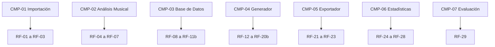

# Matriz de Trazabilidad

**Proyecto*** Sistema de Generación Automática de Setlists para DJs a partir del Análisis Musical de una Biblioteca de Audio Local

**Versión:** 2.0

**Fecha:** 2026-10-19

---

# 1. Introducción

La matriz de trazabilidad establece la relación entre los objetivos del proyecto, los requisitos funcionales, los casos de uso, los componentes software, las tareas de desarrollo y los casos de prueba.

Su propósito es garantizar la cobertura completa de los requisitos definidos en el SRS y facilitar las actividades de diseño, implementación, verificación y validación.

---

# 2. Componentes del Sistema

| Código | Componente |
|---|---|
| CMP-01 | Módulo de Importación |
| CMP-02 | Motor de Análisis Musical |
| CMP-03 | Base de Datos Local |
| CMP-04 | Generador de Setlists |
| CMP-05 | Exportador Rekordbox |
| CMP-06 | Panel de Estadísticas |
| CMP-07 | Módulo de Evaluación |
| CMP-08 | Interfaz de Usuario |
| CMP-09 | Infraestructura y Persistencia |

---

# 3. Relación Objetivos → Casos de Uso

| Objetivo | Casos de uso |
|---|---|
| O1 Importación | CU-01, CU-02 |
| O2 Análisis musical | CU-01, CU-02 |
| O3 Base de datos | CU-01, CU-02, CU-03, CU-06 |
| O4 Generación de setlists | CU-04, CU-05, CU-08 |
| O5 Exportación | CU-07 |
| O6 Estadísticas | CU-06, CU-09, CU-10 |
| O7 Evaluación | CU-11 |

---

# 4. Relación Requisitos → Casos de Uso → Componentes

| Requisito | Caso(s) de uso | Componentes |
|---|---|---|
| RF-01 | CU-01, CU-02 | CMP-01 |
| RF-02 | CU-01, CU-02 | CMP-01 |
| RF-03 | CU-01 | CMP-01 |
| RF-04 | CU-01 | CMP-02 |
| RF-05 | CU-01 | CMP-02 |
| RF-06 | CU-01 | CMP-02 |
| RF-07 | CU-01 | CMP-02 |
| RF-08 | CU-01 | CMP-03 |
| RF-09 | CU-01 | CMP-03 |
| RF-09b | CU-02 | CMP-03 |
| RF-10 | CU-05, CU-06 | CMP-03 |
| RF-11 | CU-03 | CMP-03 |
| RF-11b | CU-03 | CMP-03 |
| RF-12 | CU-04, CU-05 | CMP-04 |
| RF-13 | CU-04, CU-05 | CMP-04 |
| RF-14 | CU-04, CU-05 | CMP-04 |
| RF-15 | CU-04, CU-05 | CMP-04 |
| RF-16 | CU-04, CU-05 | CMP-04 |
| RF-17 | CU-05 | CMP-04 |
| RF-18 | CU-05 | CMP-04 |
| RF-19 | CU-05 | CMP-04 |
| RF-20 | CU-05 | CMP-08 |
| RF-20b | CU-08 | CMP-08 |
| RF-21 | CU-07 | CMP-05 |
| RF-22 | CU-07 | CMP-05 |
| RF-23 | CU-07 | CMP-05 |
| RF-24 | CU-06 | CMP-06 |
| RF-25 | CU-09 | CMP-06 |
| RF-26 | CU-09 | CMP-06 |
| RF-27 | CU-09 | CMP-06 |
| RF-28 | CU-10 | CMP-06 |
| RF-29 | CU-11 | CMP-07 |

---

# 5. Relación Casos de Uso → Issues GitHub

| Caso de uso | Issue(s) asociada(s) |
|---|---|
| CU-01 Analizar nueva biblioteca | #10, #11, #12, #13 |
| CU-02 Actualizar biblioteca | #10, #11 |
| CU-03 Consultar y ordenar biblioteca | #15 |
| CU-04 Definir parámetros | #16 |
| CU-05 Generar setlist | #14, #16 |
| CU-06 Consultar historial | #15 |
| CU-07 Exportar setlist a Rekordbox | #14, #16 |
| CU-08 Modificar orden de un setlist | #16 |
| CU-09 Consultar estadísticas | #15 |
| CU-10 Exportar datos estadísticos | #15 |
| CU-11 Evaluar resultados | #17, #18 |

---

# 6. Relación Componentes → Issues GitHub

| Componente | Issues asociadas |
|---|---|
| CMP-01 Módulo de Importación | #10, #11 |
| CMP-02 Motor de Análisis Musical | #12, #13 |
| CMP-03 Base de Datos Local | #6 |
| CMP-04 Generador de Setlists | #14 |
| CMP-05 Exportador Rekordbox | #14 |
| CMP-06 Panel de Estadísticas | #15, #16 |
| CMP-07 Módulo de Evaluación | #17, #18 |
| CMP-08 Interfaz de Usuario | #9, #15, #16 |
| CMP-09 Infraestructura y Persistencia | #5, #6, #7, #8 |

---

# 7. Relación Requisitos → Casos de Prueba

| Requisito | Caso(s) de prueba |
|---|---|
| RF-01 a RF-09 | T-CU01-01 a T-CU01-05 |
| RF-09b | T-CU02-01 |
| RF-10 | T-CU06-01 |
| RF-11, RF-11b | T-CU03-01 |
| RF-12 a RF-20 | T-CU05-01 a T-CU05-05 |
| RF-20b | T-CU08-01 |
| RF-21 a RF-23 | T-CU07-01 a T-CU07-04 |
| RF-24 | T-CU06-01 |
| RF-25 a RF-27 | T-CU09-01 |
| RF-28 | T-CU10-01 |
| RF-29 | T-CU11-01 |

---

# 8. Cobertura de Requisitos

## Resumen

| Elemento | Cantidad |
|---|---|
| Objetivos | 7 |
| Requisitos Funcionales | 29 |
| Requisitos No Funcionales | 26 |
| Casos de Uso | 11 |
| Componentes | 9 |
| Actores | 3 |
| Issues GitHub | 20 |
| Casos de Uso Críticos | 3 |

---

# 9. Diagrama General de Trazabilidad

---

# 10. Cobertura por Módulo

---

# 11. Casos de Uso Críticos

| Caso de uso | Objetivos cubiertos |
|---|---|
| CU-01 Analizar nueva biblioteca | O1, O2, O3 |
| CU-05 Generar setlist | O4 |
| CU-07 Exportar setlist a Rekordbox | O5 |

Estos tres casos de uso concentran la mayor parte de la complejidad funcional y técnica del sistema.

---

# 12. Trazabilidad con las fases del proyecto

| Fase | Issues |
|---|---|
| Análisis | #1, #2, #3, #4 |
| Diseño | #5, #6, #7 |
| Infraestructura inicial | #8, #9 |
| Implementación núcleo | #10, #11, #12, #13, #14 |
| Frontend | #15, #16 |
| Validación | #17, #18 |
| Memoria | #19 |
| Defensa | #20 |

---

# 13. Conclusión

Todos los requisitos funcionales definidos en el SRS disponen de:

- Casos de uso asociados.
- Componentes software responsables.
- Tareas de desarrollo identificadas en GitHub.
- Casos de prueba previstos para su validación.

La presente matriz proporciona trazabilidad completa entre análisis, diseño, implementación, pruebas y documentación del proyecto.
