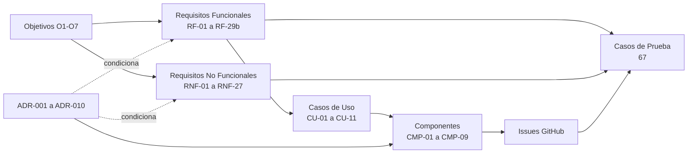
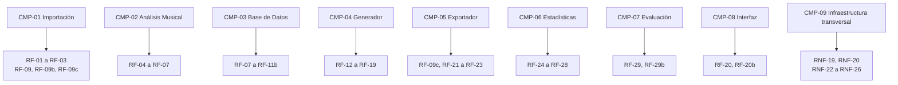

# Matriz de Trazabilidad

**Proyecto:** Sistema de Generación Automática de Setlists para DJs a partir del Análisis Musical de una Biblioteca de Audio Local

**Versión:** 3.0 (alineada con SRS v4.0 y casos de uso v1.1)

**Fecha:** 2026-10-30

**Estado:** pendiente de validación por tutor y cotutor

---

# 1. Introducción

La matriz de trazabilidad establece la relación entre los objetivos del proyecto, los requisitos (funcionales y no funcionales), los casos de uso, los componentes software, las decisiones arquitectónicas, las tareas de desarrollo y los casos de prueba.

Su propósito es garantizar la cobertura completa de los requisitos definidos en el SRS y facilitar las actividades de diseño, implementación, verificación y validación.

Las propuestas que dependen de una decisión abierta (`open-decisions.md`) se identifican en la columna **OD**. No cierran la decisión.

---

# 2. Componentes del Sistema

| Código | Componente | Alcance |
|---|---|---|
| CMP-01 | Módulo de Importación | Recorrido de carpetas, filtrado de formatos, lectura de etiquetas, identificación de pistas y detección de pistas nuevas, movidas, duplicadas y ausentes |
| CMP-02 | Motor de Análisis Musical | Puerto `AudioAnalyzer` y adaptadores de análisis (BPM, tonalidad, Camelot) |
| CMP-03 | Base de Datos Local | Repositorios, esquema SQLite, consultas y migraciones |
| CMP-04 | Generador de Setlists | Restricciones, búsqueda, función de coste y explicación de conflictos |
| CMP-05 | Exportador Rekordbox | Exportación XML y M3U8, resolución de rutas |
| CMP-06 | Panel de Estadísticas | Historial, estadísticas y exportación de datos del panel |
| CMP-07 | Módulo de Evaluación | Importación de la referencia (`ReferenceDataProvider`), métricas e informe de discrepancias |
| CMP-08 | Interfaz de Usuario | Presentación y entrada de parámetros de todos los casos de uso. Se lista como componente de un RF solo cuando el requisito es propiamente de presentación |
| CMP-09 | Infraestructura Transversal | Integración continua, empaquetado, configuración, registro de eventos y comprobaciones de arquitectura |

> Aclaración v3.0: CMP-03 cubre los datos y su persistencia; CMP-09 cubre lo que no pertenece a ningún otro componente (CI, empaquetado, configuración y registro). En v2.0 ambos se solapaban y CMP-09 no aparecía en ningún mapeo.

---

# 3. Relación Objetivos → Casos de Uso

| Objetivo | Casos de uso |
|---|---|
| O1 Importación | CU-01, CU-02 |
| O2 Análisis musical | CU-01, CU-02 |
| O3 Base de datos | CU-01, CU-02, CU-03, CU-06 |
| O4 Generación de setlists | CU-03, CU-04, CU-05, CU-08 |
| O5 Exportación | CU-07 |
| O6 Estadísticas | CU-06, CU-09, CU-10 |
| O7 Evaluación | CU-11 |

---

# 4. Relación Requisitos Funcionales → Casos de Uso → Componentes

| Requisito | Prioridad | Obj. | Caso(s) de uso | Componentes | OD |
|---|---|---|---|---|---|
| RF-01 | Must | O1 | CU-01, CU-02 | CMP-01 | — |
| RF-02 | Must | O1 | CU-01, CU-02 | CMP-01 | — |
| RF-03 | Must | O1 | CU-01 | CMP-01 | — |
| RF-04 | Must | O2 | CU-01 | CMP-02 | — |
| RF-05 | Must | O2 | CU-01 | CMP-02 | — |
| RF-06 | Must | O2 | CU-01 | CMP-02 | — |
| RF-07 | Must | O2 | CU-01, CU-11 | CMP-02, CMP-03 | OD-04 |
| RF-08 | Must | O3 | CU-01, CU-02 | CMP-03 | — |
| RF-09 | Must | O3 | CU-01, CU-02 | CMP-01, CMP-03 | OD-03 |
| RF-09b | Must | O3 | CU-02 | CMP-01, CMP-03 | OD-03 |
| RF-09c | Must | O3 | CU-02, CU-07 | CMP-01, CMP-03, CMP-05 | OD-03 |
| RF-10 | Must | O3 | CU-05, CU-06 | CMP-03 | OD-06 |
| RF-11 | Must | O3, O4 | CU-03 | CMP-03 | — |
| RF-11b | Must | O3, O4 | CU-03 | CMP-03 | — |
| RF-12 | Must | O4 | CU-04, CU-05 | CMP-04 | — |
| RF-13 | Must | O4 | CU-04, CU-05 | CMP-04 | — |
| RF-13b | Must | O4 | CU-04, CU-05 | CMP-04 | OD-02 |
| RF-14 | Must | O4 | CU-04, CU-05 | CMP-04 | — |
| RF-15 | Should | O4 | CU-04, CU-05 | CMP-04 | — |
| RF-16 | Should | O4 | CU-04, CU-05 | CMP-04 | — |
| RF-17 | Must | O4 | CU-05 | CMP-04 | OD-06 |
| RF-18 | Must | O4 | CU-05 | CMP-04 | — |
| RF-19 | Must | O4 | CU-05 | CMP-04 | — |
| RF-20 | Must | O4 | CU-05 | CMP-08 | OD-06 |
| RF-20b | Could | O4 | CU-08 | CMP-08 | OD-06 |
| RF-21 | Must | O5 | CU-07 | CMP-05 | — |
| RF-21b | Should | O5 | CU-07 | CMP-05 | — |
| RF-22 | Must | O5 | CU-07 | CMP-05 | — |
| RF-23 | Must | O5 | CU-07 | CMP-05 | — |
| RF-24 | Could | O6 | CU-06 | CMP-06 | — |
| RF-25 | Could | O6 | CU-09 | CMP-06 | — |
| RF-26 | Could | O6 | CU-09 | CMP-06 | — |
| RF-27 | Could | O6 | CU-09 | CMP-06 | — |
| RF-28 | Could | O6 | CU-10 | CMP-06 | — |
| RF-29 | Must | O7 | CU-11 | CMP-07 | OD-01 |
| RF-29b | Must | O7 | CU-11 | CMP-07 | — |

---

# 5. Relación Requisitos No Funcionales → Objetivos → Casos de Uso → Componentes

| Requisito | Prioridad | Objetivo(s) | Caso(s) de uso | Componentes | Prueba |
|---|---|---|---|---|---|
| RNF-01 | Must | O2 | CU-01, CU-02 | CMP-02 | T-CU01-11 |
| RNF-02 | Should | O2 | CU-01 | CMP-02 | T-CU01-11 |
| RNF-03 | Must | O4 | CU-05 | CMP-04 | T-CU05-11 |
| RNF-04 | Must | O3 | CU-02 | CMP-01, CMP-03 | T-CU02-01, T-CU02-05 |
| RNF-05 | Must | O7 | CU-11 | CMP-02, CMP-07 | T-CU11-02 |
| RNF-06 | Must | O7 | CU-11 | CMP-02, CMP-07 | T-CU11-02 |
| RNF-07 | Must | O7 | CU-11 | CMP-02, CMP-07 | T-CU11-03 |
| RNF-08 | Must | O7 | CU-11 | CMP-02, CMP-07 | T-CU11-03 |
| RNF-09 | Must | O7 | CU-11 | CMP-07 | T-CU11-04 |
| RNF-10 | Must | O4 | CU-05 | CMP-04 | T-CU05-02, T-CU05-03 |
| RNF-11 | Must | O4 | CU-05 | CMP-04 | T-CU05-08 |
| RNF-12 | Should | O4, O7 | CU-05 | CMP-07 | T-USO-02 |
| RNF-13 | Should | O4, O6 | CU-04, CU-05, CU-07 | CMP-08 | T-USO-01 |
| RNF-14 | Must | O4, O6 | CU-01, CU-02, CU-05, CU-07 | CMP-08 | T-USO-03 |
| RNF-15 | Must | O1 | CU-01, CU-02 | CMP-01, CMP-02 | T-CU01-09 |
| RNF-16 | Must | O1, O5 | CU-01, CU-07 | CMP-01, CMP-05 | T-CU07-03 |
| RNF-17 | Must | O3 | CU-01, CU-02 | CMP-03 | T-CU01-10 |
| RNF-18 | Should | O4 | CU-05 | CMP-04 | T-CU05-12 |
| RNF-19 | Must | Transversal | Todos | CMP-09 | T-ARQ-08 |
| RNF-20 | Must | Transversal | Todos | CMP-09 | T-ARQ-07 |
| RNF-21 | Must | O5 | CU-07 | CMP-04, CMP-05 | T-ARQ-09 |
| RNF-22 | Must | Transversal | — | CMP-09 | T-ARQ-01 |
| RNF-23 | Must | Transversal | — | CMP-02, CMP-03, CMP-05, CMP-09 | T-ARQ-02 |
| RNF-24 | Must | Transversal | — | CMP-09 | T-ARQ-03 |
| RNF-25 | Must | Transversal | Todos | CMP-09 | T-ARQ-04 |
| RNF-26 | Must | Transversal | — | CMP-09 | T-ARQ-05 |
| RNF-27 | Should | O3 | CU-01, CU-02 | CMP-03 | T-ARQ-06 |

> Los umbrales numéricos de los RNF son provisionales hasta el hito H2 (prueba de concepto).

---

# 6. Relación ADR → Requisitos → Componentes

| ADR | Decisión | Estado | Requisitos principales | Componentes |
|---|---|---|---|---|
| ADR-001 | Aplicación de escritorio | Aceptado | RNF-19, RNF-20, RNF-25 | CMP-08, CMP-09 |
| ADR-002 | Clean Architecture, puertos y adaptadores | Aceptado | RNF-21, RNF-22, RNF-23, RNF-24 | Todos |
| ADR-003 | Motor de análisis desacoplado (`AudioAnalyzer`) | Aceptado; librería pendiente de la prueba de concepto | RF-03 a RF-07, RF-29, RNF-01, RNF-02, RNF-05 a RNF-09, RNF-23 | CMP-01, CMP-02, CMP-07 |
| ADR-004 | SQLite | Aceptado | RF-08 a RF-11b, RNF-04, RNF-17, RNF-27 | CMP-03 |
| ADR-005 | Generación mediante restricciones | Aceptado | RF-12 a RF-19, RNF-03, RNF-10, RNF-11, RNF-18 | CMP-04 |
| ADR-006 | XML Rekordbox y M3U8 | Aceptado; verificación manual (RF-23) | RF-09c, RF-21, RF-21b, RF-22, RF-23, RNF-16, RNF-21 | CMP-05 |
| ADR-007 | Licencias y compatibilidad legal | Propuesto | RNF-26 | CMP-09 |
| ADR-008 | Lenguaje, interfaz gráfica y empaquetado | Propuesto | RNF-13, RNF-14, RNF-19, RNF-20 | CMP-08, CMP-09 |
| ADR-009 | Dataset y protocolo de evaluación | Propuesto | RF-29, RF-29b, RNF-05 a RNF-09, RNF-12 | CMP-07 |
| ADR-010 | Identificación permanente de pistas (OD-03) | Propuesto | RF-09, RF-09b, RF-09c, RNF-04 | CMP-01, CMP-03 |

La columna recoge los requisitos principales de cada decisión. La lista completa, con los requisitos secundarios, figura en la sección «Trazabilidad» de cada ADR.

---

# 7. Relación Casos de Uso → Issues GitHub

> Mapeo heredado de v2.0. No he podido verificarlo contra el repositorio en esta sesión, por lo que debe revisarse en GitHub.

| Caso de uso | Issue(s) asociada(s) |
|---|---|
| CU-01 Analizar nueva biblioteca | #10, #11, #12, #13 |
| CU-02 Actualizar biblioteca | #10, #11 |
| CU-03 Consultar y ordenar biblioteca | #15 |
| CU-04 Definir parámetros | #16 |
| CU-05 Generar setlist | #14, #16 |
| CU-06 Consultar historial | #15 |
| CU-07 Exportar setlist a Rekordbox | #14, #16 |
| CU-08 Modificar orden de un setlist | #16 |
| CU-09 Consultar estadísticas | #15 |
| CU-10 Exportar datos estadísticos | #15 |
| CU-11 Evaluar resultados | #17, #18 |

### Elementos sin issue asociada (propuesta de creación)

| Elemento | Motivo |
|---|---|
| RF-09c, RF-13b, RF-21b, RF-29b, RNF-27 | Requisitos nuevos de v4.0 |
| ADR-007, ADR-008, ADR-009, ADR-010 | ADR nuevos |
| Verificación de arquitectura en CI (RNF-22 a RNF-24) | Sin tarea explícita en el mapeo heredado |

---

# 8. Relación Componentes → Issues GitHub

| Componente | Issues asociadas |
|---|---|
| CMP-01 Módulo de Importación | #10, #11 |
| CMP-02 Motor de Análisis Musical | #12, #13 |
| CMP-03 Base de Datos Local | #6 |
| CMP-04 Generador de Setlists | #14 |
| CMP-05 Exportador Rekordbox | #14 |
| CMP-06 Panel de Estadísticas | #15, #16 |
| CMP-07 Módulo de Evaluación | #17, #18 |
| CMP-08 Interfaz de Usuario | #9, #15, #16 |
| CMP-09 Infraestructura Transversal | #5, #6, #7, #8 |

> Observación: el generador y el exportador comparten la issue #14. Se recomienda separarlas cuando se creen las issues de implementación, ya que corresponden a componentes y casos críticos distintos (CU-05 y CU-07). Del mismo modo, CMP-03 y CMP-09 comparten #6.

---

# 9. Catálogo de casos de prueba

Tipos: **U** unitaria · **I** integración · **P** propiedades del dominio · **B** benchmark · **M** manual · **R** revisión de diseño o análisis estático.

### 9.1 CU-01 Analizar nueva biblioteca

| ID | Descripción | Tipo | Requisitos |
|---|---|---|---|
| T-CU01-01 | Recorrido recursivo detecta todas las pistas de las subcarpetas | I | RF-01 |
| T-CU01-02 | Los ficheros no soportados se descartan y se listan con su motivo | I | RF-02 |
| T-CU01-03 | Extracción de metadatos; un campo ausente queda nulo; BPM o tonalidad de etiqueta se guardan con origen «etiqueta» | U, I | RF-03 |
| T-CU01-04 | Cada pista tiene BPM y tonalidad estimados o una marca de fallo | I | RF-04, RF-05 |
| T-CU01-05 | Conversión de las 24 tonalidades a su código Camelot | U | RF-06 |
| T-CU01-06 | Se registran origen, motor y versión; dos motores conviven sin sobrescribirse | I | RF-07 |
| T-CU01-07 | Los datos sobreviven al reinicio de la aplicación | I | RF-08 |
| T-CU01-08 | La misma pista conserva el identificador al renombrarla o moverla | I | RF-09 |
| T-CU01-09 | Un fichero corrupto no interrumpe el lote y queda registrado con su causa | I | RNF-15 |
| T-CU01-10 | Una interrupción no deja la base de datos inconsistente | I | RNF-17 |
| T-CU01-11 | Tiempo de análisis por pista y por lote de 500 pistas frente al umbral | B | RNF-01, RNF-02 |

### 9.2 CU-02 Actualizar biblioteca existente

| ID | Descripción | Tipo | Requisitos |
|---|---|---|---|
| T-CU02-01 | Una segunda importación no reanaliza ninguna pista; tras añadir pistas solo se analizan las nuevas | I | RF-09b, RNF-04 |
| T-CU02-02 | Una pista movida conserva su identificador, descriptores e histórico de setlists | I | RF-09c |
| T-CU02-03 | Una pista ausente se marca como tal y reactiva si reaparece | I | RF-09c |
| T-CU02-04 | Una pista en varias ubicaciones se registra como duplicada, con un solo identificador | I | RF-09c |
| T-CU02-05 | Detección de pistas nuevas sobre 5 000 pistas en ≤ 2 min | B | RNF-04 |

### 9.3 CU-03 y CU-04

| ID | Descripción | Tipo | Requisitos |
|---|---|---|---|
| T-CU03-01 | Las consultas por BPM, tonalidad, título, género, año y duración devuelven solo pistas que cumplen los filtros | I | RF-11 |
| T-CU03-02 | Ordenación ascendente y descendente por cada campo | I | RF-11b |
| T-CU04-01 | Validación de parámetros y valores por defecto (tolerancia de duración, salto de BPM, política armónica) | U | RF-12, RF-13, RF-13b, RF-14, RF-15, RF-16 |

### 9.4 CU-05 Generar setlist

| ID | Descripción | Tipo | Requisitos |
|---|---|---|---|
| T-CU05-01 | La duración resultante está dentro de la tolerancia (por defecto ±5 %) | P | RF-12 |
| T-CU05-02 | Ninguna pista fuera del rango de BPM y ninguna transición supera el salto máximo | P | RF-13, RF-13b, RNF-10 |
| T-CU05-03 | Todas las transiciones cumplen la política armónica | P | RF-14, RF-17, RNF-10 |
| T-CU05-04 | Ninguna pista aparece dos veces | P | RF-18 |
| T-CU05-05 | Las pistas ancladas ocupan su posición y cada intervalo respeta su género | U, I | RF-15, RF-16 |
| T-CU05-06 | Restricciones incompatibles: se informa del conflicto y no se almacena ningún setlist | U, I | RF-19 |
| T-CU05-07 | Tiempo límite agotado: se informa de forma distinta a la inviabilidad demostrada | U | RF-19 |
| T-CU05-08 | Misma biblioteca, parámetros, motor activo y semilla producen el mismo setlist | I | RNF-11 |
| T-CU05-09 | El setlist se recupera con sus parámetros y su semilla | I | RF-10 |
| T-CU05-10 | La vista del setlist muestra orden, descriptores y evaluación de cada transición | I, M | RF-20 |
| T-CU05-11 | Setlist de 2 h sobre 5 000 pistas en ≤ 60 s (percentil 95) | B | RNF-03 |
| T-CU05-12 | T(10 000) / T(5 000) ≤ 2,5 | B | RNF-18 |

### 9.5 CU-06 a CU-10

| ID | Descripción | Tipo | Requisitos |
|---|---|---|---|
| T-CU06-01 | El historial lista todos los setlists persistidos | I | RF-10, RF-24 |
| T-CU07-01 | El XML generado es válido según la especificación del formato | I | RF-21 |
| T-CU07-02 | El M3U8 contiene una ruta por pista, en orden, en UTF-8 | I | RF-21b |
| T-CU07-03 | Rutas con espacios, tildes, Unicode y rutas largas se resuelven en ambos sistemas operativos | I | RF-22, RNF-16 |
| T-CU07-04 | Aviso explícito ante pistas ausentes o con ruta no resuelta | I | RF-09c, RF-22 |
| T-CU07-05 | Importación manual en Rekordbox sobre setlists de prueba, con registro del resultado | M | RF-23 |
| T-CU08-01 | Tras reordenar, las transiciones se reevalúan y se señalan las que incumplen | I | RF-20b |
| T-CU09-01 | El ranking de pistas más utilizadas coincide con el histórico | I | RF-25 |
| T-CU09-02 | Las distribuciones coinciden con los datos almacenados | I | RF-26 |
| T-CU09-03 | Las series temporales se calculan a partir del histórico | I | RF-27 |
| T-CU10-01 | Los ficheros TXT, M3U y CSV reproducen el contenido mostrado | I | RF-28 |

### 9.6 CU-11 Evaluar resultados

| ID | Descripción | Tipo | Requisitos |
|---|---|---|---|
| T-CU11-01 | Importación de la referencia, asociación a pistas y listado de pistas sin referencia y referencias sin pista | I | RF-29b |
| T-CU11-02 | Exactitud de BPM estricta y con tolerancia de octava sobre el conjunto de evaluación | I, B | RF-29, RNF-05, RNF-06 |
| T-CU11-03 | Exactitud de tonalidad exacta y por compatibilidad Camelot | I, B | RF-29, RNF-07, RNF-08 |
| T-CU11-04 | Desglose de errores con intervalos de confianza | U, I | RNF-09 |
| T-CU11-05 | Informe desglosado por motor | I | RF-07, RF-29 |

### 9.7 Transversales

| ID | Descripción | Tipo | Requisitos |
|---|---|---|---|
| T-ARQ-01 | Dominio y aplicación no importan frameworks, librerías de audio, de base de datos ni de interfaz | R (CI) | RNF-22 |
| T-ARQ-02 | Se sustituye un adaptador por un doble y por una segunda implementación sin tocar dominio ni aplicación | I | RNF-23 |
| T-ARQ-03 | Cobertura ≥ 80 %, tipado estático y análisis estático sin incidencias bloqueantes | R (CI) | RNF-24 |
| T-ARQ-04 | Revisión de que ningún dato sale del equipo | R | RNF-25 |
| T-ARQ-05 | Inventario de licencias de las dependencias | R | RNF-26 |
| T-ARQ-06 | Migración de una base de datos de versión anterior sin pérdida de datos | I | RNF-27 |
| T-ARQ-07 | Instalación limpia del entorno en ≤ 30 min siguiendo el manual | M | RNF-20 |
| T-ARQ-08 | Mismos resultados funcionales en Windows y macOS | I (CI), M | RNF-19 |
| T-ARQ-09 | El dominio no depende del formato de rutas del sistema operativo | R, U | RNF-21 |
| T-USO-01 | Un DJ nuevo genera y exporta su primer setlist en ≤ 10 min | M | RNF-13 |
| T-USO-02 | Cuestionario a al menos 3 DJs sobre la coherencia de los setlists | M | RNF-12 |
| T-USO-03 | Progreso en operaciones de más de 5 s y mensajes de error con causa y acción sugerida | M, I | RNF-14 |

### 9.8 Identificación de pistas (prueba de concepto, ADR-010)

| ID | Descripción | Tipo | Requisitos |
|---|---|---|---|
| T-ID-01 | Renombrar y mover una pista: misma pista, ubicación actualizada, sin reanálisis | I | RF-09, RF-09c |
| T-ID-02 | Editar las etiquetas de una pista: misma pista, sin reanálisis | I | RF-09, RF-09b |
| T-ID-03 | Convertir una pista a otro formato sin pérdida: resultado según el alcance de identidad decidido | I | RF-09 |
| T-ID-04 | Recodificar una pista con otra tasa de bits: resultado según el alcance de identidad decidido | I | RF-09 |
| T-ID-05 | Dos versiones distintas de una misma obra: pistas distintas, sin fusión | I | RF-09 |
| T-ID-06 | Dos ubicaciones del mismo fichero: una pista duplicada | I | RF-09c |
| T-ID-07 | Fichero ilegible: marca de fallo y el lote continúa | I | RF-09, RNF-15 |
| T-ID-08 | Reescaneo de 5 000 pistas sin cambios y tras mover la carpeta completa: tiempo dentro del objetivo y 0 reanálisis | B | RF-09b, RF-09c, RNF-04 |

**Total: 67 casos de prueba (59 del catálogo base y 8 de identificación).** Cada RF y cada RNF tiene al menos uno. Los casos manuales (RF-23, RNF-12, RNF-13, RNF-19, RNF-20) no pueden automatizarse y se registran como evidencia en la memoria.

---

# 10. Cobertura de Requisitos

## Resumen

| Elemento | Cantidad |
|---|---|
| Objetivos | 7 |
| Requisitos Funcionales | 36 (27 Must, 3 Should, 6 Could) |
| Requisitos No Funcionales | 27 (22 Must, 5 Should) |
| Casos de Uso | 11 |
| Casos de Uso Críticos | 4 |
| Componentes | 9 |
| Actores | 3 |
| ADR | 10 (6 aceptados, 4 propuestos) |
| Casos de prueba | 67 |
| Issues GitHub | 20 (sin verificar en esta versión) |

## Comprobaciones de cobertura

| Comprobación | Resultado |
|---|---|
| Todo objetivo tiene al menos un caso de uso | Sí |
| Todo RF tiene caso de uso, componente y prueba | Sí (36 de 36) |
| Todo RNF tiene componente y prueba | Sí (27 de 27) |
| Todo caso de uso tiene al menos un RF | Sí (11 de 11) |
| Todo ADR indica los requisitos que condiciona | Sí |
| Todo componente aparece en algún mapeo | Sí (incluye CMP-08 y CMP-09) |
| Todo CU tiene issue asociada | Sí (heredado, sin verificar). Los elementos nuevos están sin issue |

---

# 11. Diagrama General de Trazabilidad

---

# 12. Cobertura por Módulo

> Corrección v3.0: el diagrama de v2.0 asignaba RF-20 y RF-20b a CMP-04, pero la tabla de trazabilidad los asignaba a CMP-08. Prevalece la tabla del apartado 4. El diagrama omitía además CMP-08 y CMP-09.

---

# 13. Casos de Uso Críticos

| Caso de uso | Objetivos cubiertos |
|---|---|
| CU-01 Analizar nueva biblioteca | O1, O2, O3 |
| CU-05 Generar setlist | O4 |
| CU-07 Exportar setlist a Rekordbox | O5 |
| CU-11 Evaluar resultados frente a Rekordbox | O7 |

Estos cuatro casos de uso concentran la mayor parte de la complejidad funcional y técnica del sistema, así como la evidencia experimental del trabajo.

---

# 14. Trazabilidad con las fases del proyecto

| Fase | Issues |
|---|---|
| Análisis | #1, #2, #3, #4 |
| Diseño | #5, #6, #7 |
| Infraestructura inicial | #8, #9 |
| Implementación núcleo | #10, #11, #12, #13, #14 |
| Frontend | #15, #16 |
| Validación | #17, #18 |
| Memoria | #19 |
| Defensa | #20 |

---

# 15. Dependencias de decisiones abiertas

| OD | Requisitos y casos de uso afectados | Componentes |
|---|---|---|
| OD-01 | RF-29, CU-11 | CMP-07 |
| OD-02 | RF-13b, RF-17, RNF-10, CU-04, CU-05 | CMP-04 |
| OD-03 | RF-09, RF-09b, RF-09c, RNF-04, CU-01, CU-02 | CMP-01, CMP-03 |
| OD-04 | RF-07, RF-29, RNF-11, CU-11 | CMP-02, CMP-03 |
| OD-05 | Modelo de dominio (`Library`), CU-01, CU-02, CU-09 | CMP-03 |
| OD-06 | RF-10, RF-17, RF-20, RF-20b, CU-05, CU-08 | CMP-03, CMP-04, CMP-08 |
| OD-07 | Vocabulario del dominio (SRS 7.0) | Todos |
| OD-08 | ADR-007, ADR-008, ADR-009 | CMP-07, CMP-08, CMP-09 |

---

# 16. Conclusión

Con esta versión, todos los requisitos funcionales y no funcionales definidos en el SRS v4.0 disponen de caso de uso (cuando procede), componente responsable y caso de prueba previsto. Los casos de uso se corresponden con el catálogo v1.1 y las decisiones arquitectónicas quedan vinculadas a los requisitos que condicionan.

Quedan pendientes, y se indican expresamente, la verificación del mapeo con GitHub, la creación de las issues de los elementos nuevos y la validación por tutor y cotutor de las propuestas que dependen de OD.

---

# 17. Control de cambios

| Versión | Fecha | Cambio |
|---|---|---|
| 1.0 | — | Versión inicial |
| 2.0 | 2026-10-19 | Matriz de objetivos, requisitos funcionales, casos de uso, componentes e issues |
| 3.0 | 2026-10-30 | Alineación con SRS v4.0 y use-cases v1.1: 36 RF y 27 RNF; nueva matriz de RNF; relación con ADR-001 a ADR-010; catálogo de 67 casos de prueba (incluye T-ID-01 a T-ID-08, de ADR-010); CU-11 crítico; CU-02 con RF-01, RF-02, RF-08, RF-09 y RF-09c; aclaración de CMP-03 y CMP-09; corrección de los diagramas de cobertura; columna de OD; sección de dependencias; corrección del resumen (v2.0 indicaba 29 RF y 26 RNF) y del título (carácter extra en «Proyecto») |
