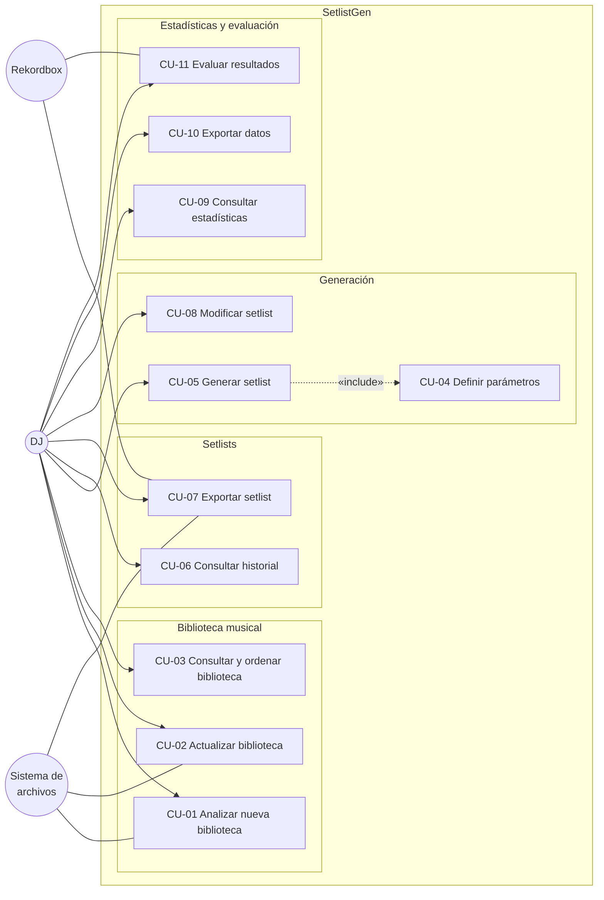

# Catálogo de Casos de Uso

**Proyecto:** SetlistGen  
**Versión:** 1.0  
**Fecha:** 2026-10-19

---

# 1. Actores

| Actor | Tipo | Descripción |
|---|---|---|
| DJ | Principal | Usuario principal del sistema. Gestiona la biblioteca, genera setlists y consulta resultados. |
| Rekordbox | Sistema externo | Destino de los setlists exportados y fuente de referencia para la evaluación. |
| Sistema de archivos local | Sistema externo | Origen de las pistas musicales y destino de las exportaciones. |

---

# 2. Catálogo de casos de uso

| ID | Nombre | Actor | RF relacionados | Prioridad | Detalle |
|---|---|---|---|---|---|
| CU-01 | Analizar nueva biblioteca | DJ | RF-01, RF-02, RF-03, RF-04, RF-05, RF-06, RF-07, RF-08, RF-09 | Must | Sí |
| CU-02 | Actualizar biblioteca existente | DJ | RF-09b | Must | — |
| CU-03 | Consultar y ordenar biblioteca | DJ | RF-11, RF-11b | Must | — |
| CU-04 | Definir parámetros de generación | DJ | RF-12, RF-13, RF-14, RF-15, RF-16 | Must | — |
| CU-05 | Generar setlist | DJ | RF-10, RF-17, RF-18, RF-19, RF-20 | Must | Sí |
| CU-06 | Consultar historial de setlists | DJ | RF-10, RF-24 | Could | — |
| CU-07 | Exportar setlist a Rekordbox | DJ, Rekordbox | RF-21, RF-22, RF-23 | Must | Sí |
| CU-08 | Modificar orden de un setlist | DJ | RF-20b | Could | — |
| CU-09 | Consultar estadísticas | DJ | RF-25, RF-26, RF-27 | Could | — |
| CU-10 | Exportar datos estadísticos | DJ | RF-28 | Could | — |
| CU-11 | Evaluar resultados frente a Rekordbox | DJ, Rekordbox | RF-29 | Should | — |

---

# 3. Diagrama de casos de uso

---

# 4. Casos de uso críticos

Se consideran críticos los casos de uso:

- CU-01 Analizar nueva biblioteca.
- CU-05 Generar setlist.
- CU-07 Exportar setlist a Rekordbox.

Estos casos implementan los objetivos principales O1, O4 y O5 del anteproyecto y concentran la mayor parte de la complejidad técnica del sistema.

---

# 5. CU-01 Analizar nueva biblioteca

## Objetivo

Analizar una biblioteca musical local y almacenar los metadatos y descriptores musicales de las pistas encontradas.

## Actor principal

DJ

## Actores secundarios

Sistema de archivos local

## Precondiciones

1. La carpeta existe.
2. La carpeta es accesible.
3. La base de datos está disponible.

## Flujo principal

1. El DJ selecciona una carpeta raíz.
2. El sistema recorre la carpeta de forma recursiva.
3. El sistema identifica los formatos válidos.
4. Extrae los metadatos disponibles.
5. Calcula BPM y tonalidad.
6. Obtiene el código Camelot.
7. Registra el origen de los descriptores.
8. Almacena la información en la base de datos.
9. Muestra un informe del proceso.

## Postcondiciones

1. Las pistas quedan almacenadas en la base de datos.
2. Los descriptores musicales quedan disponibles para consultas y generación.

---

# 6. CU-05 Generar setlist

## Objetivo

Generar automáticamente un setlist compatible con las restricciones definidas por el DJ.

## Actor principal

DJ

## Precondiciones

1. Existe una biblioteca previamente analizada.
2. La base de datos contiene pistas válidas.

## Flujo principal

1. El DJ solicita la generación.
2. El sistema solicita los parámetros configurables.
3. El DJ define duración, BPM, compatibilidad armónica y demás restricciones.
4. El sistema valida los parámetros.
5. El sistema selecciona las pistas candidatas.
6. El sistema genera una secuencia válida.
7. El sistema evita duplicados.
8. El sistema almacena el resultado.
9. El sistema muestra el setlist generado.

## Flujos alternativos

### A1. Restricciones incompatibles

1. El sistema detecta que no existe una solución válida.
2. El sistema informa de las restricciones en conflicto.
3. El proceso finaliza sin generar un setlist.

## Postcondiciones

1. Existe un setlist válido.
2. El setlist queda asociado a sus parámetros de generación.

---

# 7. CU-07 Exportar setlist a Rekordbox

## Objetivo

Exportar un setlist generado a un fichero XML compatible con Rekordbox.

## Actor principal

DJ

## Actores secundarios

Rekordbox.
Sistema de archivos local.

## Precondiciones

1. Existe un setlist generado.
2. Las rutas de las pistas son válidas.

## Flujo principal

1. El DJ selecciona un setlist.
2. El sistema valida las rutas de las pistas.
3. El sistema genera el XML.
4. El sistema guarda el fichero en disco.
5. El DJ importa el fichero en Rekordbox.

## Postcondiciones

1. El fichero XML queda disponible para su importación.
2. El setlist original permanece inalterado.
