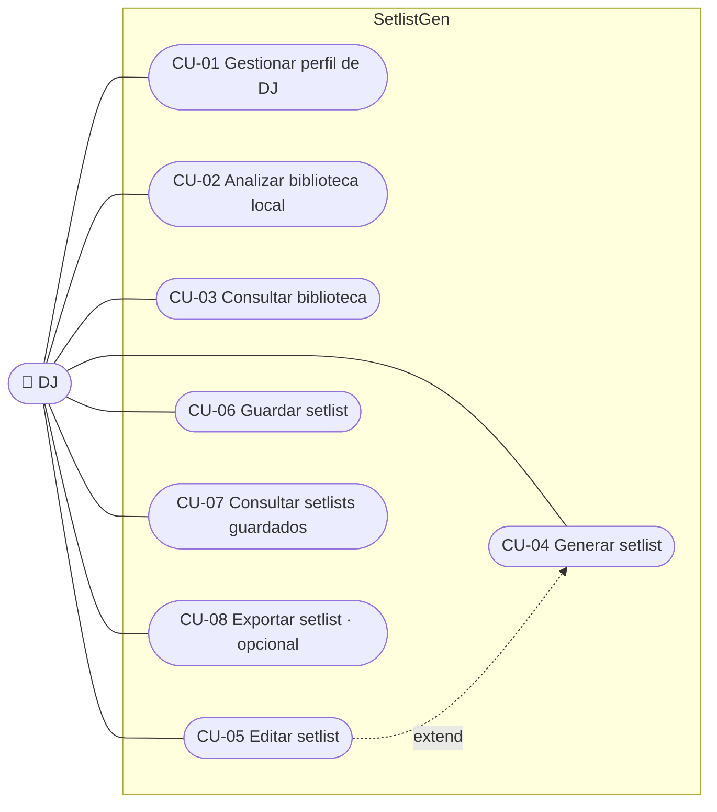
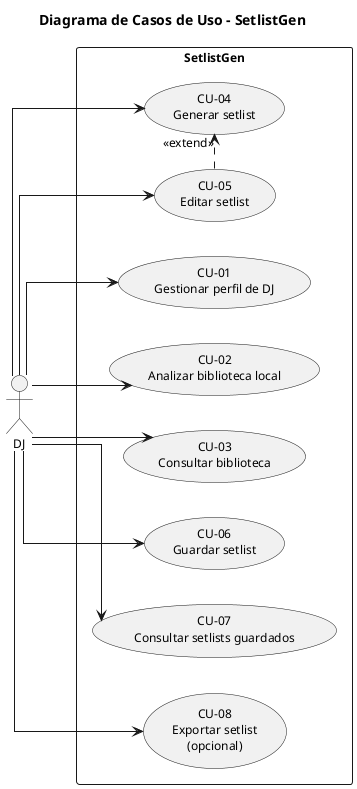
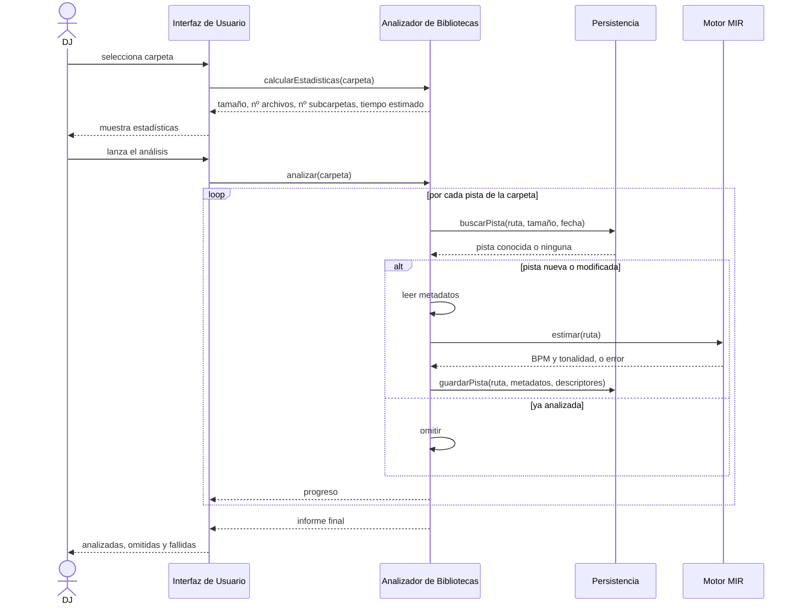
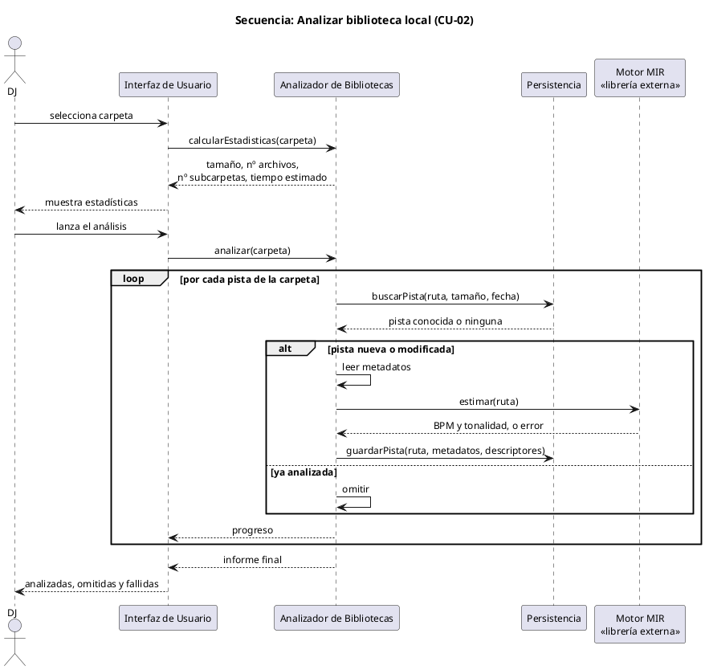
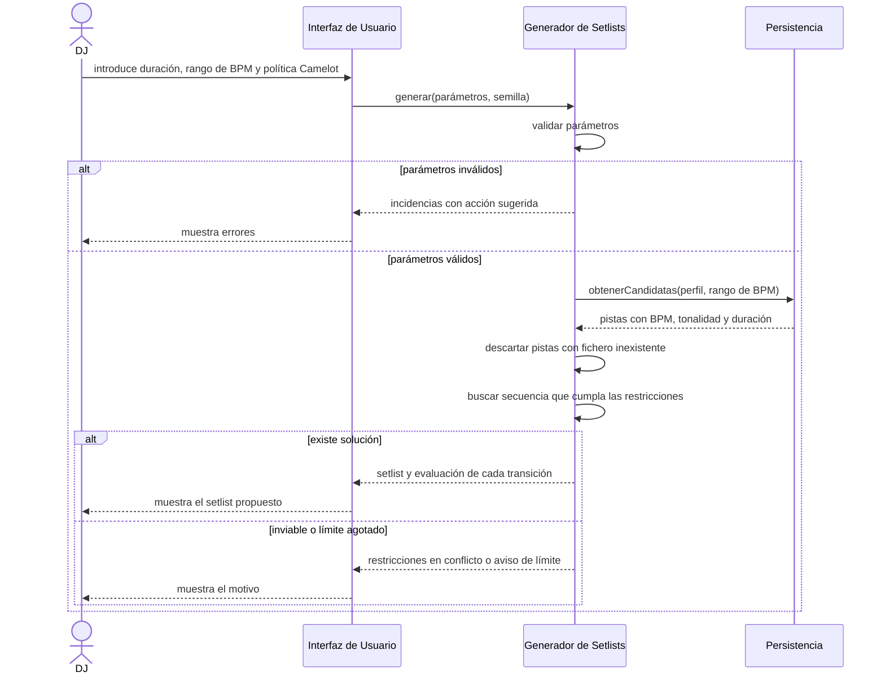
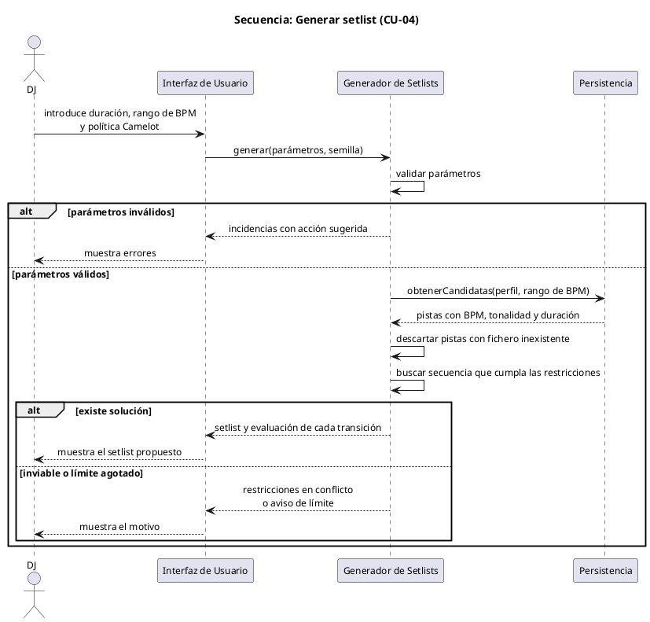

# Casos de Uso de SetlistGen

**Versión:** 1.0 · **Estado:** pendiente de revisión por el tutor

## 1. Actor y catálogo

**Actor único: el DJ.** Los procesos automáticos (cálculo del setlist, detección de duplicados) son pasos dentro de los casos de uso que inicia el DJ.

| ID | Caso de uso | Bloque | Requisitos | Críticos |
|---|---|---|---|---|
| CU-01 | Gestionar perfil de DJ | Previo | RF-01 | |
| CU-02 | Analizar biblioteca local | 1 | RF-02 a RF-07 | ✔ |
| CU-03 | Consultar biblioteca | 1 | RF-08 | |
| CU-04 | Generar setlist | 2 | RF-09 a RF-13 | ✔ |
| CU-05 | Editar setlist | 3 | RF-14 a RF-18 | |
| CU-06 | Guardar setlist | 3 | RF-19 | |
| CU-07 | Consultar setlists guardados | 3 | RF-20 | |
| CU-08 | Exportar setlist *(opcional)* | 3 | RF-21, RF-22 | |

## 2. Diagrama de casos de uso (UML)

### Vista rápida (Mermaid)

Mermaid no tiene un diagrama de casos de uso propio; este es una aproximación. La versión UML estricta es la de PlantUML.

### PlantUML (`diagrams/casos-de-uso.puml`)

## 3. Especificación de casos de uso

### CU-01 Gestionar perfil de DJ

| Campo | Contenido |
|---|---|
| **Actor** | DJ |
| **Requisitos** | RF-01 |
| **Precondiciones** | La aplicación está iniciada y la base de datos disponible |
| **Flujo principal** | 1. El sistema muestra los perfiles existentes. 2. El DJ selecciona un perfil o crea uno nuevo indicando su nombre. 3. El sistema activa el perfil y muestra sus bibliotecas y setlists |
| **Alternativos** | **A1.** No hay perfiles: el sistema pide crear uno. **A2.** El nombre está vacío o ya existe: el sistema indica la causa y pide otro |
| **Postcondiciones** | Hay un perfil activo. Todo dato creado después queda asociado a él y es privado |

### CU-02 Analizar biblioteca local

| Campo | Contenido |
|---|---|
| **Actor** | DJ |
| **Requisitos** | RF-02 a RF-07, RNF-01, RNF-08, RNF-09, RNF-12 |
| **Precondiciones** | Hay un perfil activo. El motor MIR y la base de datos están disponibles |
| **Flujo principal** | 1. El DJ selecciona una carpeta local. 2. El sistema la recorre y calcula tamaño total, número de archivos de audio y de subcarpetas, y el tiempo estimado de análisis por muestreo. 3. El sistema muestra las estadísticas. 4. El DJ lanza el análisis. 5. Para cada pista, el sistema comprueba en SQLite si ya fue analizada (ruta, tamaño y fecha) y, si es así, la omite. 6. Para las demás, extrae los metadatos, estima BPM y tonalidad con el motor MIR y deriva el código Camelot. 7. El sistema guarda la ruta y los descriptores en la biblioteca del DJ. 8. El sistema muestra el progreso y, al terminar, un informe con pistas analizadas, omitidas, descartadas y fallidas |
| **Alternativos** | **A1.** La carpeta no existe o no es legible: el sistema informa de la causa y vuelve al paso 1. **A2.** La carpeta no contiene audio válido: se informa y el caso termina. **A3.** El DJ no lanza el análisis tras ver las estadísticas: el caso termina sin cambios. **A4.** Fichero corrupto o ilegible: se registra la causa, se marca como fallida y se continúa. **A5.** El motor no devuelve BPM o tonalidad: la pista se guarda con marca de fallo y queda excluida de la generación. **A6.** Etiquetas ausentes: el campo se guarda como nulo. **A7.** Fichero ya conocido pero modificado (tamaño o fecha distintos): se reanaliza y se actualiza su registro. **A8.** El DJ cancela el análisis: las pistas ya guardadas se conservan |
| **Postcondiciones** | Las pistas analizadas están en SQLite con su ruta y descriptores, sin duplicados. Cada fallo figura en el informe con su causa. Un segundo análisis no reanaliza pistas sin cambios |

### CU-03 Consultar biblioteca

| Campo | Contenido |
|---|---|
| **Actor** | DJ |
| **Requisitos** | RF-08 |
| **Precondiciones** | Hay un perfil activo con al menos una biblioteca analizada |
| **Flujo principal** | 1. El DJ abre su biblioteca. 2. Opcionalmente aplica filtros por BPM, tonalidad, género o título. 3. Opcionalmente elige un campo de ordenación y su dirección. 4. El sistema muestra las pistas con título, artista, duración, género, BPM y código Camelot |
| **Alternativos** | **A1.** No hay pistas analizadas: el sistema sugiere analizar una carpeta (CU-02). **A2.** Ningún resultado cumple los filtros: se informa y se mantienen los filtros editables |
| **Postcondiciones** | Ninguna modificación de datos |

### CU-04 Generar setlist

| Campo | Contenido |
|---|---|
| **Actor** | DJ |
| **Requisitos** | RF-09 a RF-13, RNF-05, RNF-06, RNF-07 |
| **Precondiciones** | Hay un perfil activo con pistas analizadas con BPM y tonalidad válidos |
| **Flujo principal** | 1. El DJ solicita generar un setlist. 2. El DJ introduce la duración objetivo, el rango de BPM y la política de compatibilidad Camelot, y opcionalmente una semilla. 3. El sistema valida los parámetros. 4. El sistema selecciona las pistas candidatas: analizadas correctamente y con el fichero existente. 5. El sistema busca una secuencia sin repeticiones que cumpla las restricciones y minimice los saltos de BPM y la disonancia armónica. 6. El sistema muestra el setlist con el orden, los descriptores de cada pista y la evaluación de cada transición |
| **Alternativos** | **A1.** Parámetros inválidos (BPM mínimo mayor que el máximo, duración no positiva): el sistema indica todas las incidencias con una acción sugerida y vuelve al paso 2. **A2.** No existe combinación válida: el sistema lo demuestra, señala las restricciones en conflicto y no genera setlist. **A3.** Candidatas insuficientes para la duración: se trata como A2 e indica la restricción responsable. **A4.** Límite de búsqueda agotado sin solución: se informa de forma distinta a A2 y se sugiere relajar restricciones. **A5.** El DJ regenera con otra semilla: se vuelve al paso 5 |
| **Postcondiciones** | Hay un setlist propuesto válido en pantalla, sin pistas repetidas. No se guarda hasta que el DJ lo decida (CU-06). Con la misma biblioteca, parámetros y semilla se obtiene el mismo resultado |

### CU-05 Editar setlist

| Campo | Contenido |
|---|---|
| **Actor** | DJ |
| **Requisitos** | RF-14 a RF-18 |
| **Precondiciones** | Hay un setlist en pantalla, recién generado (CU-04) o abierto (CU-07) |
| **Flujo principal** | 1. El DJ elige una operación: reordenar pistas, ordenar por BPM ascendente, fijar una pista como inicial, eliminar una pista o añadir una pista de la biblioteca. 2. El sistema aplica el cambio y recalcula las transiciones. 3. El sistema señala con un aviso visual no bloqueante las transiciones o pistas que incumplen los parámetros. 4. El DJ repite hasta quedar conforme |
| **Alternativos** | **A1.** El DJ añade una pista que ya está en el setlist: el sistema lo rechaza e indica el motivo. **A2.** El DJ añade una pista cuyo fichero no existe: el sistema avisa y la añade solo si el DJ confirma. **A3.** El DJ elimina todas las pistas: el setlist queda vacío y no puede guardarse |
| **Postcondiciones** | El setlist en pantalla refleja el orden editado. Puede incumplir los parámetros, y cada incumplimiento está señalado. No se guarda hasta CU-06 |

### CU-06 Guardar setlist

| Campo | Contenido |
|---|---|
| **Actor** | DJ |
| **Requisitos** | RF-19, RNF-08, RNF-09 |
| **Precondiciones** | Hay un setlist no vacío en pantalla |
| **Flujo principal** | 1. El DJ solicita guardar e indica un nombre. 2. El sistema guarda en SQLite el nombre, la fecha, los parámetros, la semilla y las pistas en orden, asociados al DJ. 3. El sistema confirma el guardado |
| **Alternativos** | **A1.** Ya existe un setlist con ese nombre: el DJ elige entre sobrescribir y cambiar el nombre. **A2.** El guardado falla: se informa de la causa y no queda un setlist a medias |
| **Postcondiciones** | El setlist queda guardado de forma privada y es recuperable con el mismo orden y parámetros |

### CU-07 Consultar setlists guardados

| Campo | Contenido |
|---|---|
| **Actor** | DJ |
| **Requisitos** | RF-20 |
| **Precondiciones** | Hay un perfil activo |
| **Flujo principal** | 1. El DJ abre la lista de sus setlists guardados. 2. El sistema muestra nombre, fecha y duración de cada uno. 3. El DJ abre uno. 4. El sistema lo carga con sus pistas en orden y avisa de las pistas cuyo fichero ya no existe |
| **Alternativos** | **A1.** No hay setlists guardados: se informa. **A2.** El DJ elimina un setlist: el sistema pide confirmación y lo borra sin afectar a la biblioteca |
| **Postcondiciones** | El setlist abierto queda disponible para editar (CU-05) o exportar (CU-08). Solo se muestran los setlists del DJ activo |

### CU-08 Exportar setlist *(opcional, Could)*

| Campo | Contenido |
|---|---|
| **Actor** | DJ |
| **Requisitos** | RF-21, RF-22 (ADR-006) |
| **Precondiciones** | Hay un setlist guardado. La exportación está implementada |
| **Flujo principal** | 1. El DJ selecciona el setlist, el modo (copia en carpeta o lista `.m3u8`) y el destino. 2. El sistema comprueba que cada pista existe en disco. 3. El sistema genera la carpeta con las pistas copiadas y numeradas en orden, o la lista `.m3u8` en UTF-8. 4. El sistema informa del resultado y de las pistas exportadas |
| **Alternativos** | **A1.** Hay rutas rotas: el sistema lista las pistas afectadas y el DJ elige entre cancelar y continuar sin ellas. **A2.** El destino no es escribible o no hay espacio: se informa de la causa y no queda un resultado incompleto sin avisar |
| **Postcondiciones** | El resultado queda en el destino. El setlist guardado no se modifica. El DJ lo abre o importa en Rekordbox |

## 4. Diagramas de secuencia

### 4.1 Analizar biblioteca local (CU-02)

**Mermaid**

**PlantUML (`diagrams/secuencia-analizar-biblioteca.puml`)**

### 4.2 Generar setlist (CU-04)

**Mermaid**

**PlantUML (`diagrams/secuencia-generar-setlist.puml`)**

## 5. Control de cambios

| Versión | Cambio |
|---|---|
| 1.0 | Casos de uso reescritos desde cero: actor único, 8 casos de uso y 2 diagramas de secuencia para los casos críticos |