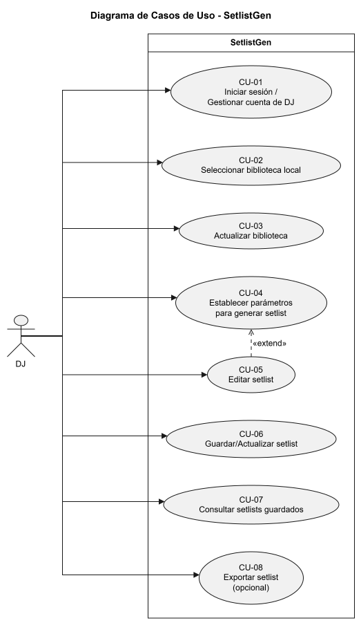
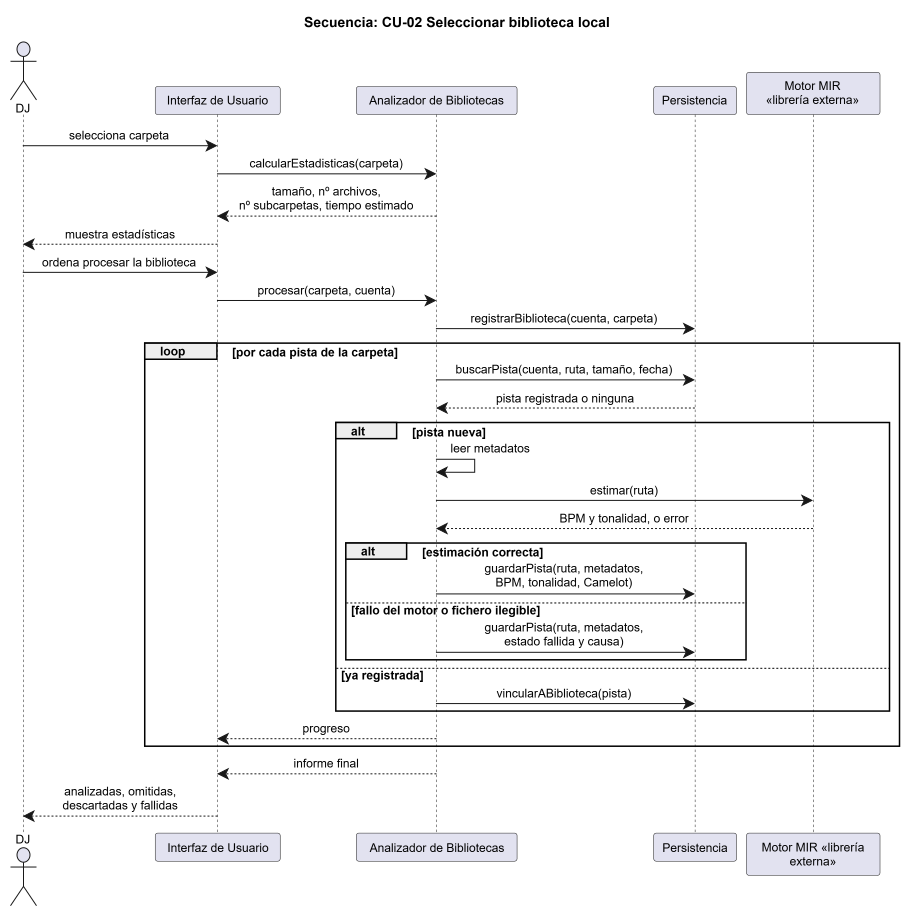
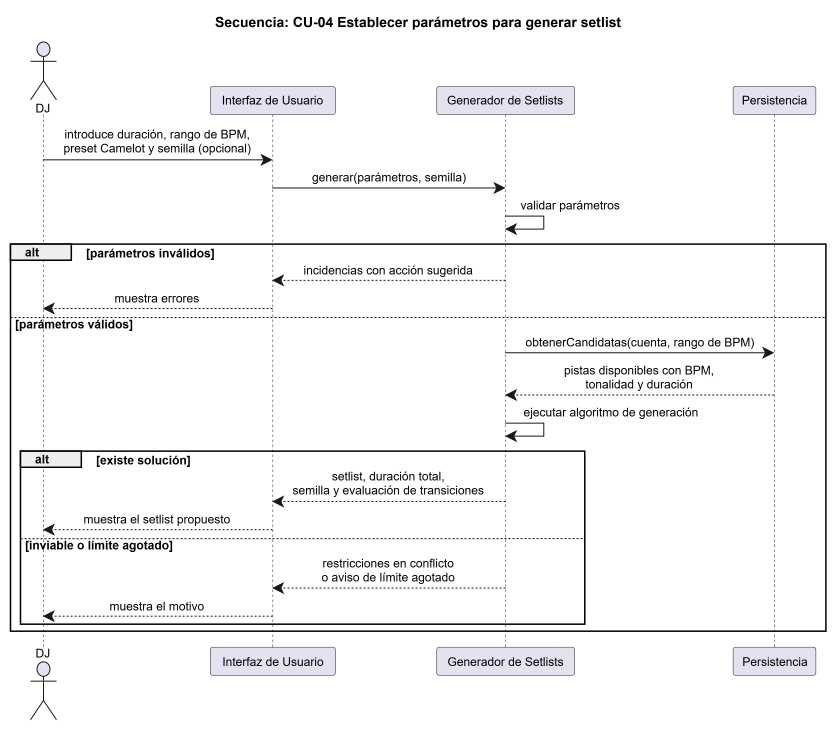

# Casos de Uso de SetlistGen

**Versión:** 1.2 · **Estado:** pendiente de revisión por el tutor
**Alineado con:** `requirements.md` v1.2.1

## 1. Actor y catálogo

**Actor único: el DJ.** Los casos de uso son las acciones que inicia el DJ. Los procesos internos (análisis de pistas, detección de duplicados, cálculo del setlist) son pasos del sistema dentro de esos casos de uso, no casos de uso independientes.

| ID | Caso de uso | Bloque | Requisitos | Crítico |
|---|---|---|---|---|
| CU-01 | Iniciar sesión / Gestionar cuenta de DJ | Cuenta | RF-01 | |
| CU-02 | Seleccionar biblioteca local | 1 | RF-02 a RF-06, RF-08 | ✔ |
| CU-03 | Actualizar biblioteca | 1 | RF-07, RF-08 | |
| CU-04 | Establecer parámetros para generar setlist | 2 | RF-09 a RF-12 | ✔ |
| CU-05 | Editar setlist | 3 | RF-13 a RF-18 | |
| CU-06 | Guardar/Actualizar setlist | 3 | RF-19 | |
| CU-07 | Consultar setlists guardados | 3 | RF-20 | |
| CU-08 | Exportar setlist *(opcional)* | 3 | RF-21, RF-22 | |

Los casos críticos son CU-02 y CU-04: concentran el análisis musical y el algoritmo de generación, que son el núcleo técnico del sistema.

## 2. Diagrama de casos de uso (UML)

* **Código fuente editable (PlantUML):** [`../diagrams/casos-de-uso.puml`](../diagrams/casos-de-uso.puml)

CU-05 extiende a CU-04 (`<<extend>>`): el DJ puede editar la propuesta generada antes de cerrarla. También puede editar un setlist abierto desde CU-07.

## 3. Especificación de casos de uso

### CU-01: Iniciar sesión / Gestionar cuenta de DJ

| Campo | Contenido |
|---|---|
| **Actor** | DJ |
| **Requisitos** | RF-01, RNF-12 |
| **Precondiciones** | La aplicación está iniciada y la base de datos disponible |
| **Flujo principal** | 1. El sistema muestra la pantalla de acceso. 2. El DJ introduce su usuario y contraseña. 3. El sistema comprueba las credenciales contra el hash almacenado. 4. El sistema abre la sesión y muestra las bibliotecas y setlists de la cuenta. 5. Cuando el DJ lo decide, cierra la sesión y el sistema vuelve a la pantalla de acceso |
| **Alternativos** | **A1.** El DJ no tiene cuenta y elige registrarse: introduce un usuario y una contraseña, el sistema comprueba que el usuario no existe, almacena la contraseña con hash y sal y abre la sesión. **A2.** El usuario ya existe o la contraseña no cumple las condiciones mínimas: el sistema indica la causa y pide corregirla. **A3.** Credenciales incorrectas: el sistema lo indica sin revelar cuál de los dos datos es erróneo y permite reintentar |
| **Postcondiciones** | Hay una sesión activa y todo dato creado a partir de ahora pertenece a esa cuenta. Ninguna otra cuenta puede ver ni modificar esos datos. Ninguna contraseña queda en claro en la base |

### CU-02: Seleccionar biblioteca local

| Campo | Contenido |
|---|---|
| **Actor** | DJ |
| **Requisitos** | RF-02, RF-03, RF-04, RF-05, RF-06, RF-08, RNF-01, RNF-08, RNF-09 |
| **Precondiciones** | Hay una sesión activa. El motor MIR y la base de datos están disponibles |
| **Flujo principal** | 1. El DJ selecciona una carpeta local. 2. El sistema recorre la carpeta y calcula el tamaño total, el número de archivos de audio, el número de subcarpetas y el tiempo estimado de análisis por muestreo de pistas. 3. El sistema muestra las estadísticas. 4. El DJ ordena procesar la biblioteca. 5. El sistema registra la carpeta como biblioteca de la cuenta y la recorre de forma recursiva, reconociendo los formatos MP3, WAV, FLAC y AIFF. 6. Para cada pista, el sistema comprueba si la cuenta ya la tiene registrada (ruta, tamaño y fecha de modificación). Si es así, la vincula a la biblioteca y no la analiza. 7. Para las pistas nuevas, el sistema extrae título, artista, duración y género. 8. El sistema estima BPM y tonalidad con el motor MIR y deriva el código Camelot. 9. El sistema guarda la ruta, los metadatos y los descriptores. El BPM se almacena como decimal con 2 decimales. 10. El sistema muestra el progreso y, al terminar, un informe con pistas analizadas, omitidas, descartadas y fallidas |
| **Alternativos** | **A1.** La carpeta no existe o no es legible: el sistema informa de la causa y vuelve al paso 1. **A2.** La carpeta no contiene audio válido: se informa y el caso termina. **A3.** El DJ no ordena procesar tras ver las estadísticas: el caso termina sin cambios. **A4.** La carpeta ya está registrada como biblioteca de la cuenta: el sistema lo indica y propone actualizarla (CU-03). **A5.** Ficheros no soportados: se descartan y figuran en el informe con su motivo. **A6.** Fichero corrupto o ilegible, o el motor no devuelve BPM o tonalidad: la pista se guarda con estado «fallida» y su causa, se excluye de la generación y de la edición, y el proceso continúa. **A7.** Etiquetas ausentes: el campo se guarda como nulo o «desconocido». **A8.** El DJ cancela el proceso: las pistas ya guardadas se conservan |
| **Postcondiciones** | La carpeta queda registrada como biblioteca de la cuenta. Sus pistas están en SQLite con su ruta y descriptores, sin duplicados y sin audio. Cada fallo figura en el informe con su causa. Un segundo procesamiento de la misma carpeta no reanaliza ninguna pista |

### CU-03: Actualizar biblioteca

| Campo | Contenido |
|---|---|
| **Actor** | DJ |
| **Requisitos** | RF-07, RF-08 |
| **Precondiciones** | Hay una sesión activa y la cuenta tiene al menos una biblioteca registrada (CU-02) |
| **Flujo principal** | 1. El DJ selecciona una biblioteca registrada y ordena actualizarla. 2. El sistema recorre de nuevo la carpeta y clasifica cada fichero como sin cambios, nuevo o modificado (tamaño o fecha distintos) y, para las pistas registradas, no encontrado. 3. El sistema muestra un resumen previo con el número de pistas nuevas, modificadas y no encontradas. 4. El DJ confirma. 5. El sistema analiza únicamente las pistas nuevas y las modificadas (metadatos, BPM, tonalidad y código Camelot) y actualiza el registro de las modificadas. 6. El sistema marca como «no disponibles» las pistas no encontradas, sin borrarlas. 7. El sistema muestra el progreso y un informe con pistas nuevas, modificadas, no disponibles, sin cambios y fallidas |
| **Alternativos** | **A1.** Ninguna pista nueva, modificada o no encontrada: el sistema lo indica y no reanaliza nada. **A2.** La carpeta de la biblioteca ya no existe: el sistema informa de la causa, no marca nada como no disponible y propone elegir otra carpeta. **A3.** Una pista «no disponible» reaparece en su ruta con el mismo tamaño y fecha: el sistema la reactiva sin reanalizarla. **A4.** Un fichero movido o renombrado aparece como pista nueva y su ruta antigua como no encontrada: se aplican ambos tratamientos. **A5.** Fallo en una pista nueva o modificada: se aplica A6 de CU-02. **A6.** El DJ cancela tras ver el resumen o durante el proceso: no se modifica nada o se conserva lo ya guardado, respectivamente |
| **Postcondiciones** | La biblioteca refleja el contenido actual de la carpeta. Ninguna pista sin cambios fue reanalizada y no hay duplicados. Las pistas no disponibles se conservan, de modo que los setlists guardados que las contienen siguen abriéndose con aviso |

### CU-04: Establecer parámetros para generar setlist

| Campo | Contenido |
|---|---|
| **Actor** | DJ |
| **Requisitos** | RF-09, RF-10, RF-11, RF-12, RNF-06, RNF-07, RNF-05 |
| **Precondiciones** | Hay una sesión activa y la cuenta tiene pistas disponibles con BPM y tonalidad válidos |
| **Flujo principal** | 1. El DJ solicita crear un setlist. 2. El DJ introduce la duración objetivo (con su tolerancia, 5 % por defecto), el rango de BPM y el preset de compatibilidad Camelot (Estricta o Energética), y opcionalmente una semilla y la biblioteca de origen. 3. El sistema valida los parámetros. Si no hay semilla, genera una. 4. El sistema selecciona las pistas candidatas: de la cuenta, disponibles y con BPM y tonalidad válidos. 5. El sistema ejecuta el algoritmo de generación: busca una secuencia sin repeticiones que cumpla el rango de BPM, el preset armónico y la duración, y que minimice los saltos de BPM y la disonancia armónica. 6. El sistema muestra el setlist propuesto con el orden, los descriptores de cada pista, la duración total, la semilla y la evaluación de cada transición |
| **Alternativos** | **A1.** Parámetros inválidos (BPM mínimo mayor que el máximo, duración no positiva, tolerancia fuera de rango): el sistema indica todas las incidencias con una acción sugerida y vuelve al paso 2. **A2.** No existe combinación válida: el sistema lo demuestra, señala al menos un conjunto de restricciones en conflicto y no genera setlist. **A3.** Candidatas insuficientes para cubrir la duración: se trata como A2 e indica la restricción responsable. **A4.** Límite de búsqueda agotado sin solución ni demostración de inviabilidad: se informa de forma distinta a A2 y se sugiere relajar restricciones. **A5.** El DJ pide otra propuesta con otra semilla: se vuelve al paso 5 |
| **Postcondiciones** | Hay un setlist propuesto válido en pantalla, sin pistas repetidas, fallidas ni no disponibles. No se guarda hasta que el DJ lo decida (CU-06). Con la misma biblioteca, parámetros y semilla se obtiene el mismo resultado |

### CU-05: Editar setlist

| Campo | Contenido |
|---|---|
| **Actor** | DJ |
| **Requisitos** | RF-13, RF-14, RF-15, RF-16, RF-17, RF-18 |
| **Relación** | `<<extend>>` de CU-04: el DJ puede editar la propuesta antes de cerrarla |
| **Precondiciones** | Hay un setlist en pantalla, recién propuesto (CU-04) o abierto desde los guardados (CU-07) |
| **Flujo principal** | 1. El DJ elige una operación: reordenar pistas, ordenar por BPM o por tonalidad Camelot (ascendente o descendente), fijar una pista como inicial, eliminar una pista o añadir una pista de sus bibliotecas (buscándola por título, artista, BPM o tonalidad). 2. El sistema aplica el cambio, renumera el orden (1..N) y reevalúa las transiciones. 3. El sistema actualiza la duración total y muestra con aviso visual no bloqueante las pistas o transiciones que incumplen los parámetros y si la duración sale de la tolerancia. 4. El DJ repite hasta quedar conforme |
| **Alternativos** | **A1.** El DJ fija una pista como inicial: el sistema la coloca en la posición 1 una sola vez, sin anclarla. Una ordenación posterior puede moverla. **A2.** El DJ añade una pista que ya está en el setlist, fallida o no disponible: el sistema lo rechaza e indica el motivo. **A3.** El DJ añade una pista cuyo fichero ya no existe: el sistema avisa y la añade solo si el DJ confirma. **A4.** El DJ deshace o rehace el último cambio (opcional, un nivel): el sistema restablece el estado anterior o posterior. **A5.** El DJ elimina todas las pistas: el setlist queda vacío y no puede guardarse |
| **Postcondiciones** | El setlist en pantalla refleja el orden editado y puede incumplir los parámetros, y cada incumplimiento está señalado. No se guarda hasta CU-06 |

### CU-06: Guardar/Actualizar setlist

| Campo | Contenido |
|---|---|
| **Actor** | DJ |
| **Requisitos** | RF-19, RNF-08, RNF-09 |
| **Precondiciones** | Hay una sesión activa y un setlist no vacío en pantalla |
| **Flujo principal** | 1. El DJ solicita guardar. 2. Si el setlist procede de uno ya guardado, el sistema ofrece **actualizarlo** o **guardarlo como nuevo**. Si es nuevo, pide un nombre. 3. El sistema guarda en SQLite, de forma atómica, la cuenta propietaria, el nombre, las fechas de creación y de última modificación, los parámetros de generación, la semilla y las referencias a las pistas con su número de orden. Si es una actualización, sustituye el contenido del setlist existente y registra la fecha de modificación. 4. El sistema confirma el guardado |
| **Alternativos** | **A1.** Ya existe otro setlist con ese nombre: el DJ elige entre sobrescribirlo y cambiar el nombre. **A2.** El guardado falla: se informa de la causa y el setlist anterior permanece intacto, sin quedar un setlist a medias |
| **Postcondiciones** | El setlist queda guardado de forma privada y es recuperable con el mismo orden y parámetros. Una actualización no crea un duplicado. No se guardan audio ni copias de los descriptores |

### CU-07: Consultar setlists guardados

| Campo | Contenido |
|---|---|
| **Actor** | DJ |
| **Requisitos** | RF-20 |
| **Precondiciones** | Hay una sesión activa |
| **Flujo principal** | 1. El DJ abre la lista de sus setlists guardados. 2. El sistema muestra nombre, fecha y duración de cada uno. 3. El DJ abre uno. 4. El sistema lo carga con sus pistas en orden y avisa de las pistas marcadas como «no disponibles» o cuyo fichero ya no exista |
| **Alternativos** | **A1.** No hay setlists guardados: se informa. **A2.** El DJ elimina un setlist: el sistema pide confirmación y lo borra sin afectar a la biblioteca ni a las pistas |
| **Postcondiciones** | El setlist abierto queda disponible para editar (CU-05) o exportar (CU-08). Solo se muestran los setlists de la cuenta activa |

### CU-08: Exportar setlist *(opcional, Could)*

| Campo | Contenido |
|---|---|
| **Actor** | DJ |
| **Requisitos** | RF-21, RF-22 (ADR-006) |
| **Precondiciones** | Hay una sesión activa y un setlist guardado. La exportación está implementada |
| **Flujo principal** | 1. El DJ selecciona el setlist, el modo (copia en carpeta o lista `.m3u8`) y el destino. 2. El sistema comprueba que cada pista existe en disco. 3. El sistema copia las pistas con un prefijo numérico que conserva el orden, o genera la lista `.m3u8` en UTF-8 con las rutas locales. 4. El sistema informa del resultado y de las pistas exportadas |
| **Alternativos** | **A1.** Hay rutas rotas o pistas no disponibles: el sistema lista las pistas afectadas y el DJ elige entre cancelar y continuar sin ellas. **A2.** El destino no es escribible o no hay espacio suficiente: se informa de la causa y no queda un resultado incompleto sin avisar |
| **Postcondiciones** | El resultado queda en el destino. El setlist guardado no se modifica. El DJ abre la carpeta o importa la lista en Rekordbox |

## 4. Diagramas de secuencia (casos críticos)

### 4.1 CU-02: Seleccionar biblioteca local

* **Código fuente editable (PlantUML):** [`../diagrams/secuencia-seleccionar-biblioteca.puml`](../diagrams/secuencia-seleccionar-biblioteca.puml)

### 4.2 CU-04: Establecer parámetros para generar setlist

* **Código fuente editable (PlantUML):** [`../diagrams/secuencia-generar-setlist.puml`](../diagrams/secuencia-generar-setlist.puml)

## 5. Cobertura de requisitos

Cada requisito funcional está cubierto por al menos un caso de uso: RF-01 en CU-01; RF-02 a RF-06 en CU-02; RF-07 en CU-03; RF-08 en CU-02 y CU-03; RF-09 a RF-12 en CU-04; RF-13 a RF-18 en CU-05; RF-19 en CU-06; RF-20 en CU-07; RF-21 y RF-22 en CU-08.

## 6. Control de cambios

| Versión | Cambio |
|---|---|
| 1.0 | Casos de uso iniciales |
| 1.1 | CU-02 a CU-06 renombrados; diagramas actualizados |
| 1.2 | Alineación con `requirements.md` v1.2.1: cuenta con usuario y contraseña (CU-01), pistas fallidas y no disponibles, presets Camelot, BPM decimal, edición completa y diagramas referenciados como imágenes `.svg` con su fuente `.puml` |