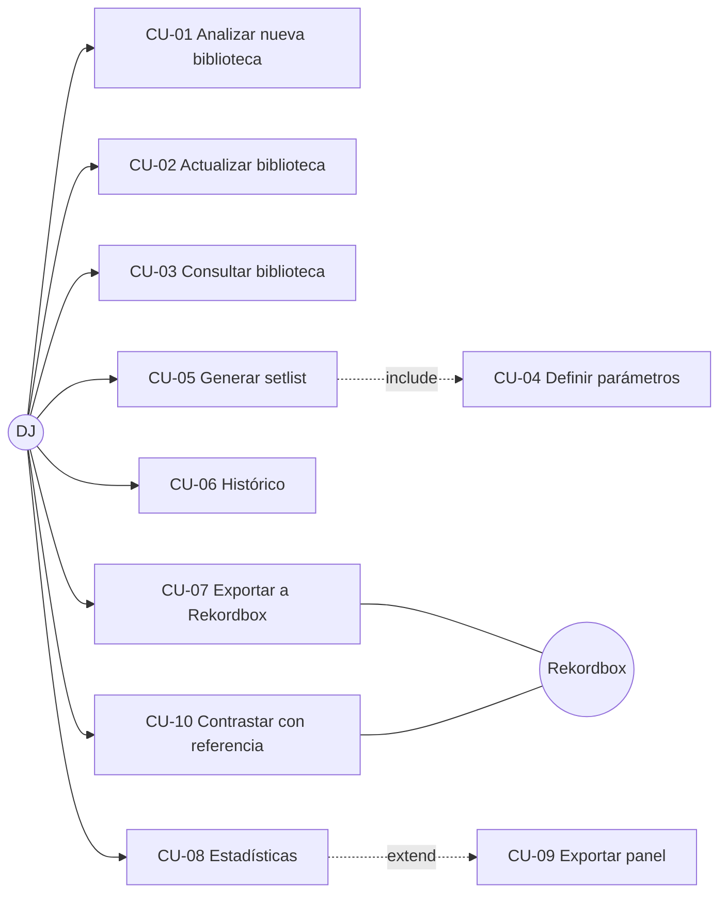

# Catálogo de Casos de Uso

**Versión:** 1.0 (propuesta) · **Fecha:** 2026-10-09
**Documentos relacionados:** `requisitos.md`, `glosario.md`

---
## 1. Catálogo

| ID | Nombre | Actor | RF relacionados | Prioridad | Detalle |
|---|---|---|---|---|---|
| CU-01 | Analizar nueva biblioteca | DJ | RF-01 a 09 | Must | **Sí** |
| CU-02 | Actualizar biblioteca existente | DJ | RF-01, 02, 09 | Must | — |
| CU-03 | Consultar la biblioteca analizada | DJ | RF-11 | Must | — |
| CU-04 | Definir parámetros del setlist | DJ | RF-12 a 16 | Must | — |
| CU-05 | Generar setlist | DJ | RF-10, 12 a 20 | Must | **Sí** |
| CU-06 | Consultar el histórico de setlists | DJ | RF-10, 24 | Should | — |
| CU-07 | Exportar setlist a Rekordbox | DJ, Rekordbox | RF-21 a 23 | Must | **Sí** |
| CU-08 | Consultar estadísticas de la biblioteca y del histórico | DJ | RF-25 a 27 | Could | — |
| CU-09 | Exportar datos del panel (TXT/M3U/CSV) | DJ | RF-28 | Could | — |
| CU-10 | Contrastar descriptores con la referencia de Rekordbox | DJ, Rekordbox | RF-29 | Should | — |

Relaciones: CU-05 incluye CU-04. CU-01 y CU-02 comparten el flujo de análisis. CU-07 parte de un setlist de CU-05 o de CU-06.

---

## 2. Casos de uso críticos

### CU-01. Analizar nueva biblioteca
- **Actor principal:** DJ. **Secundario:** Sistema de archivos local.
- **Objetivo:** incorporar a la base de datos las pistas de una carpeta con sus metadatos, BPM, tonalidad y código Camelot.
- **Capa de aplicación (puertos):** `LibraryScanner`, `MetadataReader`, `AudioAnalyzer`, `TrackRepository`.

**Precondiciones**
1. La carpeta indicada existe y es legible.
2. La base de datos está inicializada y accesible.
3. El analizador de audio está disponible.

**Flujo principal**
1. El DJ indica la carpeta raíz de su biblioteca (RF-01).
2. El sistema recorre la carpeta de forma recursiva.
3. El sistema separa los ficheros soportados (MP3, WAV, FLAC, AIFF) de los demás (RF-02).
4. Para cada pista soportada, el sistema calcula su identificador y comprueba si ya está en la base de datos (RF-09).
5. Para cada pista nueva, el sistema extrae los metadatos de las etiquetas (RF-03).
6. El sistema estima el BPM y la tonalidad, deriva el código Camelot y registra el origen de cada descriptor (RF-04 a 07).
7. El sistema persiste la pista con sus descriptores (RF-08).
8. El sistema muestra el progreso del proceso (RNF-15).
9. Al terminar, el sistema muestra un informe: pistas analizadas, ya existentes, descartadas y con error.

**Flujos alternativos**
- **A1.** La carpeta no contiene pistas válidas: el sistema informa y finaliza sin cambios.
- **A2.** Todas las pistas ya estaban en la base de datos: el sistema informa de que no hay nada que analizar (RNF-04).
- **A3.** Metadatos incompletos: los campos ausentes quedan como nulos y el proceso continúa.
- **A4.** El DJ cancela: se conservan las pistas ya persistidas y la base de datos queda consistente (RNF-18).

**Excepciones**
- **E1.** La carpeta no es accesible o no hay permisos: el sistema informa del error y no modifica la base de datos.
- **E2.** Un fichero está corrupto o no se puede decodificar: se registra su causa y se continúa con el resto (RNF-16).
- **E3.** El análisis no produce resultado fiable para una pista (audio muy corto o silencio): se almacena la pista con descriptores nulos y se marca el fallo.
- **E4.** La base de datos no está disponible: el sistema aborta con un mensaje de error y no deja datos parciales.

**Postcondiciones**
1. Cada pista válida de la carpeta figura en la base de datos con sus descriptores, o con la marca de fallo.
2. Ninguna pista ya existente fue reanalizada.
3. El informe del proceso queda disponible para el DJ.

---

### CU-05. Generar setlist
- **Actor principal:** DJ.
- **Objetivo:** obtener un setlist ordenado que respete los parámetros del DJ y las reglas de mezcla.
- **Incluye:** CU-04 Definir parámetros.
- **Capa de aplicación (puertos):** `TrackRepository`, `SetlistRepository`. La lógica de ordenación reside en el dominio.

**Precondiciones**
1. La base de datos contiene pistas analizadas con BPM y tonalidad.
2. Hay suficientes pistas candidatas para que la generación sea posible en principio.

**Flujo principal**
1. El DJ solicita generar un setlist.
2. El sistema recoge los parámetros (CU-04): duración total, rango de BPM, tonalidades admitidas o compatibilidad exigida, progresión de géneros por intervalos y pistas ancladas (RF-12 a 16).
3. El sistema valida la coherencia de los parámetros.
4. El sistema consulta las pistas candidatas (RF-11).
5. El sistema construye un orden de reproducción con saltos de tempo moderados y tonalidades compatibles según la Rueda Camelot (RF-17), sin repetir pistas (RF-18).
6. El sistema coloca las pistas ancladas en sus posiciones y ajusta la duración total a la tolerancia (RF-12, 16).
7. El sistema persiste el setlist junto con sus parámetros y la semilla empleada (RF-10).
8. El sistema muestra el setlist con el orden, los descriptores y la valoración de cada transición (RF-20).

**Flujos alternativos**
- **A1.** El DJ ajusta los parámetros y regenera el setlist, conservando el histórico de intentos.
- **A2.** Hay pistas sin BPM o tonalidad: se excluyen de la selección y se informa de cuántas.
- **A3.** No se define progresión de géneros: el sistema ignora ese criterio.

**Excepciones**
- **E1.** Parámetros inválidos (por ejemplo, intervalos que no suman la duración o rango de BPM invertido): el sistema los rechaza e indica el campo.
- **E2.** Restricciones inalcanzables con la biblioteca actual: el sistema informa de cuáles entran en conflicto y sugiere relajarlas; no persiste un setlist que las incumpla (RF-19).
- **E3.** Pistas ancladas incompatibles entre sí: el sistema informa del conflicto.
- **E4.** Fallo de persistencia: el setlist se muestra, pero se avisa de que no quedó guardado.

**Postcondiciones**
1. Existe un setlist persistido, reproducible a partir de sus parámetros y su semilla (RNF-11).
2. Todas sus transiciones cumplen las restricciones configuradas (RNF-10).
3. El setlist queda disponible para exportación (CU-07).

---

### CU-07. Exportar setlist a Rekordbox
- **Actor principal:** DJ. **Secundarios:** Rekordbox, Sistema de archivos local.
- **Objetivo:** obtener un fichero importable por Rekordbox con el setlist y las rutas de sus pistas.
- **Capa de aplicación (puertos):** `SetlistRepository`, `SetlistExporter`.

**Precondiciones**
1. Existe un setlist persistido, generado en CU-05 o recuperado en CU-06.
2. Las pistas del setlist siguen disponibles en las rutas registradas.

**Flujo principal**
1. El DJ selecciona el setlist a exportar.
2. El DJ elige el formato permitido (XML o M3U/M3U8, según ADR-005) y el destino.
3. El sistema comprueba que cada pista tiene una ruta accesible y la resuelve de forma que Rekordbox la localice (RF-22).
4. El sistema genera el fichero en el formato elegido (RF-21).
5. El sistema escribe el fichero en el destino.
6. El sistema informa de la ruta del fichero y del número de pistas exportadas.
7. El DJ importa el fichero en Rekordbox y comprueba que la lista se carga con sus pistas resueltas (RF-23).

**Flujos alternativos**
- **A1.** Hay pistas cuyo fichero fue movido o borrado: el sistema las lista y deja al DJ excluirlas o cancelar.
- **A2.** El destino ya existe: el sistema pide confirmación antes de sobrescribir.
- **A3.** El DJ cambia de formato y repite la exportación.

**Excepciones**
- **E1.** No hay permisos de escritura en el destino: el sistema informa del error y no genera ficheros parciales.
- **E2.** El setlist está vacío: el sistema lo rechaza.
- **E3.** Nombres con caracteres no representables en el formato: el sistema los codifica o normaliza y lo registra.
- **E4.** Rekordbox rechaza o no resuelve el fichero: el sistema no puede detectarlo; la incidencia se registra en el protocolo de validación.

**Postcondiciones**
1. El fichero exportado es válido según el formato elegido.
2. El setlist y la biblioteca del sistema no se modifican.
3. La base de datos interna de Rekordbox no se modifica; la importación es una acción del DJ.
