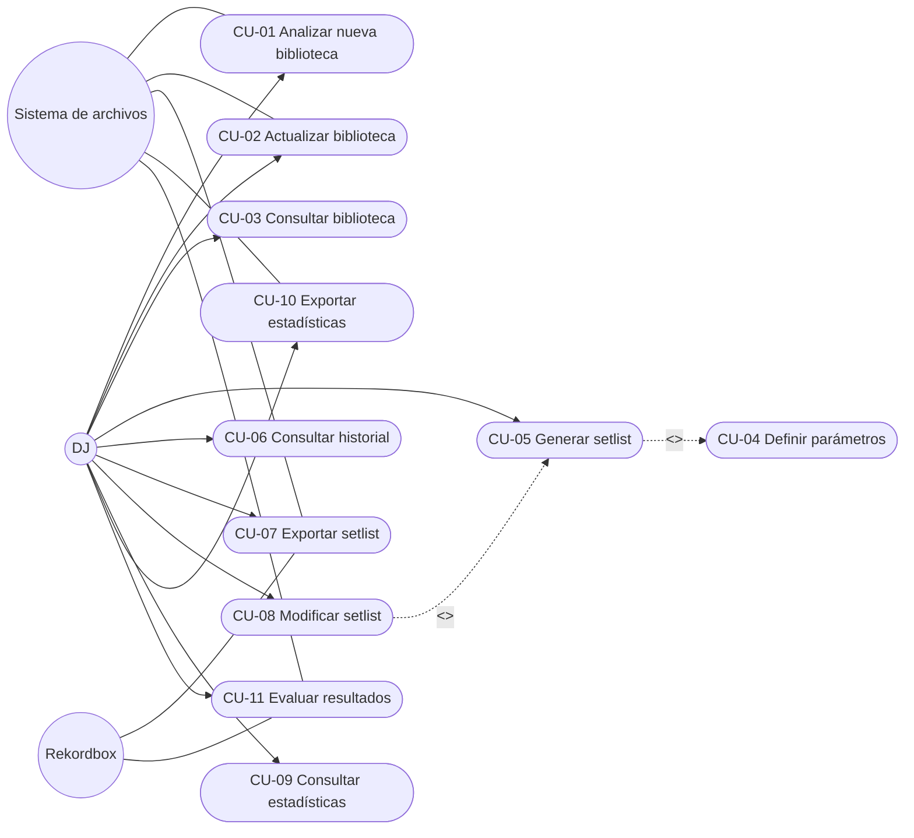

# Catálogo de Casos de Uso

**Proyecto:** SetlistGen
**Versión:** 1.1 (alineada con SRS v4.0)
**Fecha:** 2026-10-30
**Estado:** pendiente de validación por tutor y cotutor

> Los cambios que dependen de una decisión abierta de `open-decisions.md` se indican como **[PROPUESTA · OD-xx]**. No cierran la decisión.

---

# 1. Actores

| Actor | Tipo | Descripción |
|---|---|---|
| DJ | Principal | Usuario principal del sistema. Gestiona la biblioteca, genera setlists y consulta resultados. |
| Rekordbox | Sistema externo | Destino de los setlists exportados y fuente de los valores de referencia para la evaluación. El sistema no accede a Rekordbox en ejecución: intercambia ficheros (XML exportado e importado por el DJ). |
| Sistema de archivos local | Sistema externo | Origen de las pistas musicales y de los ficheros de referencia; destino de las exportaciones. |

---

# 2. Catálogo de casos de uso

| ID | Nombre | Actor | RF relacionados | Prioridad | Detalle |
|---|---|---|---|---|---|
| CU-01 | Analizar nueva biblioteca | DJ | RF-01, RF-02, RF-03, RF-04, RF-05, RF-06, RF-07, RF-08, RF-09 | Must | Sí |
| CU-02 | Actualizar biblioteca existente | DJ | RF-01, RF-02, RF-08, RF-09, RF-09b, RF-09c | Must | Sí |
| CU-03 | Consultar y ordenar biblioteca | DJ | RF-11, RF-11b | Must | — |
| CU-04 | Definir parámetros de generación | DJ | RF-12, RF-13, RF-13b, RF-14, RF-15, RF-16 | Must | — |
| CU-05 | Generar setlist | DJ | RF-10, RF-17, RF-18, RF-19, RF-20 (más los de CU-04 por inclusión) | Must | Sí |
| CU-06 | Consultar historial de setlists | DJ | RF-10, RF-24 | Could | — |
| CU-07 | Exportar setlist a Rekordbox | DJ, Rekordbox | RF-09c, RF-21, RF-21b, RF-22, RF-23 | Must | Sí |
| CU-08 | Modificar orden de un setlist | DJ | RF-20b | Could | — |
| CU-09 | Consultar estadísticas | DJ | RF-25, RF-26, RF-27 | Could | — |
| CU-10 | Exportar datos estadísticos | DJ | RF-28 | Could | — |
| CU-11 | Evaluar resultados frente a Rekordbox | DJ, Rekordbox | RF-07, RF-29, RF-29b | Must | Sí |

## 2.1 Cambios respecto a v1.0

| Caso de uso | Cambio | Motivo |
|---|---|---|
| CU-02 | RF ampliados (RF-01, RF-02, RF-08, RF-09, RF-09c); pasa a tener detalle | La matriz v2.0 ya trazaba RF-01 y RF-02 a CU-02, pero el catálogo no. Se añade RF-09c (H-19) |
| CU-04 | Añade RF-13b | Nuevo parámetro de salto máximo de BPM (H-04, OD-02) |
| CU-05 | Flujo con semilla, candidatas y tiempo límite; nuevos flujos alternativos | RNF-11, RF-19 |
| CU-07 | Añade formato M3U8, avisos por pistas ausentes y flujos alternativos | RF-21b, RF-09c, RF-22 |
| CU-11 | Pasa de Should a Must; ahora tiene detalle y es caso crítico | RF-29 pasa a Must (H-07, OD-01); RF-29b |
| CU-01 | Flujo con identificador, motor y versión y flujos alternativos | RF-07, RF-09, RNF-15, RNF-17 |

---

# 3. Diagrama de casos de uso

---

# 4. Casos de uso críticos

Se consideran críticos los casos de uso:

- CU-01 Analizar nueva biblioteca.
- CU-05 Generar setlist.
- CU-07 Exportar setlist a Rekordbox.
- CU-11 Evaluar resultados frente a Rekordbox.

Estos casos implementan los objetivos principales O1, O4, O5 y O7 del anteproyecto y concentran la mayor parte de la complejidad técnica y de la evidencia académica del sistema. CU-11 se incorpora como crítico porque RF-29 pasa a Must (OD-01) y de él depende la verificación de RNF-05 a RNF-09.

---

# 5. CU-01 Analizar nueva biblioteca

## Objetivo

Analizar una biblioteca musical local y almacenar los metadatos y descriptores musicales de las pistas encontradas.

## Actor principal

DJ

## Actores secundarios

Sistema de archivos local

## Precondiciones

1. La carpeta existe.
2. La carpeta es accesible.
3. La base de datos está disponible.
4. Hay un motor de análisis activo configurado.

## Flujo principal

1. El DJ selecciona una carpeta raíz.
2. El sistema recorre la carpeta de forma recursiva (RF-01).
3. El sistema identifica los formatos válidos (MP3, WAV, FLAC, AIFF) y registra los descartados con su motivo (RF-02).
4. Para cada pista válida, el sistema le asigna un identificador permanente (RF-09, estrategia en ADR-010 **[PROPUESTA · OD-03]**) y registra su ubicación.
5. Extrae los metadatos disponibles: título, artista, género, año y duración, y BPM o tonalidad si figuran en las etiquetas (RF-03).
6. Calcula BPM y tonalidad con el motor activo (RF-04, RF-05).
7. Obtiene el código Camelot (RF-06).
8. Registra el origen de cada descriptor (estimado o etiqueta), el motor y su versión (RF-07).
9. Almacena la información en la base de datos de forma atómica (RF-08, RNF-17).
10. Muestra un informe del proceso con las pistas analizadas, descartadas y fallidas.

Durante los pasos 2 a 9, el sistema muestra el progreso si la operación supera los 5 segundos (RNF-14).

## Flujos alternativos

### A1. Fichero no soportado
En el paso 3, el sistema descarta el fichero, lo incluye en el informe con su motivo y continúa con el siguiente.

### A2. Fichero corrupto o ilegible
En los pasos 5 o 6, si una pista no se puede leer o decodificar, el sistema registra la causa, marca la pista como fallida (RF-04) y continúa con el resto del lote (RNF-15). El fallo aparece en el informe.

### A3. Etiquetas ausentes o incompletas
En el paso 5, un campo ausente se almacena como nulo sin interrumpir el proceso (RF-03). Una pista sin género o sin año se importa igualmente.

### A4. Estimación sin resultado fiable
En el paso 6, si el motor no devuelve BPM o tonalidad, la pista se almacena con marca de fallo en ese descriptor y queda excluida de la generación hasta que se disponga de un resultado.

### A5. Misma pista en varias ubicaciones
En el paso 4, si la pista ya existe con otra ubicación dentro de la misma importación, el sistema la registra como duplicada (RF-09c), conserva un único identificador y no la analiza dos veces.

### A6. Interrupción del proceso
Si el proceso se interrumpe, la base de datos permanece consistente: las pistas confirmadas se conservan y las demás se procesan en una nueva ejecución (RNF-17, RF-09b).

## Postcondiciones

1. Las pistas quedan almacenadas en la base de datos con identificador permanente.
2. Los descriptores musicales quedan disponibles para consultas y generación, con su origen, motor y versión.
3. Todos los fallos están registrados con su causa.

---

# 6. CU-02 Actualizar biblioteca existente

## Objetivo

Reanalizar una carpeta ya importada procesando únicamente las pistas nuevas y actualizando el estado de las que se han movido o han desaparecido.

## Actor principal

DJ

## Actores secundarios

Sistema de archivos local

## Precondiciones

1. La carpeta ya fue importada (CU-01).
2. La base de datos está disponible.

## Flujo principal

1. El DJ selecciona la carpeta a actualizar.
2. El sistema recorre la carpeta de forma recursiva (RF-01) y filtra los formatos válidos (RF-02).
3. Para cada fichero, el sistema determina si se trata de una pista conocida, aplicando la estrategia de identificación (RF-09, ADR-010 **[PROPUESTA · OD-03]**).
4. El sistema clasifica cada fichero:
   - **Conocida, misma ubicación:** no se hace nada.
   - **Conocida, nueva ubicación (movida):** se actualiza la ubicación y se conserva el identificador y todo su histórico (RF-09c).
   - **Conocida, en varias ubicaciones (duplicada):** se registra cada ubicación (RF-09c).
   - **Desconocida (nueva):** se analiza y almacena como en CU-01 (RF-09b).
5. El sistema marca como **ausentes** las ubicaciones registradas que ya no existen (RF-09c).
6. El sistema muestra un informe con el número de pistas nuevas, movidas, duplicadas, ausentes y sin cambios.

## Flujos alternativos

### A1. Ninguna pista nueva
El sistema informa de que no hay nada que analizar. Ninguna pista se reanaliza (RNF-04).

### A2. Pista ausente que reaparece
Si una ubicación marcada como ausente vuelve a existir, el sistema la reactiva sin reanalizar la pista.

### A3. Fichero conocido cuyo contenido ha cambiado
El tratamiento de un fichero modificado en la misma ubicación depende de la estrategia de identificación elegida. **[Cuestión abierta · OD-03]**: con un hash del fichero completo se trataría como pista nueva; con fingerprint acústico podría conservar su identidad.

### A4. Fallo en una pista nueva
Se aplica A2 de CU-01: el fallo se registra y el lote continúa (RNF-15).

## Postcondiciones

1. Solo las pistas nuevas han sido analizadas (RF-09b).
2. Las pistas movidas conservan su identificador, sus descriptores y su aparición en setlists previos.
3. Las pistas ausentes están marcadas como tales y no se pierde su información.

---

# 7. CU-05 Generar setlist

## Objetivo

Generar automáticamente un setlist compatible con las restricciones definidas por el DJ.

## Actor principal

DJ

## Precondiciones

1. Existe una biblioteca previamente analizada.
2. La base de datos contiene pistas válidas con descriptores del motor activo.

## Flujo principal

1. El DJ solicita la generación.
2. El sistema solicita los parámetros configurables mediante CU-04 (inclusión): duración, rango de BPM, salto máximo de BPM, política de compatibilidad armónica, progresión de géneros y pistas ancladas (RF-12 a RF-16, RF-13b).
3. El DJ define los parámetros. Si no indica una semilla, el sistema genera una y la muestra.
4. El sistema valida los parámetros.
5. El sistema selecciona las pistas candidatas: pistas con descriptores válidos del motor activo y con una ubicación disponible. Excluye las ausentes y las fallidas.
6. El sistema genera una secuencia válida con las restricciones de ADR-005, sin repetir pistas (RF-17, RF-18).
7. El sistema almacena el resultado con sus parámetros y su semilla (RF-10).
8. El sistema muestra el setlist con el orden, los descriptores de cada pista y la evaluación de cada transición (RF-20).

## Flujos alternativos

### A1. Restricciones incompatibles
1. El sistema demuestra que no existe una solución válida.
2. El sistema informa de, al menos, un subconjunto de restricciones en conflicto (RF-19).
3. El proceso finaliza sin generar ni almacenar un setlist.

### A2. Tiempo límite agotado
1. La búsqueda se interrumpe por tiempo límite sin haber encontrado solución ni demostrado su inexistencia.
2. El sistema lo informa de forma distinta a A1 y sugiere relajar restricciones o ampliar el tiempo (RF-19, RNF-03).
3. No se almacena ningún setlist.

### A3. Parámetros inválidos
En el paso 4, si los parámetros son inválidos (BPM mínimo mayor que el máximo, duración no positiva, ancla en una posición imposible), el sistema indica la causa y vuelve al paso 3 (RNF-14).

### A4. Biblioteca candidata insuficiente
En el paso 5, si las candidatas no bastan para cubrir la duración, se trata como A1, indicando la restricción responsable.

## Postcondiciones

1. Existe un setlist válido, sin pistas repetidas.
2. El setlist queda asociado a sus parámetros de generación y a su semilla.
3. Con la misma biblioteca, parámetros, motor activo y semilla se obtiene el mismo setlist (RNF-11).
4. La persistencia de las evaluaciones de transición depende de **[PROPUESTA · OD-06]**.

---

# 8. CU-07 Exportar setlist a Rekordbox

## Objetivo

Exportar un setlist generado a un fichero compatible con Rekordbox: XML (principal) o M3U8 (complementario).

## Actor principal

DJ

## Actores secundarios

Rekordbox.
Sistema de archivos local.

## Precondiciones

1. Existe un setlist generado.
2. Las rutas de las pistas son válidas.

## Flujo principal

1. El DJ selecciona un setlist y el formato de exportación: XML (por defecto) o M3U8.
2. El sistema valida las rutas de las pistas (RF-22).
3. El sistema convierte las rutas al formato que espera el destino, con independencia del sistema operativo y de caracteres especiales (RNF-16, RNF-21).
4. El sistema genera el fichero (RF-21 o RF-21b).
5. El sistema guarda el fichero en disco.
6. El DJ importa el fichero en Rekordbox (RF-23).

## Flujos alternativos

### A1. Pistas con ruta no resuelta o ausentes
1. En el paso 2, el sistema detecta pistas ausentes (RF-09c) o con ruta no resoluble.
2. El sistema las lista en un aviso explícito (RF-22).
3. El DJ elige cancelar o continuar. Si continúa, esas pistas se mantienen en el fichero con su última ubicación conocida y el aviso queda en el informe. **[Cuestión abierta]**: esta política debe confirmarse con la prueba de importación en Rekordbox (riesgo R-02).

### A2. Destino no escribible
En el paso 5, el sistema informa de la causa y de la acción sugerida (RNF-14) y no deja un fichero incompleto.

### A3. Setlist editado manualmente
Si el setlist fue modificado en CU-08, se exporta con el orden actual. El sistema avisa de las transiciones que incumplen restricciones.

## Postcondiciones

1. El fichero queda disponible para su importación.
2. El setlist original permanece inalterado.
3. La verificación de que Rekordbox carga la lista con sus pistas resueltas es manual y se registra (RF-23).

---

# 9. CU-11 Evaluar resultados frente a Rekordbox

## Objetivo

Contrastar los descriptores estimados por cada motor de análisis con los valores de referencia de Rekordbox y producir un informe de discrepancias.

## Actor principal

DJ

## Actores secundarios

Rekordbox (fuente de la referencia, a través del fichero que el DJ exporta).
Sistema de archivos local.

## Precondiciones

1. Existen pistas analizadas con al menos un motor.
2. El DJ dispone de los valores de referencia de esas mismas pistas: el XML de colección exportado desde Rekordbox o, si este no los contiene, un fichero CSV equivalente (RF-29b).

## Flujo principal

1. El DJ indica el fichero de referencia.
2. El sistema lee los valores de referencia de BPM y tonalidad (RF-29b).
3. El sistema asocia cada referencia con una pista del sistema.
4. El sistema informa de las pistas sin referencia y de las referencias sin pista.
5. El DJ selecciona los motores y el conjunto de pistas a evaluar.
6. El sistema calcula las métricas para cada motor (RF-29):
   - Exactitud de BPM estricta, con tolerancia de ±4 % (RNF-05).
   - Exactitud de BPM tolerando errores de octava (RNF-06).
   - Exactitud de tonalidad exacta (RNF-07).
   - Exactitud de tonalidad por compatibilidad Camelot (RNF-08).
   - Desglose de errores (BPM: octava y otros; tonalidad: relativa, quinta, paralela y otros) con intervalos de confianza (RNF-09).
7. El sistema muestra el informe de discrepancias, desglosado por motor.
8. El sistema almacena el informe para su consulta posterior.

## Flujos alternativos

### A1. Referencia sin tonalidad
Si el fichero de referencia no incluye tonalidad, el sistema evalúa solo el BPM e informa de que las métricas de tonalidad no se pueden calcular. Se sugiere el fichero CSV alternativo.

### A2. Asociación ambigua
Si una referencia puede asociarse a más de una pista, el sistema no la asocia automáticamente, la lista en el informe y la excluye del cálculo.

### A3. Sin pistas en común
Si ninguna referencia se asocia a una pista, el sistema informa de ello y finaliza sin generar métricas.

### A4. Motor sin resultados para las pistas seleccionadas
El sistema excluye ese motor del informe e indica el motivo.

## Postcondiciones

1. Existe un informe de evaluación por motor que cubre RNF-05 a RNF-09.
2. Las pistas sin referencia y las referencias sin pista están identificadas.
3. El conjunto de evaluación y el protocolo se corresponden con ADR-009.

---

# 10. Trazabilidad inversa RF → CU

Cada requisito funcional del SRS v4.0 aparece al menos en un caso de uso.

| RF | CU | RF | CU |
|---|---|---|---|
| RF-01 | CU-01, CU-02 | RF-15 | CU-04, CU-05 |
| RF-02 | CU-01, CU-02 | RF-16 | CU-04, CU-05 |
| RF-03 | CU-01 | RF-17 | CU-05 |
| RF-04 | CU-01 | RF-18 | CU-05 |
| RF-05 | CU-01 | RF-19 | CU-05 |
| RF-06 | CU-01 | RF-20 | CU-05 |
| RF-07 | CU-01, CU-11 | RF-20b | CU-08 |
| RF-08 | CU-01, CU-02 | RF-21 | CU-07 |
| RF-09 | CU-01, CU-02 | RF-21b | CU-07 |
| RF-09b | CU-02 | RF-22 | CU-07 |
| RF-09c | CU-02, CU-07 | RF-23 | CU-07 |
| RF-10 | CU-05, CU-06 | RF-24 | CU-06 |
| RF-11 | CU-03 | RF-25 | CU-09 |
| RF-11b | CU-03 | RF-26 | CU-09 |
| RF-12 | CU-04, CU-05 | RF-27 | CU-09 |
| RF-13 | CU-04, CU-05 | RF-28 | CU-10 |
| RF-13b | CU-04, CU-05 | RF-29 | CU-11 |
| RF-14 | CU-04, CU-05 | RF-29b | CU-11 |

---

# 11. Cuestiones abiertas que afectan a los casos de uso

| Cuestión | Casos de uso | OD o riesgo |
|---|---|---|
| Estrategia de identificación y tratamiento de ficheros modificados | CU-01, CU-02 | OD-03 |
| Persistencia de la evaluación de transiciones | CU-05, CU-08 | OD-06 |
| Valor por defecto del salto máximo de BPM | CU-04, CU-05 | OD-02 |
| Política de exportación con pistas ausentes | CU-07 | Riesgo R-02 |
| Contenido del XML de referencia de Rekordbox (BPM y tonalidad) | CU-11 | H-17, prueba de concepto |

---

# 12. Control de cambios

| Versión | Fecha | Cambio |
|---|---|---|
| 1.0 | 2026-10-19 | Catálogo inicial de casos de uso |
| 1.1 | 2026-10-30 | Alineación con SRS v4.0: CU-11 pasa a Must y caso crítico; detalle de CU-02 y CU-11; flujos alternativos en CU-01, CU-05 y CU-07; RF-09c, RF-13b, RF-21b, RF-29b trazados; trazabilidad inversa RF → CU; cuestiones abiertas |
